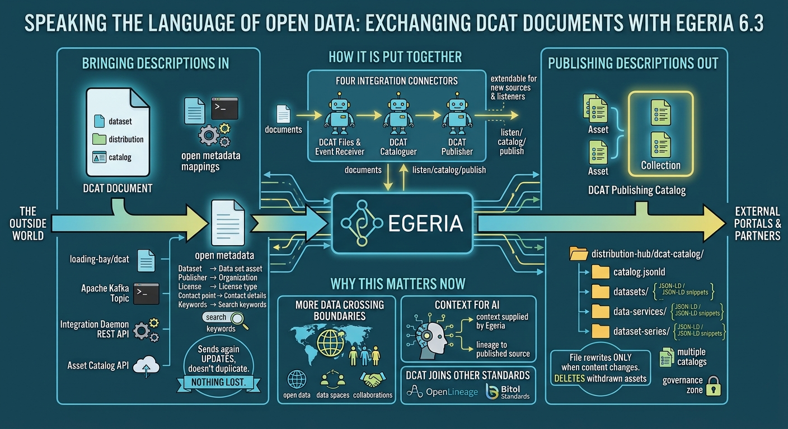

<!-- SPDX-License-Identifier: CC-BY-4.0 -->
<!-- Copyright Contributors to the Egeria project. -->

# Speaking the Language of Open Data: Exchanging DCAT Documents with Egeria 6.3

*By Mandy Chessell, Egeria Project Leader, Pragmatic Data Research (PDR) Ltd*

*Part 10 of the series on recent work in the [Egeria](https://egeria-project.org/) project, an LF AI & Data project for open metadata and governance.*


---

Most of what a data catalog describes stays inside the organization. But some of it has to cross the boundary. A government agency is obliged to list the data it makes available to the public. A research institute shares its datasets with its partners. A company relies on open data published by others, and wants to find, govern and trace it alongside its own.

In each case a description of a dataset has to travel from one organization's catalog to another's, and the two organizations almost certainly do not run the same catalog. They need a common language.

That language exists. It is the W3C [Data Catalog Vocabulary](https://www.w3.org/TR/vocab-dcat-3/), DCAT, and with release 6.3 [Egeria](https://egeria-project.org/) speaks it in both directions.

## A short introduction to DCAT

DCAT is the standard that governments and many other organizations use to describe the data they make available: what each dataset is about, who publishes it, how it is licensed and where it can be obtained. It is the basis of national and regional profiles such as DCAT-AP in Europe and DCAT-US in the United States, and it is what most open data portals harvest from one another.

It has a small vocabulary:

- a **dataset** is a collection of data published or curated by a single organization;
- a **distribution** is a specific form in which a dataset can be obtained, such as a CSV file to download or an API to call;
- a **dataset series** groups datasets that are published separately but belong together, such as the annual editions of a survey;
- a **data service** is an API that provides access to one or more datasets;
- a **catalog** is a curated list of datasets, data services and other catalogs.

Here is a minimal description of a dataset with one distribution:

```json
{
  "@context": {
    "dcat": "http://www.w3.org/ns/dcat#",
    "dct": "http://purl.org/dc/terms/"
  },
  "@id": "https://data.example.org/dataset/air-quality-2026",
  "@type": "dcat:Dataset",
  "dct:title": "Air quality measurements 2026",
  "dct:description": "Hourly readings from the city's monitoring stations.",
  "dcat:keyword": ["air quality", "environment"],
  "dcat:distribution": {
    "@type": "dcat:Distribution",
    "dct:title": "CSV download",
    "dcat:downloadURL": { "@id": "https://data.example.org/files/air-quality-2026.csv" }
  }
}
```

Egeria supports DCAT version 3 in its JSON-LD serialization, as shown. Any arrangement of JSON-LD can be read, whether nested or flattened, and with prefixes or full IRIs. Documents written in Turtle or RDF/XML need converting to JSON-LD first.

## Bringing descriptions in

Hand Egeria that document and it catalogs what the document describes.

| In DCAT | In Egeria's open metadata |
|---|---|
| Dataset | A data set asset |
| Distribution | A data file asset, if it can be downloaded, or a data store asset, if it can only be accessed, attached to its data set |
| Dataset series | A data set asset linked to its member data sets |
| Data service | A deployed API asset, with an endpoint for each of its URLs, linked to the data sets it serves |
| Catalog | A collection folder whose members are the catalog's contents |
| Keywords | Search keywords |
| Publisher | An organization, linked to the asset |
| Contact point | Contact details |
| License | A license type, linked by a license relationship |

So the dataset above becomes an asset that can be found by a search for "air quality", with a second asset for its CSV file, and from that moment it is part of the same graph as everything else in the catalog. It can be given an owner, classified, linked to glossary terms and governed by policies. If a pipeline copies it into a data lake, the lineage starts at the published source.

Three details make this dependable in practice:

- **Sending a description again updates it.** Each element is identified by the IRI of the resource it describes, so a catalog can be reloaded every night without creating duplicates. A distribution that has been removed from a dataset's description is removed from the catalog.
- **Nothing is thrown away.** Properties that are not part of core DCAT, such as those added by DCAT-AP and DCAT-US, are preserved and written out again if the asset is later published.
- **Nothing is fetched from the network.** Egeria never retrieves a JSON-LD context from a remote server while reading a document. A document should embed its context; one that refers to a remote context is read using the standard DCAT prefixes. This avoids both a dependency on somebody else's website and an avenue of attack, and it is enough to read the `data.json` catalogs published by US government agencies.

There are four ways for a document to arrive:

1. **In a file.** Drop it into a directory that Egeria is watching, by default `loading-bay/dcat`.
2. **On an Apache Kafka topic.**
3. **Through the REST API of an integration daemon**, for a tool that wants to push documents as it produces them.
4. **Directly through the Asset Catalog API**, which catalogs the document immediately and returns the identifiers of the assets it created.

## Publishing descriptions out

The other direction starts with a decision: which of our assets do we want the world, or our partners, to know about?

In Egeria that decision is expressed by membership of a collection. The [DCAT Content Pack](https://egeria-project.org/content-packs/dcat-content-pack/overview/) supplies a collection called the *DCAT Publishing Catalog*. To publish an asset, add it to the collection. To withdraw it, take it out. Folders nested inside the collection are a way to organize what is published.

On each refresh, the DCAT Publisher writes the collection out as a DCAT catalog:

```
distribution-hub/dcat-catalog/
  DCAT-Publishing-Catalog-9b07a6ef/
    catalog.jsonld
    datasets/
      <name>.jsonld
    data-services/
      <name>.jsonld
```

`catalog.jsonld` describes the catalog and everything in it, and there is a separate file for each dataset and data service. A file is only rewritten when its content changes, and the file of an asset that has been withdrawn is deleted. Point a data portal's harvester at that directory, or serve it from a web server, and the job is done.

How an asset is described depends on what it is. An API is published as a data service. A data set is published as a dataset whose distributions are the assets that supply its data. Anything else is published as a dataset with a single distribution. An asset that originally arrived as a DCAT description keeps the identifier it came with, so republishing it does not create a second identity for the same thing.

You can publish as many catalogs as you like, one for the public and one for a research consortium for instance, by attaching further collections to the publisher. And because publication is by membership of a collection, the decision to publish can be governed like any other: the collection has an owner, its changes are recorded, and it can be placed in a [governance zone](https://egeria-project.org/features/governance-zoning/overview/) so that only the right people can add to it.

The publisher is deliberately cautious. If it cannot publish one collection on a given refresh, it carries on with the others and withdraws nothing, so a temporary problem does not remove a catalog that a portal is in the middle of harvesting.

For a single asset, the Asset Catalog API will return its DCAT description on request, whether or not it is in a publishing catalog.

<!-- SCREENSHOT NEEDED: an asset catalogued from a DCAT document shown in The Catalog or Egeria Explorer, e.g. dcat-dataset-in-catalog.png -->

## How it is put together

DCAT support follows the pattern that Egeria already uses for OpenLineage events and Bitol data contracts. Four integration connectors, supplied in the content pack, run in an integration daemon:

- the **DCAT Files Receiver** and the **DCAT Event Receiver** acquire documents, from directories and from Kafka topics;
- the **DCAT Cataloguer** listens for the documents they find and catalogs them;
- the **DCAT Publisher** writes the catalogs.

Because the receivers and the cataloguer are connected through a listener mechanism, they can be extended. A connector that fetches a partner's catalog from its website on a schedule only has to hand the document over, and the cataloguing is already done. A connector that wants to react to incoming descriptions, to check them against a policy for example, only has to register as a listener. The Java beans, the JSON-LD reader and the mapping are all part of Egeria's Open Integration Framework for exactly this purpose.

## Why this matters now

Exchanging descriptions of data can sound like a chore for the compliance team. It is becoming more than that, for two reasons.

The first is that the amount of data crossing organizational boundaries is growing: open data mandates, data spaces, research collaborations and the data that is bought and sold. Each exchange is easier, and safer, when the description travels with the data in a form that both sides can process.

The second is AI. A model, or an agent, that uses external data needs to know what that data is, who published it and under what license, just as it does for internal data. Once a DCAT description has been catalogued, those facts are part of the context that Egeria supplies, and the lineage from the published source to wherever the data ends up can be followed. And in the other direction, publishing a good description of your own data is the first step in making it usable by anybody else's AI.

DCAT joins OpenLineage and the Bitol standards in the set of open standards that Egeria supports out of the box. The project's view has always been that metadata is most valuable when it can move between tools and between organizations, and that open standards are how that happens without everybody having to buy the same product.

To try it, load the DCAT Content Pack, add its integration group to an integration daemon, and drop a DCAT document into `loading-bay/dcat`. The details are in [exchanging asset descriptions](https://egeria-project.org/features/asset-description-exchange/overview/), and the whole environment is available ready to run in [Egeria Workspaces](https://egeria-project.org/egeria-workspaces/).

## Looking back

This run of posts has covered the 6.3 release from five directions: a [platform built for the long run](../blog-6-egeria-6-3-release), support for [security professionals](../blog-7-supporting-security-professionals), the [data mesh](../blog-8-building-the-data-mesh), the [layers of lineage](../blog-9-business-flows-from-lineage) and now the exchange of catalog descriptions with the outside world. What they have in common is that none of them is about collecting more metadata. They are about making the metadata an organization already has dependable enough, connected enough and portable enough to be relied upon, by people and by the AI that increasingly works alongside them.

*Follow along with the rest of the project at [egeria-project.org](https://egeria-project.org/).*

*Previous: [Extracting Business Flows from Lineage](../blog-9-business-flows-from-lineage)*
