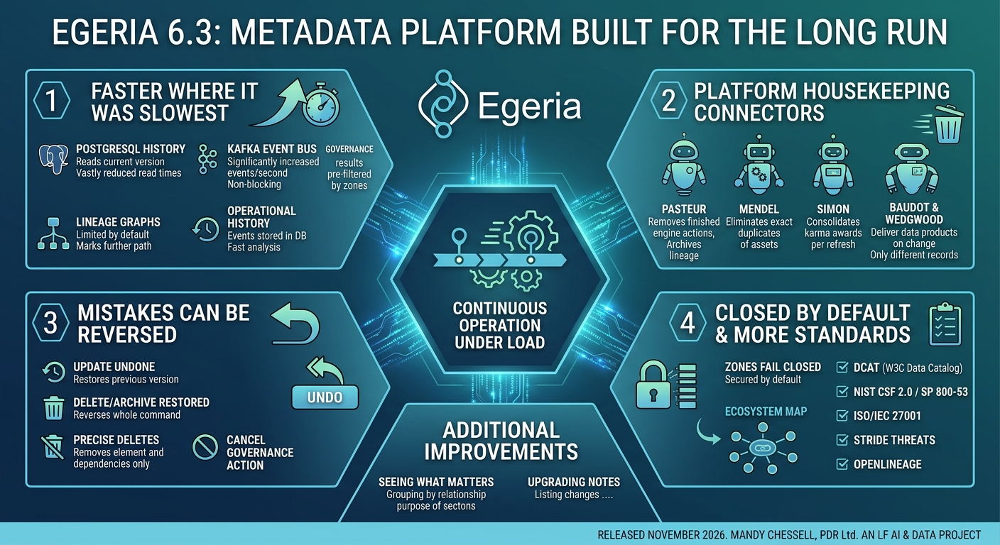

<!-- SPDX-License-Identifier: CC-BY-4.0 -->
<!-- Copyright Contributors to the Egeria project. -->

# Egeria 6.3: A Metadata Platform Built for the Long Run

*By Mandy Chessell, Egeria Project Leader, Pragmatic Data Research (PDR) Ltd*

*Part 6 of the series on recent work in the [Egeria](https://egeria-project.org/) project, an LF AI & Data project for open metadata and governance.*

---

Most software is demonstrated on its first day. The repository is empty, the event bus is quiet and every query comes back at once. A metadata platform earns its keep much later than that, when it has been running for months, holds millions of elements and their history, and is being asked questions by dozens of people, connectors and AI agents at the same time.

[Egeria 6.3](https://egeria-project.org/release-notes/latest/), released in November 2026, is about that later day. The [previous post](../blog-5-standing-on-the-shoulders-of-giants) argued that the context AI relies on is a living thing that has to be looked after. This release is what we learnt from running Egeria continuously, under load, and looking hard at where the time, the storage and the operator's patience were going.

## Faster where it was slowest

We measured a long-running platform and removed the worst of what we found.

- **History no longer slows down the present.** Every change to an element adds a version, and a busy element can gather hundreds of thousands of them. The PostgreSQL repository now reads the current version directly. On a copy of a large repository, reading an element with 238,795 versions went from 131 milliseconds to 0.05 milliseconds.
- **Searches read only what the caller may see.** [Governance zones](https://egeria-project.org/features/governance-zoning/overview/) control who can see which metadata. Searches used to retrieve every match and then discard what the user was not allowed to see. The zones are now part of the repository query.
- **The event bus keeps up.** The Apache Kafka topic connector sent one event at a time and waited for each to be acknowledged, which limited it to a few hundred events a second. In our benchmark it now sends 210,000 a second, against 344 before. Just as important, if Kafka falls behind, the platform no longer runs out of memory waiting for it.
- **Lineage graphs come back.** The lineage graph of one schema in our sample environment reached 1,057 elements up to 42 hops away, and returned 52 MB. Graphs are now limited to 8 hops by default, each element says how far it is from the start, and the graph marks where the lineage continues.
- **Operational history is queryable.** Open Lineage events can be stored in PostgreSQL as well as in files. Analysing 30 days of events, 864,000 of them, took 17 to 19 minutes from files and takes about three seconds from the database.

## A platform that does its own housekeeping

Performance problems in a metadata platform are often really housekeeping problems. Something is being done too often, or never tidied away. Several of the nanny connectors introduced in the last post have new duties, and they have new colleagues.

- **Pasteur** removes finished actions once they are old enough. Engine actions, process instances and to dos used to stay for ever. Anything that carries lineage is archived rather than deleted, so the lineage is preserved.
- **Mendel** now removes exact duplicates, the identical copies left behind when a process attaches the same thing twice. One of our sample products had gathered 27,000 copies of the same keyword. There is nothing for a steward to decide, so Mendel keeps the oldest copy and removes the rest.
- **Simon** records the contributions people make to the catalog and awards their karma points, once per refresh rather than once per change.
- **Baudot** and **Wedgwood**, which deliver data products to subscribers, now deliver when the data has changed and write only the records that differ. About 70% of the notifications Baudot sent on our sample platform were unnecessary, and they have gone.

The common thread is that connectors which used to react to every single event now note what has changed and do the work once. The platform is quieter as a result: fewer versions, fewer notifications, and audit logs that record what users actually asked for.

## Mistakes that can be reversed

When people and agents are both changing metadata, some of the changes will be wrong. Egeria has always kept the history. In 6.3 that history can be used.

An update can be **undone**, putting back the previous version. A delete or an archive can be **restored**, and restore reverses the whole command, not just the element named in it. Restoring a database schema that was deleted brings back its tables, its columns, its connection and the relationships the delete removed.

Deletes are also more precise. Deleting a column with lineage used to be able to archive the whole table, schema and asset around it. A delete now takes the element and what lies beneath it, and nothing else. And a governance action process that should not be running can be cancelled.

## Closed by default

A governance zone that had no access control defined used to be ignored. That was convenient, and it meant that a mistyped zone name could quietly expose the elements in it. In 6.3 every zone is treated as secured. A zone with no access control permits no one, and Egeria raises an exception for each zone that needs attention. The data products that describe how the ecosystem itself is secured, such as its user accounts and secrets stores, are now visible only to the security team.

Security teams get more than safer defaults in this release, and the [next post](../blog-7-supporting-security-professionals) is written for them.

## More standards, out of the box

Egeria's job is to connect tools that were not designed to work together, and open standards are how it does that without becoming one more proprietary hub. Release 6.2 added the Bitol standards for data contracts and data products. Release 6.3 adds:

- **DCAT**, the W3C Data Catalog Vocabulary used by governments and many other organizations to describe the data they publish. Egeria reads DCAT descriptions into its catalog and publishes DCAT catalogs of the assets you choose.
- **NIST CSF 2.0 and NIST SP 800-53 Rev. 5** as ready-made catalogs of security controls, along with support for the statement of applicability used in ISO/IEC 27001, and the six STRIDE threats as standard definitions.
- **OpenLineage** events that can name several information supply chains for one run, and that can be stored in PostgreSQL.

## Seeing what matters

A busy element collects a great many relationships and classifications, and showing all of them at once helps nobody. Every relationship type and classification type in Egeria now declares its purpose: structural, membership, association, action or activity for a relationship, for example, and governance, descriptive or analytical for a classification. User interfaces use the purpose to group what they show. Egeria uses it too. The diagram of an element's context no longer includes its growing history of actions and activity, which have diagrams of their own, and the diagram of an information supply chain is split into five, one for each layer, because one diagram of a large supply chain was too big to draw.

## Upgrading

Some of these improvements change default behaviour. Zones fail closed, lineage graphs are limited to 8 hops unless you ask for more, and old finished actions and exact duplicates are cleaned up when the new content packs are loaded. If you maintain your own user directory there are accounts to add for the new connectors. The [upgrade notes](https://egeria-project.org/release-notes/latest/#upgrade-notes) list everything, with what to do about each.

## The rest of this series

The next four posts look at parts of this release, and the one before it, in more depth:

- [Supporting security professionals](../blog-7-supporting-security-professionals) - what Egeria 6.3 offers the people responsible for keeping an organization safe.
- [Building the data mesh](../blog-8-building-the-data-mesh) - digital products, subscriptions, data contracts and the dependency graph that connects them.
- [Extracting business flows from lineage](../blog-9-business-flows-from-lineage) - from OpenLineage events to the data fabric, system fabric, data mesh and information supply chains.
- [Exchanging DCAT documents with Egeria 6.3](../blog-10-exchanging-dcat-documents) - sharing descriptions of your data with the outside world.

*Read the full release notes at [egeria-project.org/release-notes/latest](https://egeria-project.org/release-notes/latest/), and follow along with the rest of the project at [egeria-project.org](https://egeria-project.org/).*

*Previous: [Standing on the Shoulders of Giants](../blog-5-standing-on-the-shoulders-of-giants) &middot; Next: [Supporting Security Professionals](../blog-7-supporting-security-professionals)*
