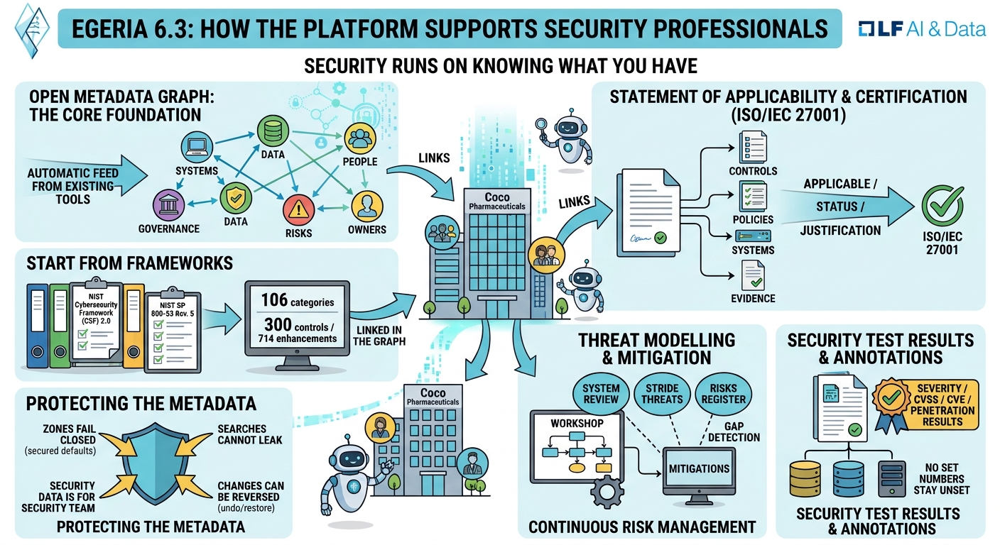

<!-- SPDX-License-Identifier: CC-BY-4.0 -->
<!-- Copyright Contributors to the Egeria project. -->

# Security Runs on Knowing What You Have: How Egeria 6.3 Supports Security Professionals

*By Mandy Chessell, Egeria Project Leader, Pragmatic Data Research (PDR) Ltd*

*Part 7 of the series on recent work in the [Egeria](https://egeria-project.org/) project, an LF AI & Data project for open metadata and governance.*

---

If you work in security, you probably do not think of yourself as a user of metadata. But consider the questions that fill your week. Which systems hold this kind of data? Who owns that server, and what is deployed on it? Which of our controls applies here, and is it actually in place? This vulnerability has just been announced: where are we exposed? An account has been compromised: what could it reach?

Every one of those is a question about how things are connected, and the answers are usually spread across a configuration database, a scanner's console, a spreadsheet of controls, a diagram from the last architecture review and the memory of the person who has been here longest.

[Egeria](https://egeria-project.org/) is an open source project that keeps an organization's knowledge of its systems, data, people and governance in one connected graph of *open metadata*, fed automatically from the tools that already hold the detail. Release 6.3 adds a good deal that is aimed directly at security teams. This post explains what is there and how it fits the work you already do.

## Start from the frameworks you already use

Nobody should invent a security program from scratch, and Egeria does not ask you to. The new [Security Content Pack](https://egeria-project.org/content-packs/security-content-pack/overview/) loads two control catalogs, generated from NIST's own public-domain OSCAL catalogs:

- The **NIST Cybersecurity Framework (CSF) 2.0**: its six functions and 22 categories as folders, holding 106 subcategories, each with its outcome statement and NIST's implementation examples.
- **NIST SP 800-53 Rev. 5**: its 20 control families, holding 300 controls and 714 control enhancements, each with its control statement and discussion, and each enhancement linked to the control it strengthens.

Every control is an element in the graph. That is the point of loading them. A control in a PDF can only be read. A control in the graph can be linked to the policy that requires it, the system it protects, the person accountable for it and the evidence that it works.

## The statement of applicability, kept alive

If your organization is certified to ISO/IEC 27001, or working towards it, you maintain a statement of applicability: the list of controls, whether each applies to you, why, and how far it has been implemented. It is one of the main documents an auditor reviews, and it is usually a spreadsheet.

Egeria 6.3 has a [statement of applicability](https://egeria-project.org/services/omvs/security-officer/overview/#statements-of-applicability) as a first-class element. Each control is linked to it with a relationship that records whether it is applicable, the justification, the reasons for inclusion, the implementation status (not started, planned, partially implemented or implemented), a description of the implementation and a review date. The statement has an author, a scope and a review date of its own, and because Egeria keeps the history of every element, you can see what it said at the time of the last audit.

What makes this more than a spreadsheet in a database is that the controls it refers to are the same elements that your policies, systems and risks are linked to. When a control's implementation changes, there is one place to record it. A certification type for ISO/IEC 27001:2022 is supplied, so the certification itself can be recorded against the organization and the systems it covers.

<!-- SCREENSHOT NEEDED: a statement of applicability with its linked controls, or a NIST control folder, in Egeria Explorer, e.g. statement-of-applicability.png -->

## Threat models that stay connected to the systems

A threat model is usually the output of a workshop: a diagram, a table of threats and a list of actions. It is accurate on the day and starts to drift as soon as the system changes.

Egeria's approach to [threat modelling](https://egeria-project.org/egeria-solutions/threat-modelling/overview/) keeps the model in the same graph as the systems:

- The **system** under review is described with solution components, their connections and the actors that use them, legitimate and otherwise. These can be linked to the real servers and data stores in the catalog.
- Each **threat** is a governance driver. The six [STRIDE](https://en.wikipedia.org/wiki/STRIDE_model) threats (spoofing, tampering, repudiation, information disclosure, denial of service and elevation of privilege) are now supplied as standard definitions, so every threat model in the organization refers to the same six.
- Each **risk** records its likelihood and impact, and is scoped to the components, systems, data or teams it threatens. Together the risks are your risk register.
- Each **mitigation** is a policy or control linked to the risks it addresses. It can be one of your own, or one from the NIST catalogs.

Once the model is linked like this, the gaps show themselves. A risk with no control responding to it is a gap in the links. So is a critical component with no risks scoped to it, which has probably never been reviewed. And when a system changes, the risks scoped to it tell you what to look at again. A template for [Dr.Egeria](https://egeria-project.org/user-interfaces/dr-egeria/overview/), our markdown-based authoring tool, walks through a STRIDE review step by step.

## A home for security test results

Vulnerability scanners and penetration testers produce findings. The findings usually stay in the tool that produced them, or in a report, disconnected from the description of the thing that was tested.

Release 6.3 adds four [security annotations](https://egeria-project.org/types/6/0665-Security-Annotations/) for recording these results against the resources they were found in:

- A **security finding**: a weakness found by a test, with its severity, CVSS score and vector, CVE and CWE identifiers, where it was found, the evidence, the recommended remediation and whether an exploit is publicly available.
- A **vulnerability**: a known vulnerability in software that a resource uses, with the affected package, the installed version, the fixed version and whether a fix is available.
- A **penetration test finding**: a weakness that a tester actually exploited, with the attack vector, the techniques used, the privileges gained, the resources compromised and the steps to reproduce it.
- A **security posture**: the summary of a test run, with open findings by severity, resources in scope and tested, and new and resolved findings.

Each test run is a report in the catalog, and each finding is linked both to the report and to the server, application or data store it concerns. The scanner's own identifier is kept, so the same finding is recognized in the next run. Because the finding is attached to the resource, the question "what is deployed on this host, who owns it, what data does it hold and which information flows depend on it?" can be answered by following links from the finding rather than by asking around.

One small change in this release matters more here than anywhere else. Numbers and flags that have not been set now stay unset. A CVSS score that nobody assessed no longer reads as zero, and an exploit flag that nobody set no longer reads as false. A security record should never claim more than is known.

## Protecting the metadata itself

A graph that describes your systems, your data, your people and your risks is valuable to an attacker too. Egeria 6.3 tightens how it protects its own content.

- **Zones fail closed.** [Governance zones](https://egeria-project.org/features/governance-zoning/overview/) control who can see and change which metadata. A zone with no access control used to be ignored, so a mistyped zone name could expose the elements in it. Every zone is now treated as secured: no access control means no access. Egeria checks its zones against the user directory and raises an exception for each one that is missing a control.
- **Searches cannot leak.** The zones a user may read are applied in the repository query itself, and each result is still checked on the way out.
- **Security data is for the security team.** Egeria publishes data products about its own operation. Those that describe user identities, user accounts, secrets stores and zone membership are now in a `security` zone, invisible to everyone else, and come with a license that forbids sharing the data outside the security team. No secret is ever published: these products do not read the secrets stores.
- **Changes can be reversed.** An update can be undone and a delete restored, completely, so a mistaken or malicious change does not have to be repaired by hand.

There are also solutions, built on the same graph, for [auditing user accounts](https://egeria-project.org/egeria-solutions/auditing-users/overview/), keeping [secrets out of configuration and metadata](https://egeria-project.org/egeria-solutions/distributed-secrets/overview/) and connecting [incidents](https://egeria-project.org/egeria-solutions/incident-management/overview/) to the resources they affect.

## Seeing it worked through

Abstract descriptions of governance are hard to judge, so the Egeria project maintains a fictional company, Coco Pharmaceuticals, whose people face recognizable problems. Its security team has grown the way many do: a single security officer responsible for both physical and IT security, a systems administrator who learnt security on the job, and, after a fraud was uncovered, a newly hired CISO whose remit includes continuous penetration testing and extending the tooling inherited from two acquisitions to the rest of the company.

Their scenarios are documented in full: [assuring IT systems security](https://egeria-project.org/practices/coco-pharmaceuticals/scenarios/assuring-it-systems-security/overview/) builds a threat model on the solution components of Coco's information supply chains, and [preparing for Martyn's Law](https://egeria-project.org/practices/coco-pharmaceuticals/scenarios/preparing-for-martyns-law/overview/) applies the same method to a physical threat at a public event. The definitions are supplied as workbooks you can load and explore.

## What this is, and is not

Egeria is not a scanner, a SIEM or a ticketing system, and it does not try to replace yours. It is the place where what those tools know is connected to everything else the organization knows: the systems, the data, the owners, the policies, the controls and the risks. The value to a security team is that the answers to "what is affected?" and "is this covered?" stop depending on who happens to be in the room.

If that sounds useful, the quickest way to see it is the [live demo](https://egeria.pdr-associates.com), or [Egeria Workspaces](https://egeria-project.org/egeria-workspaces/) running on your own machine. We would particularly like to hear from security practitioners about which integrations and reference content would help most, whether that is secrets managers, SIEM platforms or further frameworks. The people who do this work for a living are the right ones to shape what comes next.

*Follow along with the rest of the project at [egeria-project.org](https://egeria-project.org/).*

*Previous: [Egeria 6.3: A Metadata Platform Built for the Long Run](../blog-6-egeria-6-3-release) &middot; Next: [Building the Data Mesh](../blog-8-building-the-data-mesh)*
