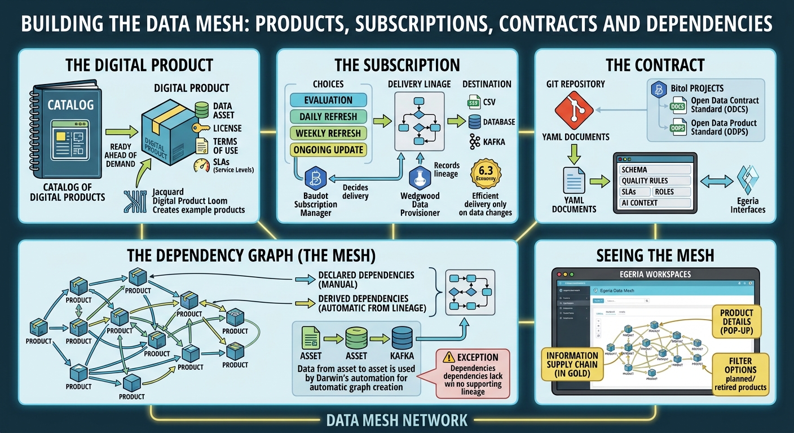
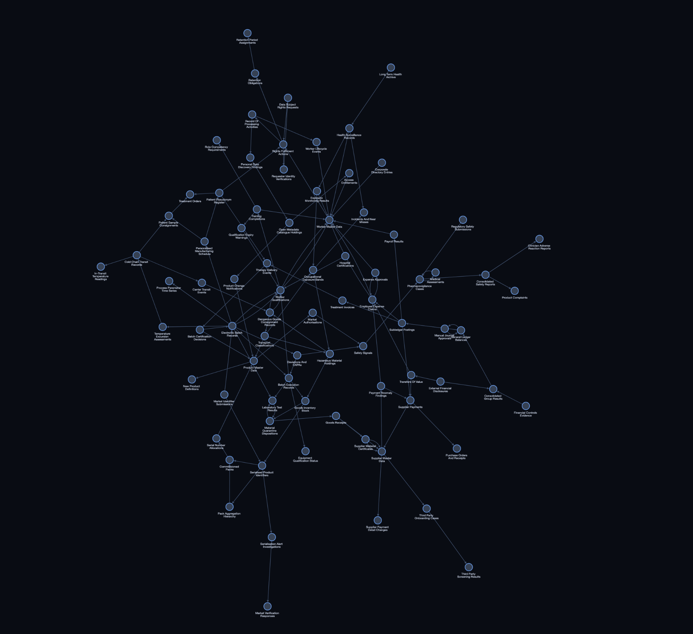
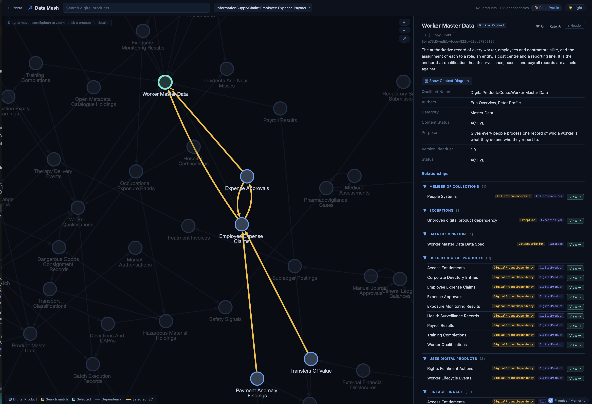
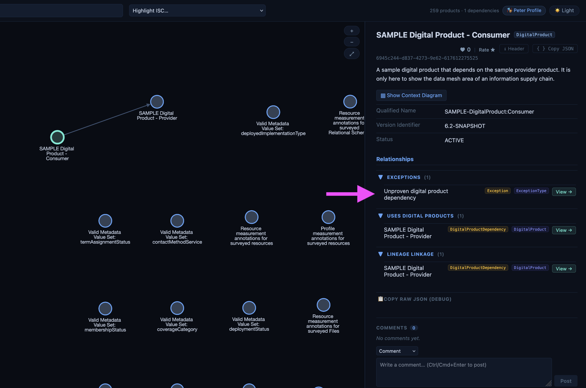

<!-- SPDX-License-Identifier: CC-BY-4.0 -->
<!-- Copyright Contributors to the Egeria project. -->

# Building the Data Mesh: Products, Subscriptions, Contracts and the Dependencies Between Them

*By Mandy Chessell, Egeria Project Leader, Pragmatic Data Research (PDR) Ltd*

*Part 8 of the series on recent work in the [Egeria](https://egeria-project.org/) project, an LF AI & Data project for open metadata and governance.*

---

"Data mesh" is one of those terms that everybody recognizes and few can point to. An organization declares that it is adopting one, teams are told that they now own data products, and a year later there is a list of products on a wiki page and no agreement about which of them anybody uses.

The trouble is that a mesh is not a list. It is a network: products that are offered, consumers that have subscribed to them, promises about what each product will deliver, and products that are built from other products. You only have a data mesh when those connections exist somewhere they can be seen, checked and relied upon.

This post describes how [Egeria](https://egeria-project.org/) builds that network from four pieces: a catalog of digital products, subscriptions that deliver them, open standards for describing them, and a dependency graph that is derived from what the data actually does.

## The product: a commitment, not a table

In Egeria a [digital product](https://egeria-project.org/concepts/digital-product/) packages data that is designed to meet a consumer's need, together with the license, the terms of use and the service levels that its consumers can rely on. That last part is what separates a product from a shared table. A product is defined ahead of demand, conforms to a specification, and is delivered on a schedule without anybody negotiating each time.

Products are organized into digital product catalogs, and Egeria ships one of its own. The [Open Metadata Digital Product Catalog](https://egeria-project.org/patterns/harvest-and-publish/overview/#the-open-metadata-digital-product-catalog) publishes the content of the metadata ecosystem itself as products: reference data, the organization's structure, survey results, the type system, and observability data about governance, IT operations and security. It is assembled by the Jacquard Digital Product Loom, one of the nanny connectors described in an [earlier post](../blog-5-standing-on-the-shoulders-of-giants), and it is useful in two ways. The products are valuable in themselves, and they are a complete, running example of how a product catalog works that you can explore before building your own.

## The subscription: delivery with a record

A consumer subscribes to a product rather than querying it. Each product offers a choice of [subscription](https://egeria-project.org/patterns/harvest-and-publish/overview/#subscriptions-and-delivery), each with its own service level objective:

| Subscription | Commitment |
|---|---|
| Evaluation | The data is delivered once, so the product can be assessed. |
| Daily refresh | The data is delivered once a day. |
| Weekly refresh | The data is delivered once a week. |
| Ongoing update | Updates arrive within an hour of the new data being received. |

The subscriber names the destination, which can be a CSV file, a database table or a Kafka topic. Two more nanny connectors do the work. The **Baudot Subscription Manager** watches each product and decides when its subscribers are due a delivery. The **Wedgwood Data Provisioner** makes the delivery and records its lineage, so there is a traceable link from the product to every copy of its data.

Release 6.3 made this much more economical. Baudot now triggers a delivery only when the product's data has changed, not when someone has merely looked at it, and holds a change back until the product's minimum notification interval has passed. Wedgwood compares what it is about to deliver with what is already at the destination and writes only the records that are new, changed or gone. A product whose table has not changed costs nothing to deliver.

Creating and cancelling a subscription are governance actions, so there is a record of who is consuming what. That record is the first set of connections in the mesh.

## The contract: open standards in git

Product teams increasingly describe their products as YAML documents kept in git alongside their code, using the standards published by the [Bitol](https://bitol.io) project, which, like Egeria, is part of LF AI & Data:

- The **Open Data Contract Standard (ODCS)** describes a dataset that one team offers to others: its schema, its quality checks, its service level agreement, its support channels and the roles that may access it.
- The **Open Data Product Standard (ODPS)** describes a data product: the data it consumes through its input ports and provides through its output ports, each described by a contract.

Egeria [supports both](https://egeria-project.org/features/digital-product-management/overview/), in both directions. A product team commits a contract to git, and the [Bitol connectors](https://egeria-project.org/content-packs/bitol-content-pack/overview/) catalog it: the product becomes a digital product, the contract becomes a data sharing agreement, the schema becomes data structures and data fields, the quality checks become data quality rules and the service level agreement becomes a service level objective. A product manager who defines a product through Egeria's own interfaces sees it written back out as a Bitol document, ready to commit.

Nothing is lost on the way round. Properties of the standards that have no open metadata equivalent are preserved, including the AI context block in ODCS, which carries the instructions and constraints an AI agent needs to interpret the data correctly.

The reason this matters for the mesh is that the teams do not have to choose. They keep working in git with the tools they like, and the organization still gets one connected catalog.

## The dependency graph: this is the mesh

Products are built from other products. A product that reports on clinical trial outcomes might depend on a product that supplies patient measurements, which in turn depends on a product listing the hospitals certified to provide them. In Egeria each of those links is a dependency relationship between two digital products, and the graph they form is the [data mesh](https://egeria-project.org/concepts/data-mesh/).

The obvious way to build that graph is to ask the product managers to declare their dependencies. They will, and the declarations will be incomplete and will go out of date, because that is what happens to anything maintained by hand.

So Egeria derives the graph as well. The **Darwin Product Dependency Manager** starts from the lineage that has been captured from the running pipelines, at the level of tables and columns, and works upwards: if data flows from an asset that belongs to one product into an asset that belongs to another, the second product depends on the first. Darwin creates the dependency and keeps it up to date as the lineage changes. The [next post](../blog-9-business-flows-from-lineage) describes how that works in detail.

Darwin never removes a dependency that a person has declared. If it can find no lineage to support one, it records an exception against the product for a steward to look at. There are three possible explanations: the lineage is incomplete, the dependency has been attributed to the wrong flow, or the dependency is not real. Each of them is worth knowing about.

The result is a mesh that combines intent with evidence. People say how the products are meant to depend on each other, the lineage says how they actually do, and the differences are surfaced rather than hidden.

## Seeing the mesh

A graph like this needs to be looked at, so [Egeria Workspaces](https://egeria-project.org/egeria-workspaces/), our ready-to-run environment, includes a **Data Mesh** application in its web portal.

*The data mesh for Coco Pharmaceuticals, the fictional company used in Egeria's examples. Each node is a digital product, and each arrow points from a product that consumes data to the product that supplies it.*

Every digital product is a node and every dependency an arrow. You can drag, zoom and search, and select a product to see its description, properties, relationships, classifications and context diagram. Three features are worth calling out:

- **Highlighting an information supply chain.** A dependency can name the [information supply chain](https://egeria-project.org/concepts/information-supply-chain/), the end-to-end business flow, that it is part of. Choose one from the list and its dependencies are drawn in gold while the rest of the mesh is dimmed. In a large mesh this is how you find the part that matters to you.

*One information supply chain highlighted, showing the products that take part in it and how the data passes between them.*

- **Exceptions.** The dependencies that Darwin could not prove are listed against the product, so the mesh shows where intent and evidence disagree.

*A product with a declared dependency that the lineage does not support. The exception is there for a steward to resolve.*

- **Planned and retired products.** A product can be marked as a promise before it is delivered, or kept as a memento after it is retired. They are hidden by default and revealed with a checkbox, so you can see how the mesh is intended to grow, or how it used to be.

The [Data Mesh user guide](https://egeria-project.org/user-interfaces/data-mesh/overview/) describes the application in full.

## Putting it together

Each of the four pieces answers a question that a list of products on a wiki cannot.

| Question | Answered by |
|---|---|
| What is on offer, and on what terms? | The digital product catalog |
| Who is using it, and where did their copy go? | Subscriptions and their delivery lineage |
| What exactly has been promised? | Data contracts, in the Bitol standards |
| What is built on what? | The dependency graph, declared by people and derived from lineage |

For anyone building AI on enterprise data, the last of those is the one to dwell on. An agent that is given a data product is implicitly given everything that product depends on. The mesh is how you find out what that is, and what will be affected when something upstream changes.

The quickest way to see all of this running is the [live demo](https://egeria.pdr-associates.com), which is built around Coco Pharmaceuticals, or [Egeria Workspaces](https://egeria-project.org/egeria-workspaces/) on your own machine.

*Follow along with the rest of the project at [egeria-project.org](https://egeria-project.org/).*

*Previous: [Supporting Security Professionals](../blog-7-supporting-security-professionals) &middot; Next: [Extracting Business Flows from Lineage](../blog-9-business-flows-from-lineage)*
