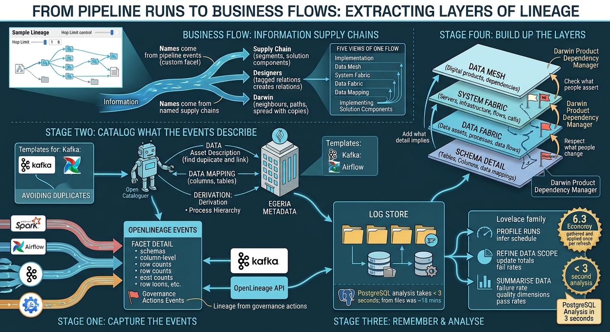

<!-- SPDX-License-Identifier: CC-BY-4.0 -->
<!-- Copyright Contributors to the Egeria project. -->

# From Pipeline Runs to Business Flows: Extracting the Layers of Lineage

*By Mandy Chessell, Egeria Project Leader, Pragmatic Data Research (PDR) Ltd*

*Part 9 of the series on recent work in the [Egeria](https://egeria-project.org/) project, an LF AI & Data project for open metadata and governance.*

---

Lineage is captured at one level and asked about at another.

What a pipeline can tell you is very specific: this job ran at this time, read these tables and wrote that one, and this column was computed from those two. What people want to know is much broader. Which systems exchange data? Which data products depend on which? How does information get from the hospital that collected it to the regulator that receives the report, and what happens to that flow if we retire this server?

The broad answers are implied by the detail, but nothing states them. And when people do state them, by drawing the architecture as they believe it to be, nothing checks whether the running systems agree.

This post follows the path that [Egeria](https://egeria-project.org/) takes from individual run events to the business flows an organization cares about. It has four stages: capture the events, catalog what they describe, analyse the history, and build up the layers.

## Stage one: capture the events

[OpenLineage](https://openlineage.io/), a sister project in LF AI & Data, is the open standard for run events. Airflow, Spark, dbt, Flink and many other engines emit an event when a job starts and when it completes or fails, naming the datasets it read and wrote, and attaching *facets* that carry the detail: schemas, column-level lineage, row counts, data quality results.

Egeria receives these events from a Kafka topic fed by the OpenLineage proxy, or directly through its own implementation of the OpenLineage API. However they arrive, they are handed to every connector that has registered an interest. Egeria also generates OpenLineage events for its own governance actions, so its work appears in the same picture as everybody else's.

## Stage two: catalog what the events describe

The **Open Lineage Cataloguer** turns each event into open metadata. The interesting part is not creating elements. It is avoiding creating them.

An organization that runs Egeria has usually catalogued its databases, topics and files already, through connectors that read each technology directly. The lineage is only useful if it attaches to those descriptions. So the cataloguer's first job, for each dataset in an event, is to find the element that already describes it. OpenLineage's naming conventions make this possible: the dataset `sales.public.orders` in the namespace `postgres://db` is matched, through the endpoint of its connection, to the table that the PostgreSQL connector catalogued. Where two descriptions of the same thing are found, they are linked as potential duplicates for resolution. Where there is none, the cataloguer creates one from the template for that technology, so a `kafka://` dataset is catalogued as an Apache Kafka topic and an Airflow task as an Apache Airflow task, not as an anonymous box.

Then it records the lineage, at the level of detail the event supports:

- between a job and a data asset, a **data flow**;
- between a job and a table, and between tables, a **data mapping**, with a data flow added at the level of the database so that the lineage can be seen at both levels;
- from the column lineage facet, a **data mapping** between the individual columns;
- between a job and its parent, and between jobs that depend on each other, the **process hierarchy** and **control flow**.

Every relationship records its *derivation*, such as "derived from OpenLineage columnLineage facet", so that anybody reading the graph later can tell what was observed from what somebody asserted.

## Stage three: remember, and analyse

A single event says what happened once. Much of what is worth knowing about a pipeline only appears across many runs.

The cataloguer keeps the running totals: for each job, the number of runs and failures, the first and last run, the duration and the volume of data read and written. In release 6.3 it gathers the events for each job and applies them once per refresh, so a job that runs every minute no longer creates a new version of its statistics every minute.

The events themselves are kept in a log store. This can be a directory of files, an OpenLineage server such as Marquez, and, new in 6.3, a PostgreSQL schema. The PostgreSQL store keeps each event as it was received, for analysis nobody has thought of yet, alongside a digest with one row per run and one per dataset that a run touched.

Three analysis services, part of the Lovelace family described in an [earlier post](../blog-5-standing-on-the-shoulders-of-giants), read the log store on a schedule:

- **Profile runs** works out how often each job really runs, how regular it is, its typical and worst-case duration, its failure rate, and infers its schedule.
- **Refine data scope** works out, for each dataset, whether its writers replace it, partition it or append to it, and so what window of data it holds.
- **Summarise data quality** turns the quality assertions scattered through the events into a pass rate for each quality dimension of each dataset.

With the PostgreSQL store, analysing a 30-day window of 864,000 events takes about three seconds. From files it took 17 to 19 minutes, and grew for as long as the platform ran.

At this point Egeria holds a detailed, current, statistically described graph of jobs, tables and columns. It is accurate, and it is far too detailed to answer the questions we started with.

## Stage four: build up the layers

Egeria organizes lineage into [four layers](https://egeria-project.org/features/lineage-management/overview/#the-layers-of-lineage). Each has its own kind of element and its own lineage, and each is tied to the layer beneath it by relationships that say what it is made of.

| Layer | What it contains | The question it answers |
|---|---|---|
| **Data mesh** | Digital products and the dependencies between them | Which products are built on which? |
| **System fabric** | Servers and other IT infrastructure, and the flows and calls between them | Which systems exchange data? |
| **Data fabric** | Data assets and processes, joined by data flows | Where does this data come from and go to? |
| **Schema detail** | Tables and columns, joined by data mappings | How exactly is this value produced? |

The data mesh and the system fabric both rest on the data fabric: a digital product is made of data assets, and so is the work that a server does.

The **Darwin Product Dependency Manager**, another of the nanny connectors, keeps these layers consistent. It does three things at each boundary between them.

**It adds what the detail implies.** If a column in one table is mapped to a column in another, then data flows between the assets that hold those tables. If data flows between two assets, it flows between the servers that host them, and creates a dependency between the products they belong to. Darwin creates those higher-level relationships and maintains them as the detail changes. In 6.3 it also derives the calls and control flows between systems, not only the data flows.

**It checks what people assert.** Architects and product managers draw lineage at the higher levels, and they should: it records intent, and it can be done before anything is built. Darwin compares each asserted relationship with the layer beneath it. One that the detail does not support is recorded as an exception for a steward: an unproven data flow, control flow, process call or product dependency. Darwin never deletes it. And it only makes the comparison when the layer beneath has actually been catalogued for both ends of the relationship. Otherwise the relationship is counted as unchecked, because missing detail is no evidence against it.

**It respects what people change.** If someone edits a relationship that Darwin created, Darwin treats it as adopted. It stops maintaining it and starts checking it like any other assertion. A person's edits are never overwritten.

## The business flow: information supply chains

The layers describe structure. What a business thinks in is flows: how an order becomes an invoice, how a patient's measurements become a trial result. In Egeria that is an [information supply chain](https://egeria-project.org/concepts/information-supply-chain/), an end-to-end flow of information for a business purpose, broken into segments and implemented by solution components.

Any lineage relationship, in any layer, can name the supply chain it belongs to. The names get there in three ways:

1. **From the pipeline.** Egeria defines a custom OpenLineage facet with which a run declares the supply chains it serves. From 6.3 a run can name several, for a job that publishes a dataset used by more than one. Every relationship the cataloguer creates from that run is tagged accordingly.
2. **From the designers.** People tag the relationships they assert.
3. **From the surroundings.** Where a relationship has no supply chain of its own but lies on a path whose supply chain is known, from a neighbouring relationship or from the relationship it proves in the layer above, Darwin establishes it. Where it lies on the paths of several supply chains, Darwin leaves the original untagged and records a copy for each.

So the supply chain spreads through the layers, and each business flow can be seen whole: the products involved, the systems they run on, the data and processes underneath, and the column mappings underneath those.

## Five views of one flow

Retrieve an information supply chain from Egeria and it comes with a set of diagrams. Before 6.3 there was one, and for a supply chain of any size it was too large to draw. There are now five:

- the **implementation** view: the supply chain's context, the design of its solution components and how far each has been deployed;
- the **data mesh** view: the digital products and their dependencies;
- the **system fabric** view: the infrastructure it runs on;
- the **data fabric** view: the data assets and processes, joined by lineage;
- the **data mapping** view: the tables and columns.

Each is drawn with the solution components and products that its elements implement shown alongside, so you can always see which part of the design a piece of infrastructure or a table belongs to.

<!-- SCREENSHOT NEEDED: the system fabric or data fabric view of an information supply chain, e.g. isc-data-fabric.png -->

For exploring lineage from a single asset outwards, the lineage graph in 6.3 is bounded to a number of hops that you choose, with a marker where the lineage continues. And the [Data Mesh application](https://egeria-project.org/user-interfaces/data-mesh/overview/) described in the [previous post](../blog-8-building-the-data-mesh) highlights the products that take part in a chosen supply chain.

<!-- SCREENSHOT NEEDED: Lineage Explorer showing a lineage graph with the hop-limit control, e.g. lineage-explorer-hops.png -->

## Why go to this trouble

It would be simpler to capture lineage at one level and stop. There are three reasons not to.

First, **different people need different layers.** An engineer debugging a transformation needs columns. An operations lead planning a migration needs systems. A product manager needs products. A business owner needs the flow. They are all looking at the same facts, and none of them should have to read the others' diagram.

Second, **the layers check each other.** Design lineage says what was intended. Operational lineage says what happened. Holding both, and reporting where they disagree, is how you find the undocumented feed and the planned integration that was never built.

Third, **AI needs provenance at the level it reasons at.** An agent asked whether it may use a data product for some purpose needs to know which products and sources lie behind it, not the name of every column that was touched on the way. An auditor reviewing the agent's answer may need exactly those columns. The same graph serves both.

The whole pipeline described here runs in [Egeria Workspaces](https://egeria-project.org/egeria-workspaces/), where the demo environment now starts Apache Airflow and Marquez alongside Egeria so that you can watch lineage arrive from running pipelines. The detail is in [leveraging Open Lineage](https://egeria-project.org/egeria-solutions/leveraging-open-lineage/overview/) and [lineage management](https://egeria-project.org/features/lineage-management/overview/).

*Follow along with the rest of the project at [egeria-project.org](https://egeria-project.org/).*

*Previous: [Building the Data Mesh](../blog-8-building-the-data-mesh) &middot; Next: [Exchanging DCAT Documents with Egeria 6.3](../blog-10-exchanging-dcat-documents)*
