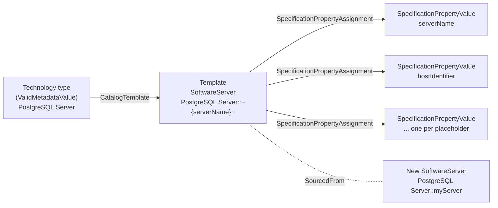

<!-- SPDX-License-Identifier: CC-BY-4.0 -->
<!-- Copyright Contributors to the Egeria project. -->

# Template Catalog

A *catalog template* is a ready-made pattern of open metadata elements that describes one kind of real-world resource - a PostgreSQL server, a Parquet file, an Apache Kafka topic, a Unity Catalog volume.  When you catalog a new resource of that kind, Egeria copies the template, substitutes the values you supply for the template's placeholders, and links the new elements back to the template.  The result is a catalog entry that has the same shape as every other entry for that technology: the right asset type, the right capability, an endpoint with a correctly formed network address, and a connection that names the connector that can open the resource.

Egeria ships 118 catalog templates in its [content packs](/content-packs).  This page explains how they are built, found and used, and then lists every one of them.  The pages below describe some of them in more detail:

* [PostgreSQL Templates](/catalog-templates/postgres-server-templates) - the server, database, schema and table templates of the PostgreSQL Content Pack, with a worked description of how they fit together.
* [Relational Database Templates](/catalog-templates/relational-database-templates) - the matching templates for Microsoft SQL Server, Oracle Database, Db2 for Linux, UNIX and Windows, and DuckDB.
* [Unity Catalog Templates](/catalog-templates/unity-catalog-templates) - the templates for OSS and Databricks Unity Catalog servers and the catalogs, schemas, tables, volumes, functions and models inside them.

## How a template is put together

A [template](/concepts/template) is a group of [anchored](/concepts/anchor) metadata elements.  The anchor element - typically an asset - carries the *Template* classification, which gives the template its display name, description and version identifier.  The other elements of the template, such as the asset's connection, endpoint and software capability, are anchored to it, so they are copied with it.  Elements that the template only points to - for example the [connector type](/concepts/connector-type) named by the connection - are shared rather than copied: the new elements are linked to the same connector type.

Attribute values in the template contain *placeholders*, which are replaced when the template is used.  The anchor element is linked to a *SpecificationPropertyValue* element for each placeholder through the *SpecificationPropertyAssignment* relationship; it records the placeholder's name, description, data type and an example value, and is what tools use to ask for the values a template needs.

Each element created from a template is linked to the template element it was copied from by the *SourcedFrom* relationship, so the elements derived from a template can be found if the template changes.

## Finding the right template

Templates are attached to [technology types](/concepts/deployed-implementation-type) - the valid values of the *deployedImplementationType* property - through the *CatalogTemplate* relationship.  To catalog a resource, you first identify its technology type, and then retrieve the templates attached to it.



The [Automated Curation](/services/omvs/automated-curation/overview) API of a view server does the lookup for you.  `POST /servers/{viewServer}/api/open-metadata/automated-curation/technology-types/by-name` with the technology type's name returns a technology type report.  Its `catalogTemplates` list gives, for each template, its display name and description, the GUID of its anchor element (`templateGUID`) and, under `specification.placeholderProperty`, the placeholders it expects.  The report also lists the [governance action processes](/concepts/governance-action-process) that work with the technology type and includes a mermaid graph of the whole picture - for example, the [PostgreSQL Server report](/catalog-templates/postgres-server-templates#technology-type-report).

A technology type normally has one template, but a few have two because two content packs supply one each: *Data File* and *Data Folder* have a path-based template in the Files Content Pack and a lineage-style template in the Core Content Pack, and *Unity Catalog Table* has both a lineage-style template and the template that the Unity Catalog synchronizer uses.  Check the template's qualified name pattern (listed below) to pick the one that matches the way you want the resource named.

## Placeholders

A placeholder is a name enclosed in `~{` and `}~`, for example `~{serverName}~`.  It can appear anywhere in a string attribute - in the qualified name, the display name, an endpoint's network address, or a connection's configuration properties.  When the template is used, each placeholder is replaced by the value supplied for it.  A placeholder supplied with a null value is removed (and an attribute that held nothing but that placeholder becomes null), but a placeholder for which no value is supplied at all is left in the new element exactly as it is, `~{` and `}~` included - so supply every placeholder the template lists, even if only as null.  The same placeholder may appear in several elements of the template, so a single value such as `hostIdentifier` fills in every endpoint that needs it.

The PostgreSQL Server template, for instance, sets the endpoint's network address to `jdbc:postgresql://~{hostIdentifier}~:~{portNumber}~/postgres`.  Supplying `hostIdentifier=coconet.com` and `portNumber=5432` gives the endpoint the address `jdbc:postgresql://coconet.com:5432/postgres`.

Some placeholders recur across most templates:

| Placeholder | Used for |
|---|---|
| `serverName`, `databaseName`, `schemaName`, `tableName` | The names that make up the qualified name of the new elements and, for databases, the JDBC network address. |
| `hostIdentifier`, `portNumber`, `hostURL` | The host name or IP address (or, for REST servers, the URL with its protocol) and port used in endpoint addresses. |
| `description`, `databaseDescription`, `schemaDescription`, `tableDescription` | The description of the new element. |
| `versionIdentifier`, `resourceName`, `displayName` | Optional descriptive properties of the new element. |
| `secretsStorePathName`, `secretsCollectionName` | The [secrets store](/concepts/secrets-store-connector) file, and the collection within it, that holds the credentials for the resource.  Templates no longer carry a user id or password; the connection embeds a secrets store connection instead, and the credentials are retrieved when the connector starts. |
| `namespacePath`, `resourceName` | The two halves of an [OpenLineage](/features/lineage-management/overview) dataset name, used by the lineage-style templates of the Core Content Pack. |
| `fileSystemName`, `filePathName`, `directoryPathName` | The file system and path name of a file or folder. |

## Using a template

There are several ways to use a template, depending on how much of the work you want Egeria to do.

* **Create the elements directly.**  The Automated Curation API's `catalog-templates/new-element` operation creates a new element from the template whose GUID you supply, using the placeholder values you pass in `placeholderPropertyValues`:

    ```
    POST {{baseURL}}/servers/{{viewServer}}/api/open-metadata/automated-curation/catalog-templates/new-element
    Authorization: Bearer {{token}}
    Content-Type: application/json

    {
       "templateGUID" : "542134e6-b9ce-4dce-8aef-22e8daf34fdb",
       "isOwnAnchor" : true,
       "placeholderPropertyValues" : {
           "serverName" : "coconet.com:5432",
           "hostIdentifier" : "coconet.com",
           "portNumber" : "5432",
           "secretsStorePathName" : "secrets/integration.omsecrets",
           "secretsCollectionName" : "local-postgres-db"
       }
    }
    ```

    The GUID above is the PostgreSQL Server template's; the [placeholder](/concepts/placeholder) page describes the request in more detail.

* **Run a governance action process.**  Most technology types for servers and databases come with *CreateAsCatalogTarget*, *CreateAndSurvey* and *DeleteAsset* processes.  They take the template's placeholder values as request parameters, create the asset from the template (or, for *DeleteAsset*, work out the qualified name it would have and delete that asset), and then attach it to the integration connector that keeps it up to date or run a survey against it.  The processes are listed in each technology type report and on the content pack pages.

* **Let an integration connector do it.**  [Integration connectors](/concepts/integration-connector) create the elements for the resources they discover from templates too.  The PostgreSQL cataloguer, for example, creates each database it finds from the *PostgreSQL Relational Database* template, using the placeholder values that were supplied when the server was catalogued.  A [catalog target](/concepts/catalog-target) can carry its own map of template names to template GUIDs to make the connector use your templates in place of the shipped ones.

* **Use pyegeria.**  The `AutomatedCuration` client of pyegeria wraps these calls, and includes some technology-specific helpers such as `create_postgres_server_element_from_template()` - see [Leveraging your PostgreSQL estate](/egeria-solutions/leveraging-postgres/overview).

The shipped templates are a starting point.  Use the [Template Manager](/services/omvs/template-manager/overview) API to classify your own elements as templates - for example a copy of a shipped template with your organization's owner, zones and classifications already attached - and link them to the technology types with *CatalogTemplate* so that they are found in the same way.  [Templated cataloguing](/features/templated-cataloguing/overview) explains which elements are copied when a template is used, and [planning your templates](/guides/planning/templates/overview) covers the decisions to make before you start loading metadata.

## The templates in each content pack

The tables list every template that is attached to a technology type in the shipped content packs.  The *Creates* column is the open metadata type of the template's anchor element; the qualified name pattern shows the placeholders that make each new element unique.

??? info "Core Content Pack - endpoints, CSV data sets, file systems and lineage-style data sets (52 templates)"
    The [Core Content Pack](/content-packs/core-content-pack/overview) supplies templates for technology types that are not tied to a specific product pack.

    | Technology type | Creates | Qualified name pattern |
    |---|---|---|
    | JDBC Endpoint | Endpoint | `JDBC Endpoint::~{serverName}~` |
    | REST API Endpoint | Endpoint | `REST API Endpoint::~{serverName}~` |
    | Apache Kafka Topic | Topic | `Topic::~{serverName}~.~{fullTopicName}~::inOut` |
    | Data File Collection | DataFileCollection | `Data File Collection::~{displayName}~` |
    | CSV Tabular Data Set | TabularDataSet | `CSV Tabular Data Set::~{directoryPathName}~::~{tableName}~::~{versionIdentifier}~` |
    | CSV Tabular Data Set Collection | TabularDataSetCollection | `CSV Tabular Data Set Collection::~{directoryPathName}~::~{versionIdentifier}~` |
    | Apple MacBook Pro | BareMetalComputer | `Apple MacBook Pro::~{hostURL}~` |
    | File System | FileSystem | `FileSystem::File System::null::~{fileSystemName}~` |
    | UNIX File System | FileSystem | `FileSystem::UNIX File System::null::~{fileSystemName}~` |

    The remaining 43 templates describe the datasets, files and jobs that appear in [OpenLineage](/features/lineage-management/overview) events.  Each creates a single element, with no connection, whose qualified name is `<technology type>::~{namespacePath}~::~{resourceName}~` - the OpenLineage namespace and name of the dataset.  The technology type's description gives the OpenLineage naming convention for the technology (for example, a Snowflake table's namespace is `snowflake://{organization name}-{account name}` and its name is `{database}.{schema}.{table}`).

    | Creates | Technology types |
    |---|---|
    | DataSet | Amazon Athena Table, AWS Glue Table, Azure Synapse Analytics Table, Azure Data Explorer Table, Google BigQuery Table, Microsoft Fabric Warehouse Table, MySQL Table, CrateDB Table, Apache Hive Table, OceanBase Table, Teradata Table, Amazon Redshift Table, Snowflake Table, Google Cloud Spanner Table, Trino Table, Apache Cassandra Table, Azure Cosmos DB Collection, Milvus Collection, In-Memory Data Set |
    | DataFile | Amazon S3 Object, Google Cloud Storage Object, Azure Blob Storage Object, Azure Data Lake Storage File, Apache Hadoop HDFS File, Databricks File System File, Data File |
    | DataFolder | Amazon S3 Folder, Google Cloud Storage Folder, Azure Blob Storage Folder, Azure Data Lake Storage Directory, Apache Hadoop HDFS Directory, Databricks File System Directory, Data Folder |
    | Document | Box File, IBM FileNet Document, Microsoft SharePoint Document |
    | Topic | Google Cloud Pub/Sub Topic |
    | DataFeed | Google Cloud Pub/Sub Subscription |
    | DeployedSoftwareComponent | Apache Airflow DAG, Apache Airflow Task, Apache Spark Job, SQL Job, Debezium Connector Task |

    The lineage-style templates for PostgreSQL, Microsoft SQL Server, Oracle and Db2 tables follow the same pattern but are supplied by the product content packs (see below).

??? info "Files Content Pack - files and folders on a file system (23 templates)"
    The [Files Content Pack](/content-packs/files-content-pack/overview) supplies a template for each kind of file that the file cataloguing connectors recognize.  Each creates the asset with a connection to the matching file connector, and is named from the file system and path name.

    | Technology type | Creates | Qualified name pattern |
    |---|---|---|
    | File System Directory | FileFolder | `FileFolder::~{fileSystemName}~:~{directoryPathName}~` |
    | Data Folder | DataFolder | `DataFolder::~{fileSystemName}~:~{directoryPathName}~` |
    | Data File | DataFile | `DataFile::~{fileSystemName}~:~{filePathName}~` |
    | CSV Data File | CSVFile | `CSVFile::~{fileSystemName}~:~{filePathName}~` |
    | Avro Data File | AvroFile | `AvroFile::~{fileSystemName}~:~{filePathName}~` |
    | JSON Data File | JSONFile | `JSONFile::~{fileSystemName}~:~{filePathName}~` |
    | Parquet Data File | ParquetFile | `ParquetFile::~{fileSystemName}~:~{filePathName}~` |
    | Spreadsheet Data File | SpreadsheetFile | `SpreadsheetFile::~{fileSystemName}~:~{filePathName}~` |
    | XML Data File | XMLFile | `XMLFile::~{fileSystemName}~:~{filePathName}~` |
    | Document File | Document | `Document::~{fileSystemName}~:~{filePathName}~` |
    | Audio Data File | AudioFile | `AudioFile::~{fileSystemName}~:~{filePathName}~` |
    | Video Data File | VideoFile | `VideoFile::~{fileSystemName}~:~{filePathName}~` |
    | 3D Image Data File | ThreeDImageFile | `ThreeDImageFile::~{fileSystemName}~:~{filePathName}~` |
    | Raster Data File | RasterFile | `RasterFile::~{fileSystemName}~:~{filePathName}~` |
    | Vector Data File | VectorFile | `VectorFile::~{fileSystemName}~:~{filePathName}~` |
    | Archive File | ArchiveFile | `ArchiveFile::~{fileSystemName}~:~{filePathName}~` |
    | Keystore File | KeyStoreFile | `KeyStoreFile::~{fileSystemName}~:~{filePathName}~` |
    | Source Code File | SourceCodeFile | `SourceCodeFile::~{fileSystemName}~:~{filePathName}~` |
    | Build Instruction File | BuildInstructionFile | `BuildInstructionFile::~{fileSystemName}~:~{filePathName}~` |
    | Executable File | ExecutableFile | `ExecutableFile::~{fileSystemName}~:~{filePathName}~` |
    | Script File | ScriptFile | `ScriptFile::~{fileSystemName}~:~{filePathName}~` |
    | Properties File | PropertiesFile | `PropertiesFile::~{fileSystemName}~:~{filePathName}~` |
    | YAML File | YAMLFile | `YAMLFile::~{fileSystemName}~:~{filePathName}~` |

    All of the file templates take `fileSystemName`, `filePathName`, `fileName`, `fileType`, `fileExtension`, `fileEncoding` and `fileAddress` (the folder templates take `directoryPathName`, `directoryName` and `directoryAddress`), plus `description`, `versionIdentifier` and `deployedImplementationType`.  The media and document templates add `embeddedMetadata` and the software file templates add `programmingLanguage`.

??? info "Egeria Content Pack - Egeria's own platforms and servers (5 templates)"
    The [Egeria Content Pack](/content-packs/egeria-content-pack/overview) supplies the templates used to describe a running Egeria deployment, including by the *OMAG Server Platform Cataloguer*.

    | Technology type | Creates | Qualified name pattern |
    |---|---|---|
    | OMAG Server Platform | SoftwareServerPlatform | `OMAG Server Platform::~{platformURLRoot}~::~{platformName}~` |
    | Metadata Access Server | SoftwareServer | `Metadata Access Server::~{platformURLRoot}~::~{serverName}~` |
    | View Server | SoftwareServer | `View Server::~{platformURLRoot}~::~{serverName}~` |
    | Integration Daemon | SoftwareServer | `Integration Daemon::~{platformURLRoot}~::~{serverName}~` |
    | Engine Host | SoftwareServer | `Engine Host::~{platformURLRoot}~::~{serverName}~` |

    The platform template takes `platformURLRoot`, `platformName`, `platformDescription`, `platformUserId` and `organizationName`; the server templates take `platformURLRoot`, `serverName`, `serverId`, `connectionUserId` and `organizationName`.  All of them take `secretsStorePathName` and `secretsCollectionName` for the credentials used to call the platform.

??? info "PostgreSQL Content Pack (6 templates)"
    The [PostgreSQL Content Pack](/content-packs/postgres-content-pack/overview) templates are described in [PostgreSQL Templates](/catalog-templates/postgres-server-templates).

    | Technology type | Creates | Qualified name pattern |
    |---|---|---|
    | PostgreSQL Server | SoftwareServer | `PostgreSQL Server::~{serverName}~` |
    | PostgreSQL Relational Database | RelationalDatabase | `PostgreSQL Relational Database::~{serverName}~::~{databaseName}~` |
    | PostgreSQL Relational Database Schema | DeployedDatabaseSchema | `PostgreSQL Relational Database Schema::~{serverName}~::~{databaseName}~.~{schemaName}~` |
    | PostgreSQL Tabular Data Set Collection | TabularDataSetCollection | `PostgreSQL Tabular Data Set Collection::~{serverName}~::~{databaseName}~.~{schemaName}~` |
    | PostgreSQL Tabular Data Set | TabularDataSet | `PostgreSQL Tabular Data Set::~{serverName}~::~{databaseName}~.~{schemaName}~.~{tableName}~` |
    | PostgreSQL Table | DataSet | `PostgreSQL Table::~{namespacePath}~::~{resourceName}~` |

??? info "Microsoft SQL Server Content Pack (6 templates)"
    The [Microsoft SQL Server Content Pack](/content-packs/mssql-content-pack/overview) templates are described in [Relational Database Templates](/catalog-templates/relational-database-templates).

    | Technology type | Creates | Qualified name pattern |
    |---|---|---|
    | Microsoft SQL Server | SoftwareServer | `Microsoft SQL Server::~{serverName}~` |
    | Microsoft SQL Server Relational Database | RelationalDatabase | `Microsoft SQL Server Relational Database::~{serverName}~::~{databaseName}~` |
    | Microsoft SQL Server Relational Database Schema | DeployedDatabaseSchema | `Microsoft SQL Server Relational Database Schema::~{serverName}~::~{databaseName}~.~{schemaName}~` |
    | Microsoft SQL Server Tabular Data Set Collection | TabularDataSetCollection | `Microsoft SQL Server Tabular Data Set Collection::~{serverName}~::~{databaseName}~.~{schemaName}~` |
    | Microsoft SQL Server Tabular Data Set | TabularDataSet | `Microsoft SQL Server Tabular Data Set::~{serverName}~::~{databaseName}~.~{schemaName}~.~{tableName}~` |
    | Microsoft SQL Server Table | DataSet | `Microsoft SQL Server Table::~{namespacePath}~::~{resourceName}~` |

??? info "Oracle Content Pack (6 templates)"
    The [Oracle Content Pack](/content-packs/oracle-content-pack/overview) templates are described in [Relational Database Templates](/catalog-templates/relational-database-templates).  For Oracle, `databaseName` is the service name of a pluggable database (PDB).

    | Technology type | Creates | Qualified name pattern |
    |---|---|---|
    | Oracle Database Server | SoftwareServer | `Oracle Database Server::~{serverName}~` |
    | Oracle Relational Database | RelationalDatabase | `Oracle Relational Database::~{serverName}~::~{databaseName}~` |
    | Oracle Relational Database Schema | DeployedDatabaseSchema | `Oracle Relational Database Schema::~{serverName}~::~{databaseName}~.~{schemaName}~` |
    | Oracle Tabular Data Set Collection | TabularDataSetCollection | `Oracle Tabular Data Set Collection::~{serverName}~::~{databaseName}~.~{schemaName}~` |
    | Oracle Tabular Data Set | TabularDataSet | `Oracle Tabular Data Set::~{serverName}~::~{databaseName}~.~{schemaName}~.~{tableName}~` |
    | Oracle Table | DataSet | `Oracle Table::~{namespacePath}~::~{resourceName}~` |

??? info "Db2 for Linux, UNIX and Windows Content Pack (6 templates)"
    The [Db2 for Linux, UNIX and Windows Content Pack](/content-packs/db2luw-content-pack/overview) templates are described in [Relational Database Templates](/catalog-templates/relational-database-templates).

    | Technology type | Creates | Qualified name pattern |
    |---|---|---|
    | Db2 for Linux, UNIX and Windows Database Server | SoftwareServer | `Db2 for Linux, UNIX and Windows Database Server::~{serverName}~` |
    | Db2 for Linux, UNIX and Windows Relational Database | RelationalDatabase | `Db2 for Linux, UNIX and Windows Relational Database::~{serverName}~::~{databaseName}~` |
    | Db2 for Linux, UNIX and Windows Relational Database Schema | DeployedDatabaseSchema | `Db2 for Linux, UNIX and Windows Relational Database Schema::~{serverName}~::~{databaseName}~.~{schemaName}~` |
    | Db2 for Linux, UNIX and Windows Tabular Data Set Collection | TabularDataSetCollection | `Db2 for Linux, UNIX and Windows Tabular Data Set Collection::~{serverName}~::~{databaseName}~.~{schemaName}~` |
    | Db2 for Linux, UNIX and Windows Tabular Data Set | TabularDataSet | `Db2 for Linux, UNIX and Windows Tabular Data Set::~{serverName}~::~{databaseName}~.~{schemaName}~.~{tableName}~` |
    | Db2 Table | DataSet | `Db2 Table::~{namespacePath}~::~{resourceName}~` |

??? info "DuckDB Content Pack (2 templates)"
    The [DuckDB Content Pack](/content-packs/duckdb-content-pack/overview) templates are described in [Relational Database Templates](/catalog-templates/relational-database-templates).  DuckDB is embedded, so there is no server template and the database is named from the path of its file.

    | Technology type | Creates | Qualified name pattern |
    |---|---|---|
    | DuckDB Relational Database | RelationalDatabase | `DuckDB Relational Database::~{databasePath}~` |
    | DuckDB Relational Database Schema | DeployedDatabaseSchema | `DuckDB Relational Database Schema::~{databasePath}~::~{schemaName}~` |

??? info "Unity Catalog Content Pack (10 templates)"
    The [Unity Catalog Content Pack](/content-packs/unity-catalog-content-pack/overview) templates are described in [Unity Catalog Templates](/catalog-templates/unity-catalog-templates).

    | Technology type | Creates | Qualified name pattern |
    |---|---|---|
    | Unity Catalog Server | SoftwareServer | `Unity Catalog Server::~{serverName}~` |
    | Databricks Unity Catalog Server | SoftwareServer | `Databricks Unity Catalog Server::~{serverName}~` |
    | Unity Catalog Catalog | Namespace | `Unity Catalog Catalog::~{serverNetworkAddress}~::~{ucCatalogName}~` |
    | Unity Catalog Schema | DeployedDatabaseSchema | `Unity Catalog Schema::~{serverNetworkAddress}~::~{ucCatalogName}~.~{ucSchemaName}~` |
    | Unity Catalog Table | VirtualRelationalTable | `Unity Catalog Table::~{serverNetworkAddress}~::~{ucCatalogName}~.~{ucSchemaName}~.~{ucTableName}~` |
    | Unity Catalog Table | VirtualRelationalTable | `Unity Catalog Table::~{namespacePath}~::~{resourceName}~` |
    | Unity Catalog Volume | DataFolder | `Unity Catalog Volume::~{serverNetworkAddress}~::~{ucCatalogName}~.~{ucSchemaName}~.~{ucVolumeName}~` |
    | Unity Catalog Function | DeployedAPI | `Unity Catalog Function::~{serverNetworkAddress}~::~{ucCatalogName}~.~{ucSchemaName}~.~{ucFunctionName}~` |
    | Unity Catalog Registered Model | DeployedAnalyticsModel | `Unity Catalog Registered Model::~{serverNetworkAddress}~::~{ucCatalogName}~.~{ucSchemaName}~.~{ucModelName}~` |
    | Unity Catalog Registered Model Version | AnalyticsModelRun | `Unity Catalog Registered Model Version::~{serverNetworkAddress}~::~{ucCatalogName}~.~{ucSchemaName}~.~{ucModelName}~::~{ucModelVersion}~` |

??? info "Apache Kafka and Apache Atlas Content Packs (1 template each)"
    | Content pack | Technology type | Creates | Qualified name pattern |
    |---|---|---|---|
    | [Apache Kafka Content Pack](/content-packs/apache-kafka-content-pack/overview) | Apache Kafka Server | SoftwareServer | `Apache Kafka Server::~{serverName}~` |
    | [Apache Atlas Content Pack](/content-packs/apache-atlas-content-pack/overview) | Apache Atlas Server | SoftwareServer | `Apache Atlas Server::~{serverName}~` |

    The Kafka server template takes `hostIdentifier` and `portNumber` for the broker's bootstrap address.  The Atlas server template takes `hostURL` and `portNumber`, plus `secretsStorePathName` and `secretsCollectionName` for the Atlas credentials.  The template for an individual Kafka topic is in the Core Content Pack.

The Coco Pharmaceuticals sample archives also contain two templates, for the weekly measurement files of the clinical trials, that are not attached to a technology type; they are described with the [Coco Pharmaceuticals content](/content-packs/coco-content-pack/overview).

!!! summary "Usage"
    Find the technology type of the resource you want to catalog, retrieve its templates with the Automated Curation API, and either create the element from the template directly or run the technology type's *CreateAsCatalogTarget* process so that Egeria keeps the catalog entry up to date.  To make the shipped templates fit your organization, create your own templates with the Template Manager API and attach them to the same technology types.

--8<-- "snippets/abbr.md"
