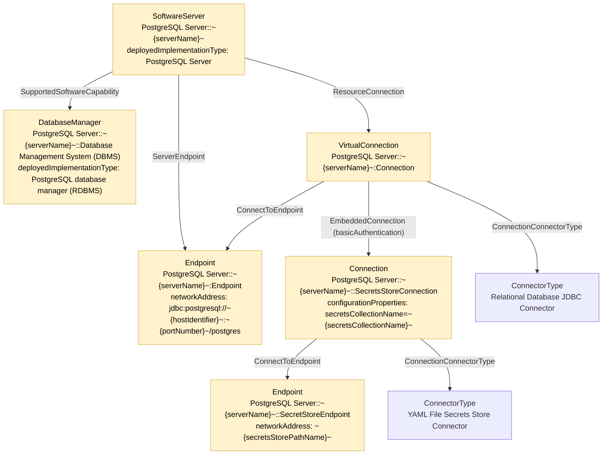
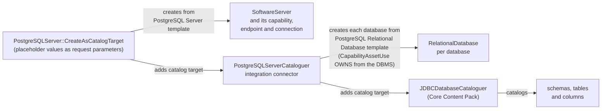

<!-- SPDX-License-Identifier: CC-BY-4.0 -->
<!-- Copyright Contributors to the Egeria project. -->

# PostgreSQL Templates

The [PostgreSQL Content Pack](/content-packs/postgres-content-pack/overview) supplies six [catalog templates](/catalog-templates) for describing a PostgreSQL server and its contents in open metadata.  Four of them describe the levels of the PostgreSQL hierarchy - server, database, schema - and the tables as [tabular data sets](/concepts/tabular-data-set-connector); one describes a schema as a tabular data set collection; and one describes a table as it is named in lineage events.  Each template is attached to its [technology type](/concepts/deployed-implementation-type) with the *CatalogTemplate* relationship, so it can be found through the [Automated Curation](/services/omvs/automated-curation/overview) API.

The same pattern is used by the Microsoft SQL Server, Oracle, Db2 and DuckDB content packs; their differences are described in [Relational Database Templates](/catalog-templates/relational-database-templates).

## The templates

| Technology type | Template creates | Qualified name pattern | Placeholders |
|---|---|---|---|
| PostgreSQL Server | *SoftwareServer* with its *DatabaseManager* capability, endpoint and connection | `PostgreSQL Server::~{serverName}~` | `serverName`, `hostIdentifier`, `portNumber`, `description`, `versionIdentifier`, `resourceName`, `secretsStorePathName`, `secretsCollectionName` |
| PostgreSQL Relational Database | *RelationalDatabase* with its endpoint and connection | `PostgreSQL Relational Database::~{serverName}~::~{databaseName}~` | `serverName`, `hostIdentifier`, `portNumber`, `databaseName`, `databaseDescription`, `versionIdentifier`, `secretsStorePathName`, `secretsCollectionName` |
| PostgreSQL Relational Database Schema | *DeployedDatabaseSchema* with its endpoint and connection | `PostgreSQL Relational Database Schema::~{serverName}~::~{databaseName}~.~{schemaName}~` | as for the database, plus `schemaName` and `schemaDescription` |
| PostgreSQL Tabular Data Set Collection | *TabularDataSetCollection* for a schema, readable through the PostgreSQL tabular data set collection connector | `PostgreSQL Tabular Data Set Collection::~{serverName}~::~{databaseName}~.~{schemaName}~` | as for the schema |
| PostgreSQL Tabular Data Set | *TabularDataSet* for a single table, readable through the PostgreSQL tabular data set connector | `PostgreSQL Tabular Data Set::~{serverName}~::~{databaseName}~.~{schemaName}~.~{tableName}~` | as for the schema, plus `tableName` and `tableDescription` |
| PostgreSQL Table | *DataSet* for a table named in lineage events | `PostgreSQL Table::~{namespacePath}~::~{resourceName}~` | `namespacePath`, `resourceName`, `displayName`, `description`, `versionIdentifier` |

The `serverName` is the name you choose for the server in open metadata - the examples in Egeria use the host and port, such as `coconet.com:5432` - and it is part of the qualified name of every element below the server, so the databases, schemas and tables of a server are always distinguishable from those of another server.

## The PostgreSQL Server template

The server template creates five elements, plus the links to two shared [connector types](/concepts/connector-type).  The shaded elements are created from the template; the connector types are shared by every connection that uses them.

The connection is a *virtual connection*: it describes the JDBC connector that opens the server, and embeds a connection to a [secrets store connector](/concepts/secrets-store-connector) that holds the server's credentials.  When the JDBC connector is started, the [connector broker](/concepts/connector-broker) uses the embedded secrets store connector to read the user id and password from the `secretsCollectionName` collection of the YAML secrets file at `secretsStorePathName`, so no credentials are stored in open metadata.

The template's anchor is also linked to one *SpecificationPropertyValue* per placeholder (not shown), which is how the technology type report and tools such as pyegeria know which values to ask for.

## The database, schema and data set templates

The *PostgreSQL Relational Database* and *PostgreSQL Relational Database Schema* templates follow the same shape as the server template, without the capability: the asset has a virtual connection to the JDBC connector, with an embedded secrets store connection, and an endpoint.  The connection's configuration properties name the database (`databaseName`) and, for the schema, the schema (`databaseSchema`), and the endpoint addresses become more specific:

| Template | Endpoint network address |
|---|---|
| PostgreSQL Server | `jdbc:postgresql://~{hostIdentifier}~:~{portNumber}~/postgres` |
| PostgreSQL Relational Database | `jdbc:postgresql://~{hostIdentifier}~:~{portNumber}~/~{databaseName}~` |
| PostgreSQL Relational Database Schema, Tabular Data Set Collection and Tabular Data Set | `jdbc:postgresql://~{hostIdentifier}~:~{portNumber}~/~{databaseName}~?currentSchema=~{schemaName}~` |

The two tabular data set templates add one more level of connection.  The asset's connection (`...::DataSetConnection`) names the *PostgreSQL Tabular Data Set Connector* or *PostgreSQL Tabular Data Set Collection Connector*, which present a table, or all the tables of a schema, as [tabular data sets](/concepts/tabular-data-set-connector) - rows and columns that a provisioning pipeline can read and write without knowing it is talking to PostgreSQL.  That connection embeds the JDBC connection described above (as *Connect to technology*), which in turn embeds the secrets store connection.  The assets carry the *DataAssetEncoding* classification.

The *PostgreSQL Table* template is different: it creates a single *DataSet* with no connection, named the way [OpenLineage](/features/lineage-management/overview) names a PostgreSQL table - namespace `postgres://{host}:{port}` and name `{database}.{schema}.{table}`.  It is used to catalog the tables that appear in lineage events.

## How the templates are used together

The templates are designed to be used by the content pack's [governance action processes](/concepts/governance-action-process) and integration connector, so that cataloguing a server leads to the cataloguing of everything in it.

1. Running *PostgreSQLServer::CreateAsCatalogTarget* creates the server's elements from the PostgreSQL Server template and attaches the new server asset as a [catalog target](/concepts/catalog-target) of the *PostgreSQLServerCataloguer* (user `postgrescatnpa`).
2. The cataloguer lists the databases on the server, skipping PostgreSQL's own template databases and those that do not allow connections.  It creates each database it has not seen before from the *PostgreSQL Relational Database* template, filling `databaseName` itself and taking the other placeholder values (host, port, secrets store) from the catalog target's configuration, and links it to the server's database manager.
3. Each new database is attached as a catalog target of the generic *JDBCDatabaseCataloguer* in the Core Content Pack's database integration group, which catalogs the schemas, tables and columns inside it.

A catalog target's `templates` map can name a different template for the cataloguer to use, keyed by the template name (`PostgreSQL Relational Database`), which is how your own version of a template can be swapped in.

The processes for each technology type are:

| Technology type | Processes |
|---|---|
| PostgreSQL Server | `PostgreSQLServer::CreateAsCatalogTarget`, `PostgreSQLServer:CreateAndSurvey`, `PostgreSQLServer:DeleteAsset` |
| PostgreSQL Relational Database | `PostgreSQLDatabase::CreateAsCatalogTarget`, `PostgreSQLDatabase:CreateAndSurvey`, `PostgreSQLDatabase:DeleteAsset` |
| PostgreSQL Relational Database Schema | `PostgreSQLDatabaseSchema::CreateAsCatalogTarget`, `PostgreSQLDatabaseSchema:DeleteAsset` |

*CreateAndSurvey* creates the asset from the template and runs the survey engine against it, producing a [survey report](/concepts/survey-report) rather than catalog entries.  *DeleteAsset* takes the same placeholder values as the create process, resolves the qualified name the template would have produced, and deletes that asset with everything anchored to it.

!!! warning "Process display names"
    In the technology type report, the *DeleteAsset* processes are shown with the display name *Catalog Resource*, the same name as the *CreateAsCatalogTarget* processes.  Use the qualified names above, or the process descriptions, to tell them apart.

## Technology type report

The technology type reports below, taken from Egeria's quickstart, show each template with its placeholders, alongside the governance action processes, integration connector and governance action types linked to the technology type.

??? info "Technology type report for PostgreSQL Server"
    --8<-- "snippets/technology-types/postgresql-server-technology-report-mermaid-graph.md"

??? info "Technology type report for PostgreSQL Relational Database"
    --8<-- "snippets/technology-types/postgresql-relational-database-technology-report-mermaid-graph.md"

!!! summary "Usage"
    Store the server's credentials in a YAML secrets store, then run *PostgreSQLServer::CreateAsCatalogTarget* with `serverName`, `hostIdentifier`, `portNumber`, `secretsStorePathName` and `secretsCollectionName` to catalog the server and everything in it.  Use the *PostgreSQL Table* template only for tables that you know through lineage events.

    [Leveraging your PostgreSQL estate](/egeria-solutions/leveraging-postgres/overview) walks through surveying and cataloguing a PostgreSQL server step by step.

--8<-- "snippets/abbr.md"
