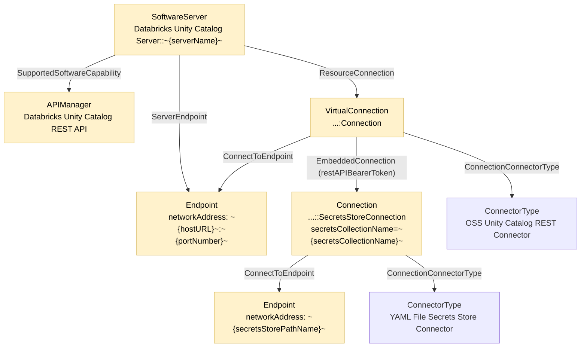
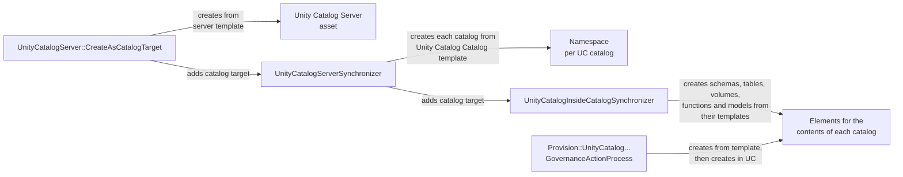

<!-- SPDX-License-Identifier: CC-BY-4.0 -->
<!-- Copyright Contributors to the Egeria project. -->

# Unity Catalog Templates

The [Unity Catalog Content Pack](/content-packs/unity-catalog-content-pack/overview) supplies ten [catalog templates](/catalog-templates) for describing Unity Catalog (UC) in open metadata: two for the servers themselves - the open source (OSS) Unity Catalog server and the Databricks-hosted Unity Catalog - and eight for the catalogs, schemas, tables, volumes, functions and registered models found inside a server.

The two groups are used differently.  You use a server template to catalog a server, usually through one of the server's governance action processes.  The other templates are mostly used by Egeria itself: the Unity Catalog synchronizers create the elements for what they find inside a server from them, and the *Provision Unity Catalog Resources* governance action service creates the open metadata description of a new resource from them before it creates the resource in Unity Catalog.

## The server templates

| Technology type | Template creates | Qualified name pattern | Placeholders |
|---|---|---|---|
| Unity Catalog Server | *SoftwareServer* with an *APIManager* capability (*Unity Catalog REST API*), an endpoint and a connection | `Unity Catalog Server::~{serverName}~` | `serverName`, `hostURL`, `portNumber`, `description`, `versionIdentifier`, `resourceName` |
| Databricks Unity Catalog Server | *SoftwareServer* with an *APIManager* capability (*Databricks Unity Catalog REST API*), an endpoint and a connection with an embedded secrets store connection | `Databricks Unity Catalog Server::~{serverName}~` | as for Unity Catalog Server, plus `secretsStorePathName` and `secretsCollectionName` |

Both servers are reached through the same *OSS Unity Catalog REST Connector*, and both endpoints have the network address `~{hostURL}~:~{portNumber}~`, where `hostURL` includes the protocol (for example `http://localhost` with port `8080`).  The difference is security.  The OSS server's connection is a plain connection with no credentials.  The Databricks server's connection is a virtual connection that embeds a connection to the *YAML File Secrets Store Connector* in the *restAPIBearerToken* position, so the bearer token used to call the Databricks REST API is read from the `secretsCollectionName` collection of the secrets file at `secretsStorePathName` rather than being stored in open metadata.

The OSS server template has the same shape without the embedded secrets store connection and its endpoint.

Each server technology type has three [governance action processes](/concepts/governance-action-process): *UnityCatalogServer::CreateAsCatalogTarget* (and *DatabricksUnityCatalogServer::CreateAsCatalogTarget*) creates the server from its template and attaches it to the *UnityCatalogServerSynchronizer*; *CreateAndSurvey* creates it and runs the Unity Catalog server survey; and *DeleteAsset* deletes the server asset created from the template.  As with the other content packs, the technology type report shows the *DeleteAsset* process with the display name *Catalog Resource*.

## The templates for the contents of a server

| Technology type | Template creates | Qualified name pattern |
|---|---|---|
| Unity Catalog Catalog | *Namespace* | `Unity Catalog Catalog::~{serverNetworkAddress}~::~{ucCatalogName}~` |
| Unity Catalog Schema | *DeployedDatabaseSchema* | `Unity Catalog Schema::~{serverNetworkAddress}~::~{ucCatalogName}~.~{ucSchemaName}~` |
| Unity Catalog Table | *VirtualRelationalTable* with a *DataFolder* for its storage location | `Unity Catalog Table::~{serverNetworkAddress}~::~{ucCatalogName}~.~{ucSchemaName}~.~{ucTableName}~` |
| Unity Catalog Volume | *DataFolder* with a connection to the *Data Folder Connector* | `Unity Catalog Volume::~{serverNetworkAddress}~::~{ucCatalogName}~.~{ucSchemaName}~.~{ucVolumeName}~` |
| Unity Catalog Function | *DeployedAPI* | `Unity Catalog Function::~{serverNetworkAddress}~::~{ucCatalogName}~.~{ucSchemaName}~.~{ucFunctionName}~` |
| Unity Catalog Registered Model | *DeployedAnalyticsModel* | `Unity Catalog Registered Model::~{serverNetworkAddress}~::~{ucCatalogName}~.~{ucSchemaName}~.~{ucModelName}~` |
| Unity Catalog Registered Model Version | *AnalyticsModelRun* | `Unity Catalog Registered Model Version::~{serverNetworkAddress}~::~{ucCatalogName}~.~{ucSchemaName}~.~{ucModelName}~::~{ucModelVersion}~` |
| Unity Catalog Table | *VirtualRelationalTable* with no connection | `Unity Catalog Table::~{namespacePath}~::~{resourceName}~` |

These templates name each element with the network address of its server (`serverNetworkAddress`, for example `http://localhost:8080`) followed by UC's own three-level name, *catalog.schema.object*, so the same name in two Unity Catalog servers gives two different elements.  The network address is also kept in the element's `additionalProperties`, and the UC name is split across `namespacePath` (the catalog and schema) and `resourceName` (the full name).

Every template takes `description` and `versionIdentifier`.  The other placeholders are:

| Template | Placeholders |
|---|---|
| Catalog | `serverNetworkAddress`, `ucCatalogName`, `ucServerQualifiedName` |
| Schema | `serverNetworkAddress`, `ucCatalogName`, `ucSchemaName` |
| Table | `serverNetworkAddress`, `ucCatalogName`, `ucSchemaName`, `ucTableName`, `ucTableType` (for example `MANAGED`), `ucDataSourceFormat` (for example `CSV`), `ucStorageLocation`, `rootSchemaTypeQualifiedName` |
| Volume | `serverNetworkAddress`, `ucCatalogName`, `ucSchemaName`, `ucVolumeName`, `ucVolumeType` (for example `MANAGED`), `ucStorageLocation`, `localStorageLocation`, `directoryPathName` |
| Function | `serverNetworkAddress`, `ucCatalogName`, `ucSchemaName`, `ucFunctionName`, `rootSchemaTypeQualifiedName` |
| Registered Model | `serverNetworkAddress`, `ucCatalogName`, `ucSchemaName`, `ucModelName`, `rootSchemaTypeQualifiedName` |
| Registered Model Version | as for Registered Model, plus `ucModelVersion`, `ucModelVersionRunId`, `ucModelVersionSource` and `ucModelVersionStatus` (for example `READY`) |
| Table (lineage-style) | `namespacePath`, `resourceName`, `displayName` |

A few of the templates include more than the anchor element:

* The **table** template links the table, through *DataSetContent*, to a *DataFolder* that describes where its data is stored (`pathName` is `ucStorageLocation`), and attaches a *PropertyFacet* to hold the vendor properties that UC reports for the table.
* The **volume** template gives the volume a connection to the *Data Folder Connector*, whose endpoint is `localStorageLocation` - the path at which the volume's files can be read - and a *PropertyFacet* for its vendor properties.
* `rootSchemaTypeQualifiedName` is not used inside the templates.  The *Provision Unity Catalog Resources* service reads it after creating a table, function or model from its template and, if it names an existing schema type, links that schema type to the new element so that the structure of the table, or the parameters of the function, are described.

The last template in the table is a second template for the *Unity Catalog Table* technology type.  It is the lineage-style template used throughout the content packs for tables that are known from [OpenLineage](/features/lineage-management/overview) events, named from the event's namespace and name.  When you retrieve the templates for *Unity Catalog Table* you get both; pick the one whose qualified name pattern matches how you want the table named.

### How these templates are used

* The *UnityCatalogServerSynchronizer* (user `ucservernpa`) creates an element from the *Unity Catalog Catalog* template for each catalog it finds in a server, anchored to the server, and passes each catalog to the *UnityCatalogInsideCatalogSynchronizer* (user `uccatcatnpa`).  That connector creates the schemas, tables, volumes, functions and registered models from their templates.  Both connectors look up the template to use by technology type name in their `templates` map, so you can substitute your own templates through their configuration or their catalog targets.
* The five *Provision::UnityCatalog...::GovernanceActionProcess* processes (for catalogs, schemas, tables, volumes and functions) run the *Provision Unity Catalog Resources* service, which creates the open metadata element from the matching template - using its request parameters as the placeholder values, or a different template if you pass `templateGUID` - and then creates the resource in the Unity Catalog server.  There is no provisioning process for registered models or model versions.

## Technology type report

The technology type report for *Unity Catalog Server*, taken from Egeria's quickstart, shows the template with its placeholders, alongside the governance action processes, integration connectors and governance action types linked to the technology type.

??? info "Technology type report for Unity Catalog Server"
    --8<-- "snippets/technology-types/unity-catalog-server-technology-report-mermaid-graph.md"

!!! summary "Usage"
    Run *UnityCatalogServer::CreateAsCatalogTarget* with `serverName`, `hostURL` and `portNumber` (and, for *DatabricksUnityCatalogServer::CreateAsCatalogTarget*, the secrets store placeholders) to catalog a server and keep the elements for its catalogs, schemas, tables, volumes, functions and models in step with it.  Use the provisioning processes when you want Egeria to create new resources in Unity Catalog from their open metadata description.

    [Leveraging Unity Catalog](/egeria-solutions/leveraging-unity-catalog/overview) walks through the scenarios step by step.

--8<-- "snippets/abbr.md"
