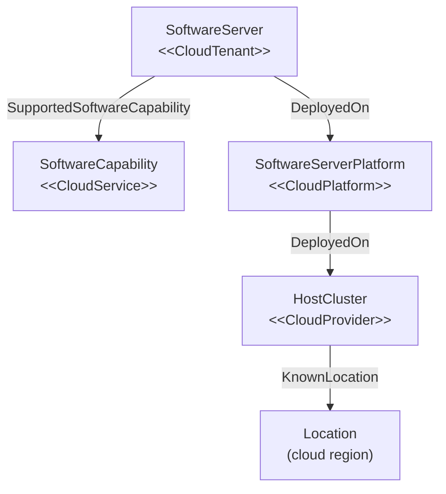

<!-- SPDX-License-Identifier: CC-BY-4.0 -->
<!-- Copyright Contributors to the Egeria project. -->

# Cloud Platforms and Services

Cloud computing is not so different from what organizations have always done: software still runs on platforms, on hosts, in a location.  The difference is who is in control.  When infrastructure or services are provided by a cloud provider, the organization relies on technology that it does not operate itself, and that affects how it governs the data and processes that depend on it.

Open metadata therefore does not have separate element types for the cloud.  Hosts, software server platforms, software servers and software capabilities are catalogued in the same way wherever they run, and a classification is added to show that a cloud provider is involved.  This means that an organization's systems can be described consistently across its own data centers and its cloud services, while the parts that are outside its control are still easy to find.

## The cloud classifications

There are four classifications, matching the different levels of service that a cloud provider can offer.

| Classification | Applied to | Shows that | Properties |
|---|---|---|---|
| [*CloudProvider*](/types/0/0090-Cloud-Platforms-and-Services/#cloudprovider) | a [host](/concepts/host) - typically a host cluster | the host is provided and run by a cloud provider.  With *infrastructure as a service* (IaaS), the organization deploys its own virtual machines and containers onto it. | *providerName* |
| [*CloudPlatform*](/types/0/0090-Cloud-Platforms-and-Services/#cloudplatform) | a [software server platform](/types/0/0037-Software-Server-Platforms) | the platform is running in a cloud service.  With *platform as a service* (PaaS), the organization deploys its own software servers and capabilities onto it. | *deployedImplementationType* |
| [*CloudTenant*](/types/0/0090-Cloud-Platforms-and-Services/#cloudtenant-classification) | a [software server](/types/0/0040-Software-Servers) | the server supports the organization's tenancy in a cloud service. | *tenantName*, *tenantType* |
| [*CloudService*](/types/0/0090-Cloud-Platforms-and-Services/#cloudservice) | a [software capability](/concepts/software-capability) | the capability is offered by the cloud provider as a service.  With *software as a service* (SaaS), the organization calls APIs backed by software that the provider has already deployed. | *offeringName*, *serviceType* |

The *deployedImplementationType* of the *CloudPlatform* classification names the cloud technology, and its values can be kept consistent with a [deployed implementation type](/concepts/deployed-implementation-type) valid value set.

> **Figure 1:** The cloud classifications mark each layer of the stack that a cloud provider supplies.

An organization only classifies the layers that the provider supplies.  With infrastructure as a service, only the host is classified *CloudProvider*, and the platforms, servers and capabilities deployed onto it are the organization's own.  With software as a service, the organization may only catalog the *CloudService* capability that it calls, since the rest of the stack is hidden from it.

## Why cloud deployments are marked

???+ info "Data sovereignty"
    Cloud services run in the provider's data centers, which may be in a different country from the organization.  Linking the classified host or platform to the provider's region with the [*KnownLocation*](/types/0/0025-Locations/#knownlocation-relationship) relationship shows where data processed or stored by the service actually resides - see [storage volume](/concepts/storage-volume) for how storage is tied to a location.

???+ info "Dependency and risk"
    Finding the elements with a cloud classification shows which business capabilities and [information supply chains](/concepts/information-supply-chain) depend on a third party.  This is the starting point for assessing the impact of a provider outage, a change in a provider's terms, or a decision to move to a different provider.

???+ info "Governance responsibility"
    Responsibility for security and resilience is shared between the organization and the provider, and the split depends on the level of service.  The classification shows which model applies, so that the organization's governance controls can be targeted at the layers it is actually responsible for.  The terms of the service can be recorded as an [agreement](/types/7/0711-Agreements).

## Cloud services at Coco Pharmaceuticals

When [Gary Geeke](/practices/coco-pharmaceuticals/personas/gary-geeke) [extended the systems inventory](/practices/coco-pharmaceuticals/scenarios/cataloguing-infrastructure/overview) with the systems of the acquired manufacturers, a number of them turned out to be software-as-a-service applications - customer management, human resources and quality management services that the sites subscribe to rather than run.  None of these appeared in his own inventory, because he never operated them, yet the information supply chains depend on them.  Classifying the capabilities they provide as *CloudService* keeps them in the same inventory as the systems that Coco Pharmaceuticals runs itself, while making clear that their operation is in someone else's hands.

## Maintaining cloud classifications

* The [DevOps Pipeline API](/services/omvs/devops-pipeline/overview) adds and removes all four cloud classifications (*setHostAsCloudProvider*, *setAsCloudPlatform*, *setServerAsCloudTenant* and *setCapabilityAsCloudService*, with matching *clear...* operations).
* The [Asset Maker API](/services/omvs/asset-maker/overview) creates and maintains the hosts, software server platforms, software servers and software capabilities that are classified.

!!! education "Further information"
    * The open metadata types for the cloud classifications are defined in [model 0090](/types/0/0090-Cloud-Platforms-and-Services).

--8<-- "snippets/abbr.md"
