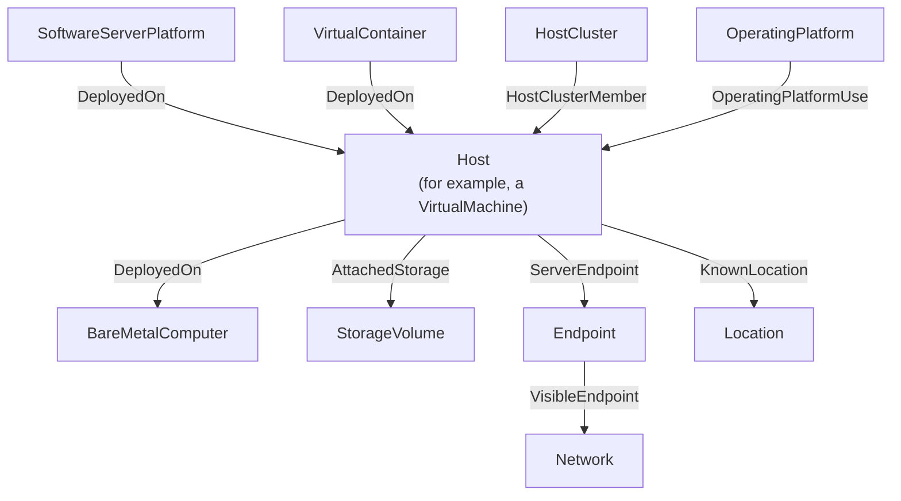

<!-- SPDX-License-Identifier: CC-BY-4.0 -->
<!-- Copyright Contributors to the Egeria project. -->

# Host

A *host* is a deployment environment that has access to hardware and a basic software stack, typically including the operating system.  It is where software runs: a physical computer in a data center, a laptop, a virtual machine, a container, or a cluster of machines working together as one.

Hosts are the foundation of the *system fabric* - the IT infrastructure that the data and processes of an [information supply chain](/concepts/information-supply-chain) run on.  Cataloguing them makes it possible to answer questions such as *which systems does this business capability depend on?*, *what is running in this data center?* and *what is affected if this machine fails?*

## Kinds of host

A host is a kind of [IT infrastructure](/types/0/0030-Operating-Platforms/#itinfrastructure-entity) [asset](/concepts/asset), so it has the asset's naming, ownership and *deploymentStatus* properties.  In modern systems, hardware is virtualized to get the most use out of it: a single computer may support many hosts, and many computers may together support a single host.  The open metadata types reflect this with four subtypes of [*Host*](/types/0/0035-Complex-Hosts/#host-entity):

| Type | Describes | Example deployed implementation types |
|---|---|---|
| [*BareMetalComputer*](/types/0/0035-Complex-Hosts/#baremetalcomputer-entity) | A connected set of physical hardware with an operating system. | Bare Metal Computer, Laptop Computer, Small Form Factor (SFF) Computer, Smartphone, Tablet |
| [*VirtualMachine*](/types/0/0035-Complex-Hosts/#virtualmachine-entity) | Virtualized hardware provided by a hypervisor running on a physical computer. | Virtual Machine |
| [*VirtualContainer*](/types/0/0035-Complex-Hosts/#virtualcontainer-entity) | A container that provides the services of a host to the software deployed in it, delegating requests for storage and network access to the host it runs on. | Docker Container |
| [*HostCluster*](/types/0/0035-Complex-Hosts/#hostcluster-entity) | A collection of hosts that together provide a service, often for horizontal scaling. | Hadoop Cluster, Kubernetes Cluster |

The [deployed implementation type](/concepts/deployed-implementation-type) property records the specific technology, so a laptop and a rack-mounted server can both be *BareMetalComputer* elements while still being told apart.

## Relationships

A host sits at the centre of a network of relationships that describe what runs on it, what it runs on, and where it is.

> **Figure 1:** The relationships that link a host to the software it runs, the hardware it runs on, and its location.

???+ info "What runs on the host, and what the host runs on"
    The [*DeployedOn*](/types/0/0035-Complex-Hosts/#deployedon-relationship) relationship shows where IT infrastructure is deployed.  It links a [software server platform](/types/0/0037-Software-Server-Platforms) to the host it runs on, a container to the host that runs it, or a virtual machine to the physical computer under its hypervisor.  Its properties record when the deployment happened and who (or what) did it.

    The [*HostClusterMember*](/types/0/0035-Complex-Hosts/#hostclustermember-relationship) relationship links a host cluster to the hosts it manages.  Its *memberRole* property shows how each member is used - for example, in a Kubernetes cluster it distinguishes the nodes providing the processing from the pods running on them.

???+ info "The software stack"
    The host's operating system and the packages installed with it are described by an [operating platform](/concepts/operating-platform), linked with the *OperatingPlatformUse* relationship.  Since many hosts can share the same operating platform, this shows which hosts have a particular standard stack, and when it was installed on each.

???+ info "Storage, networks and location"
    * The [*AttachedStorage*](/types/0/0036-Storage/#attachedstorage-relationship) relationship links a host to the [storage volumes](/concepts/storage-volume) it writes to.
    * The *ServerEndpoint* relationship links a host to the [endpoints](/concepts/endpoint) at which it can be reached, and the *VisibleEndpoint* relationship links those endpoints to the [networks](/concepts/network) they are visible in.
    * The [*KnownLocation*](/types/0/0025-Locations/#knownlocation-relationship) relationship links a host to the [location](/types/0/0025-Locations) where it is installed, such as a data center or a site.  A laptop or phone that has no fixed location can be given the *MobileResource* classification instead.
    * A host run by a cloud provider is given the *CloudProvider* classification - see [cloud platforms and services](/concepts/cloud-platform).

!!! summary "Usage"
    A catalogued host is the anchor point for operational questions: following its relationships shows the software running on it, the storage and networks it uses and the location it sits in.  Working in the other direction, the software capabilities that implement the solution components of an information supply chain can be traced down to the hosts they depend on.

## Hosts at Coco Pharmaceuticals

[Gary Geeke](/practices/coco-pharmaceuticals/personas/gary-geeke) began by [cataloguing the infrastructure](/practices/coco-pharmaceuticals/scenarios/cataloguing-infrastructure/overview) listed in his systems spreadsheet, so that the solution components of the strategic information supply chains could be mapped to the systems that run them.  The systems from the two acquired manufacturers show the range of hosts that a catalog needs to describe: the Austin site runs its data lake on Hadoop clusters, which are *HostCluster* elements with the data lake's nodes as members, while the Bucharest site runs much of its workload on virtual machines managed by an on-premises virtualization platform.

## Maintaining hosts

* The [Asset Maker API](/services/omvs/asset-maker/overview) creates and maintains hosts, and their *DeployedOn* relationships.
* The [DevOps Pipeline API](/services/omvs/devops-pipeline/overview) maintains the *HostClusterMember*, *OperatingPlatformUse* and *AttachedStorage* relationships, and the *CloudProvider* classification.
* The [Connection Maker API](/services/omvs/connection-maker/overview) maintains endpoints and links them to hosts.
* The [Location Arena API](/services/omvs/location-arena/overview) maintains locations and the *KnownLocation* relationship.

Hosts can be browsed in [The Catalog](/user-interfaces/the-catalog/overview) under the **IT Infrastructure** card.

!!! education "Further information"
    * The open metadata types for hosts are defined in [model 0035](/types/0/0035-Complex-Hosts).
    * Software server platforms, which run on hosts, are defined in [model 0037](/types/0/0037-Software-Server-Platforms).

--8<-- "snippets/abbr.md"
