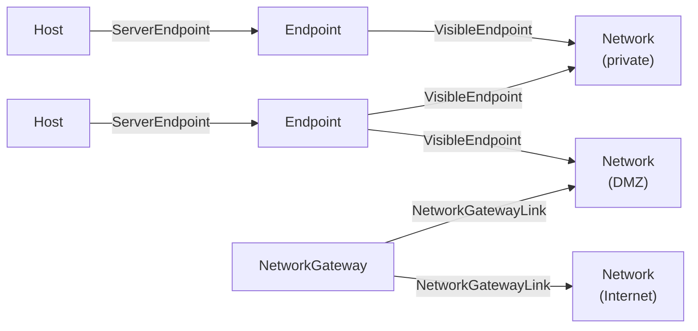

<!-- SPDX-License-Identifier: CC-BY-4.0 -->
<!-- Copyright Contributors to the Egeria project. -->

# Network

A *network* provides the interconnectivity between systems.  Cataloguing networks shows which systems can reach one another, where systems are isolated in private networks, and where the gateways between those networks - and onto the Internet - are.

The open metadata model for networks is deliberately simple.  It has two elements and two relationships:

* A [*Network*](/types/0/0070-Networks-and-Gateways/#network-entity) is a kind of [IT infrastructure](/types/0/0030-Operating-Platforms/#itinfrastructure-entity) [asset](/concepts/asset), so it can be named, owned, located and given a *deploymentStatus* like any other piece of infrastructure.
* A [*NetworkGateway*](/types/0/0070-Networks-and-Gateways/#networkgateway-entity) is a connection point that enables network traffic to pass between two networks.  It is a kind of [software capability](/concepts/software-capability), because a gateway is provided by software - a router, firewall, proxy or API gateway - running on a server.
* The [*VisibleEndpoint*](/types/0/0070-Networks-and-Gateways/#visibleendpoint-relationship) relationship shows that an [endpoint](/concepts/endpoint) can be reached through a network.
* The [*NetworkGatewayLink*](/types/0/0070-Networks-and-Gateways/#networkgatewaylink-relationship) relationship connects a network gateway to a network it serves.

> **Figure 1:** Systems are placed in networks through their endpoints, and network gateways connect the networks together.

## Placing systems in networks

Systems are not linked to networks directly.  Instead, a host or other piece of IT infrastructure is linked to the [endpoints](/concepts/endpoint) at which it can be called with the *ServerEndpoint* relationship, and each endpoint is linked to the networks it is visible in with the *VisibleEndpoint* relationship.  This is more precise than linking the whole system to a network: a server may expose its administration endpoint only on a management network while its service endpoint is visible more widely.  An endpoint may be visible in several networks.

## Connecting networks with gateways

The *NetworkGatewayLink* relationship records the addresses that a gateway maps between.  Its *externalEndpointAddresses* property lists the network addresses that callers use to reach the gateway, and its *internalEndpointAddresses* property lists the addresses that the gateway maps those requests to.

*NetworkGatewayLink* is a [multi-link](/concepts/uni-multi-link) relationship, so the same gateway can be linked to the same network more than once - for example, once for each address mapping that it maintains.  Each link has its own unique identifier, which is used to update or remove it.

!!! summary "Usage"
    Following the relationships from a network shows which endpoints - and hence which systems - are reachable in it, and which gateways connect it to other networks.  This supports security reviews (*which services can be reached from the Internet?*), the impact analysis of a network outage or change, and checking that regulated systems are kept in the segregated networks that the security policies require.

## Networks at Coco Pharmaceuticals

The systems from Coco Pharmaceuticals' acquired manufacturers, catalogued as part of [cataloguing infrastructure](/practices/coco-pharmaceuticals/scenarios/cataloguing-infrastructure/overview), include several network-related components.  The Austin data lake is reached through a gateway that sits in front of its Hadoop clusters, which is a natural *NetworkGateway*, and the Bucharest site runs network anomaly detection that monitors the traffic on its site network.  Recording the networks and the endpoints visible in them gives [Ivor Padlock](/practices/coco-pharmaceuticals/personas/ivor-padlock)'s security team a picture of which systems are exposed where.

## Maintaining networks

* The [DevOps Pipeline API](/services/omvs/devops-pipeline/overview) creates and maintains networks and network gateways, and the *NetworkGatewayLink* and *VisibleEndpoint* relationships.
* The [Connection Maker API](/services/omvs/connection-maker/overview) maintains endpoints and links them to the infrastructure that provides them.

!!! education "Further information"
    * The open metadata types for networks are defined in [model 0070](/types/0/0070-Networks-and-Gateways).
    * Endpoints and the *ServerEndpoint* relationship are defined in [model 0026](/types/0/0026-Endpoints).

--8<-- "snippets/abbr.md"
