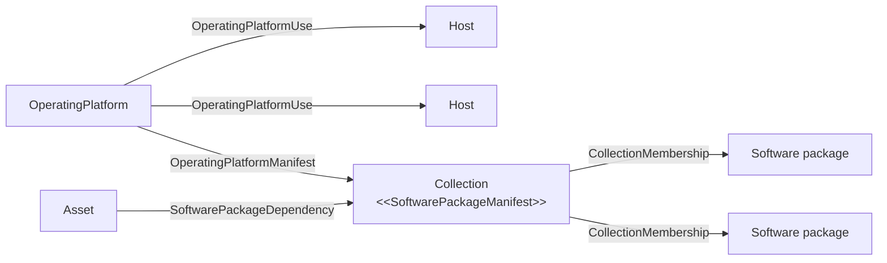

<!-- SPDX-License-Identifier: CC-BY-4.0 -->
<!-- Copyright Contributors to the Egeria project. -->

# Operating Platform

An *operating platform* describes the operating system and software stack that is installed on a [host](/concepts/host).  It records which operating system is running, the level of patches applied to it, and - through a linked collection - the software packages and configuration that make up the rest of the stack.

An operating platform is a description of a stack rather than one particular installation of it.  Many hosts can share the same operating platform, so an organization can define a small number of standard stacks and record which hosts each one has been rolled out to.  The pipelines that build and patch hosts can then use these elements to manage the rollout and update of the software packages.

## Properties

The [*OperatingPlatform*](/types/0/0030-Operating-Platforms/#operatingplatform-entity) element has the following properties, in addition to the usual names and description:

* *operatingSystem* - the name of the operating system running on this operating platform.
* *operatingSystemPatchLevel* - the level of patches applied to the operating system.
* *byteOrdering* - the order in which bytes are arranged into larger numerical values when they are stored in memory or sent over a network.  This matters when binary data is exchanged between platforms.

An operating platform is not an [asset](/concepts/asset): it is an [*AuthoredReferenceable*](/types/0/0010-Base-Model) element, which also gives it *authors* and a *contentStatus*.  The content status follows the life of a standard stack, from *DRAFT* while it is being defined, through *ACTIVE* while it is the approved stack to deploy, to *DEPRECATED* once hosts should be moved to its replacement.

## Relationships

> **Figure 1:** An operating platform links a standard software stack to the hosts it is installed on.

???+ info "OperatingPlatformUse - where the stack is installed"
    The [*OperatingPlatformUse*](/types/0/0030-Operating-Platforms/#operatingplatformuse-relationship) relationship links an operating platform to each piece of [IT infrastructure](/types/0/0030-Operating-Platforms/#itinfrastructure-entity), typically a host, that it is installed on.  Its properties record the *installTime*, and the *deployer* that installed it - a person, organization or engine - with the *deployerTypeName* and *deployerPropertyName* that identify the deployer's element in the catalog.

???+ info "OperatingPlatformManifest - what the stack contains"
    The details of the software stack are captured in a [collection](/concepts/collection) linked to the operating platform with the [*OperatingPlatformManifest*](/types/0/0030-Operating-Platforms/#operatingplatformmanifest-relationship) relationship.  The collection can contain software packages, configuration files and other details, organized into nested collections if needed.  A collection that lists software packages is given the [*SoftwarePackageManifest*](/types/0/0030-Operating-Platforms/#softwarepackagemanifest-classification) classification.

???+ info "SoftwarePackageDependency - what other assets need"
    The same kind of package list can describe the packages that an application or other asset needs when it runs.  The [*SoftwarePackageDependency*](/types/0/0030-Operating-Platforms/#softwarepackagedependency-relationship) relationship links the asset to that collection.  Comparing an asset's dependencies with the manifest of the operating platform on the host it is deployed to shows whether everything it needs is installed.

!!! summary "Usage"
    Operating platforms turn the software levels of individual machines into a small set of managed standards.  When a security fix is released for a package, the manifests show which operating platforms include it and their *OperatingPlatformUse* relationships show which hosts need patching.  When a host is rebuilt, its operating platform says exactly what to install.

## Operating platforms at Coco Pharmaceuticals

One of the jobs that [Gary Geeke](/practices/coco-pharmaceuticals/personas/gary-geeke)'s systems spreadsheet did was to keep track of the software levels on all the machines - and it was the hardest part to keep up to date.  Once the systems were [catalogued in Egeria](/practices/coco-pharmaceuticals/scenarios/cataloguing-infrastructure/overview), formalizing those software levels into standard operating platforms reduced the variation in the system stacks and allowed a systematic upgrade process.  The next step is for [Lemmie Stage](/practices/coco-pharmaceuticals/personas/lemmie-stage)'s DevOps pipelines to record the *OperatingPlatformUse* relationships as they build each host, so the catalog stays current without anyone maintaining it by hand.

## Maintaining operating platforms

* The [DevOps Pipeline API](/services/omvs/devops-pipeline/overview) creates and maintains operating platforms, their *OperatingPlatformUse* and *OperatingPlatformManifest* relationships, the *SoftwarePackageDependency* relationship and the *SoftwarePackageManifest* classification.
* The [Collection Manager API](/services/omvs/collection-manager/overview) maintains the collections that list the software packages and their members.

!!! education "Further information"
    * The open metadata types for operating platforms are defined in [model 0030](/types/0/0030-Operating-Platforms).

--8<-- "snippets/abbr.md"
