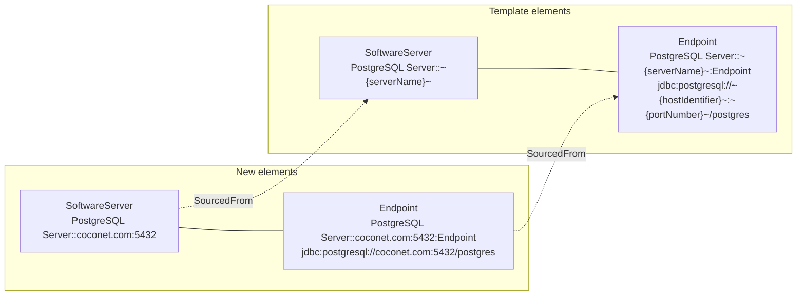

<!-- SPDX-License-Identifier: CC-BY-4.0 -->
<!-- Copyright Contributors to the Egeria project. -->


# Placeholders

A placeholder is a replaceable value.  
Placeholders allow concrete values to be substituted when an element is either created or used.  They are found in many technologies.  For example, both Postman and IntelliJ's HTTP client use placeholders in their REST API definitions to denote network addresses or identifiers.  These values are supplied when the REST request is made through an environment file.

Egeria has support for placeholders both in its [configuration documents](/concepts/configuration-document) and its [template](/features/templated-cataloguing/overview) support that is used when creating metadata.  In both cases, a placeholder is written with a tilde and curly brace at each end - `~{placeholderName}~`.  These delimiters avoid confusion with the `{{variable}}` syntax used by HTTP clients such as Postman and IntelliJ.

## Placeholder variables

The placeholders in the configuration document are called *placeholder variables*.  It is possible to use them when configuring a server:

```
###
# Set up the common properties needed to call your event bus.  The value of ~{kafkaEndpoint}~ is resolved in the
# application.properties file using the `platform.placeholder.variables` property.

POST {{baseURL}}/open-metadata/admin-services/servers/active-metadata-store/event-bus
Content-Type: application/json

{
"producer":
{
"bootstrap.servers":"~{kafkaEndpoint}~"
},
"consumer":
{
"bootstrap.servers":"~{kafkaEndpoint}~"
}
}

```
The value to substitute for `~{kafkaEndpoint}~` is provided in the OMAG Server Platform's `application.properties` file, like this:
```
platform.placeholder.variables=\
  {\
    "kafkaEndpoint" : "localhost:9092"\
  }
```
It is read and used on each server start up.

??? education "Further information on placeholder variables"

    * [Configuring the OMAG Server Platform](/guides/admin/configuring-the-omag-server-platform) for setting up the `application.properties` file
    * [Configuring OMAG Servers](/guides/admin/servers) for details of using the placeholder properties.

## Placeholder properties

Placeholder properties may be added to attributes of the elements that are part of a template.  The values to substitute are provided to Egeria when the template is used to create a new open metadata element. 

Placeholder properties are particularly useful for elements that need to be unique in the resulting element, such as the *qualifiedName* attribute, or on attributes that provide a value specific to the new element, such as the *address* in *Endpoint*.

For example, the call below is from [Automated Curation OMVS](/services/omvs/automated-curation/overview).  It creates a new metadata element based on the template with the unique identifier passed in the `templateGUID` property  of the body.
```
###
# @name createElementFromTemplate
# Create a new element from a template.
POST {{baseURL}}/servers/{{viewServer}}/api/open-metadata/automated-curation/catalog-templates/new-element
Authorization: Bearer {{token}}
Content-Type: application/json

{
   "templateGUID" : "add guid here",
   "isOwnAnchor" : true,
   "placeholderPropertyValues" : {
       "placeholderPropertyName1" : "placeholderPropertyValue1",
       "placeholderPropertyName2" : "placeholderPropertyValue2"
   }
}
```
When the template is copied, each string attribute that contains a placeholder is processed as follows:

* If a value is supplied for the placeholder, it replaces the placeholder wherever it appears in the attribute.
* If the placeholder is supplied with a null value, the placeholder is removed from the attribute.
* If no value is supplied for the placeholder at all, the placeholder is left in the new element as it is.  This is rarely what is wanted, since it typically leaves `~{...}~` in a qualified name, so supply every placeholder listed in the template's specification.

The placeholder properties that a template uses are listed in its [specification](/concepts/specification) as *placeholderProperty* entries, so a caller can discover what values to supply.

Below is an example of a call to create a PostgreSQL Server asset using the template supplied in the [PostgreSQL Content Pack](/content-packs/postgres-content-pack/overview).  The template creates a [SoftwareServer](/types/0/0040-Software-Servers) asset with a linked [SoftwareCapability](/types/0/0042-Software-Capabilities) for the [database manager (DBMS)](/types/0/0050-Applications-and-Processes), an endpoint, and a [connection](/concepts/connection) that defines how to create a connector to the server.  The connection embeds a connection to a [secrets store](/concepts/secrets-store-connector) that holds the credentials, so no user id or password is passed as a placeholder.

```
###
# @name createElementFromTemplate (PostgreSQL Server)
# Create a new element from a template.
POST {{baseURL}}/servers/{{viewServer}}/api/open-metadata/automated-curation/catalog-templates/new-element
Authorization: Bearer {{token}}
Content-Type: application/json

{
  "class" : "TemplateRequestBody",
  "templateGUID" : "542134e6-b9ce-4dce-8aef-22e8daf34fdb",
  "isOwnAnchor" : true,
  "placeholderPropertyValues" : {
    "serverName" : "coconet.com:5432",
    "hostIdentifier" : "coconet.com",
    "portNumber" : "5432",
    "description" : "PostgreSQL Server hosting the clinical trials databases.",
    "versionIdentifier" : "1.0",
    "resourceName" : "clinical-trials-postgres",
    "secretsStorePathName" : "secrets/integration.omsecrets",
    "secretsCollectionName" : "local-postgres-db"
  }
}
```

The diagram below shows how the `~{serverName}~` placeholder is used in the qualified name of each element of the template, so that every element created from it is unique.  Each new element is linked back to the template element it was copied from using the [SourcedFrom](/types/0/0011-Templates) relationship.



The full set of elements in this template, and the other PostgreSQL templates, are described in the [Template Catalog](/catalog-templates/postgres-server-templates).

The placeholder properties can be used to make the templates easy to use, removing much of the repetitive creation of property values.  The result is a consistent set of elements for the asset.


??? education "Further information on placeholder properties"

    * [Automated Curation API](/services/omvs/automated-curation/overview)
    * [Templated Cataloguing](/features/templated-cataloguing/overview)
    * [Template Catalog](/catalog-templates) - the templates supplied with Egeria and their placeholder properties

