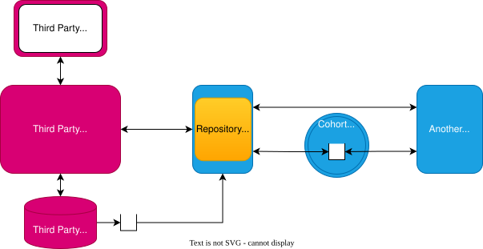
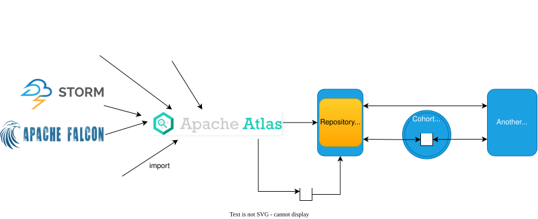

---
hide:
- toc
---

<!-- SPDX-License-Identifier: CC-BY-4.0 -->
<!-- Copyright Contributors to the Egeria project. -->

# Repository Proxy

A *repository proxy* is an [OMAG Server](/concepts/omag-server) that has been configured to act as a proxy to a third party metadata repository. 

The repository proxy hosts a repository connector to wrap the third party metadata server's APIs and an optional event mapper connector.  Egeria does not currently ship a repository connector for a third party metadata repository.  The community previously maintained connectors for Apache Atlas and IBM Information Governance Catalog (IGC), but their repositories ([egeria-connector-hadoop-ecosystem :material-github:](https://github.com/odpi/egeria-connector-hadoop-ecosystem){ target=gh } and [egeria-connector-ibm-information-server :material-github:](https://github.com/odpi/egeria-connector-ibm-information-server){ target=gh }) are now archived.  They remain useful as examples of how to write a repository connector and event mapper - see [Implementing a repository connector](/guides/developer/implement-repository-connector).

The value of a repository proxy is that it provides access to the metadata that is being collected by the third party metadata repository.  For example, in the picture below, Apache Atlas is running in a Hadoop environment and cataloguing the data it contains.  Through the repository proxy, this metadata is then visible to all of the other users connected via the [cohort](/features/cohort-operation/overview).

--8<-- "snippets/abbr.md"
