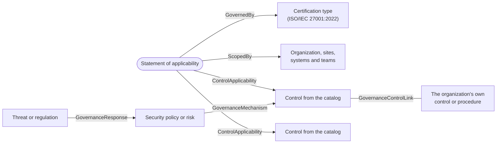
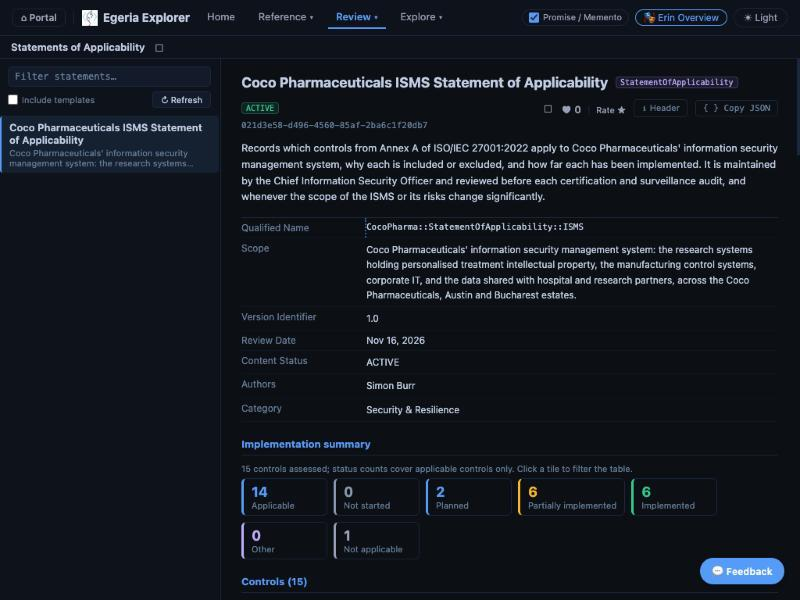
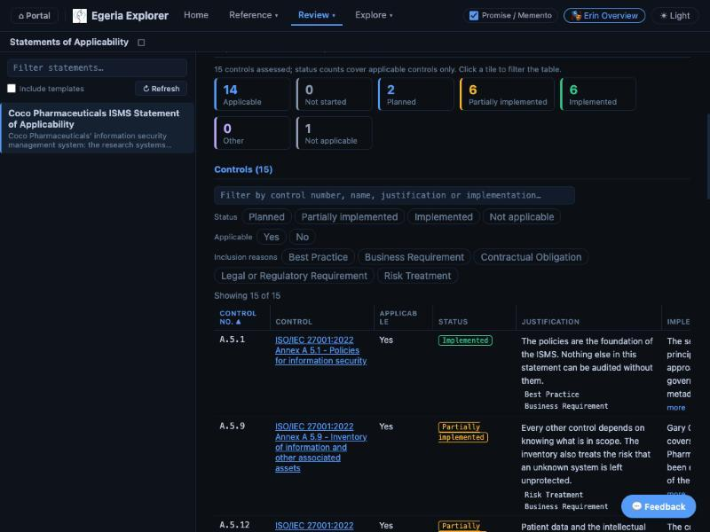

<!-- SPDX-License-Identifier: CC-BY-4.0 -->
<!-- Copyright Contributors to the Egeria project. -->

# Statement of Applicability

A *statement of applicability* is an organization's record of which controls from a reference catalog apply to it, why each one is included or excluded, and how far each one has been implemented.

It is best known from ISO/IEC 27001, the international standard for an *information security management system* (ISMS).  The standard lists a reference set of security controls in its Annex A and requires an organization to compare the controls it has chosen with that list, so that nothing necessary is overlooked, and to record the result.  The statement of applicability is that record, and it is one of the first documents that a certification auditor asks for.  The same approach works for any catalog of controls, such as NIST SP 800-53 or the NIST Cybersecurity Framework.

A statement of applicability is traditionally a spreadsheet with a row for each control.  The difficulty with a spreadsheet is that it is disconnected from everything it describes.  It says that a control is implemented, but not where; it says a control is justified by a risk, without linking to the risk; and it is out of date soon after the audit it was prepared for.  In Egeria, the statement is an element in open metadata, linked to the controls, the certification it supports, the scope it covers and, through the controls, to the policies, risks and systems that give each decision its meaning.

## What a statement of applicability records

The statement itself has a name, a description, the **scope** it covers (typically the scope of the ISMS) and the date it was last reviewed.  It also has authors, a version identifier and a content status, so that a draft can be distinguished from the version that has been approved for an audit.

For each control it assesses, the statement records:

| Property | Meaning |
|---|---|
| **Label** | The identifier of the control in the catalog, such as `A.5.9`. |
| **Is applicable** | Whether the control applies within the scope of the statement.  A control is treated as applicable unless this is set to false. |
| **Justification** | Why the control is included, or why it is excluded.  An exclusion needs a justification just as much as an inclusion does. |
| **Inclusion reasons** | The reasons the control is included, such as risk treatment, a legal or regulatory requirement, a contractual obligation, a business requirement or best practice. |
| **Implementation status** | How far the control has been implemented: `NOT_STARTED`, `PLANNED`, `PARTIALLY_IMPLEMENTED`, `IMPLEMENTED` or `OTHER`. |
| **Implementation description** | How the control is implemented within the scope of the statement. |
| **Review date** | When the applicability of this control was last reviewed. |

## How it is represented in open metadata

The statement is a [*StatementOfApplicability*](/types/4/0423-Security-Definitions#statementofapplicability-entity) element.  Each control in the catalog is a [governance definition](/concepts/governance-definition), typically a governance control, and the assessment of each control is held in the properties of the [*ControlApplicability*](/types/4/0423-Security-Definitions#controlapplicability-relationship) relationship that links the statement to it.



* The [*GovernedBy*](/types/4/0401-Governance-Definitions) relationship links the statement to the [certification type](/types/4/0482-Certifications) that it supports.
* The [*ScopedBy*](/types/1/0120-Assignment-Scopes) relationship links the statement to the elements that are in scope, such as the organization, its sites, systems and teams.
* There is one *ControlApplicability* relationship for each control that has been assessed.  Linking a control that is already linked updates the existing relationship, which is how the statement is kept up to date as the implementation of a control progresses.
* The controls are ordinary governance definitions, so they take part in the rest of the governance program.  A control from the catalog is linked to the policy it implements, or the risk it treats, with [*GovernanceMechanism*](/types/4/0420-Governance-Controls), and to the organization's own controls and procedures that deliver it with [*GovernanceControlLink*](/types/4/0420-Governance-Controls).  The policies and risks are linked to the threats, regulations and other drivers that they respond to with [*GovernanceResponse*](/types/4/0415-Governance-Responses).

This is what allows the justification "risk treatment" to be followed from the statement, through the control and the policy, to the entry in the risk register that it treats, and on to the systems that the risk is scoped to.

## Where the controls come from

A statement of applicability needs the catalog of controls to be in open metadata first.

* The [Security Content Pack](/content-packs/security-content-pack/overview) supplies the NIST Cybersecurity Framework 2.0 and NIST SP 800-53 Rev. 5 catalogs as governance controls.  These are in the public domain and can be linked to a statement as soon as the content pack is loaded.
* The text of ISO/IEC 27001 belongs to ISO and IEC, so its Annex A controls are not supplied with Egeria.  An organization creates a governance control for each Annex A control from its licensed copy of the standard.  The [Core Content Pack](/content-packs/core-content-pack/overview) supplies the certification type for ISO/IEC 27001:2022 (`CertificationType::ISO/IEC 27001:2022`) for the statement to be linked to.

A statement does not need to be complete to be useful.  Controls can be added as they are assessed, and a control from the catalog that has no *ControlApplicability* relationship is one that has not yet been considered.

## Working with statements of applicability

Statements of applicability are created and maintained through the [Security Officer API](/services/omvs/security-officer/overview#statements-of-applicability).

In [Dr.Egeria](/user-interfaces/dr-egeria/overview), a statement is written as a Markdown document using the `Create Statement of Applicability` and `Link Control Applicability` commands.  This suits the way a statement is prepared in practice: it is drafted, reviewed and corrected by the security team as a document, and then loaded.  Processing the document again updates what is already there.

```markdown
## Link Control Applicability

### Statement of Applicability
CocoPharma::StatementOfApplicability::ISMS

### Control
CocoPharma::GovernanceControl::ISO27001-A-5-9-InventoryOfInformationAssets

### Label
A.5.9

### Is Applicable
true

### Justification
Every other control depends on knowing what is in scope.

### Inclusion Reasons
- Risk Treatment
- Business Requirement

### Implementation Status
PARTIALLY_IMPLEMENTED

### Review Date
2026-11-16
```

[Egeria Explorer](/user-interfaces/egeria-explorer/overview) displays statements of applicability under its **Review** menu.  The display shows the properties of the statement, and a summary of how many of its controls are applicable, and how many are at each implementation status.


> The statement of applicability for Coco Pharmaceuticals' ISMS, with its implementation summary.

Beneath the summary is the list of controls with their label, applicability, status, justification and implementation description.  The list can be filtered by status, by applicability and by inclusion reason, which makes it easy to answer an auditor's question, such as "which controls are included because of a contractual obligation?", or to pick out the controls that still need work.  Each control is a link to its governance definition, and from there to the policies and risks behind it.


> The controls assessed by the statement, with the filters for status, applicability and inclusion reason.

## Keeping it current

A statement of applicability is not written once.  It changes whenever a control moves from planned to implemented, the scope of the ISMS changes, or a new risk makes a previously excluded control necessary.  Because the statement is linked rather than typed out, much of this is visible from the metadata:

* the proportion of applicable controls that are implemented is a measure of progress that can be reported as a governance metric;
* controls whose review date has passed can be listed for the next review;
* when a system is added to the scope, the risks scoped to it show which controls need to be reconsidered;
* the version identifier and content status of the statement record which version was presented at each audit.

!!! education "Further information"
    * [Keeping Safe](/egeria-solutions/keeping-safe#working-towards-isoiec-27001-certification) describes how Egeria supports each part of an ISO/IEC 27001 information security management system.
    * [Defining Security Strategy](/egeria-solutions/defining-security-strategy/overview#the-statement-of-applicability) describes how the statement of applicability fits into the security strategy.
    * [Building a data security strategy](/practices/coco-pharmaceuticals/scenarios/building-a-data-security-strategy/overview) shows Coco Pharmaceuticals building its strategy around ISO/IEC 27001.  The statement of applicability shown above is loaded from the [statement-of-applicability.md](https://github.com/odpi/egeria-workspaces/blob/main/coco-workbooks/4.%20keeping-safe/statement-of-applicability.md) workbook in Egeria Workspaces.
    * [0423 Security Definitions](/types/4/0423-Security-Definitions#statements-of-applicability) describes the open metadata types.

--8<-- "snippets/abbr.md"
