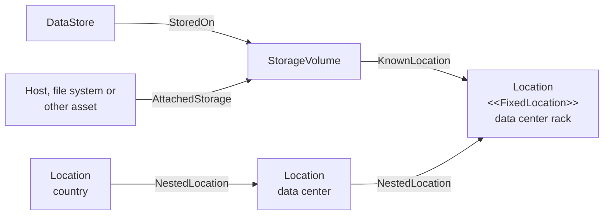

<!-- SPDX-License-Identifier: CC-BY-4.0 -->
<!-- Copyright Contributors to the Egeria project. -->

# Storage Volume

A *storage volume* describes a unit of persistent storage, such as a disk, a volume on a storage area network, a block of cloud storage or a removable drive.  Its purpose is to pin down the exact location where data is stored.

The [assets](/concepts/asset) in a catalog describe data in terms of how it is used - a file, a database, a topic.  On their own, they say nothing about where the bytes are physically held.  Linking an asset to the storage volume it writes to, and the storage volume to its location, closes that gap.

## Relationships

A storage volume is typically linked to a [*Location*](/types/0/0025-Locations/#location-entity) using the [*KnownLocation*](/types/0/0025-Locations/#knownlocation-relationship) relationship.  The location may be a physical place, such as a data center, the building it is in or the country it is in, or a cyber location, such as a cloud region.  Locations can be nested, so a storage volume linked to a rack in a data center is implicitly also located in that data center's city and country.

The [*AttachedStorage*](/types/0/0036-Storage/#attachedstorage-relationship) relationship identifies the assets that store data in the volume, such as the hosts and file systems that the volume is connected to.  The more specific [*StoredOn*](/types/2/0210-Data-Stores) relationship links a data store, such as a database or a file, directly to the storage volume that holds its data.

> **Figure 1:** A storage volume links the assets that hold data to the place where that data is physically stored.

The storage volume's own properties record its *storageCapacity* and the *units* that the capacity is measured in, along with the *relativeUncertainty* and *absoluteUncertainty* of the measurement.  A storage volume that has no fixed location, such as a removable drive or the disk of a laptop, can be given the [*MobileResource*](/types/0/0025-Locations/#mobileresource-classification) classification.

## Uses of storage location

Knowing the location where data is stored supports three main use cases.

???+ info "Data sovereignty"
    Regulations and contracts often restrict the countries or jurisdictions where certain types of data, such as personal or health data, may be stored.  Following the relationships from a data store, through its storage volume, to the nested locations shows the jurisdictions where its data actually resides, so it can be compared with the places where it is permitted to reside.

???+ info "Data breach and theft of storage"
    When a storage device is stolen or a storage system is compromised, the first question is what data it held.  Following the relationships back from the storage volume to the data stores and assets that use it shows which data has been exposed, and from there which [digital products](/concepts/digital-product), owners and data subjects are affected.  The [*SecureLocation*](/types/0/0025-Locations/#securelocation-classification) classification on the location, and the *MobileResource* classification on the volume, help to assess how likely such an exposure is in the first place.

???+ info "Backup and disaster recovery"
    Backup and recovery are planned around physical failures: a disk fails, a storage array is lost or a data center goes offline.  Knowing which data stores sit on each storage volume, and which volumes share a location, shows what would be lost in each failure and whether a backup copy is really held somewhere independent.  Combined with the importance of the data, it helps to prioritize which volumes are backed up most often and which data is restored first after a disaster.  Elements with the [*GeneratedTarget*](/types/2/0280-Software-Development-Assets/#generatedtarget-classification) classification can be rebuilt at will, so they can be given a lower priority.

## Maintaining storage volumes

* The [DevOps Pipeline API](/services/omvs/devops-pipeline/overview) creates, updates, deletes and retrieves storage volumes, and maintains their *AttachedStorage* and *StoredOn* relationships.
* The [Location Arena API](/services/omvs/location-arena/overview) maintains locations and links them to storage volumes (and any other element) with the *KnownLocation* relationship.

!!! education "Further information"
    * The open metadata type for a storage volume is defined in [model 0036](/types/0/0036-Storage).
    * Locations and their classifications are defined in [model 0025](/types/0/0025-Locations).

--8<-- "snippets/abbr.md"
