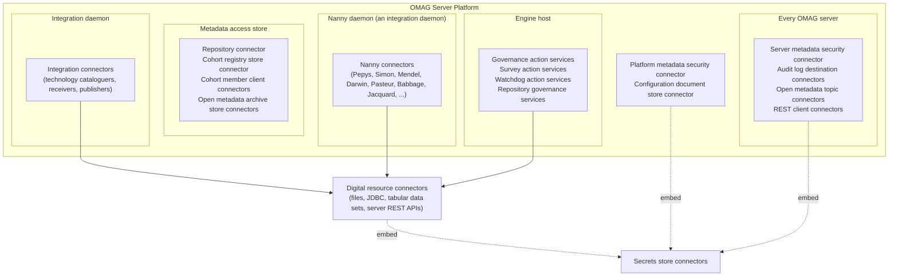

<!-- SPDX-License-Identifier: CC-BY-4.0 -->
<!-- Copyright Contributors to the Egeria project 2019. -->

# Connector catalog

Egeria has a growing collection of [connectors](/concepts/connector) to third party technologies and to the services that Egeria itself needs to run.  The technology connectors accelerate the rollout of your open metadata ecosystem, since they automate the extraction of metadata from, and its distribution to, the technologies you already use.  The runtime connectors let Egeria fit into the IT infrastructure where it is deployed.

A connector is a client to a technology.  It supports a standard API that Egeria calls, and translates these calls into requests to the technology.  Some connectors also listen for notifications from the technology and turn them into calls to Egeria, so that the information is distributed to the open metadata ecosystem.  Each connector is described in open metadata by a [connector type](/concepts/connector-type), which names its connector provider class; the [Core Content Pack](/content-packs/core-content-pack/overview) registers a connector type for each of the connectors supplied by the Egeria community.  The connectors themselves are implemented in the [open-connectors :material-github:](https://github.com/odpi/egeria/tree/main/open-metadata-implementation/adapters/open-connectors){ target=gh } module and packaged in the *omag-server-platform* distribution, and most of them are configured, ready to run, by a [content pack](/content-packs).

## Kinds of connector and where they run

Connectors run inside the [OMAG Server Platform](/concepts/omag-server-platform) and the [OMAG servers](/concepts/omag-server) it hosts.  Which server hosts a connector depends on its kind:

| Kind of connector | What it does | Where it runs |
|---|---|---|
| [Metadata security connectors](#open-metadata-security-connectors) | Authorize access to the platform, the servers and the open metadata elements. | The platform, and every OMAG server. |
| [Secrets store connectors](/concepts/secrets-store-connector) | Supply the credentials and other secrets that another connector needs. | Embedded in the connector that needs the secrets. |
| [Digital resource connectors](/concepts/digital-resource-connector) | Give access to a specific resource - a file, a database, a server's administration API - and to its data, including as [tabular data sets](/concepts/tabular-data-set-connector). | Wherever they are needed; usually called by an integration connector or governance service. |
| [Integration connectors](/concepts/integration-connector) | Keep open metadata synchronized with a technology, cataloguing what it contains or publishing open metadata to it. | An [integration daemon](/concepts/integration-daemon). |
| [Survey action services](/concepts/survey-action-service) | Analyse a resource in depth and record what they find in a [survey report](/concepts/survey-report). | An [engine host](/concepts/engine-host). |
| [Governance action services](/concepts/governance-action-service) and [watchdog action services](/concepts/watchdog-action-service) | Create, verify, correct and provision open metadata and the resources it describes, or watch for situations that need action. | An engine host. |
| [Nanny connectors](#nanny-connectors) | Observe the open metadata ecosystem itself and keep the metadata that describes it in good order. | The nanny daemon, an integration daemon configured with the nanny integration groups (and an engine host for the governance services they use). |
| [Runtime connectors](#runtime-connectors) | Provide the storage, event bus, audit log and network services that Egeria needs to run. | The platform and every OMAG server. |

## Open metadata security connectors

| Connector | Purpose | Source |
|---|---|---|
| [Platform metadata security connector](/concepts/platform-metadata-security-connector) | Authorizes access to the OMAG Server Platform services, such as starting a server or creating a new one. | [open-metadata-access-security-connector :material-github:](https://github.com/odpi/egeria/tree/main/open-metadata-implementation/adapters/open-connectors/metadata-security-connectors/open-metadata-access-security-connector){ target=gh } |
| [Server metadata security connector](/concepts/server-metadata-security-connector) | Authorizes access to an OMAG server's services and to the individual open metadata elements, for example using [governance zones](/concepts/governance-zone). | The same module - one connector implements both. |
| [Secrets store connectors](/concepts/secrets-store-connector) | Retrieve secrets such as user ids, passwords, tokens and user directories from a secure store, so that they are not kept in a [configuration document](/concepts/configuration-document) or in open metadata.  They are embedded in the connector that needs the secrets.  The *YAML File Secrets Store Connector* reads secrets from a YAML file; the *File Connector to YAML Secrets Store* gives read access to such a file as a resource. | [yaml-secrets-store-connector :material-github:](https://github.com/odpi/egeria/tree/main/open-metadata-implementation/adapters/open-connectors/secrets-store-connectors/yaml-secrets-store-connector){ target=gh } |

The security connector draws its user directory from an embedded secrets store connector; the [metadata security](/features/metadata-security/overview) feature describes how it is configured.  The connector is set up in the platform and server configuration rather than through a content pack, and the [Security Content Pack](/content-packs/security-content-pack/overview) supplies related reference data.

## Technology connectors

These connectors exchange metadata with third party technologies.  Each row is one family of connectors, supplied together in a single module and, usually, configured together by one content pack: the content pack defines the integration connectors (and the integration group they run in), the governance engines that run the survey and governance services, the [templates](/catalog-templates) that use the resource connectors, and the governance action processes that bring them together.

### Databases and data platforms

| Technology | Connectors | Content pack | Source |
|---|---|---|---|
| Relational databases through JDBC | *Relational Database JDBC Connector* (resource connector); *JDBC Relational Database Integration Connector*, which runs as the *JDBCDatabaseCataloguer* and catalogs the schemas, tables and columns of any database it is given | [Core Content Pack](/content-packs/core-content-pack/overview) | [jdbc-resource-connector :material-github:](https://github.com/odpi/egeria/tree/main/open-metadata-implementation/adapters/open-connectors/data-store-connectors/jdbc-resource-connector){ target=gh }, [jdbc-integration-connector :material-github:](https://github.com/odpi/egeria/tree/main/open-metadata-implementation/adapters/open-connectors/integration-connectors/jdbc-integration-connector){ target=gh } |
| PostgreSQL | Cataloguer for the databases in a server; surveys for a server and a database; tabular data set and tabular data set collection connectors | [PostgreSQL Content Pack](/content-packs/postgres-content-pack/overview) | [postgres-server-connectors :material-github:](https://github.com/odpi/egeria/tree/main/open-metadata-implementation/adapters/open-connectors/data-manager-connectors/postgres-server-connectors){ target=gh } |
| Microsoft SQL Server | Cataloguer for the databases in a server; surveys for a server and a database; tabular data set and tabular data set collection connectors | [Microsoft SQL Server Content Pack](/content-packs/mssql-content-pack/overview) | [mssql-server-connectors :material-github:](https://github.com/odpi/egeria/tree/main/open-metadata-implementation/adapters/open-connectors/data-manager-connectors/mssql-server-connectors){ target=gh } |
| Oracle Database | Cataloguer for the pluggable databases in a server; surveys for a server and a pluggable database; tabular data set and tabular data set collection connectors | [Oracle Content Pack](/content-packs/oracle-content-pack/overview) | [oracle-server-connectors :material-github:](https://github.com/odpi/egeria/tree/main/open-metadata-implementation/adapters/open-connectors/data-manager-connectors/oracle-server-connectors){ target=gh } |
| Db2 for Linux, UNIX and Windows | Cataloguer for the databases in a server; surveys for a server and a database; tabular data set and tabular data set collection connectors | [Db2 for Linux, UNIX and Windows Content Pack](/content-packs/db2luw-content-pack/overview) | [db2luw-server-connectors :material-github:](https://github.com/odpi/egeria/tree/main/open-metadata-implementation/adapters/open-connectors/data-manager-connectors/db2luw-server-connectors){ target=gh } |
| DuckDB | Cataloguer and survey for an embedded DuckDB database, including its federated data sources | [DuckDB Content Pack](/content-packs/duckdb-content-pack/overview) | [duckdb-connectors :material-github:](https://github.com/odpi/egeria/tree/main/open-metadata-implementation/adapters/open-connectors/data-manager-connectors/duckdb-connectors){ target=gh } |
| Unity Catalog (OSS and Databricks) | *OSS Unity Catalog REST Connector* (resource connector); server and inside-catalog synchronizers; surveys for a server, a catalog, a schema and a volume; *Provision Unity Catalog* governance action service | [Unity Catalog Content Pack](/content-packs/unity-catalog-content-pack/overview) | [unity-catalog-connectors :material-github:](https://github.com/odpi/egeria/tree/main/open-metadata-implementation/adapters/open-connectors/data-manager-connectors/unity-catalog-connectors){ target=gh } |
| WSO2 Micro Integrator | *WSO2 Micro Integrator REST Connector* (resource connector); a cataloguer for the REST APIs deployed on an instance; an API survey | None - the connector types are registered by the Core Content Pack, but no content pack configures them | [wso2mi-connectors :material-github:](https://github.com/odpi/egeria/tree/main/open-metadata-implementation/adapters/open-connectors/data-manager-connectors/wso2mi-connectors){ target=gh } |

### Files

| Technology | Connectors | Content pack | Source |
|---|---|---|---|
| Files and folders (resource connectors) | *Basic File Store*, *Basic Folder*, *CSV File Store*, *CSV Tabular Data Set*, *CSV Tabular Data Set Collection* and *Data Folder* connectors | Used by the templates of the [Files Content Pack](/content-packs/files-content-pack/overview) and the Core Content Pack | [file-connectors :material-github:](https://github.com/odpi/egeria/tree/main/open-metadata-implementation/adapters/open-connectors/data-store-connectors/file-connectors){ target=gh } |
| File cataloguing | *Data Files Monitor*, *Data Folder Monitor*, *Open Metadata Archive Files Monitor* and *Open Metadata Secrets Key Store Files Monitor* integration connectors | [Files Content Pack](/content-packs/files-content-pack/overview) | [files-integration-connectors :material-github:](https://github.com/odpi/egeria/tree/main/open-metadata-implementation/adapters/open-connectors/integration-connectors/files-integration-connectors){ target=gh } |
| File surveys | *File*, *CSV File* and *Folder* survey action services | [Core Content Pack](/content-packs/core-content-pack/overview) | [file-survey-connectors :material-github:](https://github.com/odpi/egeria/tree/main/open-metadata-implementation/adapters/open-connectors/file-survey-connectors){ target=gh } |
| Lineage from CSV files | *CSV Lineage Importer* integration connector, which creates lineage relationships between existing elements from the rows of a CSV file | None - connector type only, registered by the Core Content Pack | [csv-lineage-import-integration-connector :material-github:](https://github.com/odpi/egeria/tree/main/open-metadata-implementation/adapters/open-connectors/integration-connectors/csv-lineage-import-integration-connector){ target=gh } |

### Event brokers, catalogs and APIs

| Technology | Connectors | Content pack | Source |
|---|---|---|---|
| Apache Kafka | *Apache Kafka Admin Connector* (resource connector); *Apache Kafka Topic Integration Connector*, which catalogs the topics on a server; *Apache Kafka Server Survey* | [Apache Kafka Content Pack](/content-packs/apache-kafka-content-pack/overview) | [apache-kafka-connectors :material-github:](https://github.com/odpi/egeria/tree/main/open-metadata-implementation/adapters/open-connectors/system-connectors/apache-kafka-connectors){ target=gh } |
| Audit log records on Apache Kafka | *Distribute Audit Log Events From Kafka Topic* integration connector, which passes the audit log records that OMAG servers publish to a Kafka topic on to other audit log destinations | None - connector type only, registered by the Core Content Pack | [kafka-audit-integration-connector :material-github:](https://github.com/odpi/egeria/tree/main/open-metadata-implementation/adapters/open-connectors/integration-connectors/kafka-audit-integration-connector){ target=gh } |
| Apache Atlas | *Apache Atlas REST Connector* (resource connector); *Apache Atlas Integration Connector*; *Apache Atlas Survey Action Service* | [Apache Atlas Content Pack](/content-packs/apache-atlas-content-pack/overview) | [apache-atlas-connectors :material-github:](https://github.com/odpi/egeria/tree/main/open-metadata-implementation/adapters/open-connectors/system-connectors/apache-atlas-connectors){ target=gh } |
| OpenAPI specifications | *Open API Specification Monitor* integration connector, which catalogs the APIs described by the OpenAPI (Swagger) interfaces of a service | [APIs Content Pack](/content-packs/apis-content-pack/overview) | [openapi-integration-connector :material-github:](https://github.com/odpi/egeria/tree/main/open-metadata-implementation/adapters/open-connectors/integration-connectors/openapi-integration-connector){ target=gh } |
| OpenLineage | *Open Lineage Event Receiver*, *Open Lineage Cataloguer*, *Governance Action to Open Lineage*, and log store connectors that publish OpenLineage events to a folder of files, a PostgreSQL database or an OpenLineage API | [Open Lineage Content Pack](/content-packs/open-lineage-content-pack/overview) | [openlineage-integration-connectors :material-github:](https://github.com/odpi/egeria/tree/main/open-metadata-implementation/adapters/open-connectors/integration-connectors/openlineage-integration-connectors){ target=gh } |
| Bitol (ODCS and ODPS) | *Bitol Files Receiver*, *Bitol Event Receiver*, *Bitol Data Contract Cataloguer*, *Bitol Data Product Cataloguer*, *Bitol Document Publisher* and *File-based Bitol Store*, which receive, catalog, generate and store [Bitol](https://bitol.io) Open Data Contract Standard and Open Data Product Standard documents | [Bitol Content Pack](/content-packs/bitol-content-pack/overview) | [bitol-integration-connectors :material-github:](https://github.com/odpi/egeria/tree/main/open-metadata-implementation/adapters/open-connectors/integration-connectors/bitol-integration-connectors){ target=gh } |
| DCAT | *DCAT Files Receiver* and *DCAT Event Receiver*, which acquire W3C [Data Catalog Vocabulary (DCAT)](https://www.w3.org/TR/vocab-dcat-3/) documents from file directories and Apache Kafka topics; the *DCAT Cataloguer*, which catalogs the datasets, data services and catalogs they describe; and the *DCAT Publisher*, which writes DCAT descriptions of the assets in the [DCAT Publishing Catalog](/features/asset-description-exchange/overview/#publishing-descriptions) | [DCAT Content Pack](/content-packs/dcat-content-pack/overview) | [dcat-integration-connectors :material-github:](https://github.com/odpi/egeria/tree/main/open-metadata-implementation/adapters/open-connectors/integration-connectors/dcat-integration-connectors){ target=gh } |

### Egeria and open metadata

| Technology | Connectors | Content pack | Source |
|---|---|---|---|
| Egeria's own platforms and servers | Resource connectors for the *OMAG Server Platform*, *OMAG Server*, *Metadata Access Server*, *View Server*, *Integration Daemon* and *Engine Host*; the *OMAG Server Platform Catalog Connector*, which catalogs a running platform and its servers | [Egeria Content Pack](/content-packs/egeria-content-pack/overview) | [egeria-system-connectors :material-github:](https://github.com/odpi/egeria/tree/main/open-metadata-implementation/adapters/open-connectors/system-connectors/egeria-system-connectors){ target=gh } |
| Smart collections | *Smart Collections* integration connector, which maintains the membership of a [smart collection](/egeria-solutions/smart-collections/overview) by running its saved query and keeping the members in step with the answer | [Core Content Pack](/content-packs/core-content-pack/overview) | [smart-collections-integration-connector :material-github:](https://github.com/odpi/egeria/tree/main/open-metadata-implementation/adapters/open-connectors/integration-connectors/smart-collections-integration-connector){ target=gh } |

## Open metadata governance connectors

These governance services run in governance engines hosted by an [engine host](/concepts/engine-host).  They are organized by function rather than by technology; the survey services for specific technologies are listed with their technology above.

| Module | Services | Content pack | Source |
|---|---|---|---|
| Governance action services | General-purpose services used by the governance action processes of every content pack: *Create Asset*, *Catalog Asset* (adds a catalog target), *Delete Asset*, *Verify Asset*, *Evaluate Annotations*, *Type Detector*, *Days of Week*, *Owner Setter*, *Origin Setter*, *Origin Seeker*, *Zone Publisher*, *Anchors Zone Resynchronizer*, *Retention Classifier*, *Deduplication*, *Incident Reporter*, *Steward Informer*, *Write Audit Log*, *Move, Copy or Delete File* and *Tabular Data Set Provisioning* | [Core Content Pack](/content-packs/core-content-pack/overview) | [governance-action-connectors :material-github:](https://github.com/odpi/egeria/tree/main/open-metadata-implementation/adapters/open-connectors/governance-action-connectors){ target=gh } |
| Watchdog action services | *Generic Element Watchdog*, *Generic Folder Watchdog* (configured as the *New Files Watchdog*) and *Wait For Steward* | [Core Content Pack](/content-packs/core-content-pack/overview) | [governance-action-connectors :material-github:](https://github.com/odpi/egeria/tree/main/open-metadata-implementation/adapters/open-connectors/governance-action-connectors){ target=gh } |
| Report generation | *Survey Report* governance action service, which writes a survey report out as a markdown document | [Core Content Pack](/content-packs/core-content-pack/overview) | [report-generating-connectors :material-github:](https://github.com/odpi/egeria/tree/main/open-metadata-implementation/adapters/open-connectors/report-generating-connectors){ target=gh } |
| Lovelace services | Analytical services orchestrated by the Babbage Analytical Engine: *Popularity Profiler*, *Zone Membership Profiler*, *OpenLineage Run Profiler*, *OpenLineage Data Scope* and *OpenLineage Data Quality Summary* | Core Content Pack (popularity), [Organization Insight Content Pack](/content-packs/organization-insight-content-pack/overview) (zone membership), [Open Lineage Content Pack](/content-packs/open-lineage-content-pack/overview) (the three OpenLineage services) | [lovelace-insights :material-github:](https://github.com/odpi/egeria/tree/main/open-metadata-implementation/adapters/open-connectors/lovelace-insights){ target=gh } |
| Dynamic archivers | *Glossary Dynamic Archiver*, a [repository governance service](/concepts/repository-governance-service) that archives a glossary into an [open metadata archive](/concepts/open-metadata-archive) | None - connector type only, registered by the Core Content Pack | [dynamic-archiver-connectors :material-github:](https://github.com/odpi/egeria/tree/main/open-metadata-implementation/adapters/open-connectors/dynamic-archiver-connectors){ target=gh } |

## Nanny connectors

Nanny connectors observe the Egeria deployment and the open metadata ecosystem it serves, and keep the metadata that describes it in good order.  They are supplied in the [nanny connectors :material-github:](https://github.com/odpi/egeria/tree/main/open-metadata-implementation/adapters/open-connectors/nanny-connectors){ target=gh } module, and each is named after somebody whose work the connector's own job recalls.  The integration connectors run in the *nanny daemon* - an [integration daemon](/concepts/integration-daemon) configured with their integration groups, called `qs-nanny-daemon` in the quickstart - and the governance services they use run in an engine host.

| Connector | Purpose | Content pack |
|---|---|---|
| [Pepys Activity Observer](/features/metadata-observability/overview#the-pepys-activity-observer) | Counts the activity recorded in the OMAG servers' audit logs and maintains the *UsageActivity* classification of each anchor element - how often it is retrieved, found, updated and commented on. | Core Content Pack |
| [Simon Contribution Recorder](/features/metadata-observability/overview#the-simon-contribution-recorder) | Awards a [karma point](/concepts/karma-point) to the user responsible for each change to open metadata, and maintains the total in their contribution record. | Core Content Pack |
| [Babbage Analytical Engine](/patterns/metadata-insight/overview) | Orchestrates the [Lovelace services](/egeria-solutions/organization-insight/overview) that analyse the content of open metadata and record what they observe as classifications and survey reports. | Core Content Pack |
| [Mendel Automated Duplicate Manager](/features/duplicate-management/overview/#the-mendel-automated-duplicate-manager) | Reviews the duplicate links between metadata elements, confirms the ones it is sure of, refers the rest to a steward, withdraws its own decisions when their grounds have gone, and consolidates the clusters that have grown large enough. | Core Content Pack |
| [Darwin Product Dependency Manager](/features/lineage-management/overview/#rolling-up-the-lineage) | Keeps the layers of lineage consistent with each other: it maintains the coarse-grained lineage implied by the finer-grained lineage beneath it, up to the dependencies between the [digital products](/concepts/digital-product) that make up a [data mesh](/concepts/data-mesh), checks the lineage that people assert against the detail beneath it, and establishes the information supply chain of each relationship wherever the lineage around it shows what it is. | Core Content Pack |
| [Liskov Data Sharing Hub Manager](/patterns/harvest-and-publish/overview/#the-liskov-data-sharing-hub-manager) | Maintains the data dictionary of a data sharing hub, and keeps the members of the hub catalogued and surveyed. | Core Content Pack |
| [Pasteur Action History Cleanup :material-github:](https://github.com/odpi/egeria/tree/main/open-metadata-implementation/adapters/open-connectors/nanny-connectors#pasteur-action-history-cleanup){ target=gh } | Removes the finished [actions](/concepts/action) - engine actions, governance action process instances, to dos and the like - once the number of days configured for their type has passed since they completed, so the action history does not grow without bound. | Core Content Pack |
| [Jacquard Digital Product Loom](/patterns/harvest-and-publish/overview) | Harvests open metadata and weaves it into the digital products of the Open Metadata Digital Product Catalog.  The module also supplies a tabular data set connector for each kind of product - people, organizations, locations, reference data, valid metadata values, survey measurements, user accounts and so on. | [Products Content Pack](/content-packs/products-content-pack/overview) |
| [Baudot Subscription Manager](/frameworks/owf/overview/#watching-through-a-notification-type) | Manages the subscriptions to those products and issues the resulting notifications. | Products Content Pack |
| [Wedgwood Data Provisioner](/patterns/harvest-and-publish/overview) | A governance action service that provisions the product data into the destination that the subscriber supplied; the *Create* and *Cancel Digital Subscription* governance action services complete the subscription lifecycle. | Products Content Pack |

In the quickstart, the nanny daemon also runs the *OMAG Server Platform Cataloguer* from the Egeria Content Pack and the *Smart Collections* connector, since they too maintain metadata about Egeria itself.

## Runtime connectors

*Runtime* connectors enable Egeria's [OMAG Server Platform](/concepts/omag-server-platform) and its hosted [OMAG servers](/concepts/omag-server) to operate in many environments by providing plug-in points for the runtime services they need.  Most of them relate to persistent storage, or to connections to distributed services.  They are configured in the platform's `application.properties` or the servers' [configuration documents](/concepts/configuration-document), rather than through content packs.

| Type | Description | Connectors supplied by the Egeria community |
|---|---|---|
| [Repository and event mapper connectors](/concepts/repository-connector) | Provide the native repository of a [metadata access store](/concepts/metadata-access-store), or integrate a third party metadata repository into an [open metadata repository cohort](/services/omrs/cohort). | [In-memory and read-only in-memory :material-github:](https://github.com/odpi/egeria/tree/main/open-metadata-implementation/adapters/open-connectors/repository-services-connectors/open-metadata-collection-store-connectors/inmemory-repository-connector){ target=gh }, [PostgreSQL :material-github:](https://github.com/odpi/egeria/tree/main/open-metadata-implementation/adapters/open-connectors/repository-services-connectors/open-metadata-collection-store-connectors/postgres-repository-connector){ target=gh } |
| [Cohort member client connectors](/concepts/cohort-member-client-connector) | Call the repository services of remote cohort members. | [REST cohort member client :material-github:](https://github.com/odpi/egeria/tree/main/open-metadata-implementation/adapters/open-connectors/repository-services-connectors/open-metadata-collection-store-connectors/omrs-rest-repository-connector){ target=gh } |
| [Cohort registry store connectors](/concepts/cohort-registry-store-connector) | Store the cohort membership details of a [cohort member](/concepts/cohort-member). | [File-based :material-github:](https://github.com/odpi/egeria/tree/main/open-metadata-implementation/adapters/open-connectors/repository-services-connectors/cohort-registry-store-connectors/cohort-registry-file-store-connector){ target=gh } |
| [Configuration document store connectors](/concepts/configuration-document-store-connector) | Manage the persistence and retrieval of [configuration documents](/concepts/configuration-document). | [File-based :material-github:](https://github.com/odpi/egeria/tree/main/open-metadata-implementation/adapters/open-connectors/configuration-store-connectors/configuration-file-store-connector){ target=gh } |
| [Open metadata archive store connectors](/concepts/open-metadata-archive-store-connector) | Read and write [open metadata archives](/concepts/open-metadata-archive), such as the content packs. | [JSON file :material-github:](https://github.com/odpi/egeria/tree/main/open-metadata-implementation/adapters/open-connectors/repository-services-connectors/open-metadata-archive-connectors/open-metadata-archive-file-connector){ target=gh }, [directory :material-github:](https://github.com/odpi/egeria/tree/main/open-metadata-implementation/adapters/open-connectors/repository-services-connectors/open-metadata-archive-connectors/open-metadata-archive-directory-connector){ target=gh } |
| [Audit log destination connectors](/concepts/audit-log-destination-connector) | Send audit log records to different destinations. | [Console :material-github:](https://github.com/odpi/egeria/tree/main/open-metadata-implementation/adapters/open-connectors/repository-services-connectors/audit-log-connectors/audit-log-console-connector){ target=gh }, [console event display :material-github:](https://github.com/odpi/egeria/tree/main/open-metadata-implementation/adapters/open-connectors/repository-services-connectors/audit-log-connectors/audit-log-console-event-display-connector){ target=gh }, [event topic :material-github:](https://github.com/odpi/egeria/tree/main/open-metadata-implementation/adapters/open-connectors/repository-services-connectors/audit-log-connectors/audit-log-event-topic-connector){ target=gh }, [files :material-github:](https://github.com/odpi/egeria/tree/main/open-metadata-implementation/adapters/open-connectors/repository-services-connectors/audit-log-connectors/audit-log-file-connector){ target=gh }, [SLF4J :material-github:](https://github.com/odpi/egeria/tree/main/open-metadata-implementation/adapters/open-connectors/repository-services-connectors/audit-log-connectors/audit-log-slf4j-connector){ target=gh } |
| [Open metadata topic connectors](/concepts/open-metadata-topic-connector) | Send and receive events. | [Apache Kafka :material-github:](https://github.com/odpi/egeria/tree/main/open-metadata-implementation/adapters/open-connectors/event-bus-connectors/open-metadata-topic-connectors/kafka-open-metadata-topic-connector){ target=gh }, [in-memory :material-github:](https://github.com/odpi/egeria/tree/main/open-metadata-implementation/adapters/open-connectors/event-bus-connectors/open-metadata-topic-connectors/inmemory-open-metadata-topic-connector){ target=gh } |
| [REST client connectors](/concepts/rest-client-connector) | Issue REST API calls to Egeria's platforms and to third party technologies. | [Spring :material-github:](https://github.com/odpi/egeria/tree/main/open-metadata-implementation/adapters/open-connectors/rest-client-connectors/spring-rest-client-connector){ target=gh }, [JDK :material-github:](https://github.com/odpi/egeria/tree/main/open-metadata-implementation/adapters/open-connectors/rest-client-connectors/jdk-rest-client-connector){ target=gh } |

The out topic connectors of the services in the metadata access store, such as the *GAF Out Topic* and *OMF Out Topic* client and server connectors, are supplied with those services rather than in the open-connectors module.

!!! summary "Usage"
    To work with a technology, load its content pack into your metadata access store and run the governance action processes it supplies: they catalog the resource from its [template](/catalog-templates) and attach it to the integration connector that keeps it up to date.  The [content packs](/content-packs) and the matching *Leveraging* pages in [Egeria Solutions](/egeria-solutions) describe each technology step by step.  To write a connector of your own, start with the [developer guide](/guides/developer).

--8<-- "snippets/abbr.md"
