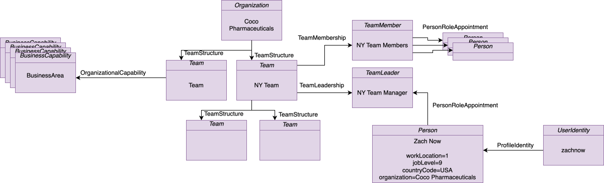
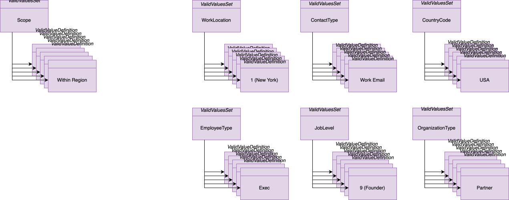
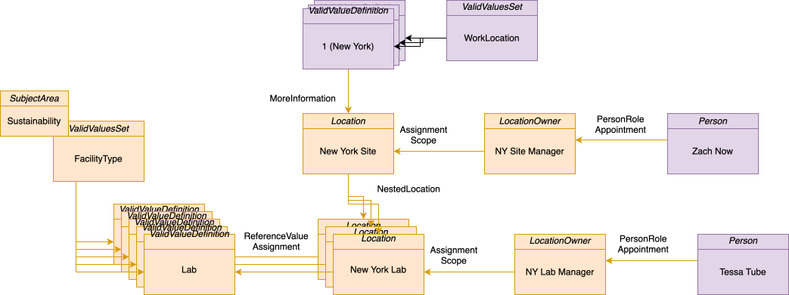
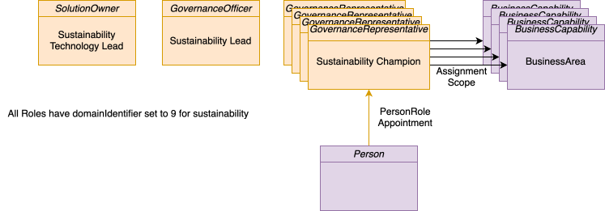
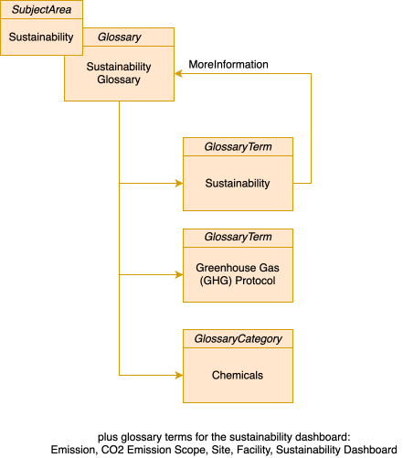
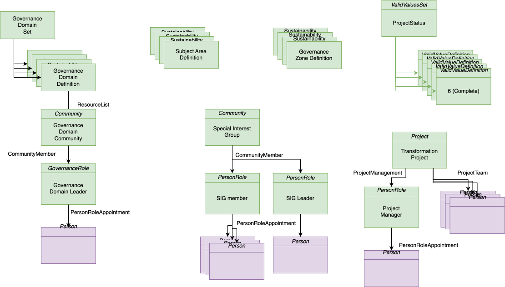
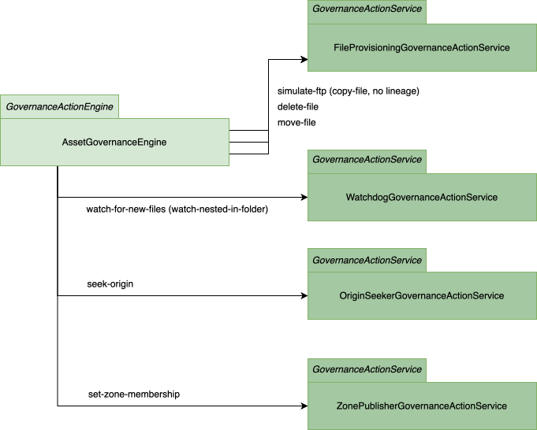

<!-- SPDX-License-Identifier: CC-BY-4.0 -->
<!-- Copyright Contributors to the Egeria project. -->

# Coco Pharmaceuticals Content Pack

The Coco Pharmaceuticals content packs supply the sample metadata for the [Coco Pharmaceuticals scenarios](/practices/coco-pharmaceuticals/).  They are useful to load when experimenting with Egeria's capabilities since they provide examples of many types of open metadata: people and organizations, governance definitions, glossaries, solution blueprints, information supply chains, IT systems and the data flows between them, templates and governance engines.

The *CocoComboArchive* (`CocoComboArchive.omarchive`) contains all of this metadata in a single content pack.  The same metadata is also supplied as six separate archives, so that different subsets can be loaded into different servers, as is done in the [Open Metadata Labs](/egeria-workspaces).  A seventh archive, *CocoTypes*, adds some specialized open metadata types.  All of the archives are found in the `content-packs` directory of the distribution, and are built by the [coco-metadata-archives :material-github:](https://github.com/odpi/egeria/tree/main/open-metadata-resources/open-metadata-samples/sample-metadata/coco-metadata-archives){ target=gh } module.

## The archives

| Archive | What it supplies | Main contents | Depends on |
|---|---|---|---|
| *CocoOrganizationArchive* | The base definitions for Coco Pharmaceuticals' organization and business capabilities: the profiles, user identities and teams of its people. | 248 *Person*s with their contact details, 21 *Organization*s, 45 *Team*s, 90 *PersonRole*s, 9 *BusinessCapability*s, the *Coco Pharmaceuticals Business Areas* root collection, and 6 reference data sets (such as `EmployeeType` and `JobLevel`) with 51 valid metadata values. | Open Metadata Types |
| *CocoGovernanceProgramArchive* | The core definition of Coco Pharmaceuticals' governance program. | 11 governance communities with their leaders, 11 *GovernanceRole*s, 35 *PersonRole*s, 25 *SubjectArea*s, 11 *Project*s, 8 *ITSubsystem*s, 3 clinical trial *CertificationType*s, a *LicenseType*, 3 *DataProcessingPurpose*s and 6 root collections (such as *Subject Areas*, *IT Systems Inventory* and *Strategic Solutions*). | Core Content Pack, *CocoOrganizationArchive* |
| *CocoSustainabilityArchive* | The base definitions for Coco Pharmaceuticals' sustainability initiative. | The *Sustainability Glossary* of 183 terms organized in 34 folders, 41 *GovernanceRole*s, 34 *PersonRole*s, 13 *Project*s, 37 *Location*s, the *Corporate Sustainability Reporting Directive (CSRD)* regulation, a business imperative, governance approaches, principle and responsibilities, and the sustainability community and its folio. | Core Content Pack, *CocoOrganizationArchive*, *CocoGovernanceProgramArchive* |
| *CocoClinicalTrialsTemplatesArchive* | The templates used for onboarding the weekly patient measurements received during a clinical trial. | Two *CSVFile* templates - one for the landing area and one for the data lake - each with a tabular schema of 4 columns linked to the 16-term *Coco Pharmaceuticals Clinical Trial Terminology* glossary. | Core Content Pack, *CocoGovernanceProgramArchive* |
| *CocoGovernanceEngineDefinitionsArchive* | The governance engines, solution blueprints and information supply chains for Coco Pharmaceuticals. | The *Clinical Trials Engine* (`ClinicalTrials@CocoPharmaceuticals`) with 6 governance action services, the *Asset Quality Survey Action Engine* (`AssetQuality@CocoPharmaceuticals`) with its survey action service, 7 governance action types, the *Onboard Landing Area Files For Clinical Trial Project* process, 8 *SolutionBlueprint*s (one is a template), 31 *SolutionComponent*s, 13 *SolutionActorRole*s and 11 *InformationSupplyChain*s. | Core, Egeria, Files, PostgreSQL and Unity Catalog content packs, *CocoGovernanceProgramArchive* |
| *CocoBusinessSystemsArchive* | A catalog of Coco Pharmaceuticals' business systems, the lineage between them and the load of their data into the data lake.  It simulates the type of metadata expected from an ETL tool suite, and was originally intended for the **cocoMDS5** server in the open metadata labs, although it can be used in any server. | 29 *SoftwareServer*s with their capabilities, 24 *Application*s, 24 *BareMetalComputer*s, and 51 *DataFlow* relationships. | The same content packs as *CocoGovernanceEngineDefinitionsArchive*, plus all four of the archives above |
| *CocoComboArchive* | All of the metadata in the six archives above, in one content pack. | The combined contents of the six archives. | Core, Egeria, Files, PostgreSQL and Unity Catalog content packs |
| *CocoTypes* (`CocoTypesArchive.omarchive`) | Additional open metadata types for Coco Pharmaceuticals.  It contains no metadata instances. | The `BiopsyScope` enumeration, the `BiopsyReport` entity type (a subtype of *Document*), the `BiopsySupportingEvidence` relationship type and the `ReviewedByClinicalTrials` classification type. | Open Metadata Types |

All of the archives also depend on the [Open Metadata Types](/content-packs/types-content-pack/overview) content pack.  The content packs they depend on that are supplied by Egeria are described in the [Core](/content-packs/core-content-pack/overview), [Egeria](/content-packs/egeria-content-pack/overview), [Files](/content-packs/files-content-pack/overview), [PostgreSQL](/content-packs/postgres-content-pack/overview) and [Unity Catalog](/content-packs/unity-catalog-content-pack/overview) content pack pages.

## CocoOrganizationArchive contents

The Coco Pharmaceuticals' department hierarchy:

The Coco Pharmaceuticals' valid values for defining an employee.

## CocoSustainabilityArchive contents

Extensions to the organization structure to support sustainability:

New sustainability roles:

New glossary for sustainability terminology.

## CocoClinicalTrialsTemplatesArchive contents

Clinical trial templates:

## CocoGovernanceProgramArchive contents

Governance program definition:

## CocoGovernanceEngineDefinitionsArchive contents

The governance engines and the request types that they support are:

| Governance engine | Request type | Governance service |
|---|---|---|
| *Clinical Trials Engine* (`ClinicalTrials@CocoPharmaceuticals`) | `set-up-clinical-trial` | Set up new clinical trial |
| | `set-up-data-lake` | Set up Data Lake to capture weekly patient measurements |
| | `nominate-hospital` | Nominates a hospital for a clinical trial (`nominate-hospital-for-clinical-trial-governance-action-service`) |
| | `certify-hospital` | Certifies that a hospital has legal and data management arrangements in place (`certify-hospital-for-clinical-trial-governance-action-service`) |
| | `onboard-hospital` | Onboard a Hospital into a Clinical Trial Governance Action Service |
| | `simulate-ftp` | File Copy Governance Action Service (with the service request type `copy-file`) |
| *Asset Quality Survey Action Engine* (`AssetQuality@CocoPharmaceuticals`) | `check-weekly-measurements-data-quality` | Validates that the data in a weekly measurements file passes data validation checks (`weekly-measurements-data-quality-survey-action-service`) |

The following figure shows an earlier design of the governance engine definitions, which used a single *AssetGovernance* engine.

--8<-- "snippets/abbr.md"
