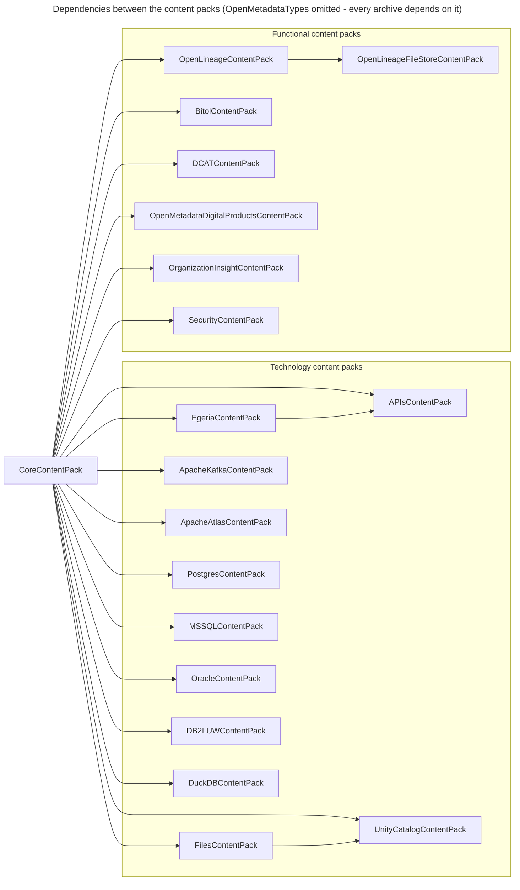

<!-- SPDX-License-Identifier: CC-BY-4.0 -->
<!-- Copyright Contributors to the Egeria project. -->

# Content Packs

A *content pack* is a ready-made set of open metadata that an Egeria deployment can load in one step.  Some content packs configure Egeria to work with a particular technology: they define the [connectors](/connectors), [integration groups](/concepts/integration-group), [governance engines](/concepts/governance-engine), [templates](/concepts/template), [technology types](/concepts/deployed-implementation-type) and [governance action processes](/concepts/governance-action-process) needed to catalog and govern it.  Others supply reusable reference content, such as security control catalogs, or sample metadata for the Coco Pharmaceuticals scenarios.

Each content pack is an [Open Metadata Archive](/concepts/open-metadata-archive) file (`.omarchive`), shipped in the `content-packs` directory of the *omag-server-platform* distribution.  A content pack can be loaded when a [metadata access store](/concepts/metadata-access-store) starts up (see [Configuring the Start-up Archives](/guides/admin/servers/by-server-type/configuring-a-metadata-access-store)) or while it is running (see the [Runtime Manager API](/services/omvs/runtime-manager/overview)).  Loading the same content pack again is harmless: every element keeps the same unique identifier from one release to the next, so a reload updates what is already there rather than creating a second copy.

As a content pack loads, the integration groups it defines are picked up by any [integration daemon](/concepts/integration-daemon) configured to run them, and its governance engines are picked up by any [engine host](/concepts/engine-host), so the connectors start working without further configuration.

## How the content packs depend on one another

Every content pack depends on the *OpenMetadataTypes* archive, which holds the type definitions, and almost all of them build on the *CoreContentPack*, which supplies the base connector types, generic governance services and the shared collection folders that the other packs add their content to.  A content pack must be loaded after the content packs it depends on.

## Technology content packs

These content packs configure Egeria to work with a particular technology.

| Content pack | Archive file | What it provides |
|---|---|---|
| [Core Content Pack](/content-packs/core-content-pack/overview) | `CoreContentPack.omarchive` | The connector types for every connector supplied by Egeria, the valid metadata values and technology types they use, generic templates, governance engines and processes, and the integration groups for Egeria's own housekeeping.  The starting point for every deployment. |
| [Egeria Content Pack](/content-packs/egeria-content-pack/overview) | `EgeriaContentPack.omarchive` | Templates and connectors for cataloguing and monitoring the Egeria infrastructure itself: platforms and servers. |
| [Files Content Pack](/content-packs/files-content-pack/overview) | `FilesContentPack.omarchive` | Templates, connectors and governance services for surveying and cataloguing the files in a file system. |
| [Open APIs Content Pack](/content-packs/apis-content-pack/overview) | `APIsContentPack.omarchive` | The connector that catalogs the operations of an API through its Open API (swagger) specification. |
| [Apache Kafka Content Pack](/content-packs/apache-kafka-content-pack/overview) | `ApacheKafkaContentPack.omarchive` | Templates, connectors and governance services for Apache Kafka servers and their topics. |
| [Apache Atlas Content Pack](/content-packs/apache-atlas-content-pack/overview) | `ApacheAtlasContentPack.omarchive` | Templates, connectors and governance services for exchanging metadata with Apache Atlas. |
| [PostgreSQL Content Pack](/content-packs/postgres-content-pack/overview) | `PostgresContentPack.omarchive` | Templates, connectors and governance services for surveying and cataloguing PostgreSQL servers and databases. |
| [Microsoft SQL Server Content Pack](/content-packs/mssql-content-pack/overview) | `MSSQLContentPack.omarchive` | Templates, connectors and governance services for surveying and cataloguing Microsoft SQL Servers and databases. |
| [Oracle Database Content Pack](/content-packs/oracle-content-pack/overview) | `OracleContentPack.omarchive` | Templates, connectors and governance services for surveying and cataloguing Oracle Database servers and pluggable databases. |
| [Db2 for LUW Content Pack](/content-packs/db2luw-content-pack/overview) | `DB2LUWContentPack.omarchive` | Templates, connectors and governance services for surveying and cataloguing IBM Db2 for Linux, UNIX and Windows servers and databases. |
| [DuckDB Content Pack](/content-packs/duckdb-content-pack/overview) | `DuckDBContentPack.omarchive` | Templates, connectors and governance services for surveying and cataloguing DuckDB databases, including their attached and federated data sources. |
| [Unity Catalog Content Pack](/content-packs/unity-catalog-content-pack/overview) | `UnityCatalogContentPack.omarchive` | Templates, connectors and governance services for exchanging metadata with Unity Catalog. |

## Functional content packs

These content packs support a capability that spans technologies.

| Content pack | Archive file | What it provides |
|---|---|---|
| [Open Lineage Content Pack](/content-packs/open-lineage-content-pack/overview) | `OpenLineageContentPack.omarchive` | Connectors that capture OpenLineage events, harvest assets and lineage from them, and generate and distribute OpenLineage events for governance action processes. |
| [Open Lineage File Store Content Pack](/content-packs/open-lineage-file-store-content-pack/overview) | `OpenLineageFileStoreContentPack.omarchive` | Saves the OpenLineage events received and generated by Egeria as JSON files in the platform's `logs/openlineage` directory. |
| [Bitol Content Pack](/content-packs/bitol-content-pack/overview) | `BitolContentPack.omarchive` | Connectors that receive, catalog, generate and store Bitol Open Data Contract Standard (ODCS) and Open Data Product Standard (ODPS) documents. |
| [DCAT Content Pack](/content-packs/dcat-content-pack/overview) | `DCATContentPack.omarchive` | Connectors that receive, catalog and publish descriptions of data assets in the W3C Data Catalog Vocabulary (DCAT). |
| [Open Metadata Digital Products Content Pack](/content-packs/products-content-pack/overview) | `OpenMetadataDigitalProductsContentPack.omarchive` | Open metadata collections packaged into dynamic digital products. |
| [Organization Insight Content Pack](/content-packs/organization-insight-content-pack/overview) | `OrganizationInsightContentPack.omarchive` | Services that monitor, analyse and capture insight into organization activity and effectiveness. |
| [Security Content Pack](/content-packs/security-content-pack/overview) | `SecurityContentPack.omarchive` | The NIST Cybersecurity Framework (CSF) 2.0 and NIST SP 800-53 Rev. 5 control catalogs, for use in statements of applicability, threat models and security programs. |

## Types and samples

| Archive | Archive file | What it provides |
|---|---|---|
| [Open Metadata Types](/content-packs/types-content-pack/overview) | `OpenMetadataTypes.omarchive` | All the open metadata type definitions provided by Egeria.  OMAG servers load these types themselves at start up; the archive is supplied for external utilities. |
| [Coco Pharmaceuticals](/content-packs/coco-content-pack/overview) | `CocoComboArchive.omarchive` and seven subset archives | Sample metadata for the [Coco Pharmaceuticals](/practices/coco-pharmaceuticals) scenarios.  It is a useful archive to load when experimenting with Egeria, since it provides examples of many types of open metadata. |
| [Simple Catalog](/content-packs/simple-content-pack/overview) | `SimpleCatalog.omarchive` and four subset archives | A small example of a database, an API and an event structure linked to a glossary term, also split into four archives for demonstrating a cohort. |

!!! summary "Usage"
    A new deployment normally starts with the *CoreContentPack*, followed by the technology content packs for the technologies it needs to work with, and then any functional content packs.  The Egeria quickstart loads the core, technology and functional content packs it demonstrates, followed by the Coco Pharmaceuticals and Simple Catalog samples.

!!! education "Further information"
    * [Creating content packs](/guides/developer/open-metadata-archives/creating-content-packs) describes how the content packs are built.
    * The [Template Catalog](/catalog-templates) lists the templates that the content packs supply.
    * The [Connector Catalog](/connectors) lists the connectors that they configure.

--8<-- "snippets/abbr.md"
