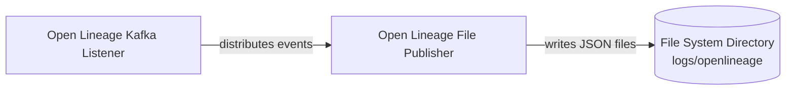

<!-- SPDX-License-Identifier: CC-BY-4.0 -->
<!-- Copyright Contributors to the Egeria project. -->

# Open Lineage File Store Content Pack

The *OpenLineageFileStoreContentPack* switches on the saving of [OpenLineage](https://openlineage.io) events as files.  Once it is loaded, every open lineage event that Egeria receives or generates is written as a JSON file in the platform's `logs/openlineage` directory.  It is a very small content pack: it adds no new connectors or reference data of its own, it simply registers a connector defined in the [Open Lineage Content Pack](/content-packs/open-lineage-content-pack/overview) with the integration group that runs it.

The content pack is found in the `OpenLineageFileStoreContentPack.omarchive` file in the `content-packs` directory of the distribution.  It depends on the [Core Content Pack](/content-packs/core-content-pack/overview) and the [Open Lineage Content Pack](/content-packs/open-lineage-content-pack/overview), which must be loaded first.  It is built by the [core-content-pack :material-github:](https://github.com/odpi/egeria/tree/main/open-metadata-resources/open-metadata-archives/core-content-pack){ target=gh } module.

## Why it is a separate content pack

The file-based log store writes one file for every event and nothing removes old files from the directory, so on a busy platform the directory grows without bound.  It is useful for a small or demonstration deployment, where being able to read the events directly is helpful, but a long-running deployment is better served by the *OpenLineagePostgresPublisher* in the Open Lineage Content Pack, which keeps the events in a PostgreSQL schema and removes them after a configurable number of days.  Keeping the registration in its own content pack lets each deployment choose.

Egeria's default runtime, built from the Egeria repository, loads this content pack into its *active-metadata-store* straight after the Open Lineage Content Pack.

## Contents

| Element | Details |
|---|---|
| Integration connector registration | Registers the *OpenLineageFilePublisherIntegrationConnector* with the *OpenLineageIntegrationGroup* (`Egeria:IntegrationGroup:OpenLineage`) as `OpenLineageFilePublisher` (user `olfilepubnpa`, refreshes every 60 minutes, with connector activity reports).  The connector and the integration group are both defined in the Open Lineage Content Pack, and the connector's connection points it at the `logs/openlineage` directory. |
| Solution blueprint | *Open Lineage File Store Content Pack* (`Egeria::SolutionBlueprint::OpenLineageFileStoreContentPack`), made up of the *Open Lineage Kafka Listener* and *Open Lineage File Publisher* solution components and interacting with a *File System Directory*.  The blueprint is filed in the *Content Pack Contents* folder of the design library. |

The connector is the File-based Open Lineage Log Store integration connector, described in the [openlineage-integration-connectors :material-github:](https://github.com/odpi/egeria/tree/main/open-metadata-implementation/adapters/open-connectors/integration-connectors/openlineage-integration-connectors){ target=gh } module.

The solution blueprint is summarised below, drawn by hand from the content of the archive (the quickstart used to generate the other blueprint graphs does not load this pack).  The wire between the two components is defined in the Open Lineage Content Pack.

!!! note "The Open Lineage Content Pack also registers the file publisher"
    In this release, the shipped `OpenLineageContentPack.omarchive` still contains its own registration of the *OpenLineageFilePublisher*, so the file publisher runs once the Open Lineage Content Pack is loaded, whether or not this pack is loaded too.

!!! summary "Usage"
    Load this content pack after the Open Lineage Content Pack into a [metadata access store](/concepts/metadata-access-store) with the [Runtime Manager](/services/omvs/runtime-manager/overview), or add it to the server's start-up archives.  Leave it out if you keep your open lineage events in PostgreSQL.

    [Leveraging Open Lineage](/egeria-solutions/leveraging-open-lineage/overview) describes how to capture and use open lineage events with Egeria.

--8<-- "snippets/abbr.md"
