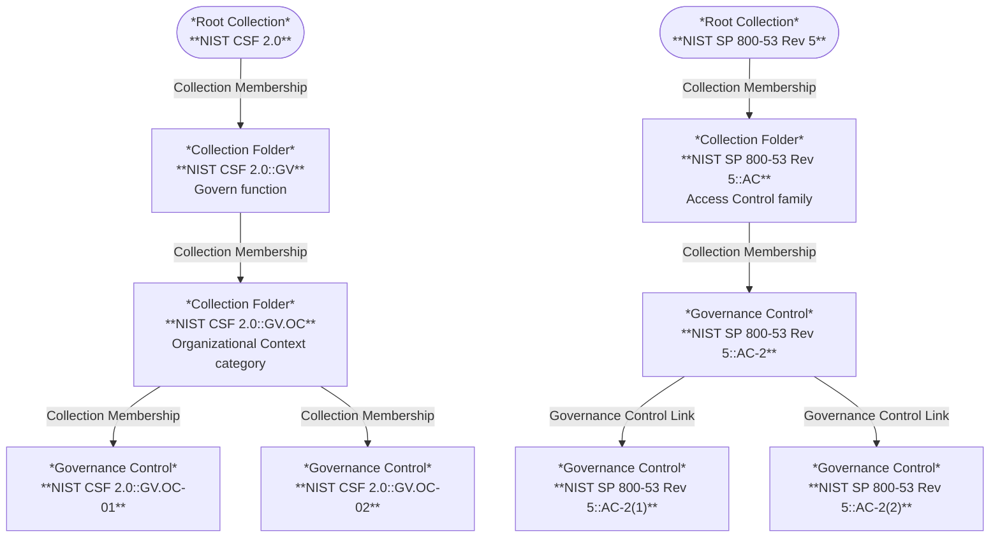

<!-- SPDX-License-Identifier: CC-BY-4.0 -->
<!-- Copyright Contributors to the Egeria project. -->

# Security Content Pack

The *SecurityContentPack* contains two standard security control catalogs: the NIST Cybersecurity Framework (CSF) 2.0 and NIST SP 800-53 Revision 5.  They give a security team a ready-made set of controls to link to a [statement of applicability](/types/4/0423-Security-Definitions#statements-of-applicability), to use as mitigations in a [threat model](/egeria-solutions/threat-modelling/overview), or to map the organization's own controls to.

Unlike the [Core Content Pack](/content-packs/core-content-pack/overview), it is not loaded automatically.  Load it into a metadata access store with the [Runtime Manager API](/services/omvs/runtime-manager/overview) when it is needed, or add it to the server's start-up archives.  It depends on the Core Content Pack.

The content pack is found in the `SecurityContentPack.omarchive` file in the `content-packs` directory of the distribution, and is built by the [core-content-pack :material-github:](https://github.com/odpi/egeria/tree/main/open-metadata-resources/open-metadata-archives/core-content-pack){ target=gh } module.

## Contents

Each catalog is a *RootCollection* with a *CollectionFolder* for each part of the catalog.  Each control is a [*GovernanceControl*](/types/4/0420-Governance-Controls) in the `Security` governance domain, so it can be linked to a statement of applicability with the *ControlApplicability* relationship.

| Catalog | Qualified name of the root | Structure | Controls |
|---|---|---|---|
| NIST Cybersecurity Framework (CSF) 2.0 | `NIST CSF 2.0` | 6 function folders, such as `NIST CSF 2.0::GV`, each holding a folder for each of its categories, such as `NIST CSF 2.0::GV.OC` (22 category folders in all) | 106 subcategories, such as `NIST CSF 2.0::GV.OC-01` |
| NIST SP 800-53 Rev. 5 Security and Privacy Controls (catalog version 5.2.0) | `NIST SP 800-53 Rev 5` | 20 control family folders | 300 controls, such as `NIST SP 800-53 Rev 5::AC-2`, and 714 control enhancements, such as `NIST SP 800-53 Rev 5::AC-2(1)` |

In all, the content pack holds 2 *RootCollection*s, 48 *CollectionFolder*s and 1,120 *GovernanceControl*s.

* **CSF subcategories** carry their identifier, their outcome statement as the summary and description, and NIST's implementation examples as the usage.
* **SP 800-53 controls and enhancements** carry their NIST label as the identifier, the label and title as the display name, the control statement as the description and the discussion as the usage.  Parameters that the organization defines are shown as NIST publishes them, for example `[Assignment: organization-defined time period]`.  Each control enhancement is linked to the control it strengthens with the *GovernanceControlLink* relationship, rather than being a member of the control family folder.
* **Withdrawn controls** are left out of both catalogs.

The following diagram illustrates the structure of the catalogs, using a few of their elements as examples.  (The Security Content Pack is not loaded in Egeria's quickstart, so this diagram is drawn by hand rather than generated.)

The catalogs are generated from NIST's [OSCAL catalogs](https://github.com/usnistgov/oscal-content), which are works of the U.S. Government in the public domain.  The source, version and license of each catalog are recorded in the additional properties of its root collection.

!!! education "Further information"
    * The [Threat Modelling](/egeria-solutions/threat-modelling/overview) solution uses these controls as mitigations.
    * The six [STRIDE](/egeria-solutions/threat-modelling/overview#threat-elicitation) threats and the *CertificationType* for ISO/IEC 27001:2022 are in the [Core Content Pack](/content-packs/core-content-pack/overview), since they are small and widely used.  The text of ISO/IEC 27001 belongs to ISO, so its Annex A controls are not supplied.

--8<-- "snippets/abbr.md"
