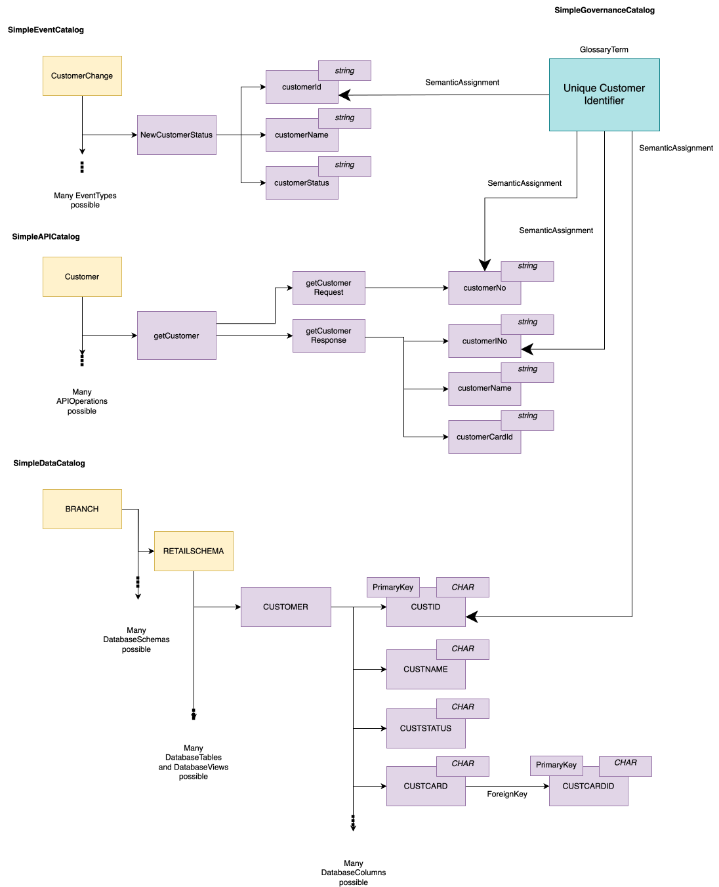

---
hide:
- toc
---

<!-- SPDX-License-Identifier: CC-BY-4.0 -->
<!-- Copyright Contributors to the Egeria project. -->

# Simple Content Pack

The *SimpleCatalog* content pack (`SimpleCatalog.omarchive`) provides a small example of a database, an API and an event structure, each describing customer details, linked to a glossary term and to one another through an information supply chain.  It is loaded automatically by the *simple-metadata-store* sample server, which uses an in-memory repository, so each time the server is restarted it starts again with just the content of this archive.

It contains:

* **A database** - the *BRANCH Database* (`Database::V37B8752.FH567.sys/BRANCH`), with its *RETAILSCHEMA* database schema and the *CUSTOMER* table of four columns (`CUSTID`, `CUSTNAME`, `CUSTSTATUS` and `CUSTCARD`).  The archive also contains a *BareMetalComputer* for the host `V37B8752.FH567.sys` that the database is named after, although no relationship links the two.
* **An API** - the *Customer API* (`DeployedAPI::global-api-gateway/CustomerDomain/APIs/Customer`) with its *Get Customer Operation*, whose request and response parameter lists hold four parameters.
* **An event structure** - the *CustomerChangeTopic* topic (`Topic::global-event-bus/CustomerDomain/Topics/CustomerChange`) and its *New Customer Status Event Type*, with three attributes.
* **Governance definitions** - the *Simple Catalog Glossary* with the *UniqueCustomerIdentifier* glossary term, which is semantically assigned to the customer identifier in the database, API and event, and the *Simple Catalog Information Supply Chain*.  Data flows show customer details passing from the API to the database schema, and from the schema to the topic, and data mappings show how the individual columns, parameters and attributes correspond.

The same metadata is also supplied as four archives for a demonstration of four metadata access stores connected together in a single [cohort](/concepts/cohort-member).  Each archive is loaded into a different server, and the cohort then shows how metadata from different catalogs is integrated.  These archives are used in the *Development labs* that are part of the [Open Metadata Labs](/egeria-workspaces).

| Archive | Contents | Depends on |
|---|---|---|
| *SimpleAPICatalog* | API metadata typically found in an API catalog: the *Customer API*, its operation and its parameters. | Open Metadata Types |
| *SimpleDataCatalog* | Database metadata typically found in a data catalog: the *BRANCH Database*, its host, schema, table and columns. | Open Metadata Types |
| *SimpleEventCatalog* | Event metadata typically found in an event catalog: the *CustomerChangeTopic* topic and its event type. | Open Metadata Types |
| *SimpleGovernanceCatalog* | The glossary, glossary term and information supply chain, and the relationships that link them to the metadata elements in the API, data and event catalogs. | Open Metadata Types, *SimpleAPICatalog*, *SimpleDataCatalog*, *SimpleEventCatalog* |

This picture shows how the simple catalog's metadata is distributed between the four archives.

All five archives are found in the `content-packs` directory of the distribution, and are built by the [simple-catalogs :material-github:](https://github.com/odpi/egeria/tree/main/open-metadata-resources/open-metadata-samples/sample-metadata/simple-catalogs){ target=gh } module.

--8<-- "snippets/abbr.md"
