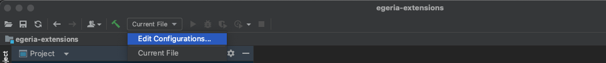
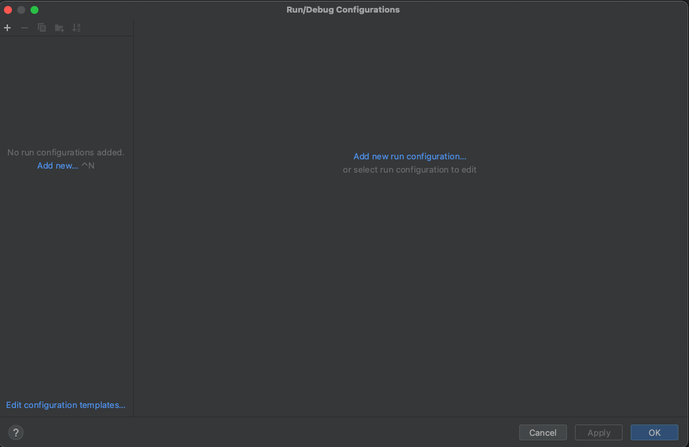
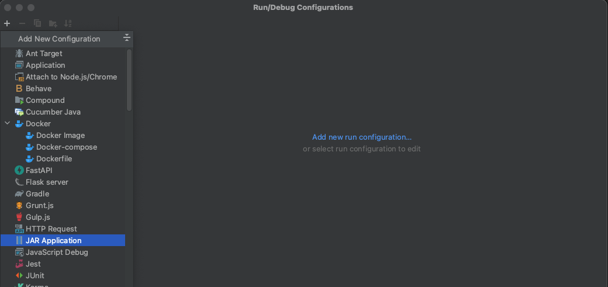
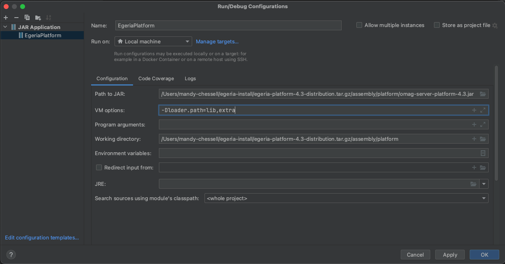
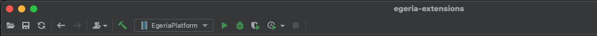
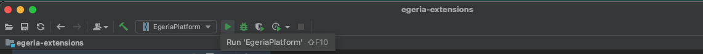
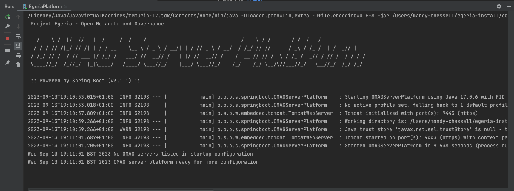

<!-- SPDX-License-Identifier: CC-BY-4.0 -->
<!-- Copyright Contributors to the Egeria project. -->

### Set up OMAG Server Platform in IntelliJ

The next set of instructions makes it easy to start and stop an OMAG Server Platform from IntelliJ.

Select `Edit Configurations` from the dropdown run menu.



Click on the `+` sign in the top left of the wizard.



Select `JAR Application`:



Fill in the properties based on the directory where you installed egeria.  The settings are:

* Path to JAR: `{install directory}/assembly/platform/omag-server-platform-{release}.jar` - for example, `omag-server-platform-6.2.jar`
* VM Options: `-Dloader.path=lib,extra`
* Working Directory: `{install directory}/assembly/platform`



Press `OK` to save the configuration and `EgeriaPlatform` appears in the dropdown run menu.



Press the green triangle to run the platform.



A new panel appears in the IntelliJ window showing the platform is starting up.



When you see the message `OMAG server platform ready for more configuration` then the platform has initialized.

### Check the platform is running

Egeria's assembly includes collections of HTTP requests for IntelliJ's HTTP client in the `{install directory}/assembly/opt/http-client-collections` directory.  The `Egeria-platform-services.http` collection calls the [Platform Services](/services/platform-services/overview) and is useful to check that your platform is running correctly.

Open `Egeria-platform-services.http` in IntelliJ.  The variables at the top of the file set the platform URL (`@baseURL=https://localhost:7443`) and the user that calls the platform.  Run the `Get OMAG Server Platform Origin` request by clicking on the green triangle next to it.  This request does not need a bearer token, so it is a simple check that the platform is running.  The response is:

```text
Egeria OMAG Server Platform (version {release})
```

The other requests in the collection need a bearer token.  Run the `Token (RequestBody)` request at the top of the file first - it stores the token it receives in the `token` variable used by the later requests.  For example, `Get all active servers` lists the servers running on the platform.  At this stage there are none.

??? tip "SSL errors from the HTTP client"
    The platform uses a self-signed certificate.  If IntelliJ's HTTP client rejects it, select the `Egeria` environment from the dropdown at the top of the `.http` file and add the following to that environment in the `http-client.private.env.json` file in the same directory:

    ```json
    "SSLConfiguration": {
      "verifyHostCertificate": false
    }
    ```
