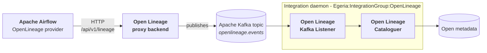

<!-- SPDX-License-Identifier: CC-BY-4.0 -->
<!-- Copyright Contributors to the Egeria project. -->

# Leveraging Apache Airflow

[Apache Airflow](https://airflow.apache.org/) orchestrates data pipelines as *DAGs* - directed acyclic graphs of *tasks* that copy, transform and publish data on a schedule.  Its DAGs are often where an organization's real data movement is defined, so knowing what they read and write, and how often they run, is a large part of understanding the data estate.

Egeria integrates with Airflow through [Open Lineage](/egeria-solutions/leveraging-open-lineage/overview).  Airflow's [OpenLineage provider](https://airflow.apache.org/docs/apache-airflow-providers-openlineage/stable/index.html) emits a standard Open Lineage *RunEvent* each time a DAG or task starts, completes or fails, describing the job, its run and the datasets it read and wrote.  Egeria receives these events and catalogues what they describe, so Airflow's pipelines appear in open metadata - and in its lineage graph - alongside the data stores that other connectors have catalogued, with no Airflow-specific code in Egeria.

* [Leveraging Open Lineage](/egeria-solutions/leveraging-open-lineage/overview) describes how Egeria receives, stores, catalogues and analyses Open Lineage events.
* [The Open Lineage Standard](/features/lineage-management/overview/#the-open-lineage-standard) describes the structure of a run event and its facets.


## How Airflow's lineage reaches Egeria


> **Figure 1:** Airflow's Open Lineage events reach the Open Lineage Cataloguer through the Open Lineage proxy backend and an Apache Kafka topic

1. Airflow's OpenLineage provider sends each run event over HTTP to the Open Lineage project's *proxy backend*, which publishes it to an Apache Kafka topic.
2. The *Open Lineage Kafka Listener* integration connector, running in an [integration daemon](/concepts/integration-daemon), receives the event from the topic and passes it to the other Open Lineage connectors in the daemon.
3. The *Open Lineage Cataloguer* integration connector catalogues what the event describes.

Both connectors are in the *Egeria:IntegrationGroup:OpenLineage* [integration group](/concepts/integration-group), defined in the Open Lineage content pack, along with the [log store connectors](/egeria-solutions/leveraging-open-lineage/overview/#storing-events-the-open-lineage-log-store) that can archive the raw events at the same time.

The integration daemon can also receive events directly, on its REST API at `{platformURLRoot}/servers/{integrationDaemonName}/open-metadata/integration-daemon/publish-open-lineage-event`.  This avoids the proxy backend and Kafka, but every call needs a [bearer token](/guides/admin/configuring-the-omag-server-platform), and a token is only valid for the platform's `bearerTokenTimeout` (one hour by default).  The proxy backend is the better choice for an Airflow deployment that runs continuously.

### What is catalogued

The [Open Lineage Cataloguer](/egeria-solutions/leveraging-open-lineage/overview/#cataloguing-the-events) turns each Airflow event into open metadata:

* Each **DAG** becomes an *Apache Airflow DAG* process and each **task** an *Apache Airflow Task* process, created from their [catalog templates](/features/templated-cataloguing/overview).  The task is owned by its DAG through a *ProcessHierarchy* relationship, from the event's *parent* run facet.  The job's namespace is the one set in Airflow's OpenLineage configuration.
* The **datasets** that a task reads and writes are matched to the elements that already describe them - for example, the tables that the PostgreSQL connectors have catalogued - and are only created when nothing describes them yet.
* The task's process is linked to its inputs and outputs by **lineage relationships**: a *DataFlow* for a data asset, and a *DataMapping* for a relational table, with a *DataFlow* added between the table's asset and the process.  Each records in its *derivation* the part of the event it came from, such as `derived from OpenLineage run inputs and outputs`.
* **Run metrics** - run counts, failures, times, durations and data volumes - are kept in the *RunMetrics* classification of the task's process.


## Setting up Airflow

1. **Install the OpenLineage provider**, `apache-airflow-providers-openlineage`, in the Airflow environment.  Adding custom run facets, described below, needs version 1.10.0 or later.

2. **Point the provider at the proxy backend** with its transport configuration - the `[openlineage] transport` option, or the `AIRFLOW__OPENLINEAGE__TRANSPORT` environment variable - and give the Airflow instance a namespace:

    ```bash
    AIRFLOW__OPENLINEAGE__TRANSPORT='{"type": "http", "url": "http://openlineage-proxy:6000", "endpoint": "api/v1/lineage"}'
    AIRFLOW__OPENLINEAGE__NAMESPACE=my-airflow-instance
    ```

    The URL is the address of your proxy backend.  The provider can also publish to the Kafka topic itself, without the proxy, using the Open Lineage client's [Kafka transport](https://openlineage.io/docs/client/python/configuration#kafka) - this needs the `openlineage-python[kafka]` package in the Airflow environment:

    ```bash
    AIRFLOW__OPENLINEAGE__TRANSPORT='{"type": "kafka", "topic": "openlineage.events", "config": {"bootstrap.servers": "kafka-host:9092"}}'
    ```

    A *composite* transport sends each event to several destinations, so Airflow can feed Egeria and another Open Lineage service, such as Marquez, at once.  The full set of options is in the provider's [configuration reference](https://airflow.apache.org/docs/apache-airflow-providers-openlineage/stable/configurations-ref.html).

3. **Set up the integration daemon** with the *Egeria:IntegrationGroup:OpenLineage* integration group, and attach the Kafka topic to the Open Lineage Kafka Listener as a [catalog target](/concepts/catalog-target).  The Egeria Workspaces notebook [Receiving Open Lineage events from Apache Kafka :material-github:](https://github.com/odpi/egeria-workspaces/blob/main/workbooks/cataloguing-and-surveys/apache-kafka/kafka-open-lineage-events.ipynb){ target=gh } walks through these steps.


## Egeria's custom facet

Open Lineage events can carry [custom facets](/openlineage/facets) alongside the standard ones.  Egeria defines the **`egeria_informationSupplyChain`** run facet, which any producer can add to a run to name the [information supply chains](/concepts/information-supply-chain) that the run moves data along - one in `iscQualifiedName`, or several in `iscQualifiedNames`.  Its schema is [EgeriaInformationSupplyChainRunFacet.json](/openlineage/facets/1-1-0/EgeriaInformationSupplyChainRunFacet.json).

```json
"egeria_informationSupplyChain": {
  "_producer": "https://github.com/apache/airflow/tree/providers-openlineage/<version>",
  "_schemaURL": "https://egeria-project.org/openlineage/facets/1-1-0/EgeriaInformationSupplyChainRunFacet.json#/$defs/EgeriaInformationSupplyChainRunFacet",
  "iscQualifiedNames": ["InformationSupplyChain::Orders", "InformationSupplyChain::Invoicing"]
}
```

When the Open Lineage Cataloguer receives an event with this facet, it tags every lineage relationship that it creates from the event - and every *DataSetContent* link from a data set to the physical data it is a view over - with the facet's information supply chains.  The lineage relationships are multi-link, so each is created once for each supply chain.  This is what places an Airflow task in the right supply chain when the supply chain's implementation is displayed, and the supply chains are carried up from there by the [Darwin Product Dependency Manager](/features/lineage-management/overview/#rolling-up-the-lineage) onto the data flows between servers and the dependencies between digital products.

Airflow does not know which information supply chains its tasks belong to, so the facet is added by a *custom run facet function* that the OpenLineage provider calls for each task event.

### Adding the facet in Airflow

The provider calls a custom run facet function with the task instance and its state, and adds the facets it returns to the event's run.  The function below looks up the information supply chains of each task in a table, and returns no facet for a task that is not part of any supply chain:

```python
# egeria_lineage_facets.py
from __future__ import annotations

import attrs
from airflow.providers.common.compat.openlineage.facet import RunFacet

FACET_NAME = "egeria_informationSupplyChain"

# The information supply chains that each task moves data along, keyed by (dag_id, task_id).
# The values are the qualified names of the InformationSupplyChain elements in Egeria.
SUPPLY_CHAINS = {
    ("load_orders", "copy_to_warehouse"): ["InformationSupplyChain::Orders"],
    ("publish_sales", "publish"): ["InformationSupplyChain::Orders", "InformationSupplyChain::Invoicing"],
}


@attrs.define
class EgeriaInformationSupplyChainRunFacet(RunFacet):
    """Names the Egeria information supply chains that a run is part of."""

    iscQualifiedNames: list[str]

    @staticmethod
    def _get_schema() -> str:
        return ("https://egeria-project.org/openlineage/facets/1-1-0/EgeriaInformationSupplyChainRunFacet.json"
                "#/$defs/EgeriaInformationSupplyChainRunFacet")


def information_supply_chain(task_instance, ti_state) -> dict[str, RunFacet] | None:
    """Return the egeria_informationSupplyChain facet for the task, if it is part of any supply chain."""
    if task_instance is None:
        return None

    chains = SUPPLY_CHAINS.get((task_instance.dag_id, task_instance.task_id))

    if not chains:
        return None

    return {FACET_NAME: EgeriaInformationSupplyChainRunFacet(iscQualifiedNames=chains)}
```

The `_get_schema` method supplies the facet's `_schemaURL`; its `_producer` is filled in automatically.  The table can of course come from anywhere - a configuration file, or the information supply chains that Egeria itself holds, retrieved through its APIs.

[coco_lineage_facets.py :material-github:](https://github.com/odpi/egeria-workspaces/blob/main/exchange-quickstart/coco-dags/coco_lineage_facets.py){ target=gh } in Egeria Workspaces is a working version of this function for the Coco Pharmaceuticals DAGs.  It reads each task's information supply chains from a JSON file generated from the strategic digital products' dependencies and subscriptions, and for a task along a single supply chain it also sets `iscQualifiedName`, so that its events are understood by releases of Egeria that only know version 1-0-0 of the facet.

Register the function with the provider's `[openlineage] custom_run_facets` option, or the `AIRFLOW__OPENLINEAGE__CUSTOM_RUN_FACETS` environment variable, as its full import path.  Several functions can be listed, separated by semicolons:

```bash
AIRFLOW__OPENLINEAGE__CUSTOM_RUN_FACETS=egeria_lineage_facets.information_supply_chain
```

The module must be importable by every Airflow component that emits events - the scheduler and the workers - so put it on their Python path (for example with `PYTHONPATH`).  It is not a DAG, so if it is kept in a DAG folder, list it in `.airflowignore` so that the DAG processor does not try to parse it.

!!! tip "Earlier releases of Egeria"
    `iscQualifiedNames` was added in version 1-1-0 of the facet, in Egeria 6.3.  For an earlier release of Egeria, use version [1-0-0](/openlineage/facets/1-0-0/EgeriaInformationSupplyChainRunFacet.json) of the schema, which names a single supply chain in `iscQualifiedName`.

### Checking that the facet is received

After a task with a supply chain has run, the lineage relationships between its process and its inputs and outputs carry the supply chain in their *iscQualifiedName*.  Retrieving the [information supply chain](/concepts/information-supply-chain) with its implementation shows the task's lineage in its **Data Fabric** subgraph.  If the relationships are not tagged, check that the event that reached Egeria contains the facet - for example in the [File-based Open Lineage Log Store](/egeria-solutions/leveraging-open-lineage/overview/#storing-events-the-open-lineage-log-store) - and that the facet's name and property names are spelled exactly as above.


## Trying it out with Egeria Workspaces

[Egeria Workspaces :material-github:](https://github.com/odpi/egeria-workspaces){ target=gh } includes an optional [Apache Airflow and Marquez runtime :material-github:](https://github.com/odpi/egeria-workspaces/blob/main/compose-configs/optional-associated-runtimes/airflow-marquez/README.md){ target=gh } that runs alongside the Egeria Quickstart.  Airflow is pre-configured with the OpenLineage provider, and its `switch-lineage.sh` script sends the events to Marquez, to Egeria through the Open Lineage proxy backend and the `openlineage.events` topic, or to both.

The runtime also loads the [Coco Pharmaceuticals DAGs :material-github:](https://github.com/odpi/egeria-workspaces/blob/main/exchange-quickstart/coco-dags/README.md){ target=gh }, which simulate the company's day-to-day activity, fill the Data Sharing Hub's digital products and deliver their subscriptions.  Their events already carry the `egeria_informationSupplyChain` facet: the runtime registers `coco_lineage_facets.information_supply_chain` in `AIRFLOW__OPENLINEAGE__CUSTOM_RUN_FACETS`, and adds the DAG bundle's folder to `PYTHONPATH` so that the scheduler and workers can import it.


## Related information

* [Leveraging Open Lineage](/egeria-solutions/leveraging-open-lineage/overview) - how Egeria receives, stores, catalogues and analyses Open Lineage events.
* [Egeria's Open Lineage Facets](/openlineage/facets) - the custom facets that Egeria defines, and their schemas.
* [Lineage Management](/features/lineage-management/overview) - how captured lineage is stitched together, rolled up and used.
* [Apache Airflow OpenLineage provider](https://airflow.apache.org/docs/apache-airflow-providers-openlineage/stable/index.html) - including its [configuration reference](https://airflow.apache.org/docs/apache-airflow-providers-openlineage/stable/configurations-ref.html).
* [Open Lineage Python client configuration](https://openlineage.io/docs/client/python/configuration) - the transports that the provider can use.

--8<-- "snippets/abbr.md"
