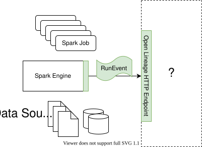
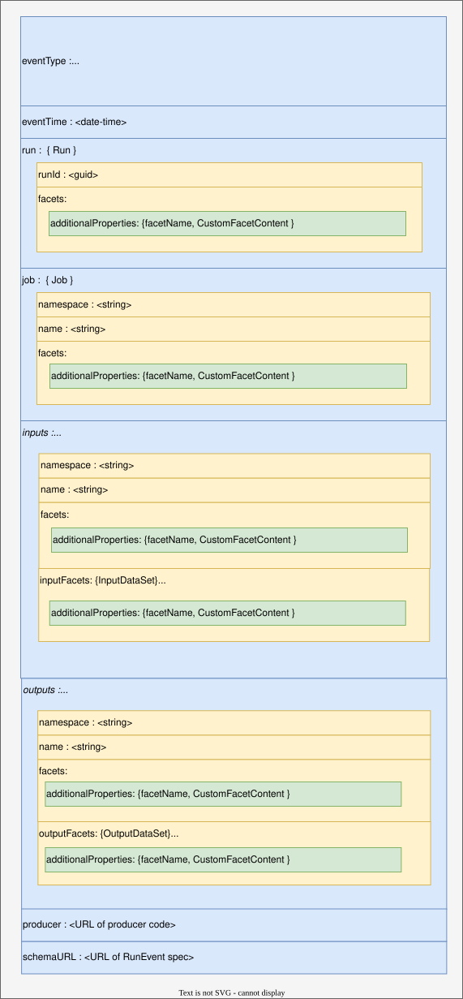
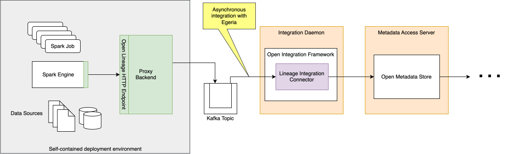
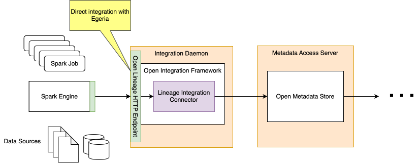
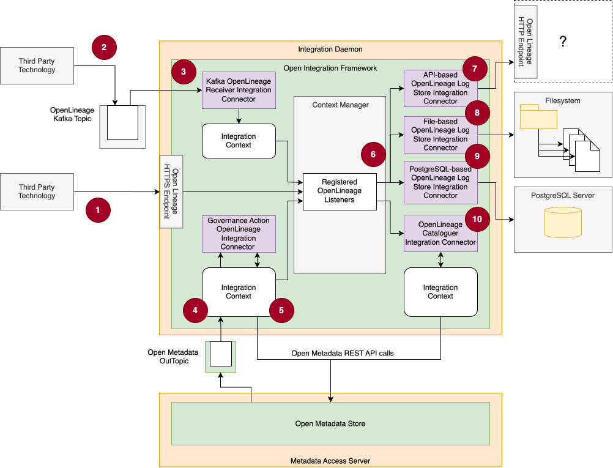
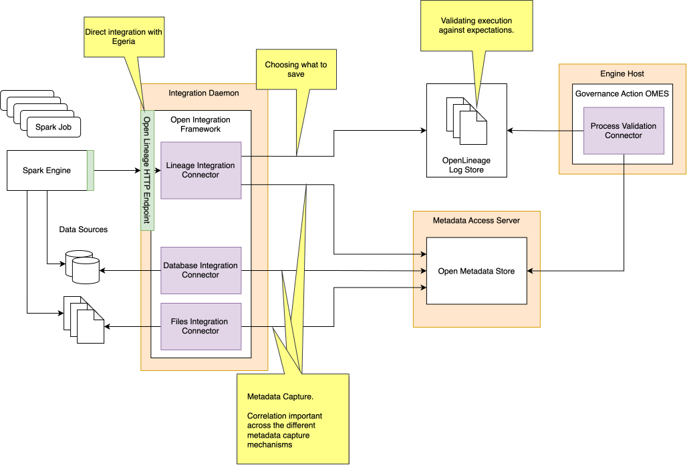
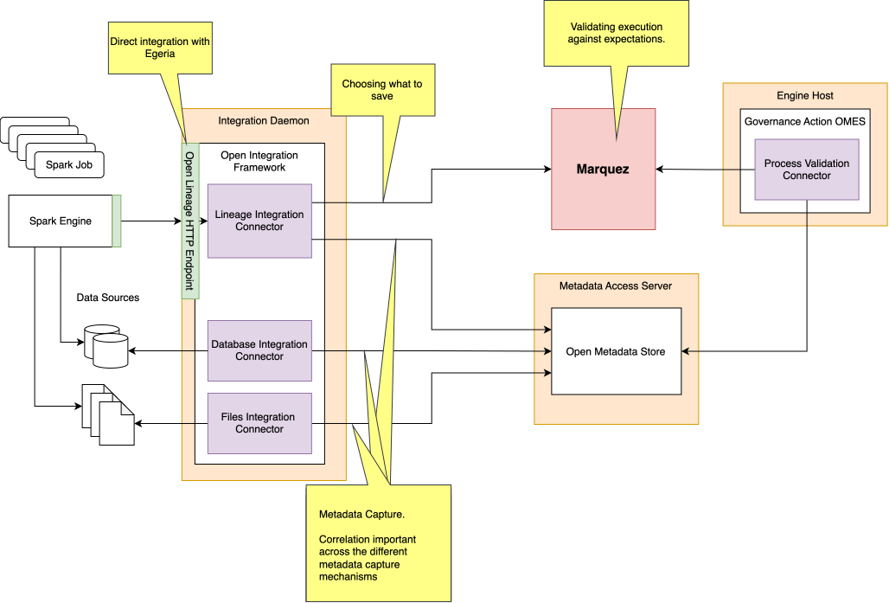

<!-- SPDX-License-Identifier: CC-BY-4.0 -->
<!-- Copyright Contributors to the Egeria project. -->

# Leveraging Open Lineage

Most processing engines - Apache Spark, Apache Airflow, dbt, ETL tools and countless custom jobs - either produce no lineage information at all, or produce it in their own proprietary format.  [Open Lineage](https://github.com/OpenLineage/OpenLineage) is a sister open source project to Egeria in the [LF AI and Data Foundation](https://lfaidata.foundation/) that gives these engines a common, vendor-neutral way to report what they did: which data they read, what they wrote, and how the two are connected.

Egeria is able to receive, store, route and act on Open Lineage events.  This means it can:

* **Harvest** information about the data stores and processes that are emitting Open Lineage events, adding them to open metadata as they are discovered.
* **Store** the Open Lineage events in an organized way, either in its own file-based log store or in an external Open Lineage-compliant server such as [Marquez](https://marquezproject.github.io/marquez/), so they are available for later analysis.
* **Route** Open Lineage events to other services - both events received from external processing engines, and events that Egeria generates itself from the [governance actions](/concepts/engine-action) it runs.

This makes Open Lineage one of the main ways that *operational* (dynamic, "what actually ran") lineage gets into Egeria's lineage graph, alongside the *design* (static) lineage captured by cataloguing.  See [Lineage Management](/features/lineage-management/overview) for the complete picture of how captured lineage - from Open Lineage and other sources - is stitched together and preserved.


## The Open Lineage standard

When a processing engine such as Apache Spark runs a process, it produces a series of *RunEvents* describing the activity of that process.  The Open Lineage standard defines the format of these events and a single, simple REST API operation, `{{urlroot}}/api/v1/lineage`, that receives them.



A RunEvent has eight parts:

* *eventType* - the type of activity being described.
* *eventTime* - the time of the event.
* *run* - the description of the process instance.
* *job* - the description of the process.
* *inputs* - the data sources used as inputs by the process instance.
* *outputs* - the data sources that hold the output of the process instance.
* *producer* - the name/location of the processing engine producing the events.
* *schemaURL* - the location of the JSON schema that describes the structure of the RunEvent.



Events also carry `additionalProperties` called *facets* - extensions that add detail such as documentation links, schema information, SQL text or data quality metrics.  Any organization or processing engine can define its own custom facets alongside the standard ones.

See [The Open Lineage Standard](/features/lineage-management/overview/#the-open-lineage-standard) for the full set of standard facets and how they are structured.


## Egeria's Open Lineage support

Egeria offers two ways to capture Open Lineage events from processing engines, depending on how the engine publishes them.

Many processing engines publish through the Open Lineage project's own *proxy backend* - a lightweight side-car that receives events over the API and republishes them to a Kafka topic.  Egeria's [Open Lineage Event Receiver :material-github:](https://github.com/odpi/egeria/blob/main/open-metadata-implementation/adapters/open-connectors/integration-connectors/openlineage-integration-connectors/README.md#open-lineage-event-receiver-integration-connector){ target=gh } integration connector listens on that topic:



Alternatively, Egeria's [integration daemon](/concepts/integration-daemon) can implement the Open Lineage API directly, so a local processing engine can send its events straight to Egeria without needing a proxy backend or a Kafka topic in between:



### The Open Lineage connectors

However they arrive, events are handed to the integration daemon's context manager, which distributes them to whichever [integration connectors](https://github.com/odpi/egeria/tree/main/open-metadata-implementation/adapters/open-connectors/integration-connectors/openlineage-integration-connectors) have registered as listeners.  Five connectors are supplied by Egeria, falling into two groups: those that *acquire or create* Open Lineage events, and those that *process or distribute* them.

| Connector Name                                                                                                        | Purpose                                                                                                                                                                                              |
|--------------------------------------------------------------------------------------------------------------------------|-----------------------------------------------------------------------------------------------------------------------------------------------------------------------------------------------------|
| **[Open Lineage Event Receiver :material-github:](https://github.com/odpi/egeria/blob/main/open-metadata-implementation/adapters/open-connectors/integration-connectors/openlineage-integration-connectors/README.md#open-lineage-event-receiver-integration-connector){ target=gh }**          | Receives Open Lineage events from a Kafka topic and passes them, via the integration daemon, to any other connectors in the same daemon that have registered as Open Lineage listeners.              |
| **[Governance Action Open Lineage :material-github:](https://github.com/odpi/egeria/blob/main/open-metadata-implementation/adapters/open-connectors/integration-connectors/openlineage-integration-connectors/README.md#governance-action-open-lineage-integration-connector){ target=gh }**    | Listens for [engine actions](/concepts/engine-action) executing in the open metadata ecosystem and generates the equivalent Open Lineage events for them - so Egeria's own governance processing shows up in the same lineage picture as external processing engines. |
| **[API-based Open Lineage Log Store :material-github:](https://github.com/odpi/egeria/blob/main/open-metadata-implementation/adapters/open-connectors/integration-connectors/openlineage-integration-connectors/README.md#api-based-open-lineage-log-store-integration-connector){ target=gh }**| Registers as a listener and forwards every event it receives on to a remote server that implements the Open Lineage API, such as Marquez.                                                            |
| **[File-based Open Lineage Log Store :material-github:](https://github.com/odpi/egeria/blob/main/open-metadata-implementation/adapters/open-connectors/integration-connectors/openlineage-integration-connectors/README.md#file-based-open-lineage-log-store-integration-connector){ target=gh }**| Registers as a listener and writes every event it receives to its own file, in JSON format, in a nominated folder - organized by the namespace and job name in the event.                          |
| **[Open Lineage Cataloguer :material-github:](https://github.com/odpi/egeria/blob/main/open-metadata-implementation/adapters/open-connectors/integration-connectors/openlineage-integration-connectors/README.md#open-lineage-cataloguer-integration-connector){ target=gh }**                  | Registers as a listener and catalogues what the events describe: jobs become [Processes](/types/2/0215-Software-Components), datasets become data assets (matched to assets already catalogued by other connectors where possible), and inputs and outputs are linked to the process with lineage relationships.  It maintains the [*RunMetrics*](/types/2/0215-Software-Components) classification on each process and, optionally, the [*DataScope*](/types/2/0210-Data-Stores) classification on the data assets, captures data quality results as survey reports and catalogues each run as a *TransientEmbeddedProcess*, with or without its own lineage.  See [Cataloguing the events](#cataloguing-the-events) below.       |

The diagram below shows all five working together in a single integration daemon:



1. A third-party processing engine sends Open Lineage events either directly to Egeria's Open Lineage API endpoint, or via a proxy backend to a Kafka topic.
2. The Open Lineage Event Receiver picks up events from the Kafka topic and hands them to the integration daemon's context manager.
3. The Governance Action Open Lineage connector registers a listener for engine actions running in the open metadata ecosystem, generates Open Lineage events to represent that processing, and hands them to the context manager too - so both sources of events flow through the same pipeline.
4. Any connector wanting to receive events - the two log store connectors and the cataloguer - registers a listener with the context manager, and from then on receives every event that arrives.
5. The API-based and file-based Open Lineage Log Store connectors write each event to their configured destination (a remote Open Lineage API server, or a local file), while the Open Lineage Cataloguer uses each event to make sure the job and datasets it describes are represented in open metadata and linked by lineage.

Because any combination of these connectors can be configured in the same integration daemon, you can, for example, catalog processes *and* archive the raw events to Marquez *and* forward Egeria's own governance action activity into the same picture, all at once.


### Cataloguing the events

The Open Lineage Cataloguer maps each run event into open metadata as it arrives.  The namespace and name that Open Lineage gives each job and dataset are extracted from the technology itself, following the [Open Lineage naming conventions](https://openlineage.io/docs/spec/naming/), so they are the most reliable identity for a resource.  The cataloguer's first job is to use them to find the elements that already describe the resource, so that the lineage from the events joins up with what other connectors have catalogued rather than building a parallel picture.

#### Datasets

The lineage is attached to the elements that describe the *physical* landscape - the tables, topics and files catalogued by Egeria's technology connectors.  The cataloguer finds every element that describes a dataset:

* elements whose *resourceName* and *namespacePath* are the dataset's name and namespace;
* elements catalogued by technology connectors, found through the endpoints of their connections.  For example, the dataset `sales.public.orders` in the namespace `postgres://db` is matched to the *RelationalTable* that the PostgreSQL connectors catalogued for the database whose endpoint is `jdbc:postgresql://db:5432/sales`.  The spelling of the scheme and any default port are normalized before the comparison.  Kafka topics, local files and Unity Catalog tables are matched in the same way;
* for a dataset in the `egeria` namespace, the element whose qualified name is the dataset's name.  This is how Egeria's own governance actions name data that has no Open Lineage identity.

The matches fall into two groups:

* **Physical elements.**  One of them is chosen to receive the lineage: elements catalogued by technology connectors are preferred over elements created from Open Lineage events, and the oldest is preferred within each group.  Any other physical match is linked to the chosen element with a *PeerDuplicateLink* for the [duplicate management](/features/duplicate-management/overview) process to resolve.
* **Abstractions** - *TabularDataSet* and *TabularDataSetCollection* assets, such as the data sets offered by digital products.  They never receive lineage themselves.  Instead each is linked to the physical element that it is a view over with a [*DataSetContent*](/types/2/0210-Data-Stores) relationship.

The cataloguer only updates the properties, schema, names and lifecycle of assets that it created itself.  Elements catalogued by technology connectors are left as their connectors maintain them, apart from gaining an owner and the Open Lineage identity if they have none.

#### Datasets and jobs that are not catalogued yet

When nothing describes a dataset or job, the cataloguer creates it from the [catalog template](/features/templated-cataloguing/overview) for its technology, so that it has the right open metadata type and technology type (*deployedImplementationType*).

* **Datasets.**  The technology is identified by the namespace scheme.  For example, a `snowflake://` dataset becomes a *Snowflake Table* (a *DataSet*), an `s3://` dataset becomes an *Amazon S3 Object* (a *DataFile*), or an *Amazon S3 Folder* when the name ends with `/`, and a `kafka://` dataset becomes an *Apache Kafka Topic*.  Templates cover the relational databases, data warehouses, NoSQL stores, object and file stores, document management systems and event streams named in the Open Lineage naming conventions.  A dataset from an unrecognized technology becomes a generic *DataStore*, which can be retyped to a more specific subtype later.
* **Jobs.**  The technology is identified by the *jobType* job facet.  For example, an Airflow task becomes an *Apache Airflow Task*, and its parent job becomes an *Apache Airflow DAG*.  Spark jobs, Debezium connector tasks and SQL jobs are handled in the same way.  A job whose technology is unrecognized becomes a generic *DeployedSoftwareComponent*.

The new asset is named `{typeName}::{namespace}::{name}`, with the namespace and name in its *namespacePath* and *resourceName*.  Its description, formula, ownership and other details are taken from the job and dataset facets.  If the template is not loaded - for example, because its content pack is not - the asset is created directly with the same open metadata type and technology type.

##### Template names

The cataloguer chooses the template by building *template names* from the values in the event, and using the first name that has a template.  The names run from the most specific to the least specific.

* For a **job**, the names come from the *integration* and *jobType* values of the *jobType* job facet: `job:{integration}:{jobType}`, then `job:{integration}`, then `job:*:{jobType}` and finally `job:*`.  For example, a job with integration `AIRFLOW` and jobType `DAG` tries `job:AIRFLOW:DAG`, `job:AIRFLOW`, `job:*:DAG` and `job:*`.  A parent or root job from the *parent* run facet has no *jobType* facet of its own.  The parent of an Airflow task uses the names for an Airflow DAG, and any other parent uses `job:*`.
* For a **dataset**, the names come from the scheme of the namespace - the part before `://`: `dataset:{scheme}:{variant}`, then `dataset:{scheme}` and finally `dataset:*`.  The variant is `folder` when the dataset's name ends with `/`, and `subscription` when a `pubsub://` dataset's name starts with `subscription:`.  The scheme is tried as it is written in the namespace and then in its normalized form: `postgresql` is normalized to `postgres`, `sqlserver` to `mssql`, `athena` to `awsathena`, `mariadb` to `mysql`, `s3a` and `s3n` to `s3`, and `gcs` to `gs`.  For example, the dataset `landing/` in the namespace `s3a://bucket` tries `dataset:s3a:folder`, `dataset:s3a`, `dataset:s3:folder`, `dataset:s3` and `dataset:*`.

The names are not case-sensitive.

The tables below show the template names that have a default template.  The templates are in the Core Content Pack, apart from the table templates for PostgreSQL, SQL Server, Oracle, Db2 and Unity Catalog, which are in those technologies' content packs.  The names `job:*` and `dataset:*` have no default template: a job with no template becomes a generic *DeployedSoftwareComponent* and a dataset with no template becomes a generic *DataStore*.

??? info "Default templates for jobs"
    | Template name | Values in the *jobType* job facet | Default template (technology type) | Open metadata type | Content pack | Template GUID |
    |---|---|---|---|---|---|
    | `job:AIRFLOW:DAG` | *integration* `AIRFLOW`, *jobType* `DAG` | Apache Airflow DAG | *DeployedSoftwareComponent* | Core | `80343088-b527-4b92-b265-d22f94c29d55` |
    | `job:AIRFLOW` | *integration* `AIRFLOW`, any other *jobType* | Apache Airflow Task | *DeployedSoftwareComponent* | Core | `53082f59-6506-4c49-8d10-8b4549e3b2d8` |
    | `job:SPARK` | *integration* `SPARK` | Apache Spark Job | *DeployedSoftwareComponent* | Core | `3a57bb36-e073-4d90-9cde-06e591b70f8b` |
    | `job:DEBEZIUM` | *integration* `DEBEZIUM` | Debezium Connector Task | *DeployedSoftwareComponent* | Core | `10215d28-879f-4af7-9e3b-7eebac38e02c` |
    | `job:SQL` | *integration* `SQL` | SQL Job | *DeployedSoftwareComponent* | Core | `7544dab2-474f-4305-b4b9-24a0719bfdec` |
    | `job:*:QUERY` | any integration, *jobType* `QUERY` | SQL Job | *DeployedSoftwareComponent* | Core | `7544dab2-474f-4305-b4b9-24a0719bfdec` |

??? info "Default templates for datasets"
    | Template name | Dataset namespace and name | Default template (technology type) | Open metadata type | Content pack | Template GUID |
    |---|---|---|---|---|---|
    | `dataset:postgres` | `postgres://` | PostgreSQL Table | *DataSet* | PostgreSQL | `4d52a7b6-6b3d-4776-9707-04b228fda2c0` |
    | `dataset:sqlserver` | `sqlserver://` | Azure Synapse Analytics Table | *DataSet* | Core | `90a7b075-0fb5-4930-a06e-c9ef1648b257` |
    | `dataset:mssql` | `mssql://` | Microsoft SQL Server Table | *DataSet* | SQL Server | `bf9299aa-6b0e-44e3-9b74-763dc274825d` |
    | `dataset:oracle` | `oracle://` | Oracle Table | *DataSet* | Oracle | `a62d00c8-06b0-49bd-8821-6971af8b4403` |
    | `dataset:db2` | `db2://` | Db2 Table | *DataSet* | Db2 LUW | `57fafc82-adc6-4fd0-abc1-1d7a0c78109f` |
    | `dataset:awsathena` | `awsathena://` | Amazon Athena Table | *DataSet* | Core | `deed8680-7d2f-490e-a41e-37838e544e93` |
    | `dataset:arn` | `arn:` | AWS Glue Table | *DataSet* | Core | `565af0d3-8fac-4a0c-b568-5509dc746388` |
    | `dataset:azurekusto` | `azurekusto://` | Azure Data Explorer Table | *DataSet* | Core | `cea56a87-4851-4bfc-a765-566b8a221181` |
    | `dataset:bigquery` | `bigquery://` | Google BigQuery Table | *DataSet* | Core | `bde5fa70-6dbf-4de1-a248-14e8fd4be148` |
    | `dataset:fabric-warehouse` | `fabric-warehouse://` | Microsoft Fabric Warehouse Table | *DataSet* | Core | `aebb8ff6-6a10-46cf-abca-8af0ac2a6a18` |
    | `dataset:mysql` | `mysql://` | MySQL Table | *DataSet* | Core | `328e4059-ed6f-4869-9f55-1184b102997a` |
    | `dataset:crate` | `crate://` | CrateDB Table | *DataSet* | Core | `90281e28-ce5f-4931-b03f-0471f30a5a68` |
    | `dataset:hive` | `hive://` | Apache Hive Table | *DataSet* | Core | `113b9fcf-1bfe-4d35-bb9c-81fdd8e498b2` |
    | `dataset:oceanbase` | `oceanbase://` | OceanBase Table | *DataSet* | Core | `77bdb6c4-b967-4fc2-aeda-c0d47aa44730` |
    | `dataset:teradata` | `teradata://` | Teradata Table | *DataSet* | Core | `ec209a5a-3121-486a-ac62-369dbe8e4dec` |
    | `dataset:redshift` | `redshift://` | Amazon Redshift Table | *DataSet* | Core | `bb45f0e3-6ca5-4686-9794-f467b7c81fc4` |
    | `dataset:snowflake` | `snowflake://` | Snowflake Table | *DataSet* | Core | `36f609b7-64ea-4fa1-9cc1-bf5475146265` |
    | `dataset:spanner` | `spanner://` | Google Cloud Spanner Table | *DataSet* | Core | `7244fdc7-4147-4e37-ac74-46fc2d937d2b` |
    | `dataset:trino` | `trino://` | Trino Table | *DataSet* | Core | `74eaabb9-f619-40bf-8250-ff5b36eaa1ad` |
    | `dataset:unitycatalog` | `unitycatalog://` | Unity Catalog Table | *VirtualRelationalTable* | Unity Catalog | `632fd18d-4fa5-4899-820f-f9f4c5b1a9cb` |
    | `dataset:cassandra` | `cassandra://` | Apache Cassandra Table | *DataSet* | Core | `285d3c53-d5f4-4497-80be-61b27ac0c13c` |
    | `dataset:azurecosmos` | `azurecosmos://` | Azure Cosmos DB Collection | *DataSet* | Core | `a1b87097-1344-4752-af75-f2c1cc828281` |
    | `dataset:milvus` | `milvus://` | Milvus Collection | *DataSet* | Core | `dcb19b7e-3cdc-41e3-857c-9c854b238b61` |
    | `dataset:s3` | `s3://` | Amazon S3 Object | *DataFile* | Core | `10313788-4f3e-4fa5-9e7d-f91944c0bc29` |
    | `dataset:s3:folder` | `s3://`, name ends with `/` | Amazon S3 Folder | *DataFolder* | Core | `edfff2d9-3b4a-4908-8cd1-193dce4069b1` |
    | `dataset:gs` | `gs://` | Google Cloud Storage Object | *DataFile* | Core | `24f778c8-66cb-4aba-ad14-184c7208e0ac` |
    | `dataset:gs:folder` | `gs://`, name ends with `/` | Google Cloud Storage Folder | *DataFolder* | Core | `2a94fff9-6997-48ff-8acf-5db2b7546a47` |
    | `dataset:wasb` | `wasb://` | Azure Blob Storage Object | *DataFile* | Core | `e7e6056b-9b6c-470f-89bf-2e91bfe548a8` |
    | `dataset:wasb:folder` | `wasb://`, name ends with `/` | Azure Blob Storage Folder | *DataFolder* | Core | `ac3e792a-9458-4bcd-bae8-979bacde067f` |
    | `dataset:wasbs` | `wasbs://` | Azure Blob Storage Object | *DataFile* | Core | `e7e6056b-9b6c-470f-89bf-2e91bfe548a8` |
    | `dataset:wasbs:folder` | `wasbs://`, name ends with `/` | Azure Blob Storage Folder | *DataFolder* | Core | `ac3e792a-9458-4bcd-bae8-979bacde067f` |
    | `dataset:abfs` | `abfs://` | Azure Data Lake Storage File | *DataFile* | Core | `3ee29e2e-c3dc-4690-95f4-0dbdfce0ffe0` |
    | `dataset:abfs:folder` | `abfs://`, name ends with `/` | Azure Data Lake Storage Directory | *DataFolder* | Core | `b6aaf460-586e-4ea3-87e8-c412ed372dc3` |
    | `dataset:abfss` | `abfss://` | Azure Data Lake Storage File | *DataFile* | Core | `3ee29e2e-c3dc-4690-95f4-0dbdfce0ffe0` |
    | `dataset:abfss:folder` | `abfss://`, name ends with `/` | Azure Data Lake Storage Directory | *DataFolder* | Core | `b6aaf460-586e-4ea3-87e8-c412ed372dc3` |
    | `dataset:hdfs` | `hdfs://` | Apache Hadoop HDFS File | *DataFile* | Core | `11916af2-3aa6-47bd-b913-7c2a2ccabc8b` |
    | `dataset:hdfs:folder` | `hdfs://`, name ends with `/` | Apache Hadoop HDFS Directory | *DataFolder* | Core | `36f0ae76-a76f-4e8c-a98c-f6c25ea642ca` |
    | `dataset:dbfs` | `dbfs://` | Databricks File System File | *DataFile* | Core | `cb6ecace-558a-447d-8ff1-1203060ab891` |
    | `dataset:dbfs:folder` | `dbfs://`, name ends with `/` | Databricks File System Directory | *DataFolder* | Core | `988aa4dc-6fef-4a75-a837-5614f99b7040` |
    | `dataset:file` | `file` or `file://` | Data File (the technology type is refined from the file's format, for example *CSV Data File*) | *DataFile* | Core | `ff2a4de1-d8e0-40ab-a5e2-212f06c6a6dd` |
    | `dataset:file:folder` | `file` or `file://`, name ends with `/` | Data Folder | *DataFolder* | Core | `589934b4-3902-4ed0-9ae1-f40880eb0096` |
    | `dataset:box` | `box://` | Box File | *Document* | Core | `1cc2f7a3-4be0-4350-93ba-99eec2e27a56` |
    | `dataset:filenet` | `filenet://` | IBM FileNet Document | *Document* | Core | `92c538d0-adbd-47b6-b46f-d6f72bc82247` |
    | `dataset:mssharepoint` | `mssharepoint://` | Microsoft SharePoint Document | *Document* | Core | `3c243f0b-ca25-4a47-adc8-8493fcbdd985` |
    | `dataset:pubsub` | `pubsub://` | Google Cloud Pub/Sub Topic | *Topic* | Core | `fd966fc9-009f-4ad1-92ee-2ae9befdbc20` |
    | `dataset:pubsub:subscription` | `pubsub://`, name starts with `subscription:` | Google Cloud Pub/Sub Subscription | *DataFeed* | Core | `93af5b29-4b6e-41de-a123-4ca883442fe0` |
    | `dataset:kafka` | `kafka://` | Apache Kafka Topic (also creates the topic's connection and endpoint) | *Topic* | Core | `ea8f81c9-c59c-47de-9525-7cc59d1251e5` |
    | `dataset:inmemory` | `inmemory` or `inmemory://` | In-Memory Data Set | *DataSet* | Core | `b1e79ff7-4a67-4fe7-a9fc-d44a93ad5be2` |

##### Changing the templates

The default templates can be replaced, and templates can be added for integrations and namespace schemes that have no default, through the *templates* property of a [*CatalogTarget*](/concepts/catalog-target) relationship attached to the cataloguer's integration connector element.  The *templates* property is a map from a template name to the unique identifier (GUID) of the template to use for that name.  For example, the following properties use an organization's own template for Snowflake tables and for every job run by dbt, and reuse the *Apache Hive Table* template for an in-house `warehouse://` namespace:

```json
{
  "class": "CatalogTargetProperties",
  "catalogTargetName": "Open Lineage templates",
  "templates": {
    "dataset:snowflake": "<GUID of your Snowflake table template>",
    "job:DBT": "<GUID of your dbt job template>",
    "dataset:warehouse": "113b9fcf-1bfe-4d35-bb9c-81fdd8e498b2"
  }
}
```

* A template named by a catalog target is used in place of the default template with the **same** template name.  The names are still tried from the most specific to the least specific, so a template supplied for `dataset:s3` is used for objects, while folders carry on using the default template for `dataset:s3:folder`.  Supply a template for `job:*` or `dataset:*` to set the template for every job or dataset that would otherwise be created without one.
* A template for a job must create a *DeployedSoftwareComponent* (or one of its subtypes).  A template for a dataset must create a data asset: a *DataSet*, *DataStore*, *DataFile*, *DataFolder*, *Document*, *Topic* or *DataFeed*, or one of their subtypes.  The new element takes its open metadata type and technology type from the template.
* The cataloguer still names the new element `{typeName}::{namespace}::{name}` and sets its *displayName*, *resourceName*, *namespacePath* and the properties taken from the facets, replacing the values in the template.  It supplies values for the `displayName`, `resourceName`, `namespacePath`, `description`, `versionIdentifier`, `filePathName` and `directoryPathName` placeholders used in the rest of the template.  A template that is not one of the defaults is also given `hostIdentifier`, `portNumber` and `serverName` from the namespace, and `fullTopicName`, `shortTopicName` and `eventDirection`.
* The cataloguer does not use the element that the catalog target points to, so the relationship can be attached to any element - for example, the element that describes the technology sending the events.  If the cataloguer has several catalog targets, their templates are combined; a template name should appear in only one of them.
* The catalog targets are read when the cataloguer starts and each time it refreshes (every 60 minutes by default, or on request).  The audit log message `OPEN-LINEAGE-INTEGRATION-CONNECTOR-0027` lists the templates in use whenever they change.  A template that can not be found, or that creates the wrong type of element, is reported with `OPEN-LINEAGE-INTEGRATION-CONNECTOR-0028` and the default is used instead.

The templates only affect jobs and datasets that are created after the change.  Elements that are already catalogued are matched as before.

#### Jobs and lineage

* The **job** is matched in the same way as a dataset, by its *namespacePath* and *resourceName*.  Parent and root jobs named in the *parent* run facet become processes that own the job through *ProcessHierarchy* relationships.  Job dependencies become *ControlFlow* relationships.
* **Lineage** is recorded from the inputs to the process and from the process to the outputs: a *DataFlow* for a data asset, and a *DataMapping* for a table, which is a schema attribute.  When a dataset is a table, a *DataFlow* is also recorded for the asset that holds it - the database schema or database - so the lineage can be seen at the asset level as well as in detail.  The column lineage facets become *DataMapping* relationships between the columns, and between the tables that hold them.  Each lineage relationship records in its *derivation* the part of the event it was derived from, such as `derived from OpenLineage columnLineage facet`, and each *DataSetContent* link records how the data set was matched, such as `matched by endpoint and table name`.
* **Run metrics** - run count, failures, first and last run times, last run duration and status, rows and bytes read and written - are maintained in the [*RunMetrics*](/types/2/0215-Software-Components) classification of the process.
* Optionally, the cataloguer also catalogues each **run** as a *TransientEmbeddedProcess* owned by the job's process, recording the run's status, timing and run facets.  With the *catalogRuns* option, the run has no lineage of its own: all the lineage is on the job's process.  With the *catalogRunLineage* option, each run is also linked to the datasets that it read and wrote, using the same lineage relationships that link them to the job's process.  The job's process then shows every dataset that any of its runs has used, and each run shows the datasets used by that run.  Both options are off by default because they create an element - and, for *catalogRunLineage*, a set of lineage relationships - for every run.
* The cataloguer can also capture the statistics and data quality facets as a survey report per event, with one annotation per assertion, and maintain the [*DataScope*](/types/2/0210-Data-Stores) classification of each output asset from the times and statistics of the writes.  The run metrics and data scope are not rewritten for every event: the cataloguer queues each element's events as they arrive and applies them in a single update on its next refresh (every 60 minutes by default), so a busy job creates one new version of these classifications per refresh.

#### Configuration properties

The optional parts of the cataloguing are controlled by configuration properties in the connection of the cataloguer's integration connector.  They are all booleans.

| Property | Default | Controls |
|---|---|---|
| `catalogRuns` | `false` | A *TransientEmbeddedProcess* for each run, owned by the job's process. |
| `catalogRunLineage` | `false` | A *TransientEmbeddedProcess* for each run (as for `catalogRuns`), linked to the datasets that the run read and wrote.  The lineage is still maintained on the job's process. |
| `catalogSchemas` | `true` | A tabular schema, from the *schema* dataset facet, for a data asset that the cataloguer creates.  The columns are needed for column-level lineage. |
| `captureStatistics` | `true` | Annotations from the *inputStatistics*, *outputStatistics* and *dataQualityMetrics* facets in a survey report for the run. |
| `captureDataQuality` | `true` | Annotations from the *dataQualityAssertions* and *test* facets in a survey report for the run. |
| `updateDataScope` | `true` | The [*DataScope*](/types/2/0210-Data-Stores) classification on the data assets that the runs read and write. |

#### Governance action runs and information supply chains

Egeria defines two custom run facets, described in [Egeria's Open Lineage Facets](/openlineage/facets):

* **`egeria_governanceAction`** is added by the Governance Action Open Lineage connector to the events it creates for Egeria's own [engine actions](/concepts/engine-action).  A run with this facet is not catalogued as a new job.  Instead its lineage is attached to the [governance action process](/concepts/governance-action-process) that the run is part of.  Provisioning services connect their own lineage to this same element, so the lineage from every run of the process meets there.  The *RunMetrics* classification is kept on the [process step](/concepts/governance-action-process-step), because each step runs separately.  The governance action process instance represents the run, so the *catalogRuns* and *catalogRunLineage* options do not apply to these runs.
* **`egeria_informationSupplyChain`** can be added by any producer - for example [Apache Airflow](/egeria-solutions/leveraging-apache-airflow/overview) - to name the [information supply chains](/concepts/information-supply-chain) that the run belongs to - one in `iscQualifiedName`, or several in `iscQualifiedNames`.

Every lineage relationship that the cataloguer creates from an event, and every *DataSetContent* link to an abstraction, is tagged with the event's information supply chains.  They are taken from the `egeria_governanceAction` facet only if there is no `egeria_informationSupplyChain` facet.  The same data can take part in several supply chains, so each relationship is created once for each of them, and a relationship is only reused when it is tagged with the same one.

Everything the cataloguer records is structural or is a "latest value": it is designed to keep the catalog current as events stream in, while leaving anything that needs the history of many runs to the analysis services described below.


## Storing events: the Open Lineage Log Store

The Open Lineage log store is a destination where events can be written so they can be queried later - both by people investigating an issue, and by governance processes validating that the operational environment is behaving as expected (see [Governing expectations](/features/lineage-management/overview/#governing-expectations)).  The implementation is pluggable.

Using the File-based Open Lineage Log Store, the log store is simply a directory (folder) in the filesystem, with one file per event:



Using the API-based Open Lineage Log Store, the same events are instead sent to a server implementing the Open Lineage API - such as Marquez, which also provides its own API for querying the events it has captured:



Both can be run side by side if you want a local archive as well as a queryable service.


## Analysing the log store: the Lovelace services

A stream of run events is a series of observations.  Some of the most useful facts about a pipeline - how often a job really runs, how long it typically takes, whether a table is rebuilt or accumulates, what proportion of a dataset's quality checks pass - only emerge from that series.  Deriving them as each event arrives would mean rewriting the process or asset on every run; deriving them from the log store on a schedule is cheaper and gives better answers.

Three [Lovelace services :material-github:](https://github.com/odpi/egeria/tree/main/open-metadata-implementation/adapters/open-connectors/lovelace-insights){ target=gh } do this analysis.  They are governance action services orchestrated by the Babbage Analytical Engine, and each can be enabled independently so that a deployment runs only the analyses it wants.  Each reads the file-based log store (supplied as its `openLineageLogStore` action target, or through the `logStoreDirectory` request parameter) for the last `analysisWindowDays` days - 30 by default - and updates only the processes and assets that it can identify uniquely from the namespace and name in the events, using the same rules as the cataloguer.

| Service                                | Reads                                                                     | Records                                                                                                                                                                                                                                                                                                                                |
|----------------------------------------|---------------------------------------------------------------------------|----------------------------------------------------------------------------------------------------------------------------------------------------------------------------------------------------------------------------------------------------------------------------------------------------------------------------------------|
| **Profile OpenLineage Runs**           | The START, COMPLETE, FAIL and ABORT events of each job's runs.            | The run profile in the *additionalProperties* of the process's [*RunMetrics*](/types/2/0215-Software-Components) classification: runs per day, failure rate, the mean, median and range of the interval between runs, how regular that interval is and an inferred schedule (such as HOURLY or DAILY), typical and worst-case duration, and the mean data volume per run.  |
| **Refine OpenLineage Data Scope**      | The writes (with lifecycle, subset and statistics facets) and reads of each dataset. | The [*DataScope*](/types/2/0210-Data-Stores) classification of the asset: whether the store is REPLACED, PARTITIONED or APPENDED by its writers, the data collection window (restarted at the latest rebuild, or extended back to the earliest known write), and the rates of writes and reads.                                                     |
| **Summarise OpenLineage Data Quality** | The data quality assertions of each dataset and the tests of each job.    | A survey report per dataset (and per job) holding a *QualityAnnotation* per quality dimension whose score is the pass rate over the window, plus an overall pass rate, so that the current quality of a dataset can be read without scanning the run history.                                                                              |

The services are supplied in the Open Lineage content pack, so a deployment that loads the pack for the connectors has them available to Babbage as well.  Running the cataloguer without the analysis services still gives complete lineage and current values; running the analysis services without the cataloguer still works for processes and assets that are already catalogued, but nothing new is created.


## From Open Lineage events to a connected lineage graph

Capturing Open Lineage events is only the first stage.  The jobs and data sources named in the events still need to be linked to each other - and to the rest of the catalog - to produce a single connected lineage graph, a process Egeria calls *stewardship* (deduplication and stitching).  From there, lineage can be viewed directly through open metadata queries, or exported to a [Lineage Warehouse](/concepts/lineage-warehouse) for large-scale, long-term analysis.

See [Lineage Management](/features/lineage-management/overview) for the full architecture, including how design and operational lineage combine, how stitching works, and how the resulting graphs are preserved and used.


## Related information

* [Lineage Management](/features/lineage-management/overview) - the complete lineage story: capture, stewardship and preservation.
* [Open Lineage project](https://github.com/OpenLineage/OpenLineage) - the standard itself, including the full facet specifications.
* [Egeria's Open Lineage Facets](/openlineage/facets) - the custom facets that Egeria defines, and their schemas.
* [Leveraging Apache Airflow](/egeria-solutions/leveraging-apache-airflow/overview) - sending Airflow's Open Lineage events to Egeria, with the information supply chain facet.
* [Integration Daemon](/concepts/integration-daemon) - the server that hosts the Open Lineage connectors.
* [Lineage Warehouse](/concepts/lineage-warehouse) - where preserved lineage graphs are stored for analysis.

--8<-- "snippets/abbr.md"
