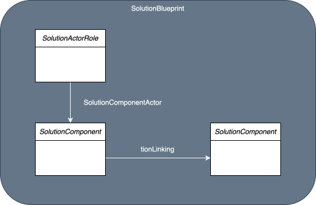
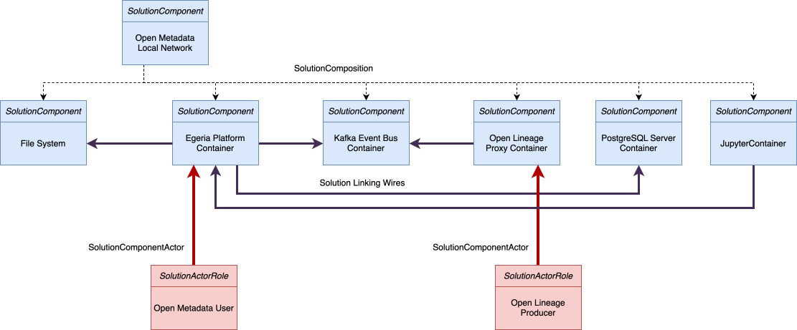

<!-- SPDX-License-Identifier: CC-BY-4.0 -->
<!-- Copyright Contributors to the Egeria project. -->

# Threat Modelling

Threat modelling is a process used to identify, analyze, and prioritize potential threats to an organization's assets, systems, and operations. It involves creating a model of the system or process being analyzed, identifying potential threats, and assessing the likelihood and impact of those threats. The goal of threat modelling is to help organizations proactively address potential security risks and vulnerabilities before they can be exploited by attackers.

Threat modelling is an essential component of the overall [security strategy](/egeria-solutions/defining-security-strategy/overview) for any organization, as it provides a structured approach to identifying and mitigating potential security risks.  It is also not a one-off exercise.  Technology changes, new attacks emerge and the business takes on new partners, so the model needs to be revisited regularly - which is easier when it is kept in open metadata alongside the systems it describes, rather than in a drawing that is filed and forgotten.

Egeria supports threat modelling in three ways:

* the **systems** being modelled are described using solution components and blueprints that can be linked to the real systems in the catalog.
* the **threats and risks** are recorded as governance definitions, linked to the policies and controls that respond to them.
* the **inventory** that the model depends on is kept up to date through [proactive cataloguing](/egeria-solutions/proactive-cataloguing/overview), so that new systems and changes to existing ones can be checked against the model.

The steps below follow the widely used approach described by [OWASP](https://owasp.org/www-community/Threat_Modeling_Process).

## System Modelling

System modelling identifies the components of a system and their interactions.  Each component is modelled using a [Solution Component](/concepts/solution-component).  The components are connected using  [Solution Linking Wires](/concepts/connector).  The solution blueprint also shows the actors (both humans and software) that are involved in the system.  They include both the legitimate users and the bad actors.  They are modelled as [Solution Actor Roles](/types/7/0730-Solution-Components) and linked to the solution components using the [Solution Component Actor](/types/7/0730-Solution-Components) relationship.

Solution components can be nested to represent the structure of the system.  This allows the capture of system and network boundaries that are used to limit the exposure of key assets.

[Solution Blueprints](/concepts/solution-blueprint) are used to select components and roles to illustrate an aspect of the system.  This helps to create a focus and scope for a review meeting by selecting just the components that are relevant to the review, with maybe details of the context they operate in

## Threat Elicitation

Once the key system components have been identified, create a list of threats that could be exploited by an attacker.

STRIDE is an acronym describing six categories of security threats to an IT system that can be used as a checklist for identifying potential threats.
The terms that make up the stride model are:

* Spoofing - a spoofing attack is a situation in which a person or program successfully identifies as another by falsifying data, to gain an illegitimate advantage.
* Tampering - tampering is the act of modifying data or software in a way that is not authorized.
* Repudiation - repudiation is the act of denying having performed an action, such as a transaction or a message.
* Information Disclosure - information disclosure is the act of revealing sensitive information to unauthorized parties.
* Denial of Service - denial of service is the act of preventing legitimate users from accessing a system or service.
* Elevation of Privilege - elevation of privilege is the act of gaining unauthorized access to a system or resource with higher privileges than intended.

When you are considering threats, think about all types of data that could be accessed by an attacker, including:

* Configuration data: such as connection information for databases and other services.
* Authentication data: user identifiers, passwords, certificates and tokens.
* Persistent data: the data stored by the system in databases, files and logs.
* Data in transit: the requests, responses and events that travel over the network between components.
* State data: information about the current sessions and activities of users.
* Temporary data: intermediate results created while processing a request.

It is useful to ask questions such as these:

* How could an attacker change, for example, the authentication data?
* What is the impact if an attacker can read the personal data held by a component?
* What happens if access is denied to a component that others depend on?

## Prioritizing Threats

The next stage is to rank the threats by risk.  This combines a measure of impact with a measure of likelihood.

* What is the chance of an attack occurring? That is, how much effort/cost/time would be required to mount the attack? 1 = high chance, 10 = low chance
* What is the cost or damage to the component if an attack occurs? 1 = little damage, 10 = massive damage

> Risk = Damage if an attack occurs / Chance of attack. 
> 
> 1 = little risk, 10 = massive risk

## Mitigation Approaches

Starting with top-ranked threats, consider the possible following mitigation techniques.  
Typically the security strategy will set out the preferred approaches for each threat type.
However, the specifics of the technology involved may provide alternative approaches, or make such mitigation impossible - in which case, it may be time to choose different technology.

Here are some examples of mitigation techniques for different types of threat:

 | Threat type            | Mitigation technique                                         |
 |------------------------|--------------------------------------------------------------|
 | Spoofing identity      | Authentication                                               |
 |                        | Protect secrets                                              |
 |                        | Change passwords and other secrets regularly                 |
 |                        | Remove obsolete user identities                              |
 | Tampering with data    | Authorization (Governance Zones and Service Access Controls) |
 |                        | Secure storage                                               |
 |                        | Tamper-resistant network protocols                           |
 | Non-repudiation        | Digital signatures / certificates                            |
 |                        | Timestamps                                                   |
 |                        | Audit trails                                                 |
 | Information disclosure | Authorization                                                |
 |                        | Privacy-enhanced protocols                                   |
 |                        | Encryption                                                   |
 |                        | Protect secrets                                              |
 | Denial of service      | Authentication                                               |
 |                        | Authorization                                                |
 |                        | Throttling through gateway                                   |
 |                        | Quality of service                                           |
 | Elevation of privilege | Authentication                                               |
 |                        | Authorization                                                |
 |                        | Privilege separation                                         |
 |                        | Role-based access control                                    |
 |                        | Secure storage for secrets                                   |
 |                        | Tamper-resistant network protocols                           |

## Recording the results in Egeria

The output of a threat modelling session is recorded as governance definitions so that it can be reviewed, prioritized and tracked:

* Each category of threat that the organization must guard against is a [*Threat*](/types/4/0405-Governance-Drivers) - a governance driver.  Threats are often shared across governance domains, so check for an existing definition first.
* Each concrete consequence of a threat for this organization is a [*Risk*](/types/4/0415-Governance-Responses), with its likelihood, impact, overall importance and the implications that must be true for the organization to have responded.  Together, the risks form the organization's *risk register*.
* Each risk is linked to the elements it applies to - the solution components, systems, data assets, teams or events it threatens - with the [*ScopedBy*](/types/1/0120-Assignment-Scopes) relationship.  This is what connects the risk register to the system model.
* The chosen mitigations become [governance policies](/types/4/0415-Governance-Responses) and [controls](/types/4/0420-Governance-Controls), linked back to the risks and threats they address.

When the systems change, the risks scoped by the affected components show what needs to be revisited, and when a new threat emerges, the risks and controls that relate to it - and the parts of the system they apply to - can be found by following the links.

!!! summary "Usage"
    Keeping the threat model in open metadata turns it from a design-time artefact into a living part of the security program.  A risk that has no policy responding to it shows up as a gap in the links, and so does a critical component with no risks scoped to it, which has probably never been reviewed.

## A STRIDE template for Dr.Egeria

The [STRIDE threat model template :material-download:](stride-threat-model.txt){ download="stride-threat-model.md" } is a [Dr.Egeria](/user-interfaces/dr-egeria/overview) Markdown file that walks through the steps on this page.  It contains the commands to:

* create a solution blueprint for the review, with its components, actors and data flows;
* record each risk, link it to its STRIDE threat with *GovernanceResponse*, and scope it to the component it threatens with *ScopedBy*;
* record each mitigating control and link it to the risks it addresses with *GovernanceMechanism*.

The six STRIDE threats are already defined in the [Core Content Pack](/content-packs/core-content-pack/overview), with qualified names such as `Threat::STRIDE::Spoofing`, so every threat model links its risks to the same six threats.  The mitigations can be your own controls, or controls from the NIST SP 800-53 catalog in the [Security Content Pack](/content-packs/security-content-pack/overview).

It also includes the STRIDE questions to ask of each component and data flow, with typical mitigations for each category.  Replace the values in square brackets, copy command blocks as needed, and check the file with `dr_egeria --validate` before processing it.

## Examples

* [Assuring IT Systems Security](/practices/coco-pharmaceuticals/scenarios/assuring-it-systems-security/overview) shows Coco Pharmaceuticals' security team building on the solution components of its information supply chains to model threats to its systems.
* [Preparing for Martyn's Law](/practices/coco-pharmaceuticals/scenarios/preparing-for-martyns-law/overview) applies the same approach to a physical security threat - terrorism at a public event.
* [Planning for security](/guides/planning/security/overview) contains a threat model of an Egeria deployment itself.

--8<-- "snippets/abbr.md"
