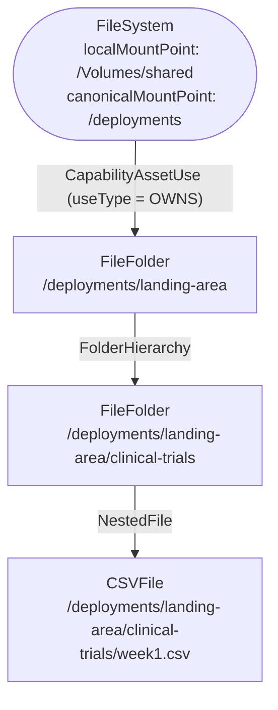

<!-- SPDX-License-Identifier: CC-BY-4.0 -->
<!-- Copyright Contributors to the Egeria project. -->

# File System Normalization

A file system is rarely seen in the same way by every system that uses it.  It is *mounted* into each system or container at a location chosen for that system, called its *mount point*.  The path name of a directory or file starts with the mount point, so two systems that mount the same file system at different points use different path names for the same directory or file.

Consider a shared file system that holds a file called `landing-area/clinical-trials/week1.csv`.

| System | Mount point | Path name of the file |
|:-------|:------------|:----------------------|
| The file server that hosts the file system | `/export/shared` | `/export/shared/landing-area/clinical-trials/week1.csv` |
| A data engineer's laptop | `/Volumes/shared` | `/Volumes/shared/landing-area/clinical-trials/week1.csv` |
| A container running an analytics job | `/mnt/data` | `/mnt/data/landing-area/clinical-trials/week1.csv` |
| A container running Egeria | `/deployments` | `/deployments/landing-area/clinical-trials/week1.csv` |

Each of these path names is correct, but only for the system that uses it.  If each system catalogues the file under the path name that it sees, the catalog fills with elements that describe the same file, and nothing shows that they are the same.  A search for the file by its path name succeeds or fails depending on which system catalogued it.

*File system normalization* removes this ambiguity.  Every directory and file is catalogued under one agreed path name, called its *canonical path name*, whichever system catalogues it.

## Mount points and canonical path names

Normalization uses two properties:

* **localMountPoint** is the mount point of the file system as seen by the system that is working with the files.
* **canonicalMountPoint** is the value that replaces the local mount point when the path name is stored in open metadata.

The canonical path name of a directory or file is its local path name with the local mount point replaced by the canonical mount point.  Using the example above with a canonical mount point of `/deployments`, the laptop's `/Volumes/shared/landing-area/clinical-trials/week1.csv` and the analytics container's `/mnt/data/landing-area/clinical-trials/week1.csv` both become `/deployments/landing-area/clinical-trials/week1.csv`.

The canonical path name is stored in the `pathName` property of the [*FileFolder*](/types/2/0220-Files-and-Folders/#filefolder) or [*DataFile*](/types/2/0220-Files-and-Folders/#datafile) asset.  It identifies the directory or file; it is not necessarily a path name that works on any particular system.  The address that a [connector](/concepts/connector) uses to read the directory or file is held in the endpoint of the asset's connection, and is not changed by normalization.

Egeria's connectors that catalogue files use a local mount point of `.` (the directory that the connector is running in) and a canonical mount point of `/deployments` unless they are told otherwise.  These defaults suit files that are stored beneath the directory where the [OMAG Server Platform](/concepts/omag-server-platform) is installed, because `/deployments` is where the platform is installed in Egeria's containers.  Files catalogued by a platform running on a laptop therefore line up with the same files catalogued by a platform running in a container.  Any other file system needs its mount points to be defined.

## Defining the mount points for a file system

The mount points are properties of the [*FileSystem*](/types/0/0056-Resource-Managers/#filesystem) software capability that represents the file system in open metadata.  To define the mount points for a set of directories and files:

1. Create a *FileSystem* element for the file system, and set both its `localMountPoint` and `canonicalMountPoint` properties.
2. Link the *FileSystem* to the *FileFolder* asset for the top-level directory that it applies to, using the [*CapabilityAssetUse*](/types/0/0045-Servers-and-Assets/#capabilityassetuse-relationship) relationship.  Set the relationship's `useType` property to `OWNS`.

The mount points then apply to that folder and to everything catalogued beneath it: the folders linked to it by [*FolderHierarchy*](/types/2/0220-Files-and-Folders/#folderhierarchy) relationships and the files linked to those folders by [*NestedFile*](/types/2/0220-Files-and-Folders/#nestedfile) relationships.

> **Figure 1:** A file system linked to the top-level folder that it owns.  Its mount points apply to the folder and to the folders and files beneath it

Linking the *FileSystem* to the folder is what makes the path names unambiguous.  A path name on its own does not say which file system it belongs to, nor which part of it is the mount point.  The link records both in the catalog, where they can be seen by anyone who needs to work out how a path name in the catalog relates to the path name on their own system, and where they can be used by any connector that needs to normalize a path name.

When a folder can reach more than one *FileSystem*, the following rules decide which one is used.

* **The nearest file system is used.**  A *FileSystem* linked to a folder takes precedence over one linked to its parent folder, which takes precedence over one linked to the folder above that.  This allows a sub-directory that is mounted from a different file system to have its own mount points.
* **A file system that only uses the folder is set aside.**  A folder is often linked to more than one software capability: the file system that holds it, and others that read from it.  If a folder is linked to more than one *FileSystem* with mount points, those linked with a `useType` of `USES` are ignored.
* **Ambiguous file systems are not trusted.**  If the nearest folder with a file system is still linked to more than one *FileSystem* once the users have been set aside, there is no means to choose between them.  None of them is used, including any linked to folders further up the hierarchy.

Only a *FileSystem* that has both mount point properties set is considered.

!!! tip "Setting up your catalog"
    * Decide on the canonical mount point for each file system before any of its files are catalogued, and use the same value in every system that catalogues them.
    * Link one *FileSystem* with a `useType` of `OWNS` to each top-level folder.  Use a `useType` of `USES` for any other file system that is linked to the same folder.
    * Leave the qualified names of the folders and files alone.  Normalization changes the `pathName` property only.

An [integration connector](/concepts/integration-connector) that catalogues directories and files can also be given the mount points directly.  The folder and file cataloguers accept `localMountPoint` and `canonicalMountPoint` in the configuration properties of each [catalog target](/concepts/catalog-target).  If the catalog target names a *FileSystem* as its metadata source, the mount points of that *FileSystem* are used in place of the configuration properties.

!!! example "How the Liskov Data Sharing Hub Manager uses the mount point properties"
    The [Liskov Data Sharing Hub Manager](/patterns/harvest-and-publish/overview/#the-liskov-data-sharing-hub-manager) builds the data dictionary for a [data sharing hub](/concepts/data-sharing-hub).  When a directory is a member of the hub, Liskov finds the files catalogued from it by searching for file assets whose `pathName` includes the directory's `pathName`.  This only works if the directory and its files are catalogued under the same form of path name, so Liskov normalizes them first.

    On each refresh, Liskov works out the mount points for the directory from the first of these sources that supplies them:

    1. The nearest *FileSystem* with both mount points set that is linked by a *CapabilityAssetUse* relationship to the directory's *FileFolder* asset or to one of its parent folders, chosen using the rules above.  If the file systems are ambiguous, Liskov writes message `LISKOV-DATA-HUB-MANAGER-0025` to the [audit log](/concepts/audit-log) and moves on to the next source.
    2. A catalog target relationship that links the directory to the integration connector that catalogues it.  The mount points come from the *FileSystem* named as the relationship's metadata source or, if there is none, from the relationship's `localMountPoint` and `canonicalMountPoint` configuration properties.  This is where the folder cataloguer gets its mount points from, so Liskov converts path names in the same way that the cataloguer does.
    3. Liskov's own `localMountPoint` and `canonicalMountPoint` configuration properties.
    4. The defaults: `.` and `/deployments`.

    It then uses the mount points as follows.

    * **It corrects the path names.**  The directory, and every folder and file catalogued beneath it with a local path name, has its `pathName` changed to the canonical path name.  Each change is recorded as `LISKOV-DATA-HUB-MANAGER-0023`.  The qualified names and the connections are left as they are.
    * **It finds the directory's files.**  The CSV and Parquet files whose `pathName` starts with the directory's canonical path name are catalogued, surveyed and added to the data dictionary.
    * **It links the duplicates that normalization reveals.**  Correcting the path names can show that the same folder or file has been catalogued more than once: by hand under its local path name, for example, and again by a cataloguer under its canonical path name.  Liskov links folders, or files, that have the same canonical path name with a [*PeerDuplicateLink*](/features/duplicate-management/overview) relationship that has a status of `DISCOVERED`, and records it as `LISKOV-DATA-HUB-MANAGER-0024`.

    Liskov does not decide whether the linked elements really are duplicates.  The [Mendel Automated Duplicate Manager](/features/duplicate-management/overview/#the-mendel-automated-duplicate-manager) confirms a duplicate link between two files, or between two folders, that have the same `pathName`, after which they are returned as a single element.

## Open metadata representation

* The *FileSystem* software capability, with its `localMountPoint` and `canonicalMountPoint` properties, is in [model 0056](/types/0/0056-Resource-Managers/#filesystem).
* The *CapabilityAssetUse* relationship that links a file system to a folder, and the values for its `useType` property, are in [model 0045](/types/0/0045-Servers-and-Assets).
* The *FileFolder* and *DataFile* assets, with their `pathName` property, and the *FolderHierarchy* and *NestedFile* relationships that organize them, are in [model 0220](/types/2/0220-Files-and-Folders).

## Further information

* [Leveraging your files](/egeria-solutions/leveraging-files/overview) describes the connectors that catalogue and survey directories and files.
* [Duplicate Management](/features/duplicate-management/overview) describes how elements that represent the same digital resource are linked and combined.
* [Harvest and Publish](/patterns/harvest-and-publish/overview) describes data sharing hubs and the Liskov Data Sharing Hub Manager.

--8<-- "snippets/abbr.md"
