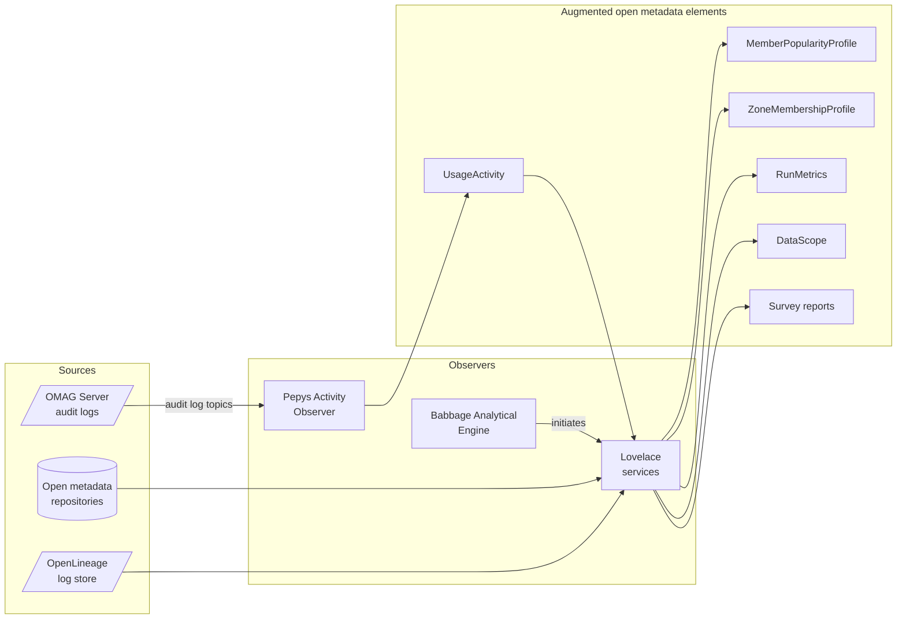
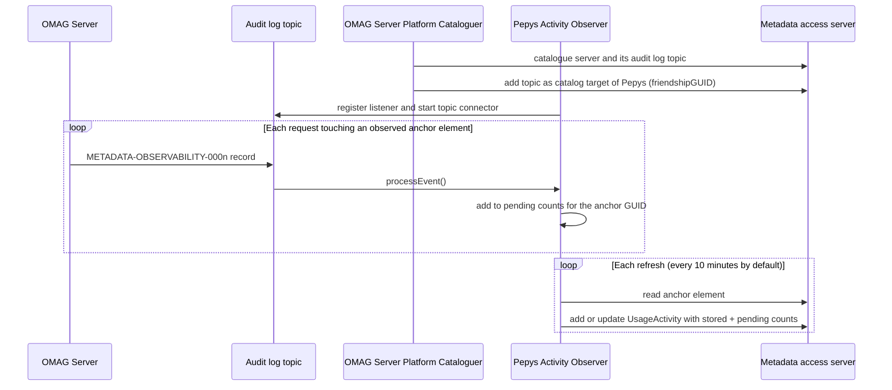
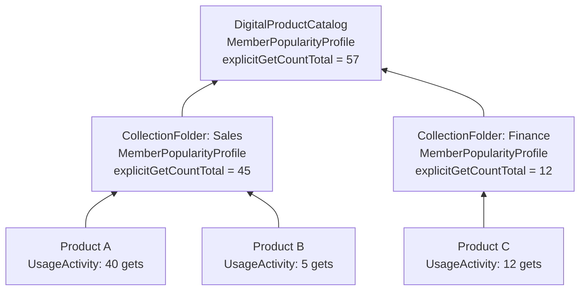

<!-- SPDX-License-Identifier: CC-BY-4.0 -->
<!-- Copyright Contributors to the Egeria project. -->

# Metadata Observability

Open metadata describes what an organization's [digital resources](/concepts/digital-resource) *are*: their names, owners, schemas, connections and lineage.  It says much less about how those resources are *behaving*.  Which data sets are people actually looking for?  Which glossary terms are found by searches but never chosen?  How often does a pipeline really run, how long does it take, and how often does it fail?  Which collections of products are attracting attention, and which have gone quiet?

*Metadata observability* is the capability that answers these questions.  It gathers observations from three kinds of source and records what it learns as classifications on the open metadata elements that the observations are about:

* **Open metadata itself** - the content of the open metadata repositories can be analysed to reveal patterns, such as what each [governance zone](/concepts/governance-zone) controls, or which members of a collection are most used.
* **Logs** - the [audit logs](/concepts/audit-log) of the OMAG Servers report who retrieved, searched for and updated each element; an [OpenLineage](/features/lineage-management/overview) log store records every run of every job.
* **Runtime metrics** - the start, completion and failure of runs, the volume of data they process and the results of their data quality checks.

The result is a rich *operational view* of the landscape that sits alongside the descriptive view.  Because the observations are stored on the elements themselves, rather than in a separate monitoring tool, they are returned with the element by every open metadata API, they are subject to the same [security](/features/metadata-security/overview) as the element, and they can be harvested, published and combined with the rest of the metadata.

> **Figure 1:** Observations flow from the sources, through the observers, and are stored as classifications and reports on the open metadata elements they describe.

The work is done by two of Egeria's *nanny connectors* - the [integration connectors](/concepts/integration-connector) that look after the open metadata ecosystem itself.  The *Pepys Activity Observer* turns audit log records into usage counts, and the *Babbage Analytical Engine* runs a set of analytical [governance services](/concepts/governance-service) called the *Lovelace services* that derive higher-level insight.  Pepys feeds Babbage: the counts that Pepys maintains on individual elements are the raw material from which the Lovelace Popularity Profiler builds the popularity of whole collections.

!!! summary "Usage"
    Metadata observability lets the people responsible for the data landscape - product owners, data stewards, platform teams and governance leads - see which resources are delivering value, which are being neglected, and which are misbehaving, using the same catalog they already use to find and describe those resources.

## Observing activity through the audit log

Every time a metadata access server performs a request that touches an *observed anchor element*, it writes an *activity* message to its audit log.  The observed anchor elements are those whose type is, or inherits from, one of:

* [Asset](/concepts/asset) - such as a data set, a file, an API or a process.
* [DigitalProduct](/concepts/digital-product) - a product in a digital product catalog.
* [GlossaryTerm](/concepts/glossary-term) - a term in a glossary.

An element that is [anchored](/concepts/anchor) to one of these - such as a schema attribute, a connection, a comment or a rating - is reported against its anchor, so activity on the detail of an asset counts as activity on the asset.  [Feedback](/concepts/feedback) (comments, likes, ratings and informal tags) is distinguished from other attachments so that consumer engagement can be told apart from curation.

The messages are defined in the [metadata-observability :material-github:](https://github.com/odpi/egeria/tree/main/open-metadata-implementation/common-services/metadata-observability){ target=gh } module.  In each of them, the first parameter (`{0}`) is the calling user and the third (`{2}`) is the unique identifier of the anchor element.

| Message                       | Reports                                                       | Counted in            |
|-------------------------------|---------------------------------------------------------------|-----------------------|
| METADATA-OBSERVABILITY-0001   | An anchor element was created.                                | Not counted           |
| METADATA-OBSERVABILITY-0002   | The anchor element was retrieved by its identifier or name.   | *explicitGetCount*    |
| METADATA-OBSERVABILITY-0003   | An element anchored to it was retrieved by identifier or name. | *explicitGetCount*    |
| METADATA-OBSERVABILITY-0004   | An element anchored to it was created, linked, unlinked or updated. | *updateAttachmentCount* |
| METADATA-OBSERVABILITY-0005   | Feedback attached to it was added or updated.                 | *updateFeedbackCount* |
| METADATA-OBSERVABILITY-0006   | The properties of the anchor element were updated.            | *updatePropertyCount* |
| METADATA-OBSERVABILITY-0007   | An element anchored to it was deleted.                        | *deleteAttachmentCount* |
| METADATA-OBSERVABILITY-0008   | The anchor element was returned by a search.                  | *findCount*           |
| METADATA-OBSERVABILITY-0009   | An element anchored to it was returned by a search.           | *findCount*           |
| METADATA-OBSERVABILITY-0010   | A user called a REST API operation (not tied to an element).  | Not counted           |
| METADATA-OBSERVABILITY-0011   | Feedback attached to it was deleted.                          | *deleteFeedbackCount* |

The creation of an anchor element is not counted, since creation says nothing about how much the element is used.  Message 0007 is not written when the anchor element itself is deleted - there is nothing left to count against.

The audit log records are routed to the destinations configured for each server by its [audit log destination connectors](/concepts/audit-log-destination-connector).  For observability, the destination that matters is an [open metadata topic](/concepts/open-metadata-topic-connector): the records are published as events, which is how the Pepys Activity Observer receives them.

## The Pepys Activity Observer

The *Pepys Activity Observer* is named after [Samuel Pepys](https://en.wikipedia.org/wiki/Samuel_Pepys), whose diary so faithfully recorded the activity around him.  It is a dynamic integration connector (`PepysActivityObserverConnector`) supplied in the [nanny connectors :material-github:](https://github.com/odpi/egeria/tree/main/open-metadata-implementation/adapters/open-connectors/nanny-connectors){ target=gh } module.  It listens to the topics that the OMAG Servers write their audit logs to, and maintains the [*UsageActivity*](/types/7/0795-Usage-Activity) classification of each observed anchor element named in the activity messages.

### Finding the audit log topics

Pepys does not need to be configured with the topics it listens to.  Its [catalog targets](/concepts/catalog-target) are the *Topic* assets for the audit log topics, and these are added for it by the *OMAG Server Platform Cataloguer*.  As the cataloguer catalogues each OMAG Server and the topic its audit log is written to, it adds that topic as a catalog target of the integration connector named in its `friendshipGUID` configuration property - which the Core Content Pack sets to Pepys.  The cataloguer checks whether the topic is already a catalog target (by looking at the connectors that refresh it) before adding it, and remembers the topics it has registered, so the many servers that share one audit log topic cost a single registration.

When a new catalog target appears, Pepys creates a `PepysTopicCatalogTargetProcessor` for it, which registers Pepys as a listener on the topic's connector and starts the connector if it is not already running.  Pepys logs PEPYS-ACTIVITY-OBSERVER-0003 for each topic it begins to listen to.

> **Figure 2:** The OMAG Server Platform Cataloguer connects Pepys to the audit log topics; Pepys gathers activity as it arrives and writes it on each refresh.

### How the counts are recorded

The decisions that Pepys makes as records arrive and as it refreshes are:

* **Which records count.**  Every event on the topic is parsed as an audit log record.  An event that is not an audit log record is ignored (noted only at debug level, since anything can be written to a topic), as is a record whose message is not one of the counted activity messages above, or that has no anchor element identifier.
* **Whose activity counts.**  Pepys's own reads and updates of the anchor elements are themselves reported in the audit log.  It ignores every record whose calling user is its own user identifier - otherwise each update of a *UsageActivity* classification would be counted as more activity, without end.  Only that one user is excluded: the activity of other automation, such as other integration connectors and governance services, is counted along with that of people.
* **When counts are written.**  Records arrive on the topic connectors' threads and are added to an in-memory tally of the seven counts, held per anchor element.  The tally is written on each refresh of the connector, so a busy element costs one read and one update per refresh rather than one per record.  The Core Content Pack sets the refresh interval to 10 minutes.  Any outstanding tally is also written when the connector is disconnected.
* **How counts are added.**  For each element in the tally, Pepys reads the element (without its attached elements) immediately before writing, and adds the tally to the counts actually stored in its *UsageActivity* classification.  If the element does not have the classification yet, it is added, starting from zero.  The counts are therefore cumulative from the time that Pepys started observing the element.
* **What happens when a write fails.**  The tally for an element is taken out of the pending set before it is written, so records that arrive during the write are kept for the next refresh.  If the element cannot be found, has gone, or the connector's user is not permitted to classify it (for example, because it is in a [governance zone](/features/governance-zoning/overview) that restricts classification), retrying will not help: the counts are discarded and PEPYS-ACTIVITY-OBSERVER-0006 is logged.  Any other failure - most likely the metadata access server being unavailable - puts the counts back to be retried on the next refresh, and PEPYS-ACTIVITY-OBSERVER-0005 is logged.

After each refresh that writes anything, PEPYS-ACTIVITY-OBSERVER-0004 reports how many activities were added to how many elements.

### Reading the usage activity counts

The seven counts of the *UsageActivity* classification each tell a different story, and they are most useful in combination:

| Count                   | What it shows                                                                                                         |
|-------------------------|-----------------------------------------------------------------------------------------------------------------------|
| *explicitGetCount*      | How often people ask for the element (or its detail) by name or identifier - a sign that it is of specific interest.  |
| *findCount*             | How often the element (or its detail) is returned by searches - how *findable* it is, rather than whether it was chosen. |
| *updatePropertyCount*   | How often the element's own description is being maintained.                                                          |
| *updateAttachmentCount* | How actively the content attached to the element - its schema, connections, notes - is being curated.                 |
| *updateFeedbackCount*   | How much its consumers are engaging with it through comments, likes, ratings and informal tags.                       |
| *deleteAttachmentCount* | How often attached content is removed, for example as it is reorganized or corrected.                                 |
| *deleteFeedbackCount*   | How often feedback is withdrawn.                                                                                      |

For example, an asset with a high *findCount* and a low *explicitGetCount* is turning up in searches but is not being chosen - perhaps its description does not make its purpose clear.  An asset with a high *explicitGetCount* but no recent curation may be an important resource whose description is drifting out of date.  A product with growing *updateFeedbackCount* has an engaged community of consumers.

## The Babbage Analytical Engine and the Lovelace services

The *Babbage Analytical Engine* is named after [Charles Babbage](https://en.wikipedia.org/wiki/Charles_Babbage), and the analytical services that it drives are named after [Ada Lovelace](https://en.wikipedia.org/wiki/Ada_Lovelace), who wrote the first programs for his Analytical Engine.  The pattern that they follow is described in [Metadata Insight](/patterns/metadata-insight/overview).

Babbage is an integration connector whose catalog targets are [governance action types](/concepts/governance-action-type).  Each Lovelace service is registered with Babbage as a governance action type that calls a [governance action service](/concepts/governance-action-service) or [watchdog action service](/concepts/watchdog-action-service).  On each refresh (once a day in the Core Content Pack), Babbage checks each governance action type in turn:

* If there is already an engine action for the governance action type whose status is *REQUESTED*, *APPROVED*, *WAITING*, *ACTIVATING*, *IN_PROGRESS* or *PAUSED*, the service is running or about to run, and Babbage moves on.  The earlier statuses are included so that a service that has been requested but not yet claimed by its engine host is not requested twice.
* Otherwise Babbage initiates the governance action type, passing the catalog target's configuration properties as the request parameters, and logs BABBAGE-ANALYTICAL-ENGINE-0012.

The effect is that a short-running governance action service is run once per Babbage refresh, while a long-running watchdog action service is started once and restarted if it ever stops.  Babbage itself does no analysis: each Lovelace service can be enabled independently, so a deployment runs only the analyses that it wants, and anyone can write a new Lovelace service and register it.

The Lovelace services supplied with Egeria are in the [lovelace-insights :material-github:](https://github.com/odpi/egeria/tree/main/open-metadata-implementation/adapters/open-connectors/lovelace-insights){ target=gh } module:

| Lovelace service                           | Observes                                                                    | Records                                                                                                         | Content pack |
|--------------------------------------------|-----------------------------------------------------------------------------|-----------------------------------------------------------------------------------------------------------------|--------------|
| **Popularity Profiler**                    | The *UsageActivity* of the members of each collection.                      | The [*MemberPopularityProfile*](/types/7/0795-Usage-Activity) classification of the collection.                 | Core |
| **Zone Membership Profiler**               | The elements in each governance zone.                                       | The [*ZoneMembershipProfile*](/types/4/0424-Governance-Zones) classification of the zone.                       | [Organization Insight](/content-packs/organization-insight-content-pack/overview) |
| **Karma Point Awards**                     | Changes to open metadata, and the users who make them.                      | [Karma points](/concepts/karma-point) on the contributor's profile.                                             | [Organization Insight](/content-packs/organization-insight-content-pack/overview) |
| **OpenLineage Run Profiler**               | The runs of each job in the OpenLineage log store.                          | The run profile (frequency, regularity, duration, failure rate, data volume) in the [*RunMetrics*](/types/2/0215-Software-Components) classification of the job's process. | [Open Lineage](/content-packs/open-lineage-content-pack/overview) |
| **OpenLineage Data Scope**                 | The writes and reads of each dataset in the OpenLineage log store.          | The write pattern and data collection window in the [*DataScope*](/types/2/0210-Data-Stores) classification of the dataset's asset. | [Open Lineage](/content-packs/open-lineage-content-pack/overview) |
| **OpenLineage Data Quality Summary**       | The data quality assertions and tests in the OpenLineage log store.         | A [survey report](/concepts/survey-report) per dataset (and per job) with the pass rate of each quality dimension. | [Open Lineage](/content-packs/open-lineage-content-pack/overview) |

The Karma Point Awards service is the long-running watchdog; the others are governance action services that run on each Babbage refresh.  The three OpenLineage services turn the logs and runtime metrics of the data pipelines into an operational view of the processes and data sets, and are described in detail in [Leveraging Open Lineage](/egeria-solutions/leveraging-open-lineage/overview).

!!! summary "Usage"
    Babbage and the Lovelace services take observations that only make sense as a series - a month of runs, every member of a collection, the whole content of a zone - and reduce them to a summary that is stored where it is needed: on the element it describes.

## The Lovelace Popularity Profiler

The *Lovelace Popularity Profiler* (`LovelacePopularityProfilerService`) lifts the usage activity that Pepys records on individual elements up to the level of the [collections](/concepts/collection) that organize them.  It maintains the [*MemberPopularityProfile*](/types/7/0795-Usage-Activity) classification of every collection of these kinds:

* *RootCollection*
* *Glossary*
* *DataSharingHub*
* *CollectionFolder*
* *DigitalProductCatalog*

For each of the seven usage activity counts, the profile holds a *Total* for the collection as a whole and a *Profile* that maps each member's unique identifier to its own contribution.  So a product catalog's profile shows both how much activity its products attract in total, and which products are attracting it.

### How a profile is built

The service is registered as the *Build Member Popularity Profile* governance action type and runs on each Babbage refresh.  It finds every collection of the profiled kinds (skipping [templates](/features/templated-cataloguing/overview)), and for each one reads the members linked to it through the *CollectionMembership* relationship.  Each member contributes:

* the counts from its own *UsageActivity* classification, if it has one, plus
* if the member is itself a collection of a profiled kind, the totals of *its* members - profiled first, within the same run, or
* if the member is some other kind of collection, the totals from its stored *MemberPopularityProfile*, if it has one.

Because nested collections are profiled before the collection that contains them, the activity of the leaf members ripples up through every level to the top-level collection in a single run.

> **Figure 3:** The usage activity of the products ripples up through the folders to the catalog.  Each folder's own UsageActivity, if it has one, is added to what it contributes to the catalog.

The profiler makes these decisions along the way:

* **A member linked more than once** to the same collection is counted once.
* **A membership cycle** - a collection that is, indirectly, a member of itself - is broken: when the profiler meets a collection whose profile it is still building, that collection contributes nothing at that point, since its activity is already being counted further up the path.
* **Its own reads are not counted as finds.**  The profiler reads each collection's members with the collection set as the viewing element, so that its reads are recognized as building the collection's profile rather than as the members being found by a search.
* **An unchanged profile is not rewritten.**  If a collection already has a *MemberPopularityProfile* with exactly the same counts, it is left alone, so a quiet collection does not generate updates (and the activity those updates would report).

When it completes, the service logs LOVELACE-INSIGHTS-0047 with the number of collections profiled and the number of profiles created or updated.

## The operational view

Taken together, these observers augment the open metadata elements with an operational view of the landscape:

| Classification or report      | Found on                                               | Maintained by                       | Answers                                                       |
|-------------------------------|--------------------------------------------------------|-------------------------------------|---------------------------------------------------------------|
| *UsageActivity*               | Assets, digital products and glossary terms            | Pepys Activity Observer             | How much is this element used, found and curated?             |
| *MemberPopularityProfile*     | Root collections, glossaries, data sharing hubs, folders and product catalogs | Lovelace Popularity Profiler | Which members of this collection attract the activity?   |
| *ZoneMembershipProfile*       | Governance zones                                       | Lovelace Zone Membership Profiler   | What does this zone control the visibility of?                |
| *RunMetrics*                  | Processes                                              | Lovelace OpenLineage Run Profiler   | How often does this job run, how long does it take, how often does it fail? |
| *DataScope*                   | Data assets                                            | Lovelace OpenLineage Data Scope     | Is this data rebuilt or accumulated, and what period does it cover? |
| Survey report                 | Data assets and processes                              | Lovelace OpenLineage Data Quality Summary | What proportion of this data's quality checks pass?     |
| Karma points                  | Contributors' profiles                                 | Lovelace Karma Point Awards         | Who is contributing to open metadata?                         |

Since these are ordinary classifications, they are returned in the header of the element by any of the [Open Metadata View Services](/services/omvs) and can be used to sort, filter and highlight elements in tools such as a catalog or a product marketplace.  They are also published along with the rest of the open metadata by the Jacquard Digital Product Loom, in the observability product families described in [Harvest and Publish](/patterns/harvest-and-publish/overview), so that the operational view is available to analysts and AI applications as subscribed data.

!!! summary "Usage"
    With the operational view in place, a product owner can see which of their products are being used and which are being found but passed over; a steward can focus curation on the resources that people actually depend on; and a platform team can spot the pipelines whose runs are becoming slower, less regular or less reliable.

## Setting up metadata observability

The components are supplied in the content packs and need only to be loaded and run:

* The [Core Content Pack](/content-packs/core-content-pack/overview) defines the Pepys Activity Observer (in the *OpenMetadataObservability* [integration group](/concepts/integration-group)), the OMAG Server Platform Cataloguer configured to pass the audit log topics to Pepys, the Babbage Analytical Engine (in the *Babbage* integration group), and the Lovelace Popularity Profiler registered with Babbage.
* The [Organization Insight Content Pack](/content-packs/organization-insight-content-pack/overview) adds the Karma Point Awards and Zone Membership Profiler services.
* The [Open Lineage Content Pack](/content-packs/open-lineage-content-pack/overview) adds the three OpenLineage analysis services.

For usage activity to be observed, each metadata access server must write its audit log to a topic (so that Pepys can listen to it), and the OMAG Server Platforms must be catalogued (so that the cataloguer can find the topics).  An [integration daemon](/concepts/integration-daemon) runs the integration groups, and an [engine host](/concepts/engine-host) runs the governance engines that host the Lovelace services.

!!! info "Related information"

    * [Model 0795 Usage Activity](/types/7/0795-Usage-Activity) - the *UsageActivity* and *MemberPopularityProfile* classifications.
    * [Metadata Insight](/patterns/metadata-insight/overview) - the pattern followed by Babbage and the Lovelace services.
    * [Leveraging Open Lineage](/egeria-solutions/leveraging-open-lineage/overview) - capturing OpenLineage events and analysing the log store.
    * [Audit Log](/concepts/audit-log) and [Audit Log Destination Connector](/concepts/audit-log-destination-connector) - where the activity messages are written.
    * [User Feedback](/features/user-feedback/overview) - the comments, likes, ratings and tags counted as feedback.
    * [Organization Insight](/egeria-solutions/organization-insight/overview) - the insight into people and teams produced by the Lovelace services.

--8<-- "snippets/abbr.md"
