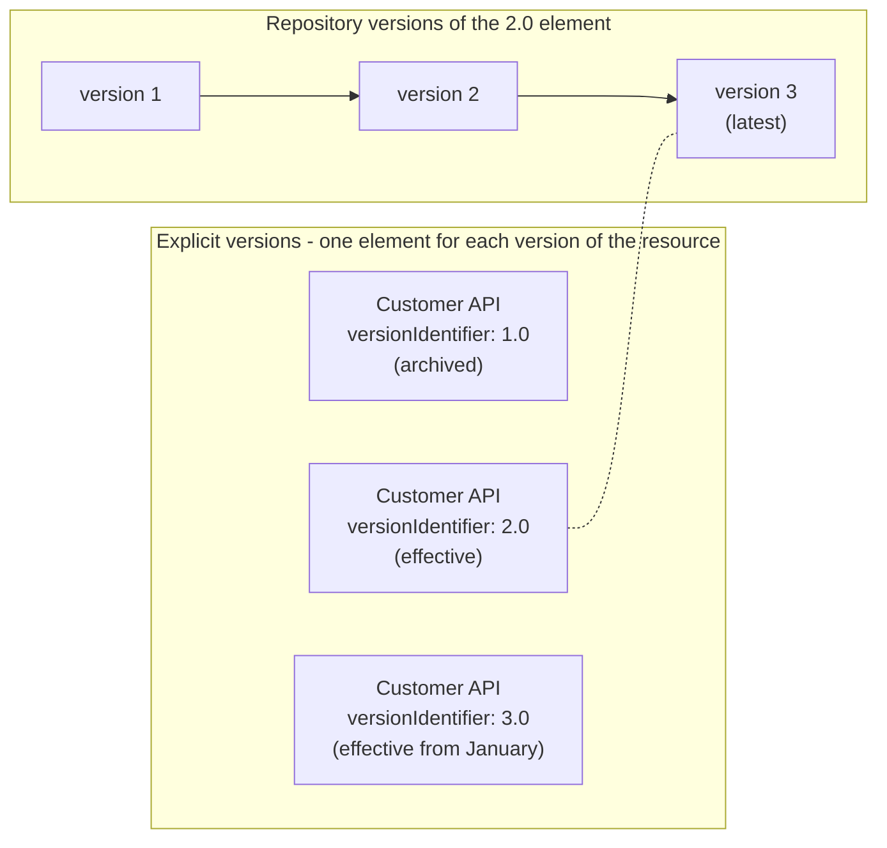
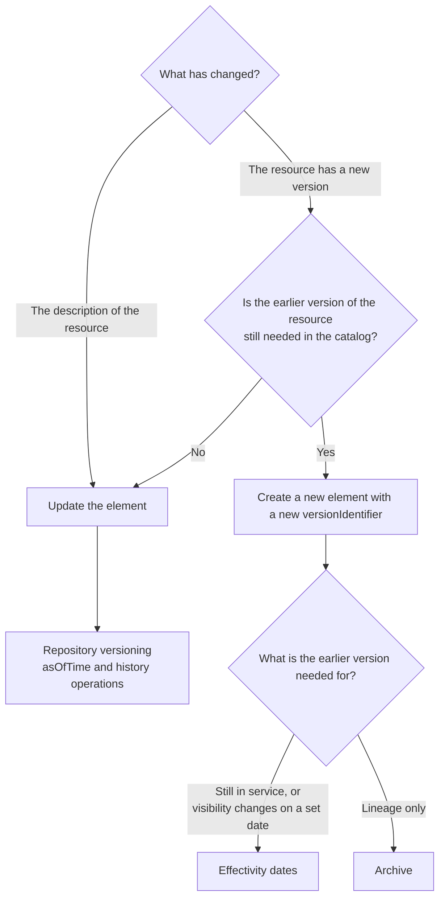

<!-- SPDX-License-Identifier: CC-BY-4.0 -->
<!-- Copyright Contributors to the Egeria project. -->

# Versioning

The word *version* is used in two different ways when people talk about metadata.

* Sometimes it means *"what did this description say last month?"*.  The resource being described has not been replaced, but the metadata about it has been corrected, enriched or reclassified over time, and the earlier state of that metadata is of interest.
* Sometimes it means *"which release of this resource are you talking about?"*.  There is a version 1.0 and a version 2.0 of an API, a schema, a model or a software component, and both are deployed, in use, and need their own description.

Egeria supports both, using two different mechanisms.

| | Repository versioning | Explicit element versions                                                                                                                |
|:--|:--|:-----------------------------------------------------------------------------------------------------------------------------------------|
| What is versioned | The metadata element. | The [resource](/concepts/resource) that the metadata element describes.                                                                  |
| Who creates a new version | The open metadata repository - automatically, on every update. | You (or a connector) - by creating a new element.                                                                                        |
| Where the version is recorded | In the element's header (*version*, *createTime*, *updateTime* ...). | In the element's *versionIdentifier* property, and in its *qualifiedName*.                                                               |
| Number of elements | One element (one [GUID](/concepts/guid)), with a history. | One element (and GUID) for each version.                                                                                                 |
| Versions active at once | One - the latest.  Earlier versions are history. | As many as you need.                                                                                                                     |
| How earlier versions are retrieved | `asOfTime` queries and the history operations. | Ordinary queries using attributes such as *resourceName* and *versionIdentifier*, further controlled by effectivity dates and archiving. |

The two approaches are not alternatives.  Every element that explicitly models a version of a resource is also versioned by its repository, so you can ask what the description of version 2.0 of an API looked like on the day it was released.

## Repository versioning

Each [open metadata repository](/concepts/open-metadata-repository) versions the elements, relationships and classifications that it stores.  There is nothing to switch on and nothing for the caller to do: each time an instance is updated, the repository saves a new version of it and retains the previous one.

The version information is held in the element's header and is returned with the element on every retrieval:

* *version* - the version number.  Egeria's repositories add 1 on each update.
* *createTime* and *createdBy* - when the element was first created and by whom.
* *updateTime* and *updatedBy* - when this version of the element was created, and by whom.
* *maintainedBy* - the list of users that have contributed to the element across all of its versions.

On the view service APIs these appear in the `versions` section of the `elementHeader`:

```json
{
  "elementHeader": {
    "guid": "c3bd1b95-...",
    "versions": {
      "createdBy": "erinoverview",
      "createTime": "2026-03-02T09:14:07.120+00:00",
      "updatedBy": "peterprofile",
      "updateTime": "2026-06-18T15:42:31.004+00:00",
      "maintainedBy": [ "erinoverview", "peterprofile" ],
      "version": 4
    }
  }
}
```

??? info "Repository versions and the cohort"
    The version number does more than record history.  When elements are replicated around an [open metadata repository cohort](/concepts/cohort-member), or loaded from an [open metadata archive](/features/metadata-archiving/overview), the receiving repository compares the incoming version with the one it already holds and only stores the element if it is new, or a later version.  See [metadata provenance](/features/metadata-provenance/overview) for the rules that determine which repository is allowed to create a new version of an element.

### Two time dimensions

Repository versioning gives Egeria *bi-temporal* metadata.  There are four timestamps on every element, relationship and classification, describing two independent time dimensions:

* **Repository time** - *createTime* and *updateTime* record *when the metadata was known* to the repository.  These are maintained automatically and can not be set by the caller.
* **Business time** - *effectiveFrom* and *effectiveTo* record *when the metadata applies* in the real world.  These are the [effectivity dates](/features/effectivity-dates/overview).  They are optional and are set by the caller.

Each has its own option on a query:

| Option | Time dimension | Question it answers | Default (null) |
|:--|:--|:--|:--|
| `asOfTime` | Repository time | What did the repository hold at this moment? | The latest versions. |
| `effectiveTime` | Business time | Which elements are in force at this moment? | Any effective time. |

A query can use both - for example, *"what did we know last Tuesday about what would be in force in January?"*.

### Querying the past with asOfTime

The retrieval operations of the [view services](/services/omvs) accept an `asOfTime` option in the request body.  The time is specified in [ISO 8601](https://en.wikipedia.org/wiki/ISO_8601) format.  When it is set, the repository answers the query using the versions of the elements, relationships and classifications that were current at that time, rather than the latest ones.

```json
{
  "class": "GetRequestBody",
  "asOfTime": "2026-04-30T23:59:59.000+00:00"
}
```

The results are returned as ordinary metadata elements, through the same APIs, so anything that can display or process the current metadata can do the same for the metadata as it was.  The whole query is evaluated at that point in time: an element that has since been deleted is returned, a relationship that had not yet been created is not, and a classification that has since been changed shows its earlier properties.

### Retrieving the versions of an element

`asOfTime` returns the one version that was current at a chosen moment.  To see how an element has changed, retrieve its versions as a list using the history operations of the [Metadata Expert](/services/omvs/metadata-expert/overview) API (and the other view services that share its operations):

| Operation | URL (after `/servers/{serverName}/api/open-metadata/{urlMarker}`) | Returns |
|:--|:--|:--|
| `getMetadataElementHistory` | `/metadata-elements/{elementGUID}/history` | The versions of an element. |
| `getClassificationHistory` | `/metadata-elements/{elementGUID}/classifications/{classificationName}/history` | The versions of one of the element's classifications. |
| `getRelationshipHistory` | `/relationships/{relationshipGUID}/history` | The versions of a relationship. |

The request body is optional.  It can limit the versions returned to those that were current in a particular period (`fromTime` and `toTime` - null means unbounded), control the order (`oldestFirst` - the default is newest first) and page through the results (`startFrom` and `pageSize`).

```
###
# @name getMetadataElementHistory
POST {{baseURL}}/servers/{{viewServer}}/api/open-metadata/metadata-expert/metadata-elements/{{elementGUID}}/history
Authorization: Bearer {{token}}
Content-Type: application/json

{
  "class": "HistoryRequestBody",
  "fromTime": "2026-01-01T00:00:00.000+00:00",
  "toTime": null,
  "oldestFirst": true,
  "startFrom": 0,
  "pageSize": 10
}
```

Each entry in the result is a complete copy of the element at that version, with the `versions` section of its header showing who made the change and when.  Comparing adjacent entries shows what changed in each update, which is the basis for audit, for understanding why a query result has changed, and for analysing how actively a description is being maintained.

!!! attention "Support for history depends on the repository"
    The history is kept by the open metadata repository where the element is stored, and the ability to retain it is an optional capability of a repository.  The [repository workbench](/guides/cts/repository-workbench/profiles/instance-versions) of the conformance test suite reports whether a particular repository supports it.  A repository that does not keep history rejects historical requests rather than returning the latest version in their place.

!!! summary "Usage"
    * Repository versioning is always on.  Read the `versions` section of the element header to see which version you have and who last changed it.
    * Use `asOfTime` to reconstruct what a query would have returned at a time in the past - for example, to explain a decision that was made using the metadata as it was then.
    * Use the history operations to list the versions of a single element, relationship or classification for comparison and analysis.
    * Do not use repository versions to represent different releases of a resource.  Only the latest version is returned by a normal query, so the earlier releases would disappear from the catalog.

!!! attention "Repository history can only go forward"
    The version number is incremented each time an element is updated.  If an update is undone, the previous version's attributes are restored, but the version number is incremented.  Similarly, if a deleted element is restored, its previous state before deletion is restored, but the version number is incremented.  The undo and restore operations are described in the [Metadata Expert API](/services/omvs/metadata-expert/overview#undoing-updates-and-restoring-deleted-elements).

## Explicit element versions

Repository versioning assumes that only the latest version matters day-to-day.  That is not true when it is the *resource* that has versions and more than one of them is active at once:

* Version 1 of an API is still being called while consumers migrate to version 2.
* Three releases of a software component are deployed to different environments.
* A data set is published each month and consumers choose which edition to use.
* A new version of a schema is being designed while the current version is in production.

In these cases, each version of the resource is catalogued as its own metadata element.  Each element has its own GUID, its own properties, classifications and relationships (so each version can have its own schema, owner, lineage, deployment location and so on), and its own repository history.


> **Figure 1:** Three versions of a resource modelled as three elements.  Each of these elements has its own sequence of repository versions.

### Identifying the version

The [*Referenceable*](/concepts/referenceable) type, which is the supertype for most open metadata elements, has a *versionIdentifier* property for this purpose.  It is a string that is managed by the caller, so it can follow whatever convention the resource uses - `2.0`, `V6.3-SNAPSHOT`, `2026-10`, `draft`.

Since each version is a separate element, and a *Referenceable*'s *qualifiedName* must be unique, the *versionIdentifier* value forms part of the *qualifiedName*.  This is the convention followed by the [templates](/features/templated-cataloguing/overview) supplied with Egeria.  For example, the qualified name defined in the template for a CSV tabular data set is:

```
CSV Tabular Data Set::~{directoryPathName}~::~{tableName}~::~{versionIdentifier}~
```

The [placeholder](/concepts/placeholder) for *versionIdentifier* is replaced when the template is used, so each new version catalogued with the template receives a distinct, predictable qualified name.

### Retrieving all of the versions

The properties that identify the resource, rather than the version, tend to be the same across all of its versions:

* *resourceName* - the name of the resource as it is known in its technology.
* *namespacePath* - the qualifying name that locates the resource amongst others of its type.
* *pathName* - the fully qualified location of a file, folder or data store.
* *displayName* - the name shown to people.

This consistency means that a single query on one of these properties (using a *find* or *get by name* operation) returns the elements for all versions of the resource, each identifying itself through its *versionIdentifier*.  Searching on the *qualifiedName* with the version left off the end has the same effect.  The caller can then present the list, select the latest, or select the one that matches the version in use.

This only works if the values are kept consistent.  If *resourceName* includes the version number in one element and not in the next, the versions no longer line up.  Keep the version in *versionIdentifier* and *qualifiedName* and out of the other naming properties.

### Controlling which versions are visible

As versions accumulate, returning all of them on every query becomes unhelpful.  There are two ways to control which versions are returned, and they suit different stages of a version's life.

???+ info "Effectivity dating"
    [Effectivity dates](/features/effectivity-dates/overview) give you fine control over which versions are visible to a query.  Each version's element has its *effectiveFrom* and *effectiveTo* dates set to the period when that version of the resource is in service.  The periods may overlap where versions are active at the same time.

    * A query with `effectiveTime` set to the current time returns only the versions that are in service now.
    * A query with `effectiveTime` set to a future time shows the versions that will be in service then, which allows a new version to be catalogued, reviewed and linked to its consumers before it is released.
    * A query with `effectiveTime` set to a time in the past shows which versions were in service then.
    * A query with a null `effectiveTime` ignores the effectivity dates and returns every version.

    The effectivity dates can be set on relationships and classifications too, so it is possible to describe not only when a version is in service, but when a particular consumer moves from one version to the next.

???+ info "Archiving"
    Archiving is for versions that are no longer in service and are only needed to explain [lineage](/features/lineage-management/overview).  An archived element is classified as a [*Memento*](/concepts/memento).  It remains in the repository, with all of its relationships, but is only returned to requests that set the `forLineage` option.  The result is that the version disappears from searches and other day-to-day queries, but still appears in a lineage graph that shows, for example, which version of a process produced a report two years ago.

    An element is archived using its *delete* operation, with the `deleteMethod` option set to `ARCHIVE`.  The archive date is added to the element's *qualifiedName*.  An archived element can be restored.  See [deleting metadata](/guides/developer/maintaining-metadata/overview#deleting-metadata) for the details.

The two can be used in sequence: effectivity dates manage a version through its planned, active and retired stages, while it may still be of interest to people looking for resources to use; archiving takes over when the version has been decommissioned and its only remaining value is historical.

Notice the difference from an `asOfTime` query.  An `effectiveTime` or `forLineage` query returns the *latest* description of an older version of the resource.  An `asOfTime` query returns an *older description* of whichever elements matched.

!!! summary "Usage"
    * Create a separate element for each version of a resource when more than one version needs to be visible at once, or when the versions differ in their relationships - not just their properties.
    * Set *versionIdentifier* on each element and include its value in the *qualifiedName*.  Using templates makes this consistent.
    * Keep *resourceName*, *namespacePath*, *pathName* and *displayName* the same across the versions so that one query returns them all.
    * Use effectivity dates when you need to control which versions are visible at a particular time, including versions that are planned.
    * Archive a version when it is no longer in service and is only needed for lineage.

## Choosing between them


> **Figure 2:** Choosing how to record a change

??? education "Further information"
    * [The Fourth Dimension](/egeria-solutions/fourth-dimension/overview) describes how `asOfTime`, effectivity dates and context events work together.
    * [Historical queries and effectivity dates](/features/effectivity-dates/overview).
    * [Finding metadata](/guides/developer/finding-metadata/overview) and [maintaining metadata](/guides/developer/maintaining-metadata/overview) in the developer guide describe the options on the query, update and delete requests.
    * The structure of the [element header](/concepts/open-metadata-instances/#instanceauditheader) in the open metadata repositories.

--8<-- "snippets/abbr.md"
