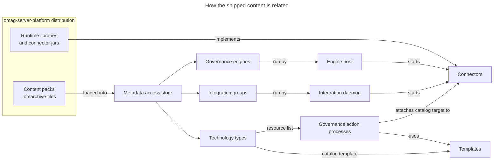

<!-- SPDX-License-Identifier: CC-BY-4.0 -->
<!-- Copyright Contributors to the Egeria project. -->

# Content Catalogs

Egeria ships four kinds of content in its *omag-server-platform* distribution (the directories named below are under `assembly/platform`).  The runtime libraries provide the platform and its services; the configuration decides which of those services run in each server; the connectors plug Egeria into the technologies around it; and the content packs load the open metadata that tells the running servers which connectors to use, and how.  The catalogs on this site describe what is supplied today.

| Catalog | What it describes | Where it is in the distribution |
|---|---|---|
| [Content Pack Catalog](/content-packs) | The [open metadata archives](/concepts/open-metadata-archive) that load connector definitions, [templates](/concepts/template), technology types, reference data, governance definitions and sample metadata into a metadata access store. | `content-packs` directory |
| [Connector Catalog](/connectors) | The connector implementations supplied by the Egeria community, organized by what they connect to and where they run. | `lib` directory (connector jar files) |
| [Template Catalog](/catalog-templates) | The templates supplied by the content packs, which describe how to catalog a particular kind of resource, along with the placeholders they need. | Inside the content packs |
| [Configuration](/guides/admin) | How to configure the [OMAG servers](/concepts/omag-server) that run on the platform, and which services each one activates. | `data/servers` directory (sample configuration documents) and the platform's `application.properties` |
| [Runtime libraries](/services) | The services that manage open metadata, run the connectors and provide Egeria's APIs. | `omag-server-platform` jar file and the `lib` directory |

## How the content fits together

The content packs, connectors and templates are closely linked.  A content pack does not contain any code: it describes the connectors that are present in the platform's libraries, and configures them by defining [integration groups](/concepts/integration-group) and [governance engines](/concepts/governance-engine) that list the connectors to run.  An [integration daemon](/concepts/integration-daemon) or [engine host](/concepts/engine-host) reads this configuration from its [metadata access store](/concepts/metadata-access-store) and starts the connectors, so loading a content pack is enough to put its connectors to work.

The content packs also define the [technology types](/concepts/deployed-implementation-type) for the resources the connectors work with.  Each technology type links to the templates for cataloguing resources of that type, and to the [governance action processes](/concepts/governance-action-process) that create the resource's asset from its template and hand it to the right connector.  This is how a tool, or a person, can start from the name of a technology and find everything needed to bring it under governance.

!!! summary "Usage"
    Use the [Content Pack Catalog](/content-packs) to choose the content packs to load for the technologies you work with, the [Template Catalog](/catalog-templates) to find out what information is needed to catalog a resource, and the [Connector Catalog](/connectors) to see which connectors are available and where each one runs.

--8<-- "snippets/abbr.md"
