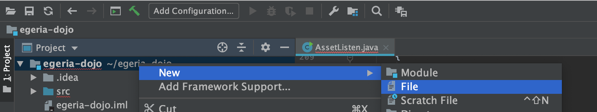
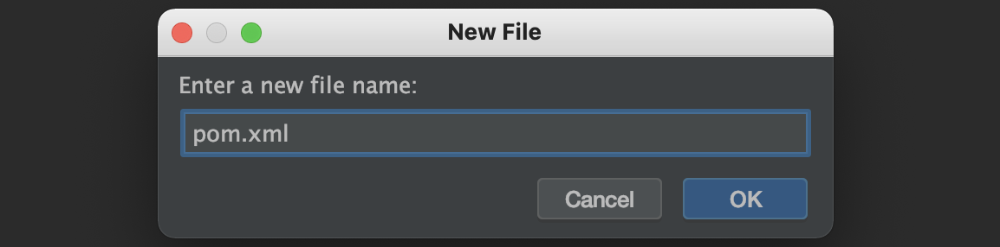

<!-- SPDX-License-Identifier: CC-BY-4.0 -->
<!-- Copyright Contributors to the Egeria project. -->

A `pom.xml` is the file that controls an Apache Maven build. From IntelliJ, select the top level directory for the module (`egeria-dojo` in this case) and using the right-mouse menu, select `New` and then `File` from the sub menu.



Enter `pom.xml` as the file name and click `OK`.



Egeria's libraries are published to Maven Central under the group `org.odpi.egeria`.  Egeria also publishes a BOM (bill of materials) with the artifact name `egeria`.  Importing it into the `dependencyManagement` section of your `pom.xml` sets the version of every Egeria module and of the third-party libraries that Egeria is built and tested with, so the individual dependencies do not need a version.

The example below is a starting point for a utility that calls the platform services.  Change the `groupId`, `artifactId` and Egeria version to suit your utility, and add the client modules for the services you need to call (see [Java clients](/guides/developer/java-clients/overview)).

```xml linenums="1"
<?xml version="1.0" encoding="UTF-8"?>
<project xmlns="http://maven.apache.org/POM/4.0.0"
         xmlns:xsi="http://www.w3.org/2001/XMLSchema-instance"
         xsi:schemaLocation="http://maven.apache.org/POM/4.0.0 http://maven.apache.org/xsd/maven-4.0.0.xsd">
    <modelVersion>4.0.0</modelVersion>

    <groupId>org.example</groupId>
    <artifactId>egeria-dojo</artifactId>
    <version>1.0-SNAPSHOT</version>

    <properties>
        <maven.compiler.release>21</maven.compiler.release>
        <open-metadata.version>6.2</open-metadata.version>
    </properties>

    <dependencyManagement>
        <dependencies>
            <dependency>
                <groupId>org.odpi.egeria</groupId>
                <artifactId>egeria</artifactId>
                <version>${open-metadata.version}</version>
                <type>pom</type>
                <scope>import</scope>
            </dependency>
        </dependencies>
    </dependencyManagement>

    <dependencies>
        <dependency>
            <groupId>org.odpi.egeria</groupId>
            <artifactId>platform-services-client</artifactId>
        </dependency>
        <dependency>
            <groupId>org.odpi.egeria</groupId>
            <artifactId>open-metadata-framework</artifactId>
        </dependency>
        <dependency>
            <groupId>org.odpi.egeria</groupId>
            <artifactId>open-connector-framework</artifactId>
        </dependency>
        <dependency>
            <groupId>org.odpi.egeria</groupId>
            <artifactId>audit-log-framework</artifactId>
        </dependency>
        <dependency>
            <groupId>org.odpi.egeria</groupId>
            <artifactId>yaml-secrets-store-connector</artifactId>
            <scope>runtime</scope>
        </dependency>
        <dependency>
            <groupId>org.odpi.egeria</groupId>
            <artifactId>http-helper</artifactId>
        </dependency>
        <dependency>
            <groupId>ch.qos.logback</groupId>
            <artifactId>logback-classic</artifactId>
        </dependency>
    </dependencies>
</project>
```

Egeria requires Java 21, hence `maven.compiler.release` is set to `21`.  The Java clients declare their own Egeria dependencies with runtime scope, so the frameworks whose classes appear in a client's method signatures are listed explicitly: `open-metadata-framework` (for example `org.odpi.openmetadata.frameworks.openmetadata.ffdc.InvalidParameterException`), `open-connector-framework` (`SecretsStoreConnector`) and `audit-log-framework` (`AuditLog`).  The `yaml-secrets-store-connector` provides `YAMLSecretsStoreProvider`, a secrets store that the clients can use to obtain their bearer token (see [secrets store connector](/concepts/secrets-store-connector)).  The [HTTP Helper](/guides/developer/http-helper/overview) and [Logback](/guides/developer/logback/overview) dependencies are explained on their own pages.

??? tip "Using Gradle instead"
    Egeria itself is built with Gradle, and the same published artifacts can be used from a Gradle build.  The equivalent `dependencies` block in `build.gradle` is:

    ```groovy
    dependencies {
        implementation platform("org.odpi.egeria:egeria:6.2")
        implementation 'org.odpi.egeria:platform-services-client'
        implementation 'org.odpi.egeria:open-metadata-framework'
        implementation 'org.odpi.egeria:open-connector-framework'
        implementation 'org.odpi.egeria:audit-log-framework'
        runtimeOnly 'org.odpi.egeria:yaml-secrets-store-connector'
        implementation 'org.odpi.egeria:http-helper'
        implementation 'ch.qos.logback:logback-classic'
    }
    ```
