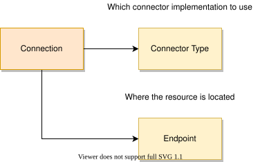

<!-- SPDX-License-Identifier: CC-BY-4.0 -->
<!-- Copyright Contributors to the ODPi Egeria project. -->

The purpose of the connector provider is to provide information on how to configure, and initialize a particular connector implementation.  It is both an information component describing the properties of the connector during set up, and also the factory class used to create an instance of the connector at runtime.

### The ConnectorProvider class

All connector providers extend the abstract [`ConnectorProvider`](https://odpi.github.io/egeria/org/odpi/openmetadata/frameworks/connectors/ConnectorProvider.html) class.  This class includes the `getConnectorType()` method that returns the [`ConnectorType`](https://odpi.github.io/egeria/org/odpi/openmetadata/frameworks/connectors/properties/beans/ConnectorType.html) that is added to a [Connection object](/concepts/connection) used to create an instance of the connector.

> The connection object contains properties needed by the connector to operate.  It includes a connector type object that is used when constructing the connector and an endpoint object that defines where the corresponding [digital resource](/concepts/digital-resource) is located.

The connector type describes the capabilities of the connector such as:

- the java class of this connector provider. A connector provider is the factory for its [Connector](/concepts/connector).  It is typically called from the [Connector Broker](/concepts/connector-broker).  The connector broker uses the `connectorProviderClassName` in the connector type to create an instance of the connector provider.

- the `configurationProperties` that can be added to the connector's connection object to adapt its behavior.  The administrator who is configuring the connector uses the `recognizedConfigurationProperties` from the connector type to determine the properties that the connector supports.

- the interfaces that the connector implements (`connectorInterfaces`), the type of asset and deployed implementation type it works with (`supportedAssetTypeName` and `supportedDeployedImplementationType`) and the format of any data it expects (`expectedDataFormat`).

The `ConnectorProvider` class also defines the `getConnector()` method called to construct an instance of the connector at runtime using the connection object.

In addition, `ConnectorProvider` has methods that return more detailed information to tools that are configuring the connector: `getSupportedConfigurationProperties()`, `getSupportedTemplateTypes()` and `getSupportedTechnologyTypes()`.  These return values that a subclass sets up in the protected `supportedConfigurationProperties`, `supportedTemplateTypes` and `supportedTechnologyTypes` variables.

### Audit Logging

If the connector provider implements the [`AuditLoggingComponent`](https://odpi.github.io/egeria/org/odpi/openmetadata/frameworks/auditlog/AuditLoggingComponent.html) interface, it is passed an [audit log object](https://odpi.github.io/egeria/org/odpi/openmetadata/frameworks/auditlog/AuditLog.html) through `setAuditLog()`.  This audit log is used to create child audit log objects that are passed to each connector instance when it is created.

The connector provider is also able to return the [`ComponentDescription`](https://odpi.github.io/egeria/org/odpi/openmetadata/frameworks/auditlog/ComponentDescription.html) object used in each child audit log through `getConnectorComponentDescription()`.

### ConnectorProviderBase and OpenConnectorProviderBase classes

Egeria provides a base class for the connector provider called [`ConnectorProviderBase`](https://odpi.github.io/egeria/org/odpi/openmetadata/frameworks/connectors/ConnectorProviderBase.html) that implements the factory method for a connector and the `AuditLoggingComponent` interface.  It also stores all the properties needed by the information methods such as `getConnectorType()`.  If the connector type has no values for properties such as the qualified name, connector provider class name, framework name, interface language and connector interfaces, `getConnectorType()` fills them in from the provider's class and the connector's class.

Most connector providers extend `OpenConnectorProviderBase` (a subclass of `ConnectorProviderBase`), or a base class for a specific type of connector that extends it.  Its constructor takes an `OpenConnectorDefinition` that describes the connector, the class name of the connector, and the list of recognized configuration property names.  It uses these values to build both the connector type and the component description used in the audit log.

