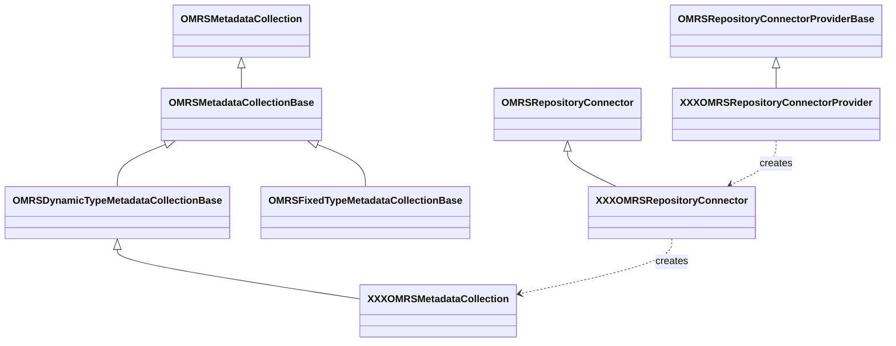

<!-- SPDX-License-Identifier: CC-BY-4.0 -->
<!-- Copyright Contributors to the Egeria project. -->

# Implementing a Repository Connector

A [repository connector](/concepts/repository-connector) is built from three classes: a connector provider, a connector, and the metadata collection that the connector returns.  The interfaces and base classes are described in [Writing Repository Connectors](/guides/developer/repository-connectors/overview).  This page walks through the steps to implement each of them, and to plug the result into an [OMAG Server](/concepts/omag-server).



## Build dependencies

The interfaces and base classes are in the *repository-services-apis* module.  A repository connector also depends on the [Open Connector Framework (OCF)](/frameworks/ocf/overview), the [Audit Log Framework (ALF)](/frameworks/alf/overview) and the [Open Metadata Framework (OMF)](/frameworks/omf/overview), whose exceptions appear on the OCF's API.

=== "Maven"

    ```xml
    <dependencies>

        <dependency>
            <groupId>org.odpi.egeria</groupId>
            <artifactId>open-connector-framework</artifactId>
        </dependency>

        <dependency>
            <groupId>org.odpi.egeria</groupId>
            <artifactId>audit-log-framework</artifactId>
        </dependency>

        <dependency>
            <groupId>org.odpi.egeria</groupId>
            <artifactId>open-metadata-framework</artifactId>
        </dependency>

        <dependency>
            <groupId>org.odpi.egeria</groupId>
            <artifactId>repository-services-apis</artifactId>
        </dependency>

    </dependencies>
    ```

=== "gradle"

    ```
    dependencies {
        compileOnly project(':open-metadata-implementation:frameworks:open-connector-framework')
        compileOnly project(':open-metadata-implementation:frameworks:audit-log-framework')
        compileOnly project(':open-metadata-implementation:frameworks:open-metadata-framework')
        compileOnly project(':open-metadata-implementation:repository-services:repository-services-apis')
    }
    ```

## Writing the connector provider

--8<-- "docs/guides/developer/implementing-a-connector-provider.md"

The connector provider for a repository connector extends `OMRSRepositoryConnectorProviderBase`.  For example, the in-memory repository's provider is:

```java
public class InMemoryOMRSRepositoryConnectorProvider extends OMRSRepositoryConnectorProviderBase
{
    /*
     * Class of the connector.
     */
    private static final String connectorClassName     = "org.odpi.openmetadata.adapters.repositoryservices.inmemory.repositoryconnector.InMemoryOMRSRepositoryConnector";

    /**
     * Constructor used to initialize the ConnectorProviderBase with the Java class name of the specific
     * OMRS Connector implementation.
     */
    public InMemoryOMRSRepositoryConnectorProvider()
    {
        super(EgeriaOpenConnectorDefinition.IN_MEMORY_REPOSITORY_CONNECTOR,
              connectorClassName,
              null);
    }
}
```

## Writing the connector

The connector extends `OMRSRepositoryConnector`.  When the server starts, the [Open Metadata Repository Services (OMRS)](/services/omrs) creates the connector from its connection and then calls the following methods, in this order, before calling `start()`:

1. `setAuditLog` and `setMaxPageSize`.
2. `setServerName`, `setServerType`, `setServerUserId` and `setOrganizationName`.
3. `setRepositoryHelper` and `setRepositoryValidator` - these supply the [repository helper](/concepts/repository-helper) and [repository validator](/concepts/repository-validator) that the connector and its metadata collection use to build and check type definitions and instances.
4. `setMetadataCollectionName` and then `setMetadataCollectionId`.

The OMRS calls `getMetadataCollection()` as soon as `setMetadataCollectionId` returns, so the connector should override `setMetadataCollectionId` to create its metadata collection.  The base class's `getMetadataCollection()` throws a `RepositoryErrorException` if the `metadataCollection` variable has not been set.  This is how the in-memory repository connector does it:

```java
    @Override
    public void setMetadataCollectionId(String metadataCollectionId)
    {
        if (metadataCollectionId == null)
        {
            super.metadataCollectionId = UUID.randomUUID().toString();
        }
        else
        {
            super.metadataCollectionId = metadataCollectionId;
        }

        /*
         * Initialize the metadata collection only once the connector is properly set up.
         */
        super.metadataCollection = new InMemoryOMRSMetadataCollection(this,
                                                                      super.serverName,
                                                                      repositoryHelper,
                                                                      repositoryValidator,
                                                                      super.metadataCollectionId);
    }
```

Use the `start()` and `disconnect()` methods to open and close the connection to the repository technology.  The connection's endpoint, secured properties and configuration properties are available from the `connectionBean` variable inherited from `ConnectorBase`.

## Writing the metadata collection

The metadata collection extends one of the base classes described in [Choosing a base class for the metadata collection](/guides/developer/repository-connectors/overview#choosing-a-base-class-for-the-metadata-collection).  Its constructor receives the parent connector, the repository name, the repository helper and validator, and the metadata collection id.  `OMRSFixedTypeMetadataCollectionBase` also takes the names of the attribute types and types that the repository supports.

The methods of `OMRSMetadataCollection` fall into these groups:

* Methods to retrieve information about the metadata repository, such as `getMetadataCollectionId`.
* Methods for working with the type definitions (TypeDefs and AttributeTypeDefs).  These are handled by `OMRSDynamicTypeMetadataCollectionBase` and `OMRSFixedTypeMetadataCollectionBase`.
* Methods for querying entities and relationships, for example `getEntityDetail`, `findEntities` and `findRelationships`.
* Methods for maintaining the instances, for example `addEntity`, `updateEntityProperties`, `classifyEntity`, `addRelationship`, `deleteEntity`, `restoreEntity` and `purgeEntity`.
* Methods for repairing the metadata collections of the cohort, for example `reIdentifyEntity`, `reTypeEntity` and `reHomeEntity`.
* Methods for the local maintenance of reference copies, for example `saveEntityReferenceCopy` and `purgeEntityReferenceCopy`.  These changes are not sent to the rest of the cohort.

Use the repository helper to build instances (for example `getSkeletonEntity`, `getNewRelationship` and `getNewClassification`) and the repository validator to check the parameters and the instances against their types.  The [OMRS metamodel](/guides/developer/repository-connectors/metamodel/overview) describes the structures that the methods work with.

!!! tip "Use the existing connectors as a guide"
    The [in-memory :material-github:](https://github.com/odpi/egeria/tree/main/open-metadata-implementation/adapters/open-connectors/repository-services-connectors/open-metadata-collection-store-connectors/inmemory-repository-connector){ target=gh } and [PostgreSQL :material-github:](https://github.com/odpi/egeria/tree/main/open-metadata-implementation/adapters/open-connectors/repository-services-connectors/open-metadata-collection-store-connectors/postgres-repository-connector){ target=gh } repository connectors are complete native repository implementations built on `OMRSDynamicTypeMetadataCollectionBase`.  Both return an `OMRSDynamicTypeStore` from `getDynamicTypeStore()` so that the types defined through their API survive a restart.

## Adding an event mapper

If the repository's content can be changed through the third party technology's own interfaces, add an [event mapper connector](/guides/developer/repository-connectors/event-mapper-connector) so that these changes are sent to the other members of the cohort.

## Configuring the connector in a server

Once the connector's JAR file is on the OMAG Server Platform's classpath, it is configured with the [Administration Services](/services/admin-services/overview):

* For a native repository in a [metadata access store](/concepts/metadata-access-store), use `POST /open-metadata/admin-services/servers/{serverName}/local-repository/mode/plugin-repository/details?connectorProvider={connectorProviderClassName}`.  The request body is an optional map of configuration properties.  Alternatively, pass a complete connection to `.../local-repository/mode/plugin-repository/connection`.  See [Configuring a Metadata Access Store](/guides/admin/servers/by-server-type/configuring-a-metadata-access-store).
* For an adapter to a third party repository in a [repository proxy](/concepts/repository-proxy), use `POST .../local-repository/mode/repository-proxy/details?connectorProvider={connectorProviderClassName}` (or `.../repository-proxy/connection`).  See [Configuring a Repository Proxy](/guides/admin/servers/by-server-type/configuring-a-repository-proxy).

## Testing the connector

The [Conformance Test Suite](/guides/cts) runs a repository workbench against the connector to check that it correctly implements the repository services protocols.

--8<-- "snippets/abbr.md"
