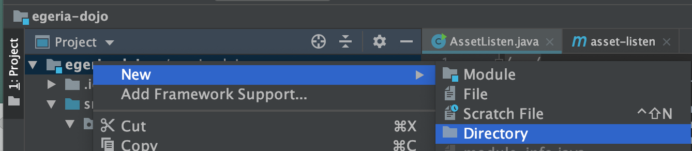
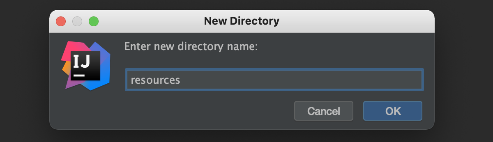
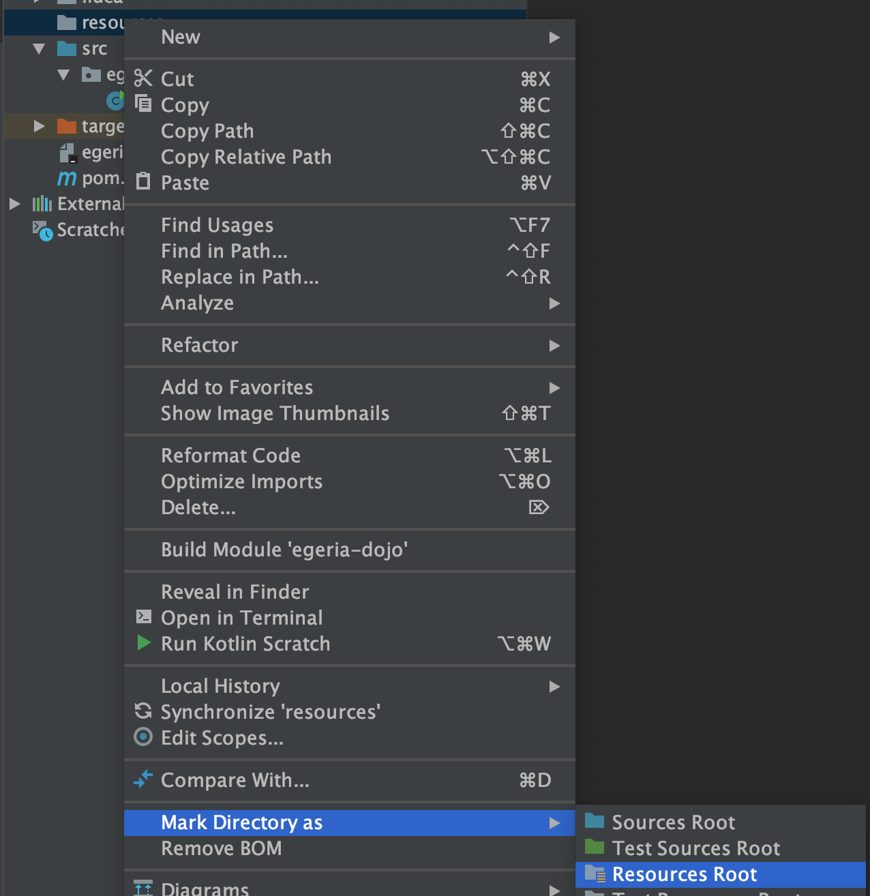
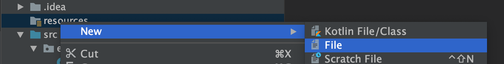

<!-- SPDX-License-Identifier: CC-BY-4.0 -->
<!-- Copyright Contributors to the Egeria project. -->

# Configuring Logback

Egeria's clients use *SLF4J* for developer logging.  This technology expects a logging destination (called a *provider* in SLF4J 2.x) to be provided.  Egeria's libraries deliberately do not include one, so that the application stays in control of its logging.  If you see the following message when you run your utility, then you need to provide a logging destination.

```bash
SLF4J(W): No SLF4J providers were found.
SLF4J(W): Defaulting to no-operation (NOP) logger implementation
SLF4J(W): See https://www.slf4j.org/codes.html#noProviders for further details.
```

Older versions of SLF4J (1.7.x) report the same problem as `Failed to load class "org.slf4j.impl.StaticLoggerBinder"`.

*Logback* is a technology that provides a logging destination for SLF4J.  It is included in your utility if its dependency is added to your pom.xml file.

```xml

<dependency>
    <groupId>ch.qos.logback</groupId>
    <artifactId>logback-classic</artifactId>
    <scope>compile</scope>
    <version>${logback.version}</version>
</dependency>

```

If you import Egeria's BOM (`org.odpi.egeria:egeria`, see [Building utilities](/guides/developer/building-utilities/overview)) the version can be omitted, since the BOM sets the logback version that Egeria is built and tested with.  Using Gradle, the equivalent is `implementation 'ch.qos.logback:logback-classic'`.

Controlling the level of developer logging is handled by a `logback.xml` file located in a resource directory of your module.  For a Maven or Gradle project, this is `src/main/resources`, which the build tool already treats as a resources root.  For a plain IntelliJ project, create the directory as described below.

??? tip "Creating the `logback.xml` file"
    Select your top-level code directory (module) and using the right-mouse menu select `New` then `Directory`.  
    
    
    Enter the directory name as `resources`.
    
    
    Select the new `resources` directory. Use the right-mouse menu to select `Mark Directory as` and then `Resources Root`.
    
    
    The icon of the directory changes.
    
    
    Select the `resources` directory again. Use the right-mouse menu to select `New` and then `File`.
    
    
    Enter the filename of `logback.xml` and click ok
    


The content of the `logback.xml` defines the level of logging.  This is a suggested starting set of values for logback that turns developer logging off.  You can then enable the logging as required. 

```xml
<?xml version="1.0" encoding="UTF-8"?>

<!-- SPDX-License-Identifier: Apache-2.0 -->
<!-- Copyright Contributors to the ODPi Egeria project. -->

<configuration>

  <appender name="STDOUT" class="ch.qos.logback.core.ConsoleAppender">
    <encoder>
      <pattern>%d{HH:mm:ss.SSS} [%thread] %-5level %logger{36} - %msg%n</pattern>
    </encoder>
  </appender>

  <root level="OFF">
    <appender-ref ref="STDOUT" />
  </root>
</configuration>
```

If your utility includes unit tests, you will need to create a `logback-test.xml` file in the same `resources` directory with similar content.

For a fuller example, the `logback.xml` file at the top level of the [egeria repository](https://github.com/odpi/egeria/blob/main/logback.xml) is shipped as a sample in the `etc` directory of the OMAG Server Platform distribution (copy it into `platform/extra` to activate it).  It writes developer logging to a rolling `debug.log` file, routes a server's audit log records (logger `org.odpi.openmetadata.frameworks.auditlog.<serverName>`) to a separate `audit.log` file, and sets the logging levels for the platform chassis (`org.odpi.openmetadata.serverchassis.springboot`) and the embedded Tomcat server.

--8<-- "snippets/abbr.md"
