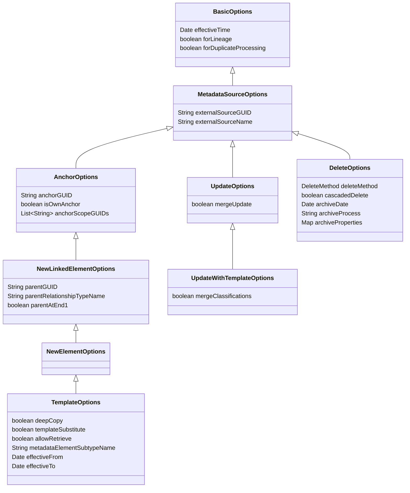
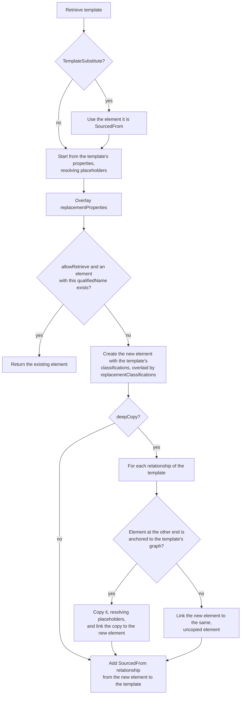
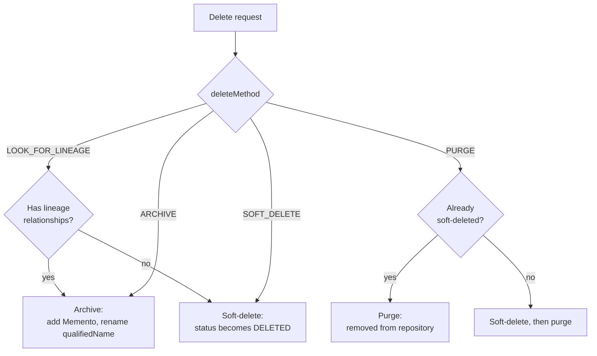

<!-- SPDX-License-Identifier: CC-BY-4.0 -->
<!-- Copyright Contributors to the Egeria project. -->

# Creating, updating and deleting metadata

This section describes how to maintain metadata in the open metadata ecosystem: creating new elements (either from scratch or by copying a template), updating their properties, and removing them again.  It is the counterpart of [Retrieving Metadata](/guides/developer/finding-metadata/overview).

The [Open Metadata View Services (OMVSs)](/services/omvs) each offer create, update and delete operations for the kinds of element they manage.  For example, the [Glossary Manager](/services/omvs/glossary-manager/overview) has these operations for glossary terms:

| Operation                        | URL (under `/servers/{serverName}/api/open-metadata/glossary-manager`) | Request body               |
|:---------------------------------|:-----------------------------------------------------------------------|:---------------------------|
| Create a term                    | `/glossaries/terms`                                                    | `NewElementRequestBody`    |
| Create a term from a template    | `/glossaries/terms/from-template/{templateGUID}`                       | `TemplateRequestBody`      |
| Update a term                    | `/glossaries/terms/{glossaryTermGUID}/update`                          | `UpdateElementRequestBody` |
| Update a term from a template    | `/glossaries/terms/{glossaryTermGUID}/update/from-template/{templateGUID}` | `UpdateWithTemplateRequestBody` |
| Delete a term                    | `/glossaries/terms/{glossaryTermGUID}/delete`                          | `DeleteElementRequestBody` |

The other view services follow the same pattern, and the [Metadata Expert](/services/omvs/metadata-expert/overview) offers the same operations for any type of element (`/metadata-elements`, `/metadata-elements/from-template`, `/metadata-elements/{metadataElementGUID}/delete` and so on).  Whichever service you call, the request is processed by the same code in the metadata access server, so the behaviour described on this page applies to all of them.

## Request options

Each request body extends an *options* class from the [Open Metadata Framework (OMF)](/frameworks/omf/overview) (package `org.odpi.openmetadata.frameworks.openmetadata.search`).  The options are arranged in a hierarchy so that common options are always named the same way.  The same options classes are passed on the Java clients.



The options shared by every maintenance request are:

* `externalSourceGUID` and `externalSourceName` - identify the [software capability](/concepts/software-capability) that owns the element when it is maintained on behalf of a third party technology.  Setting them gives the element [external provenance](/features/metadata-provenance/overview), and from then on only requests that supply the same external source can update or delete it.  Leave them null for elements that are maintained directly in open metadata.
* `effectiveTime`, `forLineage` and `forDuplicateProcessing` - these control the retrievals that the request makes along the way, such as locating the parent or anchor element.  They are described in [Types of filtering](/guides/developer/finding-metadata/overview#types-of-filtering).

## Creating metadata

A create request supplies the type and properties of the new element in a `NewElementRequestBody`.  The `properties` object carries a `class` discriminator naming the properties bean for the type - for example `GlossaryTermProperties` for a *GlossaryTerm* - and its `typeName` may name a subtype of that bean's type.  The `effectiveFrom` and `effectiveTo` properties set the element's [effectivity dates](/guides/developer/finding-metadata/overview#types-of-filtering).

Alongside the properties, the request controls where the new element sits in the graph:

* **Anchoring** - `anchorGUID` names an existing element that the new element is [anchored](/features/anchor-management/overview) to.  An anchored element shares its anchor's lifecycle and security: it is deleted when its anchor is deleted, and copied when its anchor is used as a template.  If `anchorGUID` is null, `isOwnAnchor` (default `true`) makes the new element the anchor of its own graph.  `anchorScopeGUIDs` records the broader scope (such as a glossary or a digital product) that the anchor belongs to - if it is null, it is taken from the anchor element.
* **Parent** - `parentGUID` names an existing element to connect the new element to, `parentRelationshipTypeName` names the type of relationship to create, and `parentAtEnd1` (default `true`) says which end of the relationship the parent goes at.  The relationship's own properties are passed in `parentRelationshipProperties`.  If `parentGUID` is set, `parentRelationshipTypeName` must be set too.  This saves a separate call to link the new element into place, and the element and relationship are created in the same request.
* **Classifications** - `initialClassifications` is a map from classification name to its properties bean, for classifications that should be attached when the element is created.

```
###
# @name createGlossaryTerm
POST {{baseURL}}/servers/{{viewServer}}/api/open-metadata/glossary-manager/glossaries/terms
Authorization: Bearer {{token}}
Content-Type: application/json

{
  "class" : "NewElementRequestBody",
  "anchorGUID" : "{{glossaryGUID}}",
  "isOwnAnchor" : false,
  "parentGUID" : "{{glossaryGUID}}",
  "parentRelationshipTypeName" : "CollectionMembership",
  "parentAtEnd1" : true,
  "properties" : {
    "class" : "GlossaryTermProperties",
    "qualifiedName" : "GlossaryTerm::Clinical Trials::Patient",
    "displayName" : "Patient",
    "summary" : "A person receiving treatment.",
    "aliases" : [ "Subject" ]
  }
}
```

The response is a `GUIDResponse` carrying the unique identifier of the new element.

## Templated creates

A [template](/concepts/template) is an existing element (usually classified with the [*Template*](/types/0/0011-Templates) classification) whose properties, classifications and anchored elements are copied to create a new element.  Templates make it easy to create a consistent cluster of elements in one call - for example, the PostgreSQL server templates create a software server, its software capability, endpoint and connection together.  The templates supplied with Egeria are listed in the [Template Catalog](/catalog-templates), and the [Template Manager](/services/omvs/template-manager/overview) helps you build your own.

A templated create passes a `TemplateRequestBody`.  It has all the anchor and parent options of a normal create, plus:

| Field                         | Default | Purpose |
|:------------------------------|:--------|:--------|
| `templateGUID`                |         | The element to copy.  On many view services it is in the URL instead. |
| `placeholderPropertyValues`   | null    | Values for the `~{placeholderName}~` placeholders in the template's string properties. |
| `replacementProperties`       | null    | Properties that override the template's properties in the new top-level element. |
| `replacementClassifications`  | null    | Classifications (and their properties) that override or add to the template's classifications in the new top-level element. |
| `deepCopy`                    | `true`  | Copy the elements anchored to the template as well as the template itself. |
| `allowRetrieve`               | `true`  | If an element of the same type already has the new element's qualified name, return it instead of creating a new one. |
| `isTemplateSubstitute`        | `false` | Classify the new element as a *TemplateSubstitute* (see below). |
| `metadataElementSubtypeName`  | null    | Create the new element as a subtype of the template's type. |
| `effectiveFrom`, `effectiveTo`| null    | The effectivity dates of the new element. |

### How the copy is made

The diagram below shows the decisions made for the template and for each element linked to it.



The details of each step are as follows:

* **Type** - the new element is the template's type.  The type named on the request may be the template's type, one of its supertypes, or one of its subtypes; a subtype (or `metadataElementSubtypeName`) creates the new element as that subtype, with the template's properties as its defaults.  Any other type is rejected.
* **Properties** - the template's properties are the defaults.  Placeholders in them are resolved first, and then any `replacementProperties` are overlaid property by property.  As with a [merge update](#updating-metadata), a supplied map or array property replaces the template's value entirely.
* **Classifications** - the template's classifications are copied, except *Template* and *Anchors*.  The *Anchors* classification is set up afresh from the request's anchor options.  `replacementClassifications` are then overlaid.
* **Anchored elements** - with `deepCopy` set, each element that is anchored to the template's graph is copied, and the copy is anchored to the copy of whatever the original was anchored to.  So an endpoint anchored to a connection in the template is anchored to the new connection, not flattened onto the new top-level element.  Elements that are linked to the template but not anchored to it, such as a glossary term the template is assigned to, are not copied: the new element is simply linked to the same element.  *SourcedFrom* and *CatalogTemplate* relationships are skipped, since they describe the template rather than form part of it.
* **Templates within a graph** - if the template is itself anchored to another element (say, a schema attribute in the middle of a schema), only its own part of that graph is copied - the elements at end 2 of its structural and attachment relationships.  Its parent and siblings are not linked to the copy; use the parent options to attach the copy where it belongs.
* **Traceability** - a *SourcedFrom* relationship links each new element to the template element it was copied from.  Its `sourceVersionNumber` property records the version of the template that was used, so that later changes to the template can be identified.

All the instances created by one templated create carry the same operation identifier, and the audit log records a summary of which template element was mapped to which new element.

### Placeholders

Template properties can contain [placeholders](/concepts/placeholder), written `~{placeholderName}~`.  When the template is copied, each string property in each copied element, and in the copied relationships, is processed like this:

* If a value is supplied for the placeholder, it replaces the placeholder wherever it appears in the property.
* If the placeholder is supplied with a null value, the placeholder is removed.
* If no value is supplied for the placeholder at all, the placeholder is left in place.

Placeholders are what make the copies unique.  Each copied element keeps the qualified name from its template element, after its placeholders have been resolved, so every element in a template should include a placeholder (typically the same one) in its *qualifiedName*.  The placeholders a template expects are listed in its [specification](/concepts/specification).

```
###
# @name createGlossaryTermFromTemplate
POST {{baseURL}}/servers/{{viewServer}}/api/open-metadata/glossary-manager/glossaries/terms/from-template/{{templateGUID}}
Authorization: Bearer {{token}}
Content-Type: application/json

{
  "class" : "TemplateRequestBody",
  "anchorGUID" : "{{glossaryGUID}}",
  "isOwnAnchor" : false,
  "parentGUID" : "{{glossaryGUID}}",
  "parentRelationshipTypeName" : "CollectionMembership",
  "parentAtEnd1" : true,
  "placeholderPropertyValues" : {
    "termName" : "Patient",
    "glossaryName" : "Clinical Trials"
  },
  "replacementProperties" : {
    "class" : "GlossaryTermProperties",
    "summary" : "A person receiving treatment."
  }
}
```

### Retrieving instead of creating

With `allowRetrieve` set (the default), the qualified name that the new element would have is looked up first.  If an element of the same type already has it, that element's unique identifier is returned and nothing is created or copied.  This makes it safe to repeat a templated create, for example each time a connector restarts.  The parent relationship is still added if the existing element is not already linked to the parent.  Set `allowRetrieve` to `false` if a clash should be reported as an error instead.

### Template substitutes

Sometimes a template needs to link to an element that should not be used directly - for example, a template for a database schema might want to link to "the database it is deployed on", which differs for each copy.  A *template substitute* stands in for the real element.  A template substitute is linked by *SourcedFrom* to the element it stands in for, and when the copy reaches it, the copy is linked to that element instead.  If the template being copied is itself a template substitute, the element it is sourced from is used as the template.  A substitute with no *SourcedFrom* relationship is rejected.  Set `isTemplateSubstitute` to create a new substitute from a template.

### Updating an element from a template

The `update/from-template` operations take an `UpdateWithTemplateRequestBody` and copy the template's properties and classifications onto an existing element.  The element always keeps its own qualified name, and no elements are created or linked.

* The template's properties are applied as an update, so `mergeUpdate` works exactly as described [below](#updating-metadata).
* A classification that both have takes the template's properties.  A classification only the template has is added.  With `mergeClassifications` set (the default), classifications that only the element has are kept.  With it set to `false`, they are removed, so the element ends up with the same classifications as the template.
* The *Anchors*, *Template*, *TemplateSubstitute* and *Memento* classifications are never copied or removed.

## Updating metadata

An update request supplies new properties for an existing element in an `UpdateElementRequestBody`.  The `mergeUpdate` option decides how the new properties are combined with the existing ones.

| `mergeUpdate`      | Behaviour |
|:-------------------|:----------|
| `true` (default)   | **Merge update.**  Each property in the request replaces the matching property in the element.  Properties that are not in the request keep their current values. |
| `false`            | **Replace update.**  The element's properties are replaced by those in the request.  Properties that are not in the request are removed.  The `qualifiedName` must be supplied. |

!!! warning "Maps and arrays are replaced, not merged"
    A merge update works one property at a time - it does not look inside a property's value.  If the request includes a map or array property, such as `additionalProperties`, `extendedProperties` or the `aliases` of a glossary term, the supplied value replaces the whole of the existing value.  It is not merged with the entries already there.  To add one entry to a map or array, retrieve the element, add the entry to the existing value, and send back the complete map or array.

A consequence of merge update is that it can not clear a property.  A property that is null in the request is left out of it, so the existing value is kept.  To remove a property's value, use a replace update (`mergeUpdate=false`) with the complete set of properties you want the element to have.

Merge update also tidies the element: any existing properties that are no longer defined for the element's type are dropped.  If the resulting properties are identical to the current ones, no update is made, the element's version does not change, and the response flag is `false`.

The example below changes the summary and the aliases of a glossary term.  Its display name and other properties are unchanged.  Any aliases it had before are replaced by the two supplied.

```
###
# @name updateGlossaryTerm
POST {{baseURL}}/servers/{{viewServer}}/api/open-metadata/glossary-manager/glossaries/terms/{{glossaryTermGUID}}/update
Authorization: Bearer {{token}}
Content-Type: application/json

{
  "class" : "UpdateElementRequestBody",
  "mergeUpdate" : true,
  "properties" : {
    "class" : "GlossaryTermProperties",
    "summary" : "A person enrolled in a clinical trial.",
    "aliases" : [ "Subject", "Participant" ]
  }
}
```

The same `mergeUpdate` option applies when updating the properties of a relationship or a classification.

## Deleting metadata

A delete request takes a `DeleteElementRequestBody`.  Its `deleteMethod` option chooses between four kinds of delete:

| `deleteMethod`               | What happens | Can it be undone? |
|:-----------------------------|:-------------|:------------------|
| `LOOK_FOR_LINEAGE` (default) | If the element has any relationships that are a subtype of *LineageRelationship*, it is archived; otherwise it is soft-deleted. | Yes |
| `ARCHIVE`                    | The element is classified with [*Memento*](/concepts/memento).  It stays in the repository but is only returned to queries that set `forLineage`. | Yes - restore |
| `SOFT_DELETE`                | The element's [status](/concepts/instance-status) is set to DELETED.  It is no longer returned by queries, but is still in the repository. | Yes - restore |
| `PURGE`                      | The element is removed from the repository. | No - only from repository backups |



!!! info "The default delete method"
    The Java clients and the view services always send a request body, so their default is `LOOK_FOR_LINEAGE`.  Only a call made directly to the Open Metadata Store's REST API with no request body at all is treated as `SOFT_DELETE`.

### Archive

Archiving is for elements that describe something that no longer exists - a deleted file or a decommissioned server - but that need to remain visible in [lineage](/features/lineage-management/overview) graphs.  The archive:

* adds the *Memento* classification, recording `archiveDate` (the date the resource was archived or found to be missing - null means now), `archiveProcess` (the process that requested the archive) and `archiveProperties` (for example, where the data was archived to), all taken from the request;
* appends `_archivedOn_` and the archive date to the *qualifiedName* of each archived element, which releases the name so a new element for a replacement resource can be created with it;
* archives the elements anchored to the archived element along with it.  If the element is itself anchored to something else, its downstream elements in the same anchored graph are archived with it.

An archive removes no relationships.

### Soft delete

A soft delete sets the element's status to DELETED.  The element can still be found by queries that set `limitResultsByStatus` to include DELETED, which is useful to connectors that need to know whether they have seen an element before.

### Purge

A purge permanently removes the element.  The repositories only allow an element to be purged after it has been soft-deleted, so a purge request on an active element soft-deletes it first.  Use purge for metadata that should not be kept at all, such as content created in error, or to clean up elements that were soft-deleted earlier.

### What else is deleted

Soft-deleting or archiving an element always does the same to the elements [anchored](/features/anchor-management/overview) to it.  For example, deleting a glossary deletes its terms, and deleting an asset deletes its schema, comments and ratings.  When elements are soft-deleted, the relationships attached to them are soft-deleted too.

Some elements also have important dependents that are not anchored to them - the members of a collection, the files in a folder or the assets deployed on a server.  For a soft delete (and so for `LOOK_FOR_LINEAGE`), the `cascadedDelete` option controls these:

* `false` (default) - the delete fails if any such dependents exist.
* `true` - the dependents are deleted too.

For a purge, `cascadedDelete` controls the anchored elements instead.  With `cascadedDelete=true`, everything anchored to the element is purged with it, deepest first.  With the default of `false`, only the element itself is purged, and anything anchored to it is left behind.  Those orphaned elements can no longer be found through their anchor, so set `cascadedDelete=true` when purging an element that is an anchor.

--8<-- "snippets/features/delete/cascaded-delete-intro.md"

### Restoring deleted and archived elements

A soft-deleted or archived element can be brought back using the Metadata Expert's `/metadata-elements/{metadataElementGUID}/restore` operation.  Every instance changed by a delete or archive is stamped with the same operation identifier, so restoring any one of them restores everything that the same request removed - the anchored elements and, for a soft delete, the relationships whose ends are both active again.  Elements removed by a separate, earlier request stay deleted.  For an archive, the *Memento* classification is removed and the `_archivedOn_` suffix is taken off each qualified name.  A purged element can not be restored.

### Deleting relationships and classifications

Relationships are deleted with the same `DeleteElementRequestBody` (for example with the Metadata Expert's `/related-elements/{relationshipGUID}/delete`, or the `remove` operations on the view services).  A relationship has no archived state, so `SOFT_DELETE`, `ARCHIVE` and `LOOK_FOR_LINEAGE` all soft-delete it.  `PURGE` removes it permanently, but unlike an element, a relationship must already have been soft-deleted before it can be purged.

```
###
# @name deleteGlossaryTerm
POST {{baseURL}}/servers/{{viewServer}}/api/open-metadata/glossary-manager/glossaries/terms/{{glossaryTermGUID}}/delete
Authorization: Bearer {{token}}
Content-Type: application/json

{
  "class" : "DeleteElementRequestBody",
  "deleteMethod" : "SOFT_DELETE",
  "cascadedDelete" : false
}
```

!!! summary "Choosing a delete method"
    * Leave `deleteMethod` as `LOOK_FOR_LINEAGE` when catalogued resources disappear - connectors use this so that lineage graphs keep their history.
    * Use `ARCHIVE` when the element should stay visible in lineage regardless of its current relationships.
    * Use `SOFT_DELETE` for metadata that was simply wrong or is no longer wanted, while keeping the option to restore it.
    * Use `PURGE` only when the metadata must be removed for good, and set `cascadedDelete` with it so that anchored elements go too.
    * On a soft delete, set `cascadedDelete` only when you mean to delete the dependents as well.

--8<-- "snippets/abbr.md"
