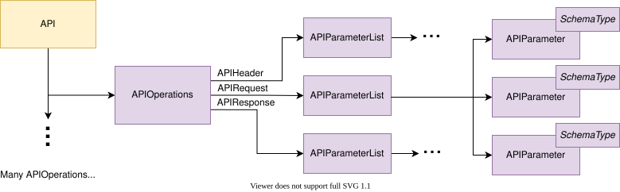
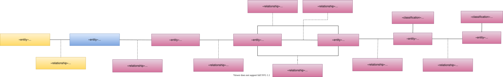

---
hide:
- toc
---

<!-- SPDX-License-Identifier: CC-BY-4.0 -->
<!-- Copyright Contributors to the Egeria project. -->

# Modelling APIs

Figure 1 shows the types of metadata that describe an API.

> **Figure 1:** API metadata

The structure of an API specification consist of a number of 
[APIOperation](/types/5/0536-API-Schemas)s
which in turn have optional
[APIParameterList](/types/5/0536-API-Schemas)s
for the header, request and response.
The details of these payloads are described using
[SchemaAttributes and SchemaTypes](/concepts/schema).

Figure 2 shows the open metadata types used to represent this metadata.

> **Figure 2:** API open metadata types

If the APIManager that hosts the API is catalogued, link each DeployedAPI to it using the
[CapabilityAssetUse](/types/0/0045-Servers-and-Assets)
relationship.
Between the DeployedAPI entity and its APIOperation entities sit the
[Schema](/types/5/0503-Asset-Schema) relationship,
[APISchemaType](/types/5/0536-API-Schemas) entity and
[APIOperations](/types/5/0536-API-Schemas) relationship.
An integration connector creates these elements through the clients of its
[integration context](/guides/developer/integration-connectors/integration-context) - for example,
`SchemaTypeClient.linkSchema()` and `SchemaTypeClient.linkAPIOperations()` - or by
[cataloguing from a template](/features/templated-cataloguing/overview) that already contains them.

The schema attributes use the
[APIParameter](/types/5/0536-API-Schemas) subtype
to allow for find requests that only return schema information for APIs.  The schema attributes also use
the [TypeEmbeddedAttribute](/types/5/0505-Schema-Attributes)
classification [method for defining the schema type](/concepts/schema).

---8<-- "snippets/abbr.md"