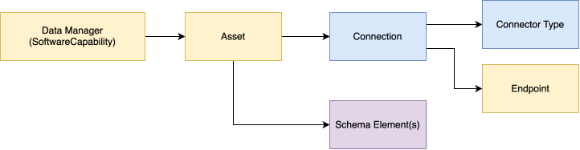
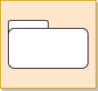
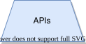

<!-- SPDX-License-Identifier: CC-BY-4.0 -->
<!-- Copyright Contributors to the Egeria project. -->

# Data Manager

## Basic metadata model

Figure 1 shows the types of metadata that an [integration connector](/concepts/integration-connector) typically captures from a data manager - a technology that stores and manages data, such as a database server, file system or event broker.

> **Figure 1:** Basic metadata captured from a data manager

These are:

* **Asset** - Asset describes the digital resource such as the data set, database schema, topic, API etc.
* **Connection**, **Connector Type** and **Endpoint** are used to create a [connector](/concepts/connector)
to access the data in the data asset.
* **Schema Element(s)** describe the structure of the data managed by the data asset.

To make it possible to search for particular types of asset, there are many specialized asset types defined in Egeria.
The full list is shown [here](/concepts/asset), however Egeria supports
the following subtypes of Asset (and any additional subtypes of these types that you wish to define yourself).

* **DeployedAPI** for API descriptions.
* **Topic** for topics supported by an event manager.
* **DataFile** for a file with sub types of:
   * **CSVFile** for CSV files.
   * **AvroFile** for files using the Avro format.
   * **JSONFile** for files using the JSON format.
* **Database** for databases.
* **DeployedDatabaseSchema** for schemas within a database.
* **Report** for reports.
* **Form** for interactive forms.
* **InformationView** for queries.

The open metadata types need to accommodate slight variations between different vendor
implementations of data managers, along with information relating to local deployment standards.
As such there is provision to support:

* Vendor properties - properties unique to a specific vendor implementation.  These are stored in a *PropertyFacet* element attached to the element with a *ReferenceableFacet* relationship whose *source* property identifies the vendor.  The [integration iterators](/guides/developer/integration-connectors/integration-context/#integration-iterators) retrieve them with `MemberElement.getVendorProperties(vendorIdentifier)`.
* `additionalProperties` - a map of string properties on each element for values that the metadata team wish to add to the metadata.

## Data Managers

Egeria supports the following types of data managers.  Each is represented by a [software capability](/concepts/software-capability) - for example *FileSystem*, *FileManager*, *DatabaseManager*, *EventBroker*, *APIManager* or *ReportingEngine* - and the provenance column shows whether the metadata is typically stored in the data manager's own [metadata collection](/concepts/metadata-collection) (external provenance) or with local cohort provenance:

| Icon                                   | Name     | Provenance | Description |
| :----------------------------------:   | :---------- | :------------------------------------------------------: | :---------- |
|    | File System | Local Cohort | Create metadata elements for files and folders along with their data connections and any known schema information. Catalogued files and folders are members of the local cohort because many different types of processes may work with them. |
|  | File Manager | External  | Create metadata elements for files and folders along with their data connections and any known schema information. Catalogued files and folders are members of the data manager's metadata collection because it is responsible for their maintenance.|
|  | Database Manager | External | Create metadata elements for databases, database schemas, tables, views, columns, primary keys and foreign keys. Catalogued elements are members of the data manager's metadata collection because it is responsible for their maintenance.|
|  | Event Broker | Local Cohort or External | Create metadata elements for topics and the event payloads they support. Catalogued elements are members of the data manager's metadata collection (ie External provenance) if it is responsible for their maintenance.|
|  | API Manager | Local Cohort or External | Create metadata elements for APIs and their supported headers and payloads. Catalogued elements are members of the data manager's metadata collection (ie External provenance) if it is responsible for their maintenance.|
|  | Display Tools | Local Cohort or External | Create metadata elements for reporting tools, forms and associated queries. Catalogued elements are members of the data manager's metadata collection (ie External provenance) if it is responsible for their maintenance.|

## More information

* [What is an Asset?](/concepts/asset)
* [Integrated cataloguing](/features/integrated-cataloguing/overview)
* [Building integration connectors](/guides/developer/integration-connectors)
* [Modeling schema structures](/concepts/schema)

--8<-- "snippets/abbr.md"
