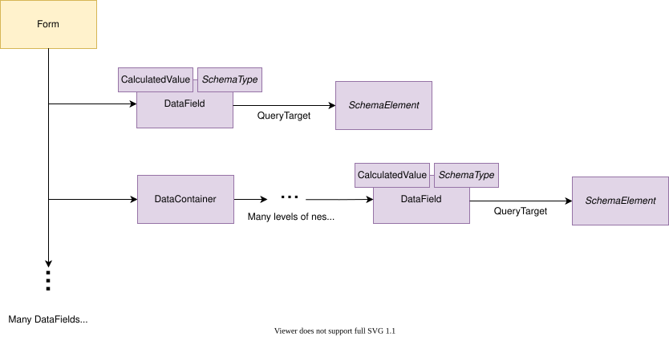
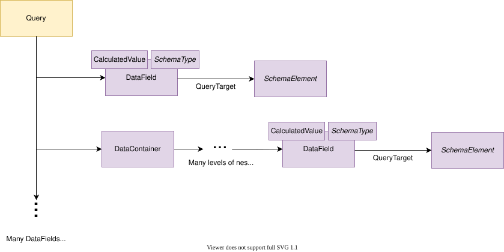
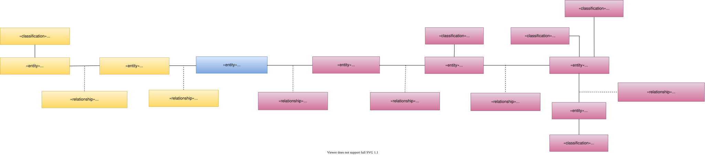
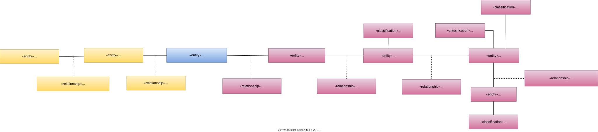
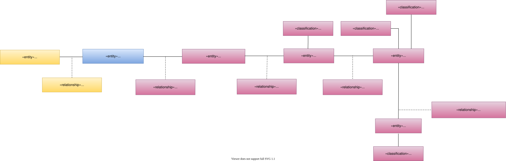

---
hide:
- toc
---

<!-- SPDX-License-Identifier: CC-BY-4.0 -->
<!-- Copyright Contributors to the Egeria project. -->

# Display Metadata

Displayed data such as reports and forms along with their related schema and connection information are mapped to the open metadata types as follows.

## Forms and Reports

Figure 1 shows the types of metadata for forms and reports that integration connectors can create.

  

> **Figure 1:** Forms and Reports metadata

Either can be represented as a set of nested **DataContainers** with specific input and output
**DataFields** used to represent the individual data items. 

## Queries

Integration connectors can also create queries that support forms and reports.
Figure 2 shows the types of metadata for the queries.

> **Figure 2:** Query metadata

Queries can also be represented as a set of nested data containers and data fields.

## Open Metadata Types

Figure 3 shows the open metadata types used to represent the metadata for forms, reports and queries.

  

  

> **Figure 3:** Form and Report open metadata types

The principle asset types are
[Form](/types/2/0239-Reports),
[Report](/types/2/0239-Reports) and
[InformationView](/types/2/0235-Information-View)
for forms, reports and queries respectively.

If the SoftwareCapability that hosts them - such as an
[Application](/types/0/0050-Applications-and-Processes) or
[ReportingEngine](/types/0/0055-Data-Processing-Engines) - is catalogued,
link each asset to it using the
[CapabilityAssetUse](/types/0/0045-Servers-and-Assets)
relationship.

When a **DataContainer** is created for a report or a form, it is represented as a
[DisplayDataContainer](/types/5/0537-Display-Schemas) entity.
**DataFields** are created as
[DisplayDataField](/types/5/0537-Display-Schemas) entities.

The **DataContainers** and **DataFields** for queries are represented as
[QueryDataContainer](/types/5/0537-Display-Schemas) and
[QueryDataField](/types/5/0537-Display-Schemas) respectively.

All of these types are subtypes of schema attribute that use
the [TypeEmbeddedAttribute](/types/5/0505-Schema-Attributes)
classification [method for defining the schema type](/concepts/schema).

The different subtypes enable metadata searches to narrow the results to this type of display metadata.

Between a form or report asset and its top-level data containers/fields sit the
[Schema](/types/5/0503-Asset-Schema) relationship,
[DisplayDataSchemaType](/types/5/0537-Display-Schemas) entity and
[AttributeForSchema](/types/5/0505-Schema-Attributes) relationship.

Similarly, the combination of
[Schema](/types/5/0503-Asset-Schema) relationship,
[QuerySchemaType](/types/5/0537-Display-Schemas) entity and
[AttributeForSchema](/types/5/0505-Schema-Attributes) relationship
sits between a query and its top-level data containers/fields.

When a data field/container is nested inside another, it is 
linked to the structure using the
[NestedSchemaAttribute](/types/5/0505-Schema-Attributes) relationship.

--8<-- "snippets/abbr.md"