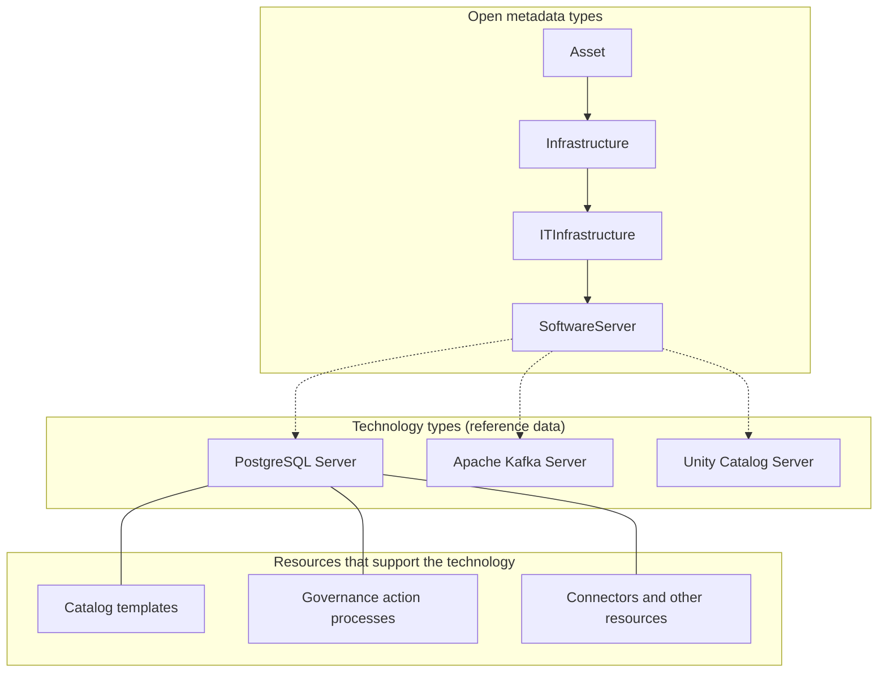

<!-- SPDX-License-Identifier: CC-BY-4.0 -->
<!-- Copyright Contributors to the ODPi Egeria project. -->


# Modelling different types of technology

The huge range and volatility of the technology that is available to organizations today is a challenge for standards such as open metadata.  It needs to maintain a balance between the need to describe all the technology that is available and the need to keep the type system small and manageable.

This section of the developer guide describes how different types of technology are represented in open metadata.  It begins with the mechanisms used to say *what type of thing* a metadata element describes.  There are three of them, and they work at different levels of precision:

| Mechanism | What it identifies | Where the values are defined | Example |
|:--|:--|:--|:--|
| Open metadata type (and its subtypes) | The general kind of thing, with its properties and the relationships it supports. | In the [open metadata type system](/types). | *SoftwareServer*, *RelationalDatabase*, *CSVFile* |
| *deployedImplementationType* attribute | The specific technology. | As reference data - a [technology type](/concepts/deployed-implementation-type) for each technology. | `PostgreSQL Server`, `Apache Kafka Server` |
| *category* attribute | A locally meaningful grouping of elements that are not technology. | As reference data, or by convention. | `clinical-trial` for a *Project* |

## The open metadata types

The [open metadata types](/types) define the structure of the metadata elements (entities), the relationships that link them together and the classifications that can be attached to them.  The types are organized through inheritance: a type has the attributes that it defines itself plus those of all of its supertypes, and can be used wherever one of its supertypes is expected.  So a *CSVFile* is a *DataFile*, which is a *DataStore*, which is a *DataAsset*, which is an [*Asset*](/concepts/asset), which is a *Referenceable*.

The types are divided into eight [areas](/types).  The types that describe technology are located in three of them, with the lineage relationships that link them together in a fourth:

| Area | Technology described | Models to start with |
|:--|:--|:--|
| [Area 0](/types/0) - base types and infrastructure | The root types (*Referenceable*, *Asset*, *Infrastructure*, *Process*, *DataAsset*) and the IT infrastructure: hosts, storage, platforms, servers, the capabilities that run in them, endpoints, networks and cloud services. | [0010 Base Model](/types/0/0010-Base-Model), [0030 Operating Platforms](/types/0/0030-Operating-Platforms), [0037 Software Server Platforms](/types/0/0037-Software-Server-Platforms), [0040 Software Servers](/types/0/0040-Software-Servers), [0042 Software Capabilities](/types/0/0042-Software-Capabilities), [0026 Endpoints](/types/0/0026-Endpoints) |
| [Area 2](/types/2) - assets | The resources that hold, serve and process data: data stores, data sets, files and folders, databases, topics, APIs, reports, software components, and the connections used to access them. | [0201 Connectors and Connections](/types/2/0201-Connectors-and-Connections), [0210 Data Stores](/types/2/0210-Data-Stores), [0212 Deployed APIs](/types/2/0212-Deployed-APIs), [0215 Software Components](/types/2/0215-Software-Components), [0220 Files and Folders](/types/2/0220-Files-and-Folders), [0223 Events and Logs](/types/2/0223-Events-and-Logs), [0224 Databases](/types/2/0224-Databases) |
| [Area 5](/types/5) - schemas and reference data | The [structure of the data](/concepts/schema) held in, or passed through, the assets: tables and columns, document and event structures, API operations and display fields.  Area 5 is also where the reference data that defines the technology types is modelled. | [0501 Schema Elements](/types/5/0501-Schema-Elements), [0505 Schema Attributes](/types/5/0505-Schema-Attributes), [0534 Relational Schemas](/types/5/0534-Relational-Schemas), [0535 Event Schemas](/types/5/0535-Event-Schemas), [0536 API Schemas](/types/5/0536-API-Schemas), [0545 Reference Data](/types/5/0545-Reference-Data) |
| [Area 7](/types/7) - lineage | The relationships that show how data flows between the assets and processes. | [Area 7](/types/7) |

A typical piece of technology is described by elements from each of the first three areas: the server and its capabilities from area 0, the assets that it hosts from area 2 and the schemas of those assets from area 5.  The [data manager](/guides/developer/mapping-technology/data-manager) page shows this pattern.

## Using subtypes in the APIs

Egeria's APIs are not defined type-by-type.  An operation is written for a type that is fairly high in the inheritance hierarchy, and it works for all of the subtypes of that type.  This is why there is, for example, one set of operations for assets rather than a set for each of the many types of asset.  The subtype comes into play in three places:

* **On a create request**, the caller chooses the subtype.  The `properties` object in the request body has a `class` that names the properties bean to use.  Each bean is set up with the name of its open metadata type, so choosing `CSVFileProperties` on an operation that creates assets results in a *CSVFile* element with access to the attributes that are specific to CSV files.  The bean's `typeName` can be set explicitly to name a more specialized type, such as a subtype that your organization has added, that has no bean of its own.

    ```
    ###
    # @name createAsset
    POST {{baseURL}}/servers/{{viewServer}}/api/open-metadata/asset-maker/assets
    Authorization: Bearer {{token}}
    Content-Type: application/json

    {
      "class" : "NewElementRequestBody",
      "properties" : {
        "class" : "CSVFileProperties",
        "qualifiedName" : "CSVFile::/data/landing/week1.csv",
        "displayName" : "week1.csv",
        "pathName" : "/data/landing/week1.csv",
        "delimiterCharacter" : ",",
        "deployedImplementationType" : "CSV Data File"
      }
    }
    ```

* **On a retrieval request**, the caller can narrow the results.  By default, a query returns elements of the operation's type and all of its subtypes.  The `metadataElementTypeName` option restricts the query to one type (and its subtypes).  The `metadataElementSubtypeNames` option supplies a list of subtypes to return - or, if `skipSubtypes` is set to `true`, a list of subtypes to leave out.

    ```json
    {
      "class" : "SearchStringRequestBody",
      "searchString" : "week1",
      "metadataElementTypeName" : "DataFile",
      "metadataElementSubtypeNames" : [ "CSVFile", "JSONFile" ]
    }
    ```

* **In the results**, each element reports its type.  The `type` section of the `elementHeader` has the element's `typeName` and its `superTypeNames`, and the `properties` object has the `class` of the bean that matches the type most closely.  A caller that is only interested in assets can treat every result as an asset; a caller that understands CSV files can make use of the additional properties.

There is more detail on these options in [finding metadata](/guides/developer/finding-metadata/overview) and [maintaining metadata](/guides/developer/maintaining-metadata/overview).

!!! summary "Usage"
    * Choose the most specific open metadata type that accurately describes the resource.  This determines which attributes and relationships are available.
    * Code against the supertype when the logic applies to all of its subtypes, and use the subtype options to narrow a query.
    * A new open metadata type is only justified when new attributes or relationships are needed.  If the aim is just to say *which* technology or *what kind* of element this is, use *deployedImplementationType* or *category*.

## Technology types: deployedImplementationType as a pseudo-subtype

The open metadata types describe technology generically.  There is a *SoftwareServer* type, but no type for a PostgreSQL server, an Apache Kafka server or a Unity Catalog server.  If there was an open metadata type for every technology, the type system would be enormous, would be permanently out of date, and would need to change each time a vendor released something new.  And since these new types would rarely add an attribute or a relationship, nothing would be gained from them.

The *deployedImplementationType* attribute fills this gap.  It is a string attribute that names the specific technology that the element represents.  It is defined on [*Asset*](/types/0/0010-Base-Model) (and so is available on servers, platforms, hosts, data stores, data sets, APIs, processes and software components) and on [*SoftwareCapability*](/types/0/0042-Software-Capabilities).  In effect, it acts as a *pseudo-subtype*: a further level of specialization beneath the open metadata type that is defined with reference data rather than in the type system.


> **Figure 1:** The *deployedImplementationType* values extend the open metadata type hierarchy using reference data.  Each value has a technology type definition that links to the resources that support the technology

### Technology type definitions

Each value for *deployedImplementationType* is described by a [*TechnologyType*](/types/5/0545-Reference-Data) element.  This is a specialized [valid value definition](/concepts/valid-value-definition) that records the name of the technology, its description, a link to its documentation (in the *url* attribute) and the open metadata type that elements for this technology should use (the associated type name).  Technology types can also be organized into a hierarchy, so that a general technology type can have more specialized ones beneath it.

A technology type is more than a list entry.  It is the place where everything that Egeria knows about supporting the technology is linked together:

* **Catalog templates** - the [templates](/features/templated-cataloguing/overview) to use when creating elements for this technology, linked with the *CatalogTemplate* relationship.  The template sets up the right open metadata type, the *deployedImplementationType* value, the connection, and any nested elements, and its specification lists the [placeholder properties](/concepts/placeholder) that the caller needs to supply.
* **Governance action processes** - the [processes](/concepts/governance-action-process) that work with this technology, for example to survey or catalog a server, linked with the *ResourceList* relationship.
* **Other resources** - the [integration connectors](/concepts/integration-connector), survey action services and other elements that support the technology, also linked with *ResourceList*.

The matching goes in the other direction too.  A [connector type](/concepts/connector-type) records the technology that it supports in its *supportedDeployedImplementationType* attribute, and a solution component records the technology it is expected to be implemented with in its *plannedDeployedImplementationType* attribute.

### Working with technology types

The [Automated Curation](/services/omvs/automated-curation/overview) API provides the operations for working with technology types:

| Operation | URL (after `/servers/{serverName}/api/open-metadata/{urlMarker}`) | Purpose |
|:--|:--|:--|
| `findTechnologyTypes` | `/technology-types/by-search-string` | Search for technology types. |
| `getTechnologyTypesForOpenMetadataType` | `/open-metadata-types/{typeName}/technology-types` | List the technology types for an open metadata type - that is, its pseudo-subtypes. |
| `getTechnologyTypeDetail` | `/technology-types/by-name` | Retrieve a technology type with its catalog templates, governance action processes and resources. |
| `getTechnologyTypeHierarchy` | `/technology-types/hierarchy` | Retrieve a technology type and the technology types beneath it. |
| `getTechnologyTypeElements` | `/technology-types/elements` | Retrieve the catalogued elements whose *deployedImplementationType* matches the technology type. |
| `createElementFromTemplate` | `/catalog-templates/new-element` | Create a new element using one of the catalog templates. |

This gives a simple sequence for cataloguing a new instance of a technology: find the technology type, retrieve its detail, choose one of its catalog templates, and create the element from the template supplying values for its placeholders.  The same detail identifies the governance action processes that can then be run against the new element.  Because all of this is driven by reference data, support for a new technology is added by loading a [content pack](/content-packs) - or creating your own technology type, templates and connectors - without any change to the open metadata types or the APIs.

The technology types supplied with Egeria are listed under [deployed implementation type](/concepts/deployed-implementation-type), and the templates in the [catalog templates](/catalog-templates) section.

!!! summary "Usage"
    * Always set *deployedImplementationType* when cataloguing technology, using the exact name of the technology type.  Consistent values are what make it possible to retrieve all elements for a technology, and to match them to the connectors and processes that support it.  Using the catalog template does this for you.
    * Use the technology type, rather than hard-coded knowledge, to discover which templates, connectors and processes are available.
    * To support a technology that Egeria does not know about, add a technology type for it and link it to the open metadata type that best describes it.  A new open metadata type is not needed.

## Category: a pseudo-subtype for other elements

Technology is not the only place where the open metadata types are deliberately general.  There is a single *Project* type, although an organization may run clinical trials, security assessments and incident investigations as projects.  There is one type for a digital product, a glossary, a community.  As with technology, defining an open metadata type for each variation would bloat the type system with types that add no new attributes.

For these elements, the *category* attribute plays the role that *deployedImplementationType* plays for technology.  It is defined on [*Referenceable*](/types/0/0010-Base-Model), and so is available on almost every element.  It holds a single string that names the kind of element this is within its type - for example, `clinical-trial` for a *Project*.

* The values for *category* are chosen by your organization.  They can be managed as [valid metadata values](/services/omvs/valid-metadata/overview), either for a specific open metadata type or for all types, so that the values are used consistently.  Valid metadata values can also be linked together to show which values for other attributes are consistent with a particular category.
* Many of the view services have a *by-category* retrieval operation (for example for processes, data assets, infrastructure assets and digital products) that returns the elements with a particular category value.  The *category* attribute can also be used in any property-based search.

The difference between the two attributes is one of scope.  Use *deployedImplementationType* for technology, where there are technology types, templates and connectors to link to.  Use *category* for everything else.

## Modelling Schema

The [SchemaElement open metadata types](/types/5) describe the structure of data.  This allows us to specify precisely the type of data items it contains and how they are arranged.  Such schemas can them be attached to Data Stores, Data Sets, APIs and Ports to show where the data is stored, how it can be queried and what data flows between processes.  The schemas are linked to assets and ports using the [Schema](/types/5/0503-Asset-Schema/) relationship.

Different technology types structure data in ways that favour their use.  Some work with tabular data, others with graphs, and others with hierarchical data.  The specific 

## Representing File Assets


> **Figure 2:** Examples of modelling file-based data sources


> **Figure 3:** Mixing files and folders

## Representing Information Views


> **Figure 4:** Overlaying information views on assets


> **Figure 5:** Mapping schema elements for an information view

## Representing APIs


> **Figure 6:** Representing APIs

## Representing Processes


> **Figure 7:** Representing Nested Processes

--8<-- "snippets/abbr.md"