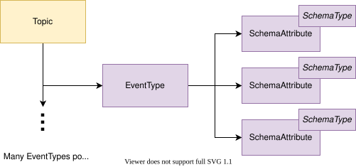
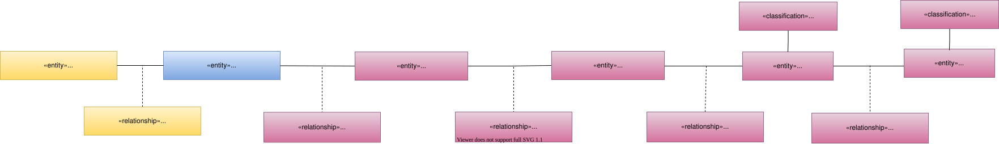

---
hide:
- toc
---

<!-- SPDX-License-Identifier: CC-BY-4.0 -->
<!-- Copyright Contributors to the Egeria project. -->

# Modelling event brokers and topics

Typically, topics are managed by an event broker such as Apache Kafka.

Figure 1 shows the types of metadata that integration connectors can create.

> **Figure 1:** Topic metadata supported by open metadata

The structure of an event is called an [EventType](/types/5/0535-Event-Schemas).
The details of this structure such as the data fields in the event are described using
[SchemaAttributes and SchemaTypes](/concepts/schema).

Figure 2 shows the open metadata types used to represent the metadata.

> **Figure 2:** Topic open metadata types supported by open metadata

If the EventBroker is catalogued, link each topic to it using the
[CapabilityAssetUse](/types/0/0045-Servers-and-Assets)
relationship.
Where a topic supports more than one event type, the
[Schema](/types/5/0503-Asset-Schema) relationship,
[EventTypeList](/types/5/0535-Event-Schemas) entity and
[SchemaTypeOption](/types/5/0501-Schema-Elements) relationship
sit in between the topic and each event type.

The schema attributes use the
[EventSchemaAttribute](/types/5/0535-Event-Schemas) subtype
to allow for find requests that only return schema information for events.  The schema attributes also use
the [TypeEmbeddedAttribute](/types/5/0505-Schema-Attributes)
classification [method for defining the schema type](/concepts/schema).

---8<-- "snippets/abbr.md"