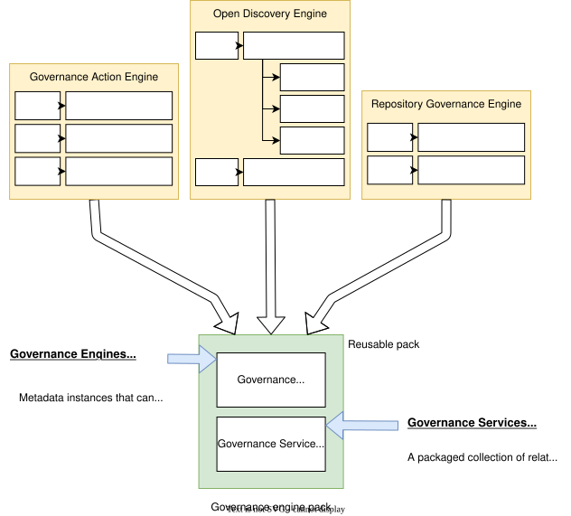

<!-- SPDX-License-Identifier: CC-BY-4.0 -->
<!-- Copyright Contributors to the ODPi Egeria project 2020. -->

# Creating governance engine packs

A *governance engine pack* is a packaging of one or more [governance engine definitions](/concepts/governance-engine-definition) into an [open metadata archive](/concepts/open-metadata-archive) with related governance service implementation jar files.

> A governance pack is constructed from one or more governance engine definitions and the jar file(s) for the referenced governance services' implementations

The Open Metadata Types used to define the governance engines are located in [0461 governance engines](/types/4/0461-Governance-Engines).

## Building the archive

A governance engine pack is a [content pack](/guides/developer/open-metadata-archives/creating-content-packs), so it is built by an archive writer.  The `GovernanceArchiveHelper` class in [content-pack-helpers :material-github:](https://github.com/odpi/egeria/tree/main/open-metadata-resources/open-metadata-archives/content-pack-helpers){ target=gh } provides the methods to create the elements of a governance engine definition:

| Method                           | What it creates                                                                                                                                                                                         |
|----------------------------------|---------------------------------------------------------------------------------------------------------------------------------------------------------------------------------------------------------|
| `addGovernanceEngine()`          | The governance engine entity.  The `typeName` parameter selects the type of engine, for example `GovernanceActionEngine`, `SurveyActionEngine` or `WatchdogActionEngine`.                                   |
| `addGovernanceService()`         | A governance service entity, plus its connection and connector type, from the class name of the service's connector provider.                                                                           |
| `addSupportedGovernanceService()`| The `SupportedGovernanceService` relationship that maps a governance request type (and optional service request type and request parameters) of the engine to the governance service that runs it.      |
| `addGovernanceActionType()`      | A governance action type that describes how to call a request type, so it can be used in governance action processes.                                                                                     |

The governance services' connector providers must be on the class path of the archive writer, since `addGovernanceService()` creates the connector type from the connector provider.

### Egeria's governance engines

Egeria's own governance engines are defined in the content packs built by the [core-content-pack :material-github:](https://github.com/odpi/egeria/tree/main/open-metadata-resources/open-metadata-archives/core-content-pack){ target=gh } module.  Three enums describe them:

* `GovernanceEngineDefinition` - each governance engine, with its GUID, name, display name, description, user id, engine type and the `ContentPackDefinition` it belongs to.
* `GovernanceServiceDefinition` - each governance service, with its connector provider class name.
* `RequestTypeDefinition` - each governance request type, linking a governance engine to a governance service, along with its request parameters and action targets.

The content pack's archive writer (a subclass of `ContentPackBaseArchiveWriter`) calls `createGovernanceEngines()`, `createGovernanceServices()` and `createRequestTypes()`, which add the entries for its content pack using the `GovernanceArchiveHelper` methods above.

The [Coco Pharmaceuticals sample archives :material-github:](https://github.com/odpi/egeria/tree/main/open-metadata-resources/open-metadata-samples/sample-metadata/coco-metadata-archives){ target=gh } use the same pattern for a third party: `CocoGovernanceEnginesArchiveWriter` builds its engines from the `CocoGovernanceEngineDefinition`, `CocoGovernanceServiceDefinition` and `CocoRequestTypeDefinition` enums.

## Deploying the pack

* Load the archive into a [metadata access store](/concepts/metadata-access-store), as described in [loading a content pack](/guides/developer/open-metadata-archives/creating-content-packs#loading-a-content-pack).
* Place the jar files containing the governance service implementations on the class path of the OMAG Server Platform that runs the [engine host](/concepts/engine-host).
* Configure the engine host to run the governance engines, naming each engine by its qualified name.  See [configuring the engine host services](/guides/admin/servers/by-section/engine-host-services-section).

--8<-- "snippets/abbr.md"
