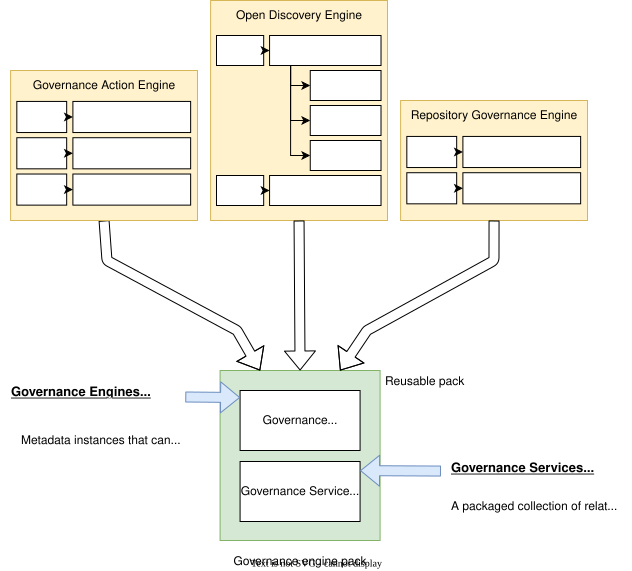

<!-- SPDX-License-Identifier: CC-BY-4.0 -->
<!-- Copyright Contributors to the ODPi Egeria project. -->

# Governance engine packs

A [governance engine pack](/concepts/governance-engine-pack) is a collection of pre-defined [governance engine](/concepts/governance-engine) and [governance service](/concepts/governance-service) definitions stored in a [content pack](/guides/developer/open-metadata-archives/creating-content-packs) (an [open metadata archive](/concepts/open-metadata-archive) of type `CONTENT_PACK`), plus the governance service implementations packaged in one or more jar files.

A team can use the governance engine pack to distribute the governance engine function to different metadata ecosystems.  How to build one is described in [creating governance engine packs](/guides/developer/open-metadata-archives/creating-governance-engine-packs).

--8<-- "snippets/abbr.md"
