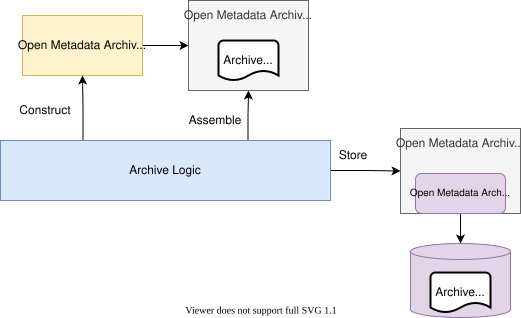

<!-- SPDX-License-Identifier: CC-BY-4.0 -->
<!-- Copyright Contributors to the Egeria project. -->


The structure of an *open metadata archive writer* that builds an open metadata archive as a JSON file uses:

* One or more *archive helper* classes to construct the elements for the archive.
* An *archive builder* class that holds the archive content in memory as it is assembled.

Your archive writer class then extracts the content from the builder to write out the archive file.



Egeria provides the following utility modules in `egeria.git` to help you create an archive writer.

* Module [`repository-services-archive-utilities` :material-github:](https://github.com/odpi/egeria/tree/main/open-metadata-implementation/repository-services/repository-services-archive-utilities){ target=gh } - located in `open-metadata-implementation/repository-services` - provides the functions for archive building using [Open Metadata Repository Services (OMRS)](/services/omrs) type definitions and instances.  These are the objects that are stored in the archive and all of this module's classes begin `OMRS`:

    * `OMRSArchiveWriter` - base class that formats an `OpenMetadataArchive` object and writes it to a file using the file-based open metadata archive store connector.  It can also read back an existing archive file (`readOpenMetadataArchive`).
    * `OMRSArchiveBuilder` - accumulates the type definitions and instances for the archive.  The archives it depends on (typically the open metadata types) are passed on its constructor so that it can resolve the types (and supertypes) that your new content uses.
    * `OMRSArchiveHelper` - creates the individual type definitions (`EntityDef`, `RelationshipDef`, `ClassificationDef`, `EnumDef`, ...) and instances (`EntityDetail`, `Relationship`, `Classification`, `EntityProxy`, ...).
    * `OMRSArchiveGUIDMap` - a persisted map from an identifier (such as a qualified name) to a GUID, so that the same element gets the same GUID each time the archive is rebuilt.

* Module [`content-pack-helpers` :material-github:](https://github.com/odpi/egeria/tree/main/open-metadata-resources/open-metadata-archives/content-pack-helpers){ target=gh } - located in `open-metadata-resources/open-metadata-archives` - has archive helper classes for building instances of well known types:

    * `SimpleCatalogArchiveHelper` - assets, schemas, connections, connector types, endpoints, glossaries, collections, valid values, governance definitions and zones etc.
    * `GovernanceArchiveHelper` - extends `SimpleCatalogArchiveHelper` with governance engines, governance services, request types, governance action types and processes, integration groups and integration connectors.
    * `EgeriaBaseArchiveWriter` - an abstract archive writer (subclass of `OMRSArchiveWriter`) that sets up the `OMRSArchiveBuilder` (depending on the open metadata types) and a `GovernanceArchiveHelper` for you.  Your subclass implements `getArchiveContent()`.
    * `ArchiveVersionStabilizer` - compares a newly built archive with the previous edition so that unchanged elements keep their previous version numbers, and elements removed since the previous edition are written in a deleted state.

Using these utilities, your archive writer inherits from `OMRSArchiveWriter` (directly, or through `EgeriaBaseArchiveWriter`) which does all the work of formatting the archive and writing it to disk.

Your archive writer creates an instance of `OMRSArchiveBuilder` to accumulate the content of the archive.

* When it is building types, it uses the `OMRSArchiveHelper` to create each type definition and then adds it to the archive builder.  This is the approach used for the [open metadata types](/types) themselves, and shown in [Defining new types](/guides/developer/open-metadata-archives/defining-new-types).

* When it is creating instances, your archive writer typically uses the appropriate helper classes in `content-pack-helpers`.  However, this is only for ease of coding because they manage the mapping from, say, a *governance zone* to an entity instance of type `GovernanceZone`.

The `content-pack-helpers` all use `OMRSArchiveHelper` in their implementation to create the actual archive object.  To illustrate, here is the code inside `SimpleCatalogArchiveHelper` for creating an entity instance of type `GovernanceZone`.  The `archiveHelper` it is using is of type `OMRSArchiveHelper`, and `idToGUIDMap` is its `OMRSArchiveGUIDMap`.  The helper is passed your archive writer's `archiveBuilder` in its constructor and so you also see the call to add the entity to the archive builder at the end of the method.  The property and type names come from the `OpenMetadataProperty` and `OpenMetadataType` enums in the Open Metadata Framework (OMF).

```java linenums="1"

    public String addGovernanceZone(String               qualifiedName,
                                    String               zoneName,
                                    String               displayName,
                                    String               description,
                                    String               criteria,
                                    String               scope,
                                    int                  domainIdentifier,
                                    Map<String, String>  additionalProperties)
    {
        final String methodName = "addGovernanceZone";

        InstanceProperties properties = archiveHelper.addStringPropertyToInstance(archiveRootName, null, OpenMetadataProperty.QUALIFIED_NAME.name, qualifiedName, methodName);
        properties = archiveHelper.addStringPropertyToInstance(archiveRootName, properties, OpenMetadataProperty.IDENTIFIER.name, zoneName, methodName);
        properties = archiveHelper.addStringPropertyToInstance(archiveRootName, properties, OpenMetadataProperty.DISPLAY_NAME.name, displayName, methodName);
        properties = archiveHelper.addStringPropertyToInstance(archiveRootName, properties, OpenMetadataProperty.DESCRIPTION.name, description, methodName);
        properties = archiveHelper.addStringPropertyToInstance(archiveRootName, properties, OpenMetadataProperty.SCOPE.name, scope, methodName);
        properties = archiveHelper.addStringPropertyToInstance(archiveRootName, properties, OpenMetadataProperty.CRITERIA.name, criteria, methodName);
        properties = archiveHelper.addIntPropertyToInstance(archiveRootName, properties, OpenMetadataProperty.DOMAIN_IDENTIFIER.name, domainIdentifier, methodName);
        properties = archiveHelper.addStringMapPropertyToInstance(archiveRootName, properties, OpenMetadataProperty.ADDITIONAL_PROPERTIES.name, additionalProperties, methodName);

        EntityDetail newEntity = archiveHelper.getEntityDetail(OpenMetadataType.GOVERNANCE_ZONE.typeName,
                                                               idToGUIDMap.getGUID(qualifiedName),
                                                               properties,
                                                               InstanceStatus.ACTIVE,
                                                               null);

        archiveBuilder.addEntity(newEntity);

        return newEntity.getGUID();
    }
```

Once all the type definitions and instances have been created, your archive writer extracts the content of the archive from the archive builder.  It is returned as an `OpenMetadataArchive` object which it passes to its superclass (`OMRSArchiveWriter`) along with the file name, and the new open metadata archive is written to disk.  This is the shape of the code in `EgeriaBaseArchiveWriter`:

```java linenums="1"

    /**
     * Returns the open metadata archive containing new metadata entities.
     *
     * @return populated open metadata archive object
     */
    public OpenMetadataArchive getOpenMetadataArchive()
    {
        getArchiveContent();   // implemented by the subclass to add the content of the archive

        /*
         * The completed archive is ready to be packaged up and returned
         */
        return this.archiveBuilder.getOpenMetadataArchive();
    }


    /**
     * Generates and writes out the open metadata archive created in the builder.
     *
     * @param folderName name of the folder to add the archive into
     */
    public void writeOpenMetadataArchive(String folderName)
    {
        try
        {
            String pathName = archiveFileName;

            if (folderName != null)
            {
                pathName = folderName + "/" + archiveFileName;
            }

            OpenMetadataArchive openMetadataArchive = this.getOpenMetadataArchive();

            // ... if a previous edition of the archive exists, ArchiveVersionStabilizer keeps the
            //     previous version of unchanged elements and adds deleted versions of removed ones ...

            System.out.println("Writing to file: " + pathName);
            super.writeOpenMetadataArchive(pathName, openMetadataArchive);
        }
        catch (Exception error)
        {
            System.out.println("error is " + error);
        }

        /*
         * Save the GUIDs used in the archive so they are consistent in the next version.
         */
        archiveHelper.saveGUIDs();
        archiveHelper.saveUsedGUIDs();
    }
```

!!! warning "Keep the GUID map with the archive"
    The GUID map file (for example `EgeriaContentPacksGUIDMap.json` for Egeria's own content packs) is read from, and written to, the working directory of the archive writer.  If the writer runs without its GUID map it does not fail - it allocates new GUIDs for elements that have already been shipped.  A repository that loaded the previous edition would then hold two copies of these elements.  Commit the GUID map alongside the archive and always run the writer from the same directory.
