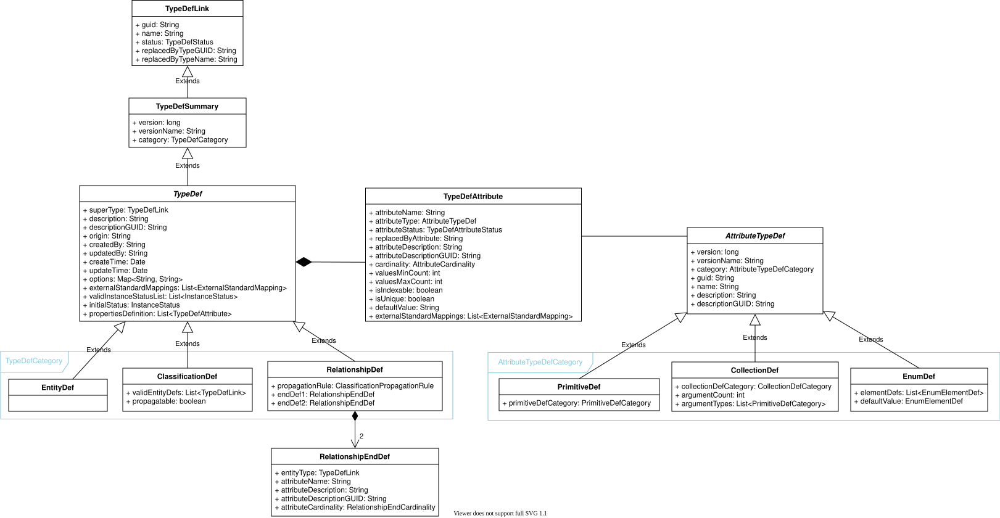
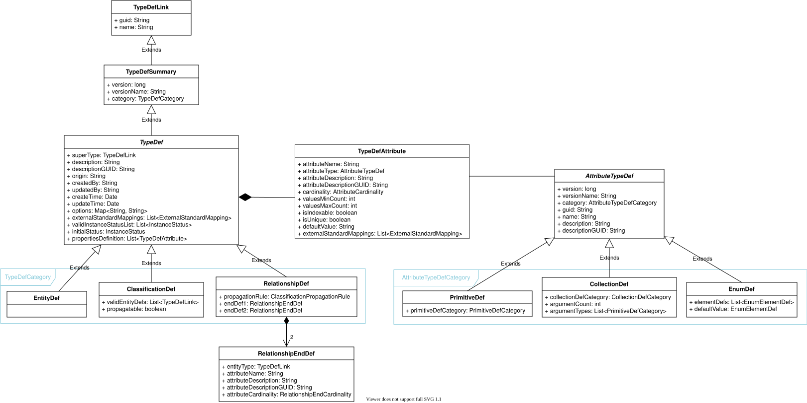
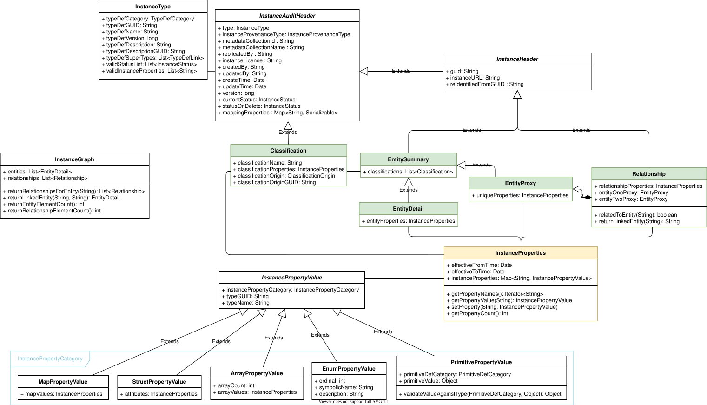

<!-- SPDX-License-Identifier: CC-BY-4.0 -->
<!-- Copyright Contributors to the Egeria project. -->

# OMRS Metamodel



OMRS's metamodel defines the structures used to represent metadata, and can be broadly divided into the following two areas:

- Type Definitions (`TypeDef`s and `AttributeTypeDef`s)
- Instances

The Java classes for these structures are in the *repository-services-apis* module, in the `properties.typedefs` and `properties.instances` sub-packages of `org.odpi.openmetadata.repositoryservices.connectors.stores.metadatacollectionstore`.

## Type definitions

`TypeDef`s define the general characteristics that are used to describe any general type -- whether native or not -- and fit into one of the following three general types (`TypeDefCategory`):

- `EntityDef` (`ENTITY_DEF`): the definition of a type of entity
- `RelationshipDef` (`RELATIONSHIP_DEF`): the definition of a type of relationship
- `ClassificationDef` (`CLASSIFICATION_DEF`): the definition of a type of classification

`TypeDef`s are implemented as Java classes in Egeria (those in *italics* are abstract).



??? example "Examples of type definitions"
    For example, the native [open metadata types](/types) that Egeria defines include:

    - a generic [`Referenceable`](/types/0/0010-Base-Model/#referenceable-entity) entity type,
    - a [`GlossaryTerm`](/types/3/0330-Terms) entity type,
    - a [`Glossary`](/types/3/0310-Glossary) entity type,
    - (and many others!)

    Rather than being another set of classes that *inherit* from the general TypeDef classes (`EntityDef`, `RelationshipDef`, `ClassificationDef`), these open types are *instantiated objects* of one of those TypeDef classes (in the above examples, of the `EntityDef` class).

    A set of `TypeDefAttribute`s within the TypeDef defines the list of additional characteristics (properties) that each of these entity types can possess -- things like names, descriptions, etc -- which may naturally vary from one entity type to another. (The type of each property is described by an `AttributeTypeDef`.)

    An example of a `RelationshipDef` is the [`CollectionMembership`](/types/0/0021-Collections) relationship that links a `Collection` (such as a `Glossary`, which is a type of collection) to each of its members, which may be any `Referenceable` (such as a `GlossaryTerm`).  It allows any number of linkages in either direction.  Again, `CollectionMembership` is an instantiated object of the class `RelationshipDef`, with a `RelationshipEndDef` for each end of the relationship.

    An example `ClassificationDef` is [`Confidentiality`](/types/4/0422-Governed-Data-Classifications): it can apply to any `Referenceable` entity (hence including both `GlossaryTerm` and `Glossary`, as both of these extend the `Referenceable` entity type).

    ```mermaid
    flowchart TB
        subgraph EntityDefs
            OMR["OpenMetadataRoot : EntityDef"]
            REF["Referenceable : EntityDef"]
            AR["AuthoredReferenceable : EntityDef"]
            COL["Collection : EntityDef"]
            GT["GlossaryTerm : EntityDef"]
            GL["Glossary : EntityDef"]
            OMR -->|superType| REF
            REF -->|superType| AR
            REF -->|superType| COL
            AR -->|superType| GT
            COL -->|superType| GL
        end
        subgraph RelationshipDefs
            CM["CollectionMembership : RelationshipDef"]
        end
        subgraph ClassificationDefs
            CONF["Confidentiality : ClassificationDef"]
        end
        CM -->|"endDef1 (memberOfCollections)"| COL
        CM -->|"endDef2 (collectionMembers)"| REF
        CONF -->|validEntityDefs| REF
    ```

??? example "Example: `Referenceable`"
    For example, `Referenceable` is defined in `OpenMetadataTypesArchive1_2` in the *open-metadata-types* module as follows.  The descriptive values for the type (its GUID, name, description and so on) come from `OpenMetadataType.REFERENCEABLE`, and the definitions of its attributes come from the `OpenMetadataProperty` enum, both in the [Open Metadata Framework (OMF)](/frameworks/omf/overview).

    ```java linenums="1"
    private EntityDef getReferenceableEntity()
    {
        /*
         * Build the Entity
         */
        EntityDef entityDef = archiveHelper.getDefaultEntityDef(OpenMetadataType.REFERENCEABLE,
                                                                this.archiveBuilder.getEntityDef(OpenMetadataType.OPEN_METADATA_ROOT.typeName));

        /*
         * Build the attributes
         */
        List<TypeDefAttribute> properties = new ArrayList<>();
        TypeDefAttribute       property;

        property = archiveHelper.getTypeDefAttribute(OpenMetadataProperty.QUALIFIED_NAME);

        property.setUnique(true);
        property.setValuesMaxCount(1);
        property.setValuesMinCount(1);
        property.setAttributeCardinality(AttributeCardinality.ONE_ONLY);
        properties.add(property);

        properties.add(archiveHelper.getTypeDefAttribute(OpenMetadataProperty.IDENTIFIER));
        properties.add(archiveHelper.getTypeDefAttribute(OpenMetadataProperty.DISPLAY_NAME));
        properties.add(archiveHelper.getTypeDefAttribute(OpenMetadataProperty.DESCRIPTION));
        properties.add(archiveHelper.getTypeDefAttribute(OpenMetadataProperty.VERSION_IDENTIFIER));
        properties.add(archiveHelper.getTypeDefAttribute(OpenMetadataProperty.CATEGORY));
        properties.add(archiveHelper.getTypeDefAttribute(OpenMetadataProperty.URL));
        properties.add(archiveHelper.getTypeDefAttribute(OpenMetadataProperty.ADDITIONAL_PROPERTIES));

        entityDef.setPropertiesDefinition(properties);

        return entityDef;
    }
    ```

    And this results in a JSON structure like the following, as returned by a metadata access store.  To keep the example short, only the `qualifiedName` and `additionalProperties` attributes are shown; the other six attributes follow the same pattern as `qualifiedName`.

    ```json linenums="1"
    {
      "class": "EntityDef",
      "headerVersion": 1,
      "guid": "a32316b8-dc8c-48c5-b12b-71c1b2a080bf",
      "name": "Referenceable",
      "status": "ACTIVE_TYPEDEF",
      "version": 1,
      "versionName": "6.3-SNAPSHOT",
      "category": "ENTITY_DEF",
      "superType": {
        "headerVersion": 1,
        "guid": "4e7761e8-3969-4627-8f40-bfe3cde85a1d",
        "name": "OpenMetadataRoot",
        "status": "ACTIVE_TYPEDEF"
      },
      "description": "An open metadata entity that has a unique identifier.",
      "descriptionGUID": "d9a26761-40ba-441d-9981-cc8f137fe379",
      "descriptionWiki": "https://egeria-project.org/types/0/0010-Base-Model/",
      "origin": "bce3b0a0-662a-4f87-b8dc-844078a11a6e",
      "createdBy": "ODPi Egeria",
      "createTime": "2020-01-01T13:42:11.090+00:00",
      "validInstanceStatusList": [
        "ACTIVE",
        "DELETED"
      ],
      "initialStatus": "ACTIVE",
      "propertiesDefinition": [
        {
          "headerVersion": 1,
          "attributeName": "qualifiedName",
          "attributeType": {
            "class": "PrimitiveDef",
            "headerVersion": 1,
            "version": 1,
            "versionName": "6.3-SNAPSHOT",
            "category": "PRIMITIVE",
            "guid": "b34a64b9-554a-42b1-8f8a-7d5c2339f9c4",
            "name": "string",
            "primitiveDefCategory": "OM_PRIMITIVE_TYPE_STRING"
          },
          "attributeStatus": "ACTIVE_ATTRIBUTE",
          "attributeDescription": "Unique name for the element.",
          "attributeDescriptionGUID": "e31e5b9b-0f96-42a9-8e67-0e3fc66ad305",
          "valuesMinCount": 1,
          "valuesMaxCount": 1,
          "indexable": true,
          "unique": true,
          "attributeCardinality": "ONE_ONLY"
        },
        {
          "headerVersion": 1,
          "attributeName": "additionalProperties",
          "attributeType": {
            "class": "CollectionDef",
            "headerVersion": 1,
            "version": 1,
            "versionName": "6.3-SNAPSHOT",
            "category": "COLLECTION",
            "guid": "005c7c14-ac84-4136-beed-959401b041f8",
            "name": "map<string,string>",
            "description": "A map from string to string.",
            "descriptionGUID": "f285d0ca-50ab-4564-b129-c7e3ba4e8545",
            "collectionDefCategory": "OM_COLLECTION_MAP",
            "argumentCount": 2,
            "argumentTypes": [
              "OM_PRIMITIVE_TYPE_STRING",
              "OM_PRIMITIVE_TYPE_STRING"
            ]
          },
          "attributeStatus": "ACTIVE_ATTRIBUTE",
          "attributeDescription": "Additional properties for the element.",
          "attributeDescriptionGUID": "534b5665-73d4-4bdc-b83b-1a8fed19dba3",
          "valuesMinCount": 0,
          "valuesMaxCount": 1,
          "indexable": true,
          "unique": false,
          "attributeCardinality": "AT_MOST_ONE"
        }
      ]
    }
    ```

## Instances

Instances define individual instantiations of the TypeDefs: for example, individual `GlossaryTerm` entities (like "Address Line 1") or `Glossary` entities (like "Coco Pharmaceuticals Terms"), `Confidentiality` classifications (like one with a level of "Sensitive"), etc.

Implemented instances will generally be objects of one of the following classes:

??? question "How are entities modeled? `EntitySummary`, `EntityProxy` and `EntityDetail`"
    Egeria models all entities using a general object -- [`EntitySummary` :material-github:](https://github.com/odpi/egeria/blob/main/open-metadata-implementation/repository-services/repository-services-apis/src/main/java/org/odpi/openmetadata/repositoryservices/connectors/stores/metadatacollectionstore/properties/instances/EntitySummary.java){ target=gh } -- from which more detailed representations (like [`EntityDetail` :material-github:](https://github.com/odpi/egeria/blob/main/open-metadata-implementation/repository-services/repository-services-apis/src/main/java/org/odpi/openmetadata/repositoryservices/connectors/stores/metadatacollectionstore/properties/instances/EntityDetail.java){ target=gh }) are derived. Note that there is a property called `type` within this object (inherited from [`InstanceAuditHeader` :material-github:](https://github.com/odpi/egeria/blob/main/open-metadata-implementation/repository-services/repository-services-apis/src/main/java/org/odpi/openmetadata/repositoryservices/connectors/stores/metadatacollectionstore/properties/instances/InstanceAuditHeader.java){ target=gh }) that defines the specific *type* of metadata the entity represents, rather than having a different type-specific object for every different type of entity.

??? question "How are relationships modeled? `Relationship` and `EntityProxy`"
    Egeria models all relationships using a general object -- [`Relationship` :material-github:](https://github.com/odpi/egeria/blob/main/open-metadata-implementation/repository-services/repository-services-apis/src/main/java/org/odpi/openmetadata/repositoryservices/connectors/stores/metadatacollectionstore/properties/instances/Relationship.java){ target=gh } -- which links together exactly two entities (using [`EntityProxy` :material-github:](https://github.com/odpi/egeria/blob/main/open-metadata-implementation/repository-services/repository-services-apis/src/main/java/org/odpi/openmetadata/repositoryservices/connectors/stores/metadatacollectionstore/properties/instances/EntityProxy.java){ target=gh }, itself an extension of EntitySummary).

    These `EntityProxy`s act as a sort of "stub" to which the relationship can point, without needing to be aware of the entire set of details of each entity involved in the relationship, and are therefore an important piece of ensuring that relationships are treated as "first-class" objects in their own right.

    As with entities, there is a property called `type` within this `Relationship` object (also inherited from [`InstanceAuditHeader` :material-github:](https://github.com/odpi/egeria/blob/main/open-metadata-implementation/repository-services/repository-services-apis/src/main/java/org/odpi/openmetadata/repositoryservices/connectors/stores/metadatacollectionstore/properties/instances/InstanceAuditHeader.java){ target=gh }) that defines the specific *type* of metadata the relationship represents, rather than having a different type-specific object for every different type of relationship.

??? question "How are classifications modeled? `Classification`"
    Egeria models all classifications using a general object -- [`Classification` :material-github:](https://github.com/odpi/egeria/blob/main/open-metadata-implementation/repository-services/repository-services-apis/src/main/java/org/odpi/openmetadata/repositoryservices/connectors/stores/metadatacollectionstore/properties/instances/Classification.java){ target=gh } -- any instance of which is possessed by exactly one entity (within the `EntitySummary`'s  `classifications` property).

    As with the other kinds of instances, note that there is a property called `type` within this `Classification` object (also inherited from [`InstanceAuditHeader` :material-github:](https://github.com/odpi/egeria/blob/main/open-metadata-implementation/repository-services/repository-services-apis/src/main/java/org/odpi/openmetadata/repositoryservices/connectors/stores/metadatacollectionstore/properties/instances/InstanceAuditHeader.java){ target=gh }) that defines the specific *type* of metadata the classification represents, rather than having a different type-specific object for every different type of classification.

    Furthermore, note that classifications in Egeria exist only as part of an entity: unlike `EntitySummary` and `Relationship`, they do **not** extend `InstanceHeader` and therefore are not assigned a GUID through which they could be independently retrieved or updated. Classifications are only retrievable or updatable *through* the entity by which they are possessed.

Each of these will typically be further described by an `InstanceProperties` object that instantiates one or more properties used to describe the entity, classification or relationship.

Instances as a concept are implemented as generic Java classes in Egeria (those in *italics* are abstract).



??? example "Examples of instances"
    Like TypeDefs, instances are managed as *instantiated objects* of the classes above (not as new classes that *inherit* from those above).

    For example, to represent an "Address Line 1" `GlossaryTerm`, there can be:

    - an instantiated `EntitySummary` object providing a headline set of information about "Address Line 1" (i.e. its classifications),
    - an instantiated `EntityDetail` object providing the full details of "Address Line 1" (all of its classifications and properties),
    - an instantiated `EntityProxy` object defining the unique properties of "Address Line 1" (i.e. a `qualifiedName` property inherited from `Referenceable` which must be unique across all instances of the object)

    The `InstanceProperties` associated with the `EntityDetail`, `Relationship` and `Classification` objects give the further detail on the object (ie. its name, summary, etc).

    - To mark "Address Line 1" as sensitive, we could add a `Confidentiality` `Classification` to it whose `InstanceProperties` set the `confidentialityLevel` property to 3, which is the ordinal for "Sensitive" in the `ConfidentialityLevel` reference data.
    - To represent the membership of "Address Line 1" in a glossary (like "Coco Pharmaceuticals Terms") we could have a `CollectionMembership` `Relationship` with one end pointing to an `EntityProxy` for "Coco Pharmaceuticals Terms" and the other end pointing to an `EntityProxy` for "Address Line 1".

    ```mermaid
    flowchart LR
        subgraph AL1 ["Address Line 1"]
            ES["Address Line 1 : EntitySummary"]
            ED["Address Line 1 : EntityDetail"]
            EP["AL1Proxy : EntityProxy"]
            EDP["AL1Properties : InstanceProperties"]
            EPP["AL1UniqueProperties : InstanceProperties"]
            ED --- EDP
            EP --- EPP
        end
        SC["SensitiveConfidentiality : Classification"]
        SCP["SCProperties : InstanceProperties"]
        SC --- SCP
        ES --- SC
        ED --- SC
        CMR["AL1Membership : Relationship"]
        GP["TermsProxy : EntityProxy"]
        GPP["TermsUniqueProperties : InstanceProperties"]
        GP --- GPP
        CMR -->|entityOneProxy| GP
        CMR -->|entityTwoProxy| EP
    ```

??? example "Code example for creating the various types"
    As code, this example could be implemented using the [repository helper](/concepts/repository-helper) that the OMRS passes to a repository connector.  `sourceName`, `userId`, `metadataCollectionId` and `metadataCollectionName` are supplied by the calling code.

    ```java linenums="1"
    final String methodName = "createExample";

    OMRSRepositoryHelper repositoryHelper = repositoryConnector.getRepositoryHelper();

    // ENTITY

    // The skeleton entity has its header and type information filled out, including a new GUID.
    EntityDetail detail = repositoryHelper.getSkeletonEntity(sourceName,
                                                             metadataCollectionId,
                                                             metadataCollectionName,
                                                             InstanceProvenanceType.LOCAL_COHORT,
                                                             userId,
                                                             "GlossaryTerm");

    InstanceProperties instanceProperties = repositoryHelper.addStringPropertyToInstance(sourceName,
                                                                                         null,
                                                                                         "qualifiedName",
                                                                                         "GlossaryTerm::Address Line 1",
                                                                                         methodName);
    instanceProperties = repositoryHelper.addStringPropertyToInstance(sourceName,
                                                                      instanceProperties,
                                                                      "displayName",
                                                                      "Address Line 1",
                                                                      methodName);
    instanceProperties = repositoryHelper.addStringPropertyToInstance(sourceName,
                                                                      instanceProperties,
                                                                      "summary",
                                                                      "Street and street number",
                                                                      methodName);

    detail.setProperties(instanceProperties);

    // CLASSIFICATION

    // The "Sensitive" level for the classification (ordinal 3 in ConfidentialityLevel)
    InstanceProperties classificationProperties = repositoryHelper.addIntPropertyToInstance(sourceName,
                                                                                            null,
                                                                                            "confidentialityLevel",
                                                                                            3,
                                                                                            methodName);

    // Creating a new Confidentiality classification for a GlossaryTerm entity, with the "Sensitive" level defined above
    Classification classification = repositoryHelper.getNewClassification(sourceName,
                                                                          metadataCollectionId,
                                                                          InstanceProvenanceType.LOCAL_COHORT,
                                                                          userId,
                                                                          "Confidentiality",
                                                                          "GlossaryTerm",
                                                                          ClassificationOrigin.ASSIGNED,
                                                                          null,
                                                                          classificationProperties);

    List<Classification> classifications = new ArrayList<>();
    classifications.add(classification);

    // ... adding the Classification(s) to the entity
    detail.setClassifications(classifications);

    // RELATIONSHIP

    // The proxy for the glossary end of the relationship is built from its unique properties
    InstanceProperties glossaryUniqueProperties = repositoryHelper.addStringPropertyToInstance(sourceName,
                                                                                               null,
                                                                                               "qualifiedName",
                                                                                               "Glossary::Coco Pharmaceuticals Terms",
                                                                                               methodName);

    EntityProxy glossaryProxy = repositoryHelper.getNewEntityProxy(sourceName,
                                                                   metadataCollectionId,
                                                                   InstanceProvenanceType.LOCAL_COHORT,
                                                                   userId,
                                                                   "Glossary",
                                                                   glossaryUniqueProperties,
                                                                   null);

    // The proxy for the glossary term end of the relationship can be built from its EntityDetail
    EntityProxy termProxy = repositoryHelper.getNewEntityProxy(sourceName, detail);

    // Define the relationship between the two EntityProxy objects - end 1 is the collection and end 2 is the member
    Relationship relationship = repositoryHelper.getNewRelationship(sourceName,
                                                                    metadataCollectionId,
                                                                    InstanceProvenanceType.LOCAL_COHORT,
                                                                    userId,
                                                                    "CollectionMembership",
                                                                    null);
    relationship.setEntityOneProxy(glossaryProxy);
    relationship.setEntityTwoProxy(termProxy);
    ```

--8<-- "snippets/abbr.md"
