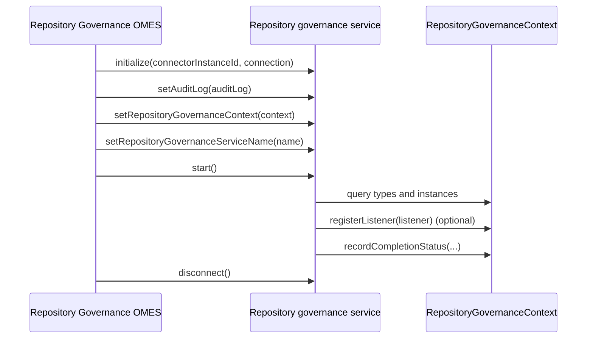

<!-- SPDX-License-Identifier: CC-BY-4.0 -->
<!-- Copyright Contributors to the Egeria project 2020. -->

# Writing Repository Governance Services

A [repository governance service](/concepts/repository-governance-service) works directly with the open metadata repositories through the [repository services (OMRS)](/services/omrs) rather than through the open metadata clients used by other governance services.  Its typical job is to maintain an [open metadata archive](/concepts/open-metadata-archive) from the live content of the repositories - either as a one-off snapshot, or by continuing to capture changes as they happen.

Repository governance services are hosted by the [Repository Governance OMES](/services/omes/repository-governance/overview) in an [engine host](/concepts/engine-host).  Unlike the survey, governance action and watchdog action services, their interfaces are not in a framework module: they are defined in the `repository-governance-api` module of the engine service itself.

Like other governance services, a repository governance service is a specialized [Open Connector Framework (OCF)](/frameworks/ocf/overview) connector with two parts: a *connector provider* and the *connector implementation*.

## Dependencies

* [Open Connector Framework (OCF)](/frameworks/ocf/overview) - basic connector interfaces.
* [Open Governance Framework (OGF)](/frameworks/ogf/overview) - the governance service provider base class and the request source and action target properties.
* [Open Metadata Framework (OMF)](/frameworks/omf/overview) - completion status and common exceptions.
* [Audit Log Framework (ALF)](/frameworks/alf/overview) - for audit logging and exceptions.
* `repository-services-apis` - the OMRS instance, type and event classes used by the context.
* `repository-governance-api` - the base classes and the context described on this page.

## Writing the connector provider

The connector provider extends [`RepositoryGovernanceProvider` :material-github:](https://github.com/odpi/egeria/blob/main/open-metadata-implementation/engine-services/repository-governance/repository-governance-api/src/main/java/org/odpi/openmetadata/engineservices/repositorygovernance/connector/RepositoryGovernanceProvider.java){ target=gh }, which extends the OGF's `GovernanceServiceProviderBase`.  This means its specification is declared in the same way as for the other governance services: `supportedRequestTypes`, `supportedRequestParameters`, `supportedActionTargetTypes`, `producedRequestParameters`, `producedActionTargetTypes` and `producedGuards`, plus `supportedConfigurationProperties` from the OCF.  Use the constructor that takes an [`OpenConnectorDefinition` :material-github:](https://github.com/odpi/egeria/blob/main/open-metadata-implementation/frameworks/open-connector-framework/src/main/java/org/odpi/openmetadata/frameworks/connectors/OpenConnectorDefinition.java){ target=gh }, the connector class name and the recognized configuration property names.

## Writing the repository governance service connector

The connector implementation extends [`RepositoryGovernanceServiceConnector` :material-github:](https://github.com/odpi/egeria/blob/main/open-metadata-implementation/engine-services/repository-governance/repository-governance-api/src/main/java/org/odpi/openmetadata/engineservices/repositorygovernance/connector/RepositoryGovernanceServiceConnector.java){ target=gh }, which implements the [`RepositoryGovernanceService` :material-github:](https://github.com/odpi/egeria/blob/main/open-metadata-implementation/engine-services/repository-governance/repository-governance-api/src/main/java/org/odpi/openmetadata/engineservices/repositorygovernance/connector/RepositoryGovernanceService.java){ target=gh } marker interface.

- `initialize` is a standard method for all connectors that is called by the [connector broker](/concepts/connector-broker) when the connector is created.  The connector is passed the [connection](/concepts/connection) object from its governance service definition and a unique identifier for this instance of the connector.
- `setAuditLog` provides a logging destination (see [Audit Log Framework (ALF)](/frameworks/alf/overview)).
- `setRepositoryGovernanceContext` supplies the [repository governance context](#the-repository-governance-context), which the base class stores in `repositoryGovernanceContext`.
- `setRepositoryGovernanceServiceName` supplies the qualified name of the service, stored in `repositoryGovernanceServiceName`, for audit log messages and exceptions.
- `start` indicates that the service is completely configured and can begin processing.  Call `super.start()` first - it checks that the context has been supplied.  This is where the service reads the repositories through the context and, if it needs to keep up to date, registers a listener for repository events.
- `disconnect` is called when the service has finished or the server is shutting down.  The service should free up any resources that it holds.

The base class also provides `handleUnexpectedException(methodName, error)`, which wraps an unexpected exception in a `ConnectorCheckedException` with a standard message.

## The repository governance context

[`RepositoryGovernanceContext` :material-github:](https://github.com/odpi/egeria/blob/main/open-metadata-implementation/engine-services/repository-governance/repository-governance-api/src/main/java/org/odpi/openmetadata/engineservices/repositorygovernance/connector/RepositoryGovernanceContext.java){ target=gh } is an abstract class implemented by the Repository Governance OMES.  It provides:

* **The request** - `getRequestType()`, `getRequestParameters()`, `getRequestSourceElements()` and `getActionTargetElements()`.
* **Type queries** - `getAllTypes()`, `findTypesByName()`, `findTypeDefsByCategory()`, `findAttributeTypeDefsByCategory()`, `findTypeDefsByProperty()`, `findTypesByExternalID()`, `searchForTypeDefs()`, `getTypeDefByGUID()`, `getTypeDefByName()`, `getAttributeTypeDefByGUID()` and `getAttributeTypeDefByName()`.
* **Instance queries** - `isEntityKnown()`, `getEntitySummary()`, `getEntityDetail()` (optionally as of a point in time), `getEntityDetailHistory()`, `getRelationshipsForEntity()`, `findEntities()`, `findEntitiesByProperty()`, `findEntitiesByClassification()`, `findEntitiesByPropertyValue()`, `isRelationshipKnown()`, `getRelationship()`, `getRelationshipHistory()`, `findRelationships()`, `findRelationshipsByProperty()` and `findRelationshipsByPropertyValue()`.  These return OMRS `EntityDetail`, `Relationship` and `TypeDef` objects, and they are issued across all the connected repositories through the enterprise repository services.
* **Events** - `registerListener(OMRSTopicRepositoryEventListener)` registers a listener for repository events through the enterprise repository services, and `disconnectFromEnterpriseTopic()` stops them.
* **Identity** - `getMetadataCollectionId()`.
* **Completion** - `recordCompletionStatus(status, outputGuards, newRequestParameters, newActionTargets, completionMessage)` and `getCompletionStatus()`.  Note that the completion message here is a plain `String`.

## Completing - or continuing

When `start()` returns, the Repository Governance OMES checks the context for a completion status:

* If one has been recorded, it logs that the service has completed and disconnects it.
* If none has been recorded, it logs that the service has returned and leaves it running.  This is how a service that keeps an archive up to date with a registered listener stays active.
* If `start()` throws an exception and no status has been recorded, the OMES records `FAILED` and disconnects the service.

## Deploying and running your repository governance service

Package your connector provider and implementation in a jar file, and add it (with any third party client libraries it needs) to the [OMAG Server Platform](/concepts/omag-server-platform) class path.

Repository governance services are grouped into [repository governance engines](/concepts/repository-governance-engine), which map a [governance request type](/concepts/governance-request-type) to the service that should run.  These definitions are created as part of a [governance engine pack](/guides/developer/open-metadata-archives/creating-governance-engine-packs) and stored in the open metadata repositories.  The engines are run by the [Repository Governance OMES](/services/omes/repository-governance/overview) in an [engine host](/concepts/engine-host), and a service runs when an [engine action](/concepts/engine-action) is requested for it.

## Example implementations

The [dynamic-archiver-connectors :material-github:](https://github.com/odpi/egeria/tree/main/open-metadata-implementation/adapters/open-connectors/dynamic-archiver-connectors){ target=gh } module contains `DynamicArchiveProvider` and `DynamicArchiveService`, abstract base classes for services that build an open metadata archive from the repositories.  `DynamicArchiveService` writes to the [open metadata archive store connectors](/guides/developer/runtime-connectors/open-metadata-archive-store-connector) supplied as embedded connectors in its connection.  The provider declares the `snapshot` and `journaling` request types, the `archiveName` and `archiveGUID` request parameters, and the `archiving-complete` and `archiving-failed` guards.

The module's `GlossaryDynamicArchiverConnector` is a skeleton: it reads its `glossaryName` configuration property but does not yet build an archive.

??? education "Further information"

    - [Metadata Archiving](/features/metadata-archiving/overview) to understand the different mechanisms that use open metadata archives.
    - [Open Metadata Archives](/concepts/open-metadata-archive) to understand structure of an open metadata archive.
    - [Configuring an engine host](/guides/admin/servers/by-server-type/configuring-an-engine-host) to understand how to set up the engine services.
    - [Defining a governance engine in a content pack](/guides/developer/open-metadata-archives/creating-governance-engine-packs) to add your repository governance engine to an archive.
    - [Writing an Open Metadata Archive Store Connector](/guides/developer/runtime-connectors/open-metadata-archive-store-connector).
    - [Loading an Open Metadata Archive at server startup](/guides/admin/servers/by-section/repository-services-section)
    - [Loading an Open Metadata Archive in a running server](/guides/operations/adding-archive-to-running-server)

--8<-- "snippets/abbr.md"
