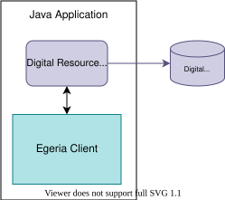

<!-- SPDX-License-Identifier: CC-BY-4.0 -->
<!-- Copyright Contributors to the ODPi Egeria project. -->

# Creating digital resource connectors

To write a resource connector you need to complete four steps:

1. Identify the properties for the [connection](/concepts/connection).
2. Write the [connector provider](/concepts/connector-provider).
3. Understand the interface that the connector needs to implement and the support provided by its base class.
4. Write the [connector](/concepts/connector) itself.

All the code you write to implement these should exist in its own module, and as illustrated by the examples could even be in its own independent code repository. Their implementation will have dependencies on Egeria's:

- [Open Connector Framework (OCF)](/frameworks/ocf/overview)
- [Audit Log Framework (ALF)](/frameworks/alf/overview)
- [Open Metadata Framework (OMF)](/frameworks/omf/overview) - the OCF exposes some of its types, such as its exceptions, on its API
- Specific interfaces used by the type of connector

!!! tip "No dependency on Egeria's OMAG Server Platform"
    Note that there is no dependency on Egeria's [OMAG Server Platform](/concepts/omag-server-platform) for these specific connector implementations: they could run in another runtime that supported the connector APIs.  In fact, even the Egeria interface modules should not be embedded in your jar file to allow your connector to run on any version of the OMAG Server Platform that supports your connector.

## Identify connection properties

Begin by identifying and designing the properties needed to connect to your tool or system. These will commonly include a network address, protocol, and user credentials, but could also include other information that can be stored in the configuration properties of the connection.

## Code the connector provider

--8<-- "docs/guides/developer/connector-provider-intro.md"
--8<-- "docs/guides/developer/implementing-a-connector-provider.md"

!!! tip "Digital resource connectors do not need to be part of Egeria"
    Connectors can be built in separate code repositories, and Egeria has no direct dependencies on them.  They are loaded at runtime using the connector provider class name in the connection's connector type.

All connectors can be configured with the network address and credential information needed to access the underlying tool or system. Therefore, you do not need to explicitly list properties for such basic details. However, the names of any additional configuration properties that may be useful to a specific type of connector can be described through the `recognizedConfigurationProperties` of the connector type.

### Implementation pattern

- Extend `OpenConnectorProviderBase`.
- Describe the connector in an `OpenConnectorDefinition` (typically an enum value) giving its component identifier, connector type GUID, names, description, connector provider class name, development status and supported asset/deployed implementation types.
- Define `static final` class members for the connector class name and the names of any additional configuration properties.
- Write a single public constructor, with no parameters, that calls `super()` with the connector definition, the connector class name, the list of recognized configuration property names and, optionally, the list of interfaces that the connector implements.
- (Optional) Set up the `supportedTechnologyTypes` and `supportedConfigurationProperties` that describe the connector to the tools that configure it.

## Understand the connector interface

Now that you have the *connector provider* to instantiate your *connector*, you need to understand what your connector actually needs to do. For a service to use your connector, the connector must implement the Open Connector Framework methods plus the specific API used to access the resource.

A digital resource connector typically extends the OCF's `ConnectorBase` class (which supplies the OCF methods) and implements a Java interface that describes the operations that can be performed on the resource.  The name of this interface is passed to the connector provider's base class so that it is listed in the `connectorInterfaces` of the connector type.

!!! example "Example: basic file store connector"
    The [`BasicFileStoreConnector` :material-github:](https://github.com/odpi/egeria/blob/main/open-metadata-implementation/adapters/open-connectors/data-store-connectors/file-connectors/basic-file-connector/src/main/java/org/odpi/openmetadata/adapters/connectors/datastore/basicfile/BasicFileStoreConnector.java){ target=gh } extends `ConnectorBase` and implements the [`BasicFileStore` :material-github:](https://github.com/odpi/egeria/blob/main/open-metadata-implementation/adapters/open-connectors/data-store-connectors/file-connectors/basic-file-connector/src/main/java/org/odpi/openmetadata/adapters/connectors/datastore/basicfile/BasicFileStore.java){ target=gh } interface, which offers methods such as `getFile()`, `getFileName()` and `getLastUpdateDate()`.  Its provider, [`BasicFileStoreProvider` :material-github:](https://github.com/odpi/egeria/blob/main/open-metadata-implementation/adapters/open-connectors/data-store-connectors/file-connectors/basic-file-connector/src/main/java/org/odpi/openmetadata/adapters/connectors/datastore/basicfile/BasicFileStoreProvider.java){ target=gh }, passes `BasicFileStore` as the connector's interface.

!!! example "Example: JDBC resource connector"
    The [`JDBCResourceConnector` :material-github:](https://github.com/odpi/egeria/blob/main/open-metadata-implementation/adapters/open-connectors/data-store-connectors/jdbc-resource-connector/src/main/java/org/odpi/openmetadata/adapters/connectors/resource/jdbc/JDBCResourceConnector.java){ target=gh } extends `ConnectorBase` and implements `AuditLoggingComponent` so that it receives an audit log.  Its provider, [`JDBCResourceConnectorProvider` :material-github:](https://github.com/odpi/egeria/blob/main/open-metadata-implementation/adapters/open-connectors/data-store-connectors/jdbc-resource-connector/src/main/java/org/odpi/openmetadata/adapters/connectors/resource/jdbc/JDBCResourceConnectorProvider.java){ target=gh }, passes the names from `JDBCConfigurationProperty` as its recognized configuration properties.

## Code the connector itself

Which brings you to writing the *connector* itself. Now that you understand the interface your connector must provide, you need to implement the methods defined by that interface.

Implement the connector by:

1. Retrieving *connection* information provided by the configuration. The default method for `initialize()` saves the connection object used to create the connector in the protected `connectionBean` variable. If your connector needs to override the `initialize()` method, it should call `super.initialize()` to capture the connection properties for the base classes.
2. Implementing the `start()` method. Use the configuration details from the connection object to connect to your underlying technology.  Call `super.start()` so that `ConnectorBase` records that the connector is active.
3. Using pre-existing, technology-specific clients and APIs to talk to your underlying technology.
4. Implementing the methods of the connector's interface, translating between the underlying technology's representation of information and the representation used by the interface.
5. Implementing the `disconnect()` method to release any resources, calling `super.disconnect()`.

For the first point, you can retrieve general connection information from the [`Connection` :material-github:](https://github.com/odpi/egeria/blob/main/open-metadata-implementation/frameworks/open-connector-framework/src/main/java/org/odpi/openmetadata/frameworks/connectors/properties/beans/Connection.java){ target=gh } object (returned by `getConnection()` or stored in `connectionBean`) like:

- the server address and protocol, by first retrieving the embedded [`Endpoint` :material-github:](https://github.com/odpi/egeria/blob/main/open-metadata-implementation/frameworks/open-connector-framework/src/main/java/org/odpi/openmetadata/frameworks/connectors/properties/beans/Endpoint.java){ target=gh } with `getEndpoint()`:
    - retrieving the protocol by calling `getProtocol()` on the `Endpoint`
    - retrieving the address by calling `getNetworkAddress()` on the `Endpoint`
- the user Id, by calling `getUserId()` on the `Connection`
- the password, by calling either `getClearPassword()` or `getEncryptedPassword()` on the `Connection`, depending on what your underlying technology can handle
- any secured properties, by calling `getSecuredProperties()` on the `Connection`

Use these details to connect to and authenticate against your underlying technology, even when it is running on a different system from the connector itself. Of course, check for `null` objects (like the `Endpoint`) as well before blindly operating on them.

Retrieve additional properties by:

- calling `getConfigurationProperties()` on the `Connection`, which returns a `Map<String, Object>`
- calling `get(name)` against that `Map<>` with the name of each additional property of interest

Alternatively, use the helper methods inherited from `ConnectorBase`, such as `getStringConfigurationProperty()`, `getBooleanConfigurationProperty()`, `getIntConfigurationProperty()` and `getArrayConfigurationProperty()`.

Implementation of the remaining points will vary widely depending on the specific technology being used. See the examples previously linked to delve deeper.

--8<-- "snippets/abbr.md"
