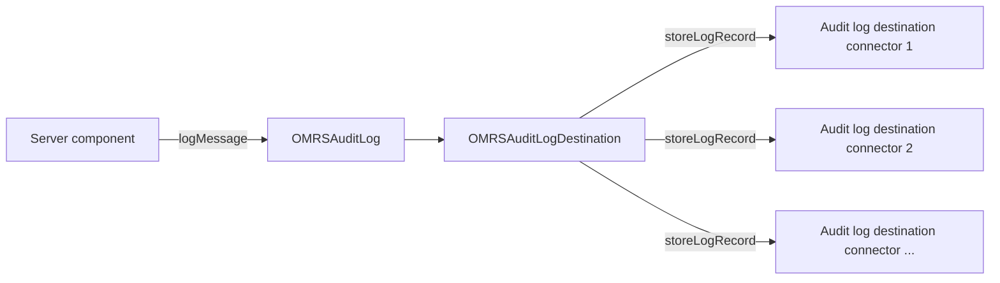

<!-- SPDX-License-Identifier: CC-BY-4.0 -->
<!-- Copyright Contributors to the Egeria project. -->

# Writing Audit Log Destination Connectors


The [audit log](/concepts/audit-log) running in an [OMAG Server](/concepts/omag-server) is implemented by the [Open Metadata Repository Services (OMRS)](/services/omrs).  It is called `OMRSAuditLog` and extends the `AuditLog` class defined in the [Audit Log Framework (ALF)](/frameworks/alf/overview).  The ALF supports an audit log with a single destination, which is an `AuditLogDestination`.  The OMRS extends this capability with `OMRSAuditLogDestination`, which acts as an audit log record distributor that passes every audit log record to each of the [audit log destination connectors](/concepts/audit-log-destination-connector) configured in the OMAG Server.  Each connector then decides whether to keep the record based on its severity and the connector's supported severities.

Before passing a record to the connectors, `OMRSAuditLogDestination` adds details of the originating server (server name, server type, organization name and metadata collection id) to the record.  The severities themselves are defined by the `AuditLogRecordSeverityLevel` enum in the ALF (`Information`, `Event`, `Decision`, `Action`, `Error`, `Exception`, `Security`, `Startup`, `Shutdown`, `Asset`, `Types` and so on).



The audit log destination connector interface is defined in the *repository-services-apis* module in the [org.odpi.openmetadata.repositoryservices.connectors.stores.auditlogstore :material-github:](https://github.com/odpi/egeria/tree/main/open-metadata-implementation/repository-services/repository-services-apis/src/main/java/org/odpi/openmetadata/repositoryservices/connectors/stores/auditlogstore){ target=gh } Java package.

In that package you will see the following Java classes:

* `OMRSAuditLogRecord` - provides a carrier for details about a single log record in the OMRS audit log.  It extends the `AuditLogRecord` class from the ALF with deprecated fields from the original OMRS implementation to provide backward compatible support to the original implementation of the audit log destination connectors.
* `OMRSAuditLogRecordOriginator` - describes the server that originated an audit log record.  This is useful if an organization is aggregating log records from different servers together into a single physical destination.
* `OMRSAuditLogReportingComponent` describes the component issuing the audit log record.  It implements the `ComponentDescription` interface from the ALF.
* `OMRSAuditLogStore` is the main interface of the audit log destination connector.  It includes the following methods:

    * `getDestinationName` - used by the OMRS in its logging and in the audit log report.
    * `getSupportedSeverities` - returns the list of audit log record severities that have been configured for this destination instance.  These are passed to the connector in its [configuration properties](/concepts/configuration-properties) passed in its [connection](/concepts/connection) that is set up in the server's [configuration document](/concepts/configuration-document).  The name of the property is `supportedSeverities`.
    * `storeLogRecord` - called for every log record written to the audit log.
    * `getAuditLogRecord` - optional method to retrieve a specific log record.
    * `getAuditLogRecordsByTimeStamp` - optional method to retrieve a list of log records written in a specified time period.  The offset and maximumRecords parameters support paging.
    * `getAuditLogRecordsBySeverity` - optional method to retrieve a list of log records that have a specific severity.  The offset and maximumRecords parameters support paging.
    * `getAuditLogRecordsByComponent` - optional method to retrieve a list of log records originating from a specific component.  The offset and maximumRecords parameters support paging.

* `OMRSAuditLogStoreConnectorBase` is the abstract base class for the audit log destination connector.  It extends `ConnectorBase` from the [Open Connector Framework (OCF)](/frameworks/ocf/overview) and implements `OMRSAuditLogStore`, providing default methods for all but `storeLogRecord(OMRSAuditLogRecord)`.  The default query methods throw `FunctionNotSupportedException`.  It also implements `initialize` to set the destination name from the display name of the connection (or its connector type) and to extract the `supportedSeverities` from the connection's configuration properties.  In addition, it includes the following protected methods to aid the writer of a connector:

    * `validateLogRecord` - validates that a new log record is properly filled out (it has originator properties and an originator component) and throws an `InvalidParameterException` if not.
    * `isSupportedSeverity` - checks whether an incoming log record has a supported severity.  If `supportedSeverities` is not set, or is an empty list, all severities are supported.
    * `getJSONLogRecord` - converts a log record to a JSON string.

* `OMRSAuditLogStoreProviderBase` is an abstract base class for the audit log destination connector's connector provider.  It extends `OpenConnectorProviderBase` and defines the `supportedSeveritiesProperty` constant (`supportedSeverities`) along with a protected method called `getRecognizedConfigurationProperties` that returns a list containing this property name.

!!! info "Severity filtering is done by the connector"
    `OMRSAuditLogDestination` calls `storeLogRecord` on every configured connector for every log record.  It is the connector's responsibility to call `isSupportedSeverity` (or apply its own filtering) so that only records with a configured severity are written to its destination.

## Example Implementations

Implementations of this type of connector are located in the [adapters/open-connectors/repository-services-connectors/audit-log-connectors :material-github:](https://github.com/odpi/egeria/tree/main/open-metadata-implementation/adapters/open-connectors/repository-services-connectors/audit-log-connectors){ target=gh } module.  They write audit log records to the console (`ConsoleAuditLogStoreConnector`), to the console with the full event payload (`EventDisplayAuditLogStoreConnector`), to a directory of JSON files (`FileBasedAuditLogStoreConnector`), to the SLF4J logging ecosystem (`SLF4JAuditLogStoreConnector`) and to an event topic (`EventTopicAuditLogStoreConnector`).

!!! tip "Observing activity from the audit log"
    The audit log records published to an event topic are also the source of Egeria's metadata observability.  The *Pepys Activity Observer* integration connector in the [nanny-connectors :material-github:](https://github.com/odpi/egeria/tree/main/open-metadata-implementation/adapters/open-connectors/nanny-connectors){ target=gh } module listens to the topics that the OMAG Servers write their audit logs to and maintains the `UsageActivity` classification of the elements whose use is reported there.  See [Metadata Observability](/features/metadata-observability/overview) for details.  If you want to analyse how open metadata is used, consider building on this rather than writing a new audit log destination connector.

## Build Dependencies

=== "Maven"

    ```xml
    <dependencies>

        <dependency>
            <groupId>org.odpi.egeria</groupId>
            <artifactId>open-connector-framework</artifactId>
        </dependency>

        <dependency>
            <groupId>org.odpi.egeria</groupId>
            <artifactId>audit-log-framework</artifactId>
        </dependency>

        <dependency>
            <groupId>org.odpi.egeria</groupId>
            <artifactId>repository-services-apis</artifactId>
        </dependency>

    </dependencies>
    ```

=== "gradle"

    ```
    dependencies {
        compileOnly project(':open-metadata-implementation:frameworks:open-connector-framework')
        compileOnly project(':open-metadata-implementation:frameworks:audit-log-framework')
        compileOnly project(':open-metadata-implementation:repository-services:repository-services-apis')
    }
    ```

## Writing the Connector Provider

--8<-- "docs/guides/developer/implementing-a-connector-provider.md"

The connector provider for an audit log destination connector extends `OMRSAuditLogStoreProviderBase` and passes the `supportedSeveritiesProperty` as one of its recognized configuration properties.  This is how the console audit log destination's provider is written:

```java
/**
 * XXXAuditLogStoreProvider is the OCF connector provider for the XXX audit log destination connector.
 */
public class XXXAuditLogStoreProvider extends OMRSAuditLogStoreProviderBase
{
    /*
     * Class of the connector.
     */
    private static final String connectorClassName = "packagename.XXXAuditLogStoreConnector";

    /**
     * Constructor used to initialize the OpenConnectorProviderBase with the Java class name of the specific
     * audit log store implementation.
     */
    public XXXAuditLogStoreProvider()
    {
        super(MyOrgConnectorDefinition.XXX_AUDIT_LOG_DESTINATION_CONNECTOR,
              connectorClassName,
              Collections.singletonList(supportedSeveritiesProperty));
    }
}
```

`MyOrgConnectorDefinition` is your own enum implementing `OpenConnectorDefinition`.  Egeria's own audit log destinations are described by values such as `CONSOLE_AUDIT_LOG_DESTINATION_CONNECTOR` and `FILE_AUDIT_LOG_DESTINATION_CONNECTOR` in `EgeriaOpenConnectorDefinition`, with a deployed implementation type of `AUDIT_LOG_DESTINATION_CONNECTOR`.

## Writing the Connector

The audit log destination connector extends `OMRSAuditLogStoreConnectorBase` and needs to implement the `storeLogRecord` method.  This needs to efficiently move the log record into the destination.  The code snippet below shows the use of the super class methods to determine which records to process.

```java
    /**
     * Store the audit log record in the audit log destination.
     *
     * @param logRecord  log record to store
     * @return unique identifier assigned to the log record
     * @throws InvalidParameterException indicates that the logRecord parameter is invalid.
     */
    @Override
    public String storeLogRecord(OMRSAuditLogRecord logRecord) throws InvalidParameterException
    {
        final String   methodName = "storeLogRecord";

        super.validateLogRecord(logRecord, methodName);

        if (super.isSupportedSeverity(logRecord))
        {
            // Put implementation here
        }

        return logRecord.getGUID();
    }
```

If the destination supports querying then you can also override the query methods: `getAuditLogRecord`, `getAuditLogRecordsByTimeStamp`, `getAuditLogRecordsBySeverity` and `getAuditLogRecordsByComponent`.

Finally, the connector should use the `start` and `disconnect` methods to initialize and close down the access to the destination technology.

## Configuring the Connector

Once the connector's JAR file is on the OMAG Server Platform's classpath, it is added to a server's configuration document with a `POST` request to `/open-metadata/admin-services/servers/{serverName}/audit-log-destinations/connection`, passing the connection for the connector in the request body.  Set `supportedSeverities` in the connection's configuration properties to the list of severity names that the destination should receive.  See [Configuring the audit log](/guides/admin/servers/by-section/repository-services-section) for the related administration commands.

--8<-- "snippets/abbr.md"
