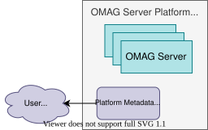

<!-- SPDX-License-Identifier: CC-BY-4.0 -->
<!-- Copyright Contributors to the Egeria project. -->

# Writing Platform Metadata Security Connectors

The [platform metadata security connector](/concepts/platform-metadata-security-connector) provides authorization support for requests to the [OMAG Server Platform](/concepts/omag-server-platform).  It is part of Egeria's [metadata security](/features/metadata-security/overview) support.


> **Figure 1:** Platform Metadata Security Connector

## Interface and Base Classes

The interfaces for the metadata security connectors are defined in the [metadata-security-apis :material-github:](https://github.com/odpi/egeria/tree/main/open-metadata-implementation/common-services/metadata-security/metadata-security-apis){ target=gh } module in the `org.odpi.openmetadata.metadatasecurity` Java package.  The platform metadata security connector implements the `OpenMetadataPlatformSecurity` interface:

* `setPlatformName` - passes the URL of the platform to the connector.
* `validateUserForNewServer` - is the user allowed to create the configuration for a new OMAG Server?
* `validateUserAsOperatorForPlatform` - is the user allowed to issue operator requests to the platform, such as starting and stopping servers, or changing the platform connectors?
* `validateUserAsInvestigatorForPlatform` - is the user allowed to issue requests that query the platform, such as listing the known and active servers?

Each method throws `UserNotAuthorizedException` if the user is not authorized.

If the connector also implements the `OpenMetadataUserSecurity` interface, the platform uses it to maintain user accounts (`getUserList`, `getUserAccount`, `setUserAccount`, `deleteUserAccount`) and security access controls (`getSecurityAccessControl`, `setSecurityAccessControl`, `deleteSecurityAccessControl`).  The platform's login support (the *user-authn* module under *user-security*) retrieves the account of the user logging on through this interface before issuing a token.

The base classes are in the [metadata-security-connectors :material-github:](https://github.com/odpi/egeria/tree/main/open-metadata-implementation/common-services/metadata-security/metadata-security-connectors){ target=gh } module in the `org.odpi.openmetadata.metadatasecurity.connectors` Java package:

* `OpenMetadataSecurityConnector` - the common base class for the platform and server security connectors.  It extends `ConnectorBase` and implements `AuditLoggingComponent`.  Its default implementation of every validation method rejects the request.  It also provides protected methods, such as `throwUnauthorizedPlatformAccess`, `throwUnauthorizedServerAccess` and `throwUnauthorizedServiceAccess`, that log a well-defined audit log message and throw the appropriate exception.  Call these from your own methods when access is to be denied.
* `OpenMetadataPlatformSecurityConnector` - extends `OpenMetadataSecurityConnector` and implements `OpenMetadataPlatformSecurity`.  Extend this class and override the methods for the requests you wish to allow.
* `OpenMetadataPlatformSecurityProvider` - the base class for the connector provider.  It extends `OpenConnectorProviderBase`.

The platform creates the connector from its connection using the `OpenMetadataPlatformSecurityVerifier` class in the *metadata-security-server* module.  It is configured either through the `platform.security.provider` property (and related `platform.security.*` properties) in the platform's `application.properties` file, or with a `POST` request to `/open-metadata/platform-services/server-platform/security/connection`.

## Example Implementations

An implementation of this type of connector is located in the [metadata-security-connectors :material-github:](https://github.com/odpi/egeria/tree/main/open-metadata-implementation/adapters/open-connectors/metadata-security-connectors){ target=gh } module.  The `OpenMetadataAccessSecurityConnector` (with its provider `OpenMetadataAccessSecurityProvider`) implements `OpenMetadataPlatformSecurity` along with the server-level interfaces, so the same connector can be used for the platform and for each server.  It uses an embedded [secrets store connector](/concepts/secrets-store-connector) to supply the user accounts and the security groups that grant access.  The sample `application.properties` file configures it with the Coco Pharmaceuticals user directory `coco-user-directory.omsecrets`.

## Build Dependencies

=== "Maven"

    ```xml
    <dependencies>

        <dependency>
            <groupId>org.odpi.egeria</groupId>
            <artifactId>open-connector-framework</artifactId>
        </dependency>

        <dependency>
            <groupId>org.odpi.egeria</groupId>
            <artifactId>metadata-security-connectors</artifactId>
        </dependency>

        <dependency>
            <groupId>org.odpi.egeria</groupId>
            <artifactId>metadata-security-apis</artifactId>
        </dependency>

        <dependency>
            <groupId>org.odpi.egeria</groupId>
            <artifactId>audit-log-framework</artifactId>
        </dependency>

        <dependency>
            <groupId>org.odpi.egeria</groupId>
            <artifactId>repository-services-apis</artifactId>
        </dependency>

    </dependencies>
    ```

=== "gradle"

    ```
    dependencies {
        implementation project(':open-metadata-implementation:common-services:metadata-security:metadata-security-connectors')
        compileOnly project(':open-metadata-implementation:common-services:metadata-security:metadata-security-apis')
        compileOnly project(':open-metadata-implementation:repository-services:repository-services-apis')
        compileOnly project(':open-metadata-implementation:frameworks:open-connector-framework')
        compileOnly project(':open-metadata-implementation:frameworks:audit-log-framework')
    }
    ```

## Writing the Connector Provider

--8<-- "docs/guides/developer/implementing-a-connector-provider.md"

The connector provider for a platform metadata security connector extends `OpenMetadataPlatformSecurityProvider`.

## Writing the Connector

The connector extends `OpenMetadataPlatformSecurityConnector` and overrides the `validateUser...` methods for the requests that should be allowed.  A method that returns normally allows the request; any request that is not overridden is rejected by the base class.

```java
public class XXXPlatformSecurityConnector extends OpenMetadataPlatformSecurityConnector
{
    @Override
    public void validateUserAsOperatorForPlatform(String userId) throws UserNotAuthorizedException,
                                                                        InvalidParameterException,
                                                                        PropertyServerException
    {
        final String methodName = "validateUserAsOperatorForPlatform";
        final String requestType = "platformOperator";

        if (! isPlatformOperator(userId))   // your own check
        {
            super.throwUnauthorizedPlatformAccess(userId, requestType, methodName);
        }
    }
}
```

--8<-- "snippets/abbr.md"
