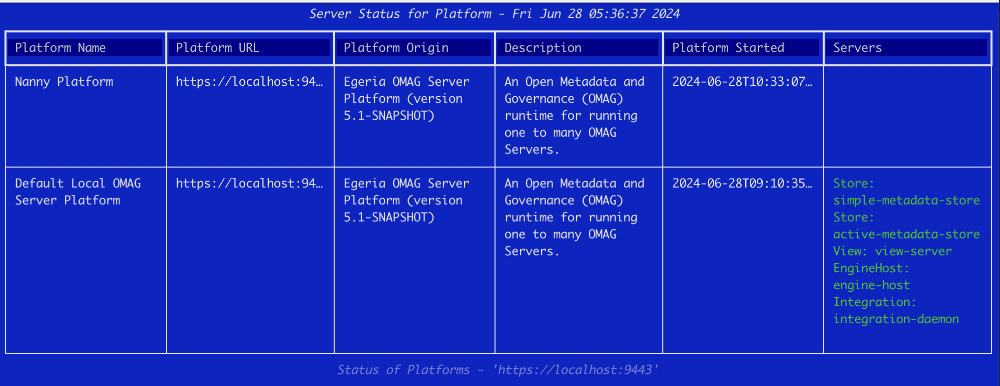
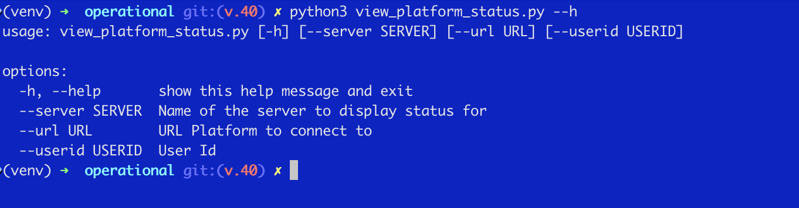

<!-- SPDX-License-Identifier: CC-BY-4.0 -->
<!-- Copyright Contributors to the Egeria project. -->

# Scripting commands

The *pyegeria* command line services allow interaction with the open metadata and governance services of Egeria from a scripting language. The naming convention for the commands helps to understand their behaviour. When the command starts with:

* get - it will return details about a single item, or the structure around it (for example `get_asset_graph` and `get_project_structure`).
* list - lists elements through a paging interface like "more" - use q to quit.
* monitor - provides a live view - typically of a status - use control-c to quit.

Many of the status commands come in pairs: for example `monitor_engine_status` gives a live view and `list_engine_status` gives a paged list of the same information.

## Installation
The **pyegeria** Egeria Python client can be installed from **pypi**. Python version 3.12 and above is a pre-requisite.
One common way to install Python packages is with the **pip** command. So to install **pyegeria** you can execute:

```shell
pip install pyegeria
```

This will install **pyegeria** and all of its required packages.  If you only want the commands, `pipx install pyegeria` installs them in their own environment, and `pipx upgrade pyegeria` upgrades them.

## Using

Once **pyegeria** is installed, the commands may be invoked from a terminal window or shell.  To start a command, just type its name at the command prompt. For instance, typing:

```shell
monitor_platform_status
```

will display a live table showing the status of the Egeria OMAG Server Platforms and servers that are catalogued in open metadata.


> The screenshots on this page were taken with an earlier release, when this command was called `view_platform_status`.

All of the commands have optional command line arguments. You can see them with the `--help` flag.



Most of the commands allow you to specify an Egeria view server, the URL of its platform, and a user identity and password (for example `--server`, `--url`, `--userid` and `--password`).  If not specified, the values come from the `EGERIA_VIEW_SERVER`, `EGERIA_VIEW_SERVER_URL`, `EGERIA_USER` and `EGERIA_USER_PASSWORD` environment variables, or the pyegeria configuration file.  The built-in defaults match the Egeria quickstart environment:

* view server URL = "https://localhost:9443"
* view server = "qs-view-server"
* user id = a user, such as **erinoverview** from the fictitious [Coco Pharmaceuticals](/practices/coco-pharmaceuticals) environment.

## The hey_egeria command line interfaces

As the number of commands has grown, they have been organized by role into groups: `cat` (for catalog users), `my` (for an individual's work), `tech` (for technical users) and `ops` (for operating Egeria).  Two command line interfaces give access to them:

* [hey_egeria](/user-interfaces/hey-egeria/overview) - provides access to the `cat`, `my`, `tech` and `ops` commands as subcommands, for example `hey_egeria cat ...`.
* `hey_egeria_ops` - a separate entry point for the operations commands, for example `hey_egeria_ops show platforms status` and `hey_egeria_ops show servers status`.

Adding `tui` to a CLI command, for example `hey_egeria tui`, opens a forms-based text user interface for picking and running the commands.  The [Operations Guide](/guides/operations/overview#hey_egeria-commands) describes the operations commands in more detail.

!!! info "Full Guide to Egeria's Python Commands"
    The full guide to Egeria's Python Commands is available at [Command Line Interfaces](https://github.com/odpi/egeria-python/blob/main/commands/doc/README.md)

--8<-- "snippets/abbr.md"
