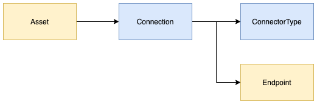
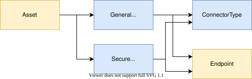
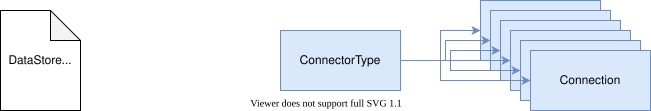

<!-- SPDX-License-Identifier: CC-BY-4.0 -->
<!-- Copyright Contributors to the Egeria project. -->

A [*connector*](/concepts/connector) is created from a [*connection*](/concepts/connection).  The connection, along with its [connector type](/concepts/connector-type) and [endpoint](/concepts/endpoint), can be stored as open metadata and linked to the [asset](/concepts/asset) that describes the digital resource that the connector accesses.  These elements are maintained through the [Connection Maker](/services/omvs/connection-maker/overview) view service.

There are two ways to create a connector in Java:

- Create a `Connection` object and pass it to the `getConnector()` method of the OCF's [`ConnectorBroker` :material-github:](https://github.com/odpi/egeria/blob/main/open-metadata-implementation/frameworks/open-connector-framework/src/main/java/org/odpi/openmetadata/frameworks/connectors/ConnectorBroker.java){ target=gh }.  The connector broker uses the connector provider class name in the connection's connector type to create the connector provider, which in turn creates and initializes the connector.  If the connection is a virtual connection, the broker also creates the connectors for its embedded connections.
- Ask a metadata access server to create the connector from a connection stored in open metadata, using the [Connected Asset Services](/services/connected-asset-services).  The Java client for these services is [`EgeriaConnectedAssetClient` :material-github:](https://github.com/odpi/egeria/blob/main/open-metadata-implementation/access-services/ocf-metadata-management/ocf-metadata-client/src/main/java/org/odpi/openmetadata/frameworkservices/ocf/metadatamanagement/client/EgeriaConnectedAssetClient.java){ target=gh }.  Its `getConnectorForAsset()` method returns a connector for the digital resource described by an asset.  There are also `getConnectorByGUID()` and `getConnectorByName()` methods that work from the unique identifier or name of a stored connection, and `getConnectorByConnection()` that works from a supplied connection object.

In both cases, the connector is returned initialized but not started.  The caller calls `start()` on the connector before using it, and `disconnect()` when it has finished with it.

### Connecting to assets with different levels of security

It is possible that an asset can have multiple connections, each with different levels of security access encoded. When a connection is requested for an asset, Egeria determines which one to use by calling the `selectConnection()` method of the [Server Security Metadata Connector](/guides/developer/runtime-connectors/server-metadata-security-connector).

### Other links to the connection

Open metadata is a connected network (graph) of information. The connector type and endpoint that a connection object links to are typically shared with many connections. This creates some interesting insight.

For example, there is typically one connector type for each connector implementation. By retrieving the relationships from the connector type to the connections, it is possible to see the extent to which the connector is used.

#### Connector types

The connector types for Egeria's connectors are supplied in the [Core Content Pack](/content-packs/core-content-pack/overview), which can be loaded into the server. This approach can be used for all of your connector implementations to create the connector type objects in your metadata repository. See the [core-content-pack :material-github:](https://github.com/odpi/egeria/tree/main/open-metadata-resources/open-metadata-archives/core-content-pack){ target=gh } module for more detail.

!!! education "Further information"
    The [connector catalog](/connectors) lists the connectors provided by the Egeria community.

